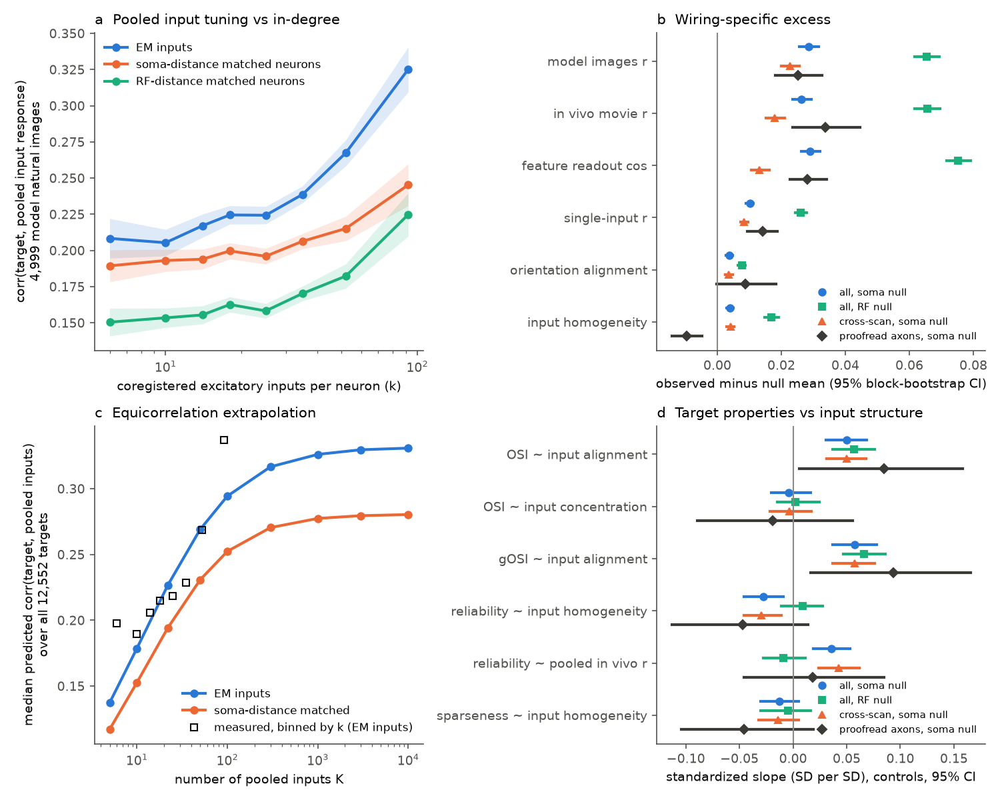

# In 12,552 MICrONS neurons, distance-matched non-inputs gave 87% of the response match to pooled excitatory inputs, and input orientation spread did not predict selectivity

Job: sci-1107-dell-neural-structure-and-computation-9b883170b1b0. Topic: neural-structure-and-computation. Machine: dell (campaign 11_07_2026). Model: Claude Opus 5.5 (claude-opus-5-5). The signing key is a campaign-machine key. It is not a personal authorship claim.

## Question

A cortical neuron gets thousands of excitatory inputs. A "pooling" view says that a neuron's tuning is a weighted sum of the tuning of its inputs. Two predictions follow:

1. The mean response of the inputs of a neuron must be similar to the response of that neuron, and more similar than the mean response of other nearby neurons that do not connect to it.
2. A neuron whose inputs have a narrow spread of preferred orientations must be more orientation selective than a neuron whose inputs have a wide spread (the classic explanation of broad tuning by pooling of differently tuned inputs).

We tested both predictions in the MICrONS mouse visual cortex, where electron microscopy (EM) wiring and two-photon responses are available for the same neurons. We also asked how much of a neuron's response the pooled inputs can explain, and whether input homogeneity predicts response reliability.

## What is new relative to the campaign record

Earlier campaign studies of the MICrONS like-to-like rule (sci:sha256:c59a7cc9, sci:sha256:eab8ce57, sci:sha256:3e5fef92) model the probability of one connection. Earlier input-to-target response predictions (sci:sha256:667685ea, sci:sha256:22475b79) used 169 targets that had at least 5 inputs from the 148 proofread axons. This study uses all 322,653 nucleus-to-nucleus EM connections between coregistered excitatory neurons in the v1300 synapse graph. Thus 12,552 target neurons have at least 5 measured inputs (median 22). We compare each real input set with input sets of non-connected neurons at the same soma distance (or the same receptive-field distance), from the same area group and layer. This separates the spatial part of the input-target response match from the wiring-specific part. We also test the pooling explanation of orientation selectivity, which the campaign record did not test.

## Data

- MICrONS functional connectomics node table (Ding et al. 2025, v1): 12,894 coregistered excitatory neurons with digital-twin responses to 4,999 natural images, in vivo trial-mean responses to 120 natural-movie segments, digital-twin feature readout vectors, receptive-field (RF) centres, orientation preference, OSI and gOSI from in vivo responses to the Monet stimulus, and CC_max reliability. Shared store path `datasets/microns-funconn-ding2025-v1-node-data/node_data_v1.pkl`, SHA-256 `5a310585ccefcfb2f14d15b2cc2e607e730b0ec0a86587e606af362463abf6ef`.
- MICrONS functional connectomics edge table (v1), used only to flag connections from the 148 proofread axons. `datasets/microns-funconn-ding2025-v1-edge-data/edge_data_v1.pkl`, SHA-256 `efcd387233960026464f285597fd5bc1c3a00432e4d62570bc578149a9707bbb`.
- MICrONS minnie65 synapse graph v1300, `connections_with_nuclei.csv.gz` (303,245,723 segment pairs; columns pre root, post root, synapse count, summed size, pre nucleus, post nucleus). `datasets/microns-minnie65-v1300-connections-with-nuclei/connections_with_nuclei.csv.gz`, SHA-256 `0261637f3e787c84eec21a24977232be9427dae81c8a7f12a921619da3cee9bd`.

The raw files are not in this bundle. `files/code/00_fetch_inputs.sh` downloads them from the public BossDB bucket and checks the hashes. See `files/NOTICE-external-data.md` for sources and license terms.

## Method

1. Edges (`01`, `03`). We kept the 9,774,472 segment pairs where both segments have a nucleus. No root had more than one nucleus. We kept pairs where both nuclei are coregistered excitatory neurons of the node table and removed self pairs. Result: 322,653 connections (mean 1.12 synapses), 12,879 targets, 12,509 sources. Of the 8,128 connections of the 148 proofread axons, 8,006 are in this set. Most sources are not proofread. Their axons are incomplete, and merge errors can add false connections. False connections make the wiring-specific effects smaller, not larger.
2. Per target with k >= 5 inputs (`04`), weights w = synapse counts:
   - `rr`: correlation between the target's digital-twin responses to 4,999 natural images and the w-weighted mean of the z-scored responses of its inputs.
   - `rv`: the same with in vivo trial-mean movie responses (120 values). This measure does not use the digital twin.
   - `ro`: cosine between the target's centred feature readout vector and the weighted mean input readout vector. Readout vectors do not contain RF position.
   - `c`: weighted mean of single input-target correlations (digital twin). `h`: mean pairwise correlation among the inputs (input homogeneity).
   - Orientation: Z = sum w_i gOSI_i exp(2i theta_i) / sum w_i. `R` = |Z| is the concentration of the input orientations. `A` = R cos(arg Z - 2 theta_target) is the alignment of the input vector with the target preference.
3. Null (`04`). For each target we built 100 null input sets (200 for the proofread subset). Each real input was replaced by a random coregistered neuron of the same area group (V1 or higher visual area) and layer. In the soma null, its soma distance to the target was in the same 25 um bin. In the RF null, its RF-centre distance to the target was in the same 0.01 bin (stimulus units). The excess is observed minus null mean.
4. Samples. "all": all inputs, soma null (primary). "all, RF null". "cross-scan": only inputs that were imaged in a different scan than the target, to remove shared imaging artefacts. "proofread": only the 8,006 connections of proofread axons, k >= 3, 757 targets, with null draws only from neurons that are sources in that subset (`sourcepool`). A first proofread run that drew nulls from all neurons gave a false orientation-concentration excess because the 148 proofread neurons are a restricted population. We report that run (`stats_ding_soma.json`) but do not use it.
5. Statistics (`05`). Means of the excess with 95% intervals from a bootstrap over 100 um cubes of target soma position (1,000 draws). Regressions of target OSI, gOSI, CC_max and lifetime sparseness on the null-standardized input measures, with controls for log k, CC_max (when it is not the outcome), soma depth, RF position, mean input CC_max, layer, area and scan. Predictors and outcomes are standardized. The same cube bootstrap gives intervals.
6. Extrapolation (`05`, `06`). For an equal-weight mean of K inputs with equal pairwise correlation h and equal input-target correlation c, the correlation with the target is c / sqrt(h + (1 - h)/K). With each target's measured c and h, this formula reproduced the measured `rr` with correlation 0.998 across targets. We used it to extrapolate to large K.

No analysis plan was hashed before the computation. The analysis choices were made before the main runs, except the source-pool null for the proofread subset, which we added after we saw the artefact in step 4.

## Results

**1. Pooled inputs match the target only weakly, and most of the match is spatial.** In 12,552 targets, the pooled digital-twin response of the EM inputs had mean correlation 0.229 with the target. Soma-distance-matched non-inputs gave 0.200 (excess 0.028, 95% CI 0.026 to 0.032; positive in 63% of targets). So the soma null gives 87.6% of the observed match. In variance terms, the pooled inputs explain 7.9% of the target's natural-image response variance, and matched non-inputs explain 6.0%. The in vivo movie responses gave the same result (0.193 against 0.167; excess 0.026, CI 0.024 to 0.029), as did the RF-free readout features (0.150 against 0.121; excess 0.029, CI 0.026 to 0.032).

| Sample (null) | targets | rr obs / null | rv obs / null | ro obs / null | rv excess (95% CI) |
|---|---|---|---|---|---|
| all (soma) | 12,552 | 0.229 / 0.200 | 0.193 / 0.167 | 0.150 / 0.121 | 0.026 (0.024, 0.029) |
| all (RF) | 12,552 | 0.229 / 0.164 | 0.193 / 0.128 | 0.150 / 0.075 | 0.066 (0.062, 0.070) |
| cross-scan (soma) | 12,436 | 0.216 / 0.194 | 0.178 / 0.160 | 0.127 / 0.114 | 0.018 (0.015, 0.021) |
| proofread axons (soma, source pool) | 757 | 0.167 / 0.142 | 0.149 / 0.115 | 0.085 / 0.057 | 0.034 (0.024, 0.045) |

The RF-matched null is lower than the soma-matched null. Thus soma proximity carries more shared tuning than RF proximity alone, and the soma null is the stricter test. The excess stayed when we removed same-scan inputs and when we used only proofread axons. The unproofread inputs gave the same excess as the proofread axons, so merge errors do not explain the result.

**2. The wiring-specific part grows with in-degree and is largest in layer 5.** The observed match rose from 0.21 (k 5-8) to 0.33 (k >= 70), and the soma null rose from 0.19 to 0.25 (panel a). The rv excess was 0.014 for L2/3 targets, 0.026 for L4 and 0.058 for L5 (soma null). Most targets with k >= 45 are L5 neurons, so in-degree and layer are confounded.

**3. More inputs would not make the match high.** Inputs are heterogeneous (mean pairwise correlation 0.057) and each input matches the target weakly (mean 0.078; null 0.068). The extrapolation gives a median limit of 0.33 for infinitely many inputs with the same statistics (soma null 0.28; range 0.29 to 0.40 across in-degree bins and layers). Under this linear model, local excitatory inputs that resemble the measured ones cannot explain more than about 10 to 16% of a neuron's natural-image response variance (panel c). The model ignores nonlinear integration, inhibition, thalamic and long-range inputs, and synapse strength other than counts.

**4. Input orientation spread did not predict orientation selectivity.** The pooled input orientation vector was weak (mean R 0.078; soma null 0.074) and only slightly aligned with the target preference (A 0.016 against 0.012; excess 0.0037, CI 0.0026 to 0.0048). After controls, input concentration R (null-standardized) did not predict target OSI: slope 0.007 SD per SD (CI -0.012 to 0.026). It also did not predict gOSI (0.010, CI -0.008 to 0.027) or digital-twin OSI (0.015, CI -0.003 to 0.033). All four samples agree. Effects larger than about 0.03 SD per SD are excluded in the full sample. Input alignment A predicted OSI (0.050, CI 0.031 to 0.069; similar in all samples). But this association is expected from measurement alone: a weakly tuned target has a noisy preferred orientation, so its alignment with any input vector is near zero. The alignment result therefore does not show that pooling makes selectivity.

**5. Input homogeneity did not robustly predict reliability or sparseness.** CC_max decreased slightly with input homogeneity under the soma null (-0.027, CI -0.046 to -0.009) and increased with the pooled in vivo match (0.036, CI 0.019 to 0.053). Both effects were near zero under the RF null (0.009 and -0.009, CIs include 0). Lifetime sparseness had no clear relation to input homogeneity in three of four tests. We do not claim a structure-reliability link.

## Interpretation

In this mouse, the EM-identified local excitatory inputs of a neuron carry a small but reliable wiring-specific copy of its natural-image tuning (about 0.02 to 0.03 in correlation beyond distance-matched neurons). This agrees with the like-to-like rule of Ding et al. (2025) and the campaign studies, and adds a target-level effect size. Most of the input-target similarity is a property of position, not of the specific wiring. Orientation selectivity is not explained by how concentrated the orientation preferences of the local excitatory inputs are. Together with the weak pooled orientation signal, this argues against a simple feedforward pooling account of selectivity from local excitatory inputs. Other factors (inhibition, thalamic input, dendritic nonlinearity, synapse strength) must carry most of the tuning.

## Limitations

- One mouse, one EM volume, excitatory coregistered inputs only (on average about 22 of thousands of inputs per neuron). No inhibitory or thalamic inputs.
- Most source axons are not proofread. False connections and missed connections make the excess smaller. The proofread subset agrees, but it is small.
- Synapse count is the only weight. Synapse size and position were not used.
- Digital-twin responses are model outputs from a shared model core. The in vivo measure (120 movie segments) agrees but is noisier.
- The null matches distance, area group and layer. It does not match RF size, depth within a layer or cell subtype. Neuropil contamination between near cells in the same scan can add similarity; the cross-scan sample reduces this.
- The extrapolation in result 3 is a linear equicorrelation model. It is not a measured value.
- Bootstrap intervals over 100 um cubes do not include variation across animals.

## Open items for the next worker

- Repeat the target-level test in the V1 Deep Dive mouse (sci:sha256:8bb07345, sci:sha256:a932e167 describe its data).
- Add inhibitory inputs (coregistered inhibitory cells exist in the MICrONS manual coregistration tables) and test whether inhibitory input tuning explains selectivity better than excitatory input tuning.
- Use synapse size and dendritic location as weights, and use proofread-dendrite targets.
- Separate in-degree and layer 5 identity with a within-layer design.

## Reproduction

`files/code/run_all.sh INPUT_DIR SCRATCH_DIR OUT_DIR` runs the full pipeline (about 3 hours on 2 CPUs; the 3 GB connection file is the slowest step). `00_fetch_inputs.sh` writes the three source files into a separate folder that you choose. Python 3.12 with numpy, pandas, pyarrow and matplotlib. Set `OMP_NUM_THREADS=1`. Random seeds are fixed in the code (null draws seed 20261111, bootstrap seed 7).

Files:
- `files/fig_pooling.png`: figure above.
- `files/results/stats_<sample>.json`: all summary statistics, regressions, and breakdowns by in-degree, layer and area, for samples `all_soma`, `all_rf`, `xscan_soma`, `ding_soma_sp` and the rejected `ding_soma`.
- `files/results/per_target_all_soma.csv.gz`: per-target derived values for the primary sample (nucleus id, layer, area, k, synapse count, observed value, null mean and null SD for each measure, excess, z, extrapolated limit).
- `files/code/`: all code (01 filter, 02 node preparation, 03 edges, 04 pooling and nulls, 05 statistics, 06 figure).

Intermediate scratch hashes (SHA-256) from this run: `edges_coreg.parquet` a93f84705659e4d30ebf34d0918d01a83154ff4a7112f2271fedee7831095ba7, `nodes.parquet` 81c79e8a7e6ba7df77be26d52222ce105f50acc28e3387b1dd77ed17c7ec4c20, `pool_all_soma.parquet` 20e7fdcf5fff3c3dc5aef0fe209962849481fe60881c8e5c90cd5061c53f3143.

## References

- Ding Z. et al. (2025) Functional connectomics reveals general wiring rule in mouse visual cortex. Nature 640, 459-469. doi:10.1038/s41586-025-08840-3
- MICrONS Consortium (2025) Functional connectomics spanning multiple areas of mouse visual cortex. Nature 640, 435-447. doi:10.1038/s41586-025-08790-w
- Campaign publications cited in sci.json.
