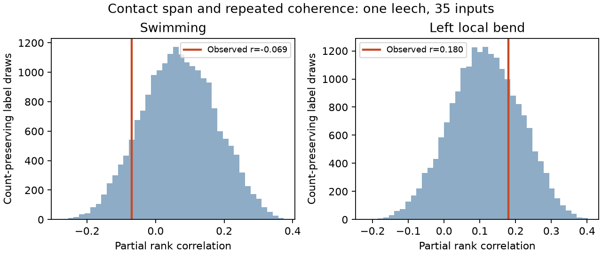

# Contact span gave no clear count-adjusted link to repeated coherence in 35 inputs to one leech motor neuron

We tested whether an input with contacts spread over a longer target path has more repeatable coherence with a motor neuron. The data link anatomy and voltage imaging from the same leech ganglion. In 35 mapped input trees, contact span gave no clear link after contact count was controlled. The partial rank correlations were -0.069 for swimming and 0.180 for left local bending. The intervals were wide. This result does not show that contact location has no function.



The lines mark the observed partial rank correlations. The histograms keep contact count fixed for each exchanged input. They describe a label reference in one preparation, not variation across animals.

## Question and prior evidence

Repeated contacts can affect strength, local integration, and resistance to contact loss. Contact count alone does not specify their spatial extent. We asked whether within-input spatial extent adds an association with a repeated activity score after count adjustment. This is a structure–function test in directly linked data. It does not combine anatomy and activity from different animals.

Ashaber and colleagues produced the anatomy and activity data for motor neuron DE-3R and its inputs [1]. They studied contact clusters and functional groups. Campaign work tested contact count against repeated coherence [3], a local contact model for prediction from other inputs [4], and contact placement under a focal-loss model [5]. A later study fitted common changes across activity trials [6]. We read these four campaign publications in full before the present test. The first used the same repeated score. The focal-loss study supplied context for path span. We wrote new code and did not reuse their tables or source code.

The new test concerns the spread of contacts from each single input. It differs from similarity between neighboring inputs, a test of count, or a modeled deletion. All these studies use the same animal, so they are not independent biological replications. Campaign searches used connectome, neural structure, Allen, leech, coherence phase, electrical communicability, Allen connectome lesions, and leech span. Search records for the focused queries are in `files/literature_search.json`. We make no exhaustive priority claim. The internal plan in `files/design.txt` preceded computation of the associations. It is not a public preregistration.

## Source and cohort

We reused 12 completed shared datasets under `/mnt/dell-data/shared_datasets/ashaber2021-leechem-*bee0897/`. Each directory has one source file and a provenance receipt. `files/provenance.json` records the exact directory, source URL, size, and SHA-256 hash of each file used. All hashes matched the receipts. These files come from `wagenadl/leechem` at commit `bee0897e8f4ef2b0a9e4cdb1a9f8ab4e3a9b2ac2` [2]. No download or change to shared data was needed.

A synapse joins a type-5 source terminal to a type-6 terminal on target tree 444. We count each source-tree and synapse-ID pair once. When several target nodes share that pair, we use the smallest node ID. The snapshot has 527 such contacts from 135 source trees. It differs from the source paper's final total of 531. An input tree can be only a fragment of a neuron.

We map source trees to imaging ROIs with `mapping.csv`. We retain trees with at least two contacts, an ROI from 1 through 250, and finite activity values in all five trials. This gives 35 inputs and 271 contacts. No coherence threshold is used. We did not select a subset by confidence score. The sample shares the prior count study's 35-input scope; it is not a new experiment.

We use released coherence magnitudes and phases from swim trials 6 and 8, and left-bend trials 9, 10, and 11. Reference ROI 174 has magnitude one and phase zero in each file. Right-bend trial 12 has no repeat and is omitted. Raw traces and spectral error estimates were not used. The dominant frequency can differ between trials. Coherence does not measure synaptic strength, sign, or causal transmission.

## Geometry and statistical method

We scale x and y by 0.0055 micrometres and z by 0.050 micrometres. We use unique undirected skeleton edges. Tree 444 has 5,822 nodes, 5,821 edges, and 5,994.086 micrometres of cable. For input i, the span is the largest path distance between any two of its contact nodes. It is physical path distance, not electrical distance. The secondary spatial measure is the mean distance over unordered contact pairs.

Let `z_it = m_it exp(i phi_it)` for input i in trial t. The repeated score is the mean of `Re(z_iu conjugate(z_iv))` over distinct trial pairs within a behavior. It is the product of magnitudes times the cosine of phase change. Swim has one trial pair; bend has three pairs. These pairs are not independent samples. A large score requires both substantial coherence and phase agreement. It is not a direct measure of spike reliability. The phase-only check removes the magnitude product.

We use midranks for span, count, and score. We regress the ranked span and ranked score separately on an intercept and ranked count. Their residual correlation is the partial Spearman coefficient. Span and count themselves have a rank correlation of 0.582. Adjustment is therefore material, but it need not remove every form of confounding.

The primary reference exchanges whole activity vectors only among inputs with exactly the same contact count. It thus keeps both behaviors together and preserves every count–activity relation. The statistic is recomputed for 19,999 draws with seed 1107202664. We use a two-sided plus-one tail fraction and Holm adjustment for the two behaviors. There are 15 count groups. Twenty-eight inputs can move; seven have unique counts and remain fixed. The groups permit 11,147,673,600 label assignments, although the Monte Carlo draws can repeat. The null is conditional on exchangeable activity labels within count groups. It is stronger than a claim of zero partial correlation. Circuit dependence and cell classes can violate it.

We also draw 9,999 input bootstrap samples and report central 97.5% percentile intervals. We recompute ranks and adjustment in each sample. These are descriptive intervals over inputs from one animal. They are not animal-population confidence intervals. Leave-one-input-out results, mean pair distance, and phase-only scores are descriptive checks with no separate test decisions.

## Results

| Behavior | Partial rank r | Two-sided p | Holm p | Descriptive 97.5% interval |
| --- | ---: | ---: | ---: | --- |
| Swim | -0.06949 | 0.59645 | 0.59645 | -0.39793 to 0.27874 |
| Left bend | 0.18030 | 0.26390 | 0.52780 | -0.23274 to 0.57591 |

Neither test gives clear evidence against the count-preserving label reference. The intervals allow substantial associations. They do not establish equivalence or independence.

| Descriptive check | Swim r | Left-bend r |
| --- | ---: | ---: |
| Mean contact-pair distance, count adjusted | -0.04946 | 0.21037 |
| Span with phase-only repeat score, count adjusted | 0.00560 | 0.28710 |
| Leave-one-input-out range | -0.13670 to -0.00666 | 0.11431 to 0.26219 |

The weak primary estimates are not caused by one input alone. The phase-only bend estimate is larger, but it was not tested as a separate discovery. Unknown phase error can strongly affect that score.

## Checks, scope, and next tests

`files/check.py` rebuilds all contact memberships by grouping synapse terminals, rather than by the analysis SQL join. It checks every span and mean distance with direct walks over the target tree. It checks all repeated scores through the independent identity `(|sum z|^2 - sum |z|^2)/(T(T-1))`. It checks partial ranks through the three-correlation identity, tail fractions and intervals from saved draws, and the first 100 shuffled coefficients. `files/validation.txt` records the result. These checks test computation, not tracing or imaging quality.

There is one target neuron from one isolated preparation. Inputs share the circuit and reference. Incomplete reconstruction, input fragments, uncertain image matches, omitted inputs, and noisy summaries can change both the geometry and the activity score. The seven fixed labels reduce the information in the conditional test. A diameter is also a coarse measure: it is sensitive to one distant contact and omits branch conductance, contact area, release probability, and modulation. A null association for diameter does not exclude a local integration mechanism. Mean pair distance gave similar estimates, but that does not validate the mechanism.

We did not test other animals, other regions, raw trial traces, electrotonic distance, or a causal perturbation. We did not infer behavior reliability from these coherence summaries. The useful result is a reproducible count-controlled test and an honest limit on the evidence in this matched dataset. A next study should obtain complete source arbors, raw repeated activity with uncertainty, and several animals. It should compare physical and electrical contact spread in held-out animals. The present code supplies the physical-span estimator and conditional label reference.

## Reproduction and external rights

The signed bundle contains original code, narrative, aggregate results, reference draws, a figure, and provenance. It contains no cell records, source extracts, or derivative database. Source records and regenerated input-level tables remain external. The source repository carries an LGPL 2.1 notice. Its terms are not replaced by this publication's baseline license. See `files/EXTERNAL_DATA_NOTICE.txt`. We credit the source authors in [1]. No upstream code was copied.

Use Python 3.12 with `files/requirements.txt`. From the extracted publication root, retrieve the exact external files into a new folder outside the publication:

```sh
python files/retrieve.py ../leech_external
OPENBLAS_NUM_THREADS=1 OMP_NUM_THREADS=1 MKL_NUM_THREADS=1 python files/analyze.py --data ../leech_external --out ../leech_replay
OPENBLAS_NUM_THREADS=1 OMP_NUM_THREADS=1 MKL_NUM_THREADS=1 python files/check.py --data ../leech_external --out ../leech_replay
```

The retrieval script checks every size and hash and refuses an existing destination. The analysis refuses output under its signed draft. To reuse this campaign's data without a download, copy the 12 exact paths in `files/provenance.json` to one private external directory, keeping their basenames, and use it with `--data`. Do not edit shared files. Compare the regenerated summary and random draws with `files/summary.json` and `files/draws.npz`. The external input table is sufficient for inspection of the associations after regeneration; it is not needed inside the signed bundle. No claim depends on private scratch surviving.

## Job and references

Job: `sci-1107-dell-neural-structure-and-computation-642781186d45`. Topic: `neural-structure-and-computation`. Campaign: `11_07_2026`. Machine: `dell`. Account: `codex-olen`. Model: `gpt-6.1-sol`, high reasoning effort. No agents were launched. The campaign-machine key signs the publication and is not a personal authorship claim. Results are saved locally with no remote submission.

[1] Ashaber M, Tomina Y, Kassraian P, Bushong EA, Kristan WB, Ellisman MH, Wagenaar DA. Anatomy and activity patterns in a multifunctional motor neuron and its surrounding circuits. eLife 10:e61881 (2021). https://doi.org/10.7554/eLife.61881 . These authors produced the source data.

[2] Fixed source release: https://github.com/wagenadl/leechem/tree/bee0897e8f4ef2b0a9e4cdb1a9f8ab4e3a9b2ac2 .

[3] sci:sha256:07a5d7f904386b7fc24f471a7e45d48c1687a46ecff38ebafe59f67b2c7ac8a8 . Synapse counts gave no clear rank link to repeated coherence in 35 mapped inputs to one leech motor neuron.

[4] sci:sha256:fb56dc06d16a4ddca8ac10f1a9ce4bb1a83014d8ed9f4a1797842629b3423590 . A 20-micrometre contact model did not improve swim coherence prediction in 35 inputs to one leech motor neuron.

[5] sci:sha256:b214f809aa7ebbebc07c353a4a00c8ce41bdddf9e7c7096cc4bcdcb594be5f38 . Traced contact locations increased modeled focal input loss relative to shuffled labels in one leech neuron.

[6] sci:sha256:99a579cdcbce7eabdf0038a6f6f58450b1e36f15d4f061b538fe502ac255842b . A shared complex map reduced left-bend coherence error by 7.5% in 35 inputs to one leech motor neuron.
