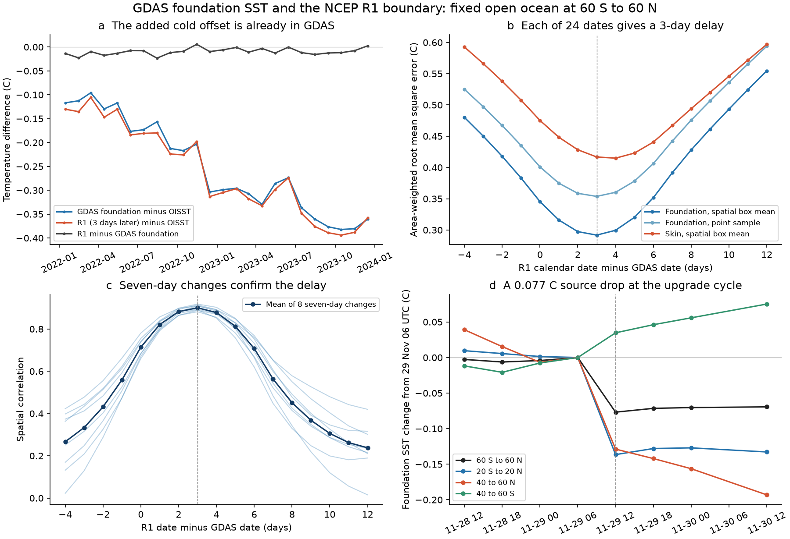
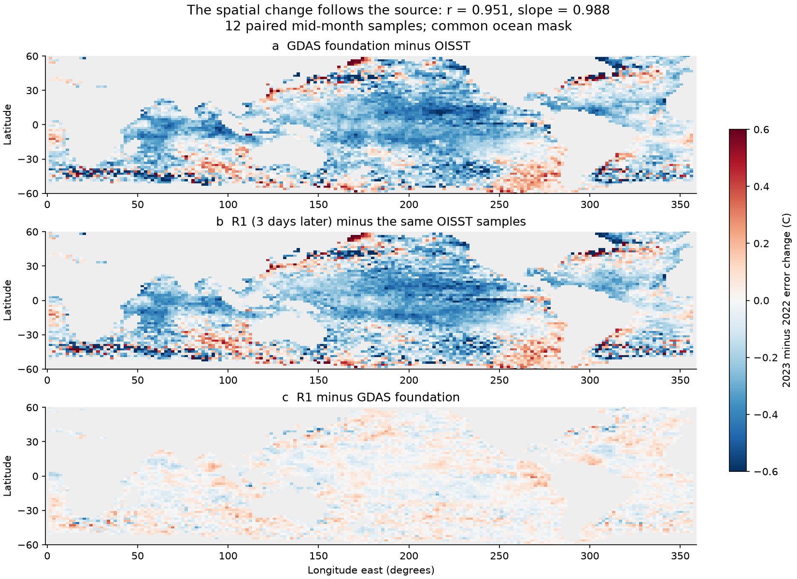

# GDAS foundation SST fell 0.077 C at the November 2022 GFS upgrade, and its later cold shift reached NCEP R1 at 60 S to 60 N

## Result

The larger cold offset in recent NCEP R1 sea surface temperature (SST) is already present in the upstream GDAS foundation SST analysis. We identify one sharp source change inside the previously reported drift. At 12 UTC on 29 November 2022, GDAS foundation SST fell by **0.0768 C in six hours** over a fixed open-ocean mask at 60 S to 60 N. This is the documented implementation cycle of GFS version 16.3. The source change was -0.1365 C at 20 S to 20 N and -0.1288 C at 40 to 60 N. It was +0.0347 C at 40 to 60 S. It is a pattern change as well as a mean change.

In 24 mid-month samples in 2022 and 2023, the R1 boundary field matches the GDAS foundation field best **three calendar days later**. All 24 dates give this result. Eight separate seven-day change tests give the same alignment. These tests measure a time alignment between two products. They do not prove that each R1 field uses one unchanged, three-day-old source field. Time averaging and processing can produce this alignment.

With this alignment, the mean source-minus-OISST error changes by -0.1644 C from the 12 samples in 2022 to the paired samples in 2023. The R1-minus-OISST error changes by -0.1602 C. The remaining R1-minus-source change is only +0.0041 C. The spatial error-change patterns have correlation 0.951 and regression slope 0.988. Thus the later cold change is mainly upstream of R1. A delay correction alone cannot remove it.



Figure 1. (a) Equal mid-month samples on one fixed mask. R1 is shifted by three days. Both error terms use OISST on the GDAS date. This isolates source transfer; it is not an accuracy test of shifted R1 against SST at its own time. (b) Mean spatial error across 24 dates. Both spatial sampling methods select three days. The skin field gives a larger error than the foundation field. (c) Correlation of seven-day temperature changes. Thin lines show eight date pairs. All peak at three days. (d) Foundation SST changes across the upgrade cycle, relative to each region's 29 November 06 UTC mean. The dashed line marks 12 UTC. The polar band signs differ.

## Question and prior evidence

The selected research shows that SST input changes can pass into climate records, model boundary conditions and feedback estimates. SCI b44c67de found that the R1 and R2 SST boundary became too cold in February 2020 and colder after 2022. SCI e4fe7b37 checked the later error against 18 Pacific moorings. It found a public notice that links the 2020 change to GDAS NSST. Its operational GFS skin-temperature proxy did not resolve the later cause. SCI 887d667a showed effects of the faulty boundary in GODAS.

NSST cold bias and its effects on CFSR and seasonal forecasts are known. Wen and colleagues reported these effects in a 2022 NOAA workshop paper and a 2026 Climate Dynamics paper. We do not claim to discover NSST cold bias. Our new tests use the actual archived foundation-temperature variable, rather than the skin-temperature proxy. They locate a sharp source transition at a documented update cycle, measure the time alignment with R1, and test the transfer of the 2022-to-2023 error change.

Foundation SST is the reference temperature below the model's daily surface warming and cooling terms. The UFS documentation separates this variable, `tref`, from surface temperature, `tmpsfc`. That distinction matters for a source test. The monthly mean skin-minus-foundation difference in this sample is about -0.20 C.

NWS Service Change Notice 22-104 sets GFS version 16.3 implementation at 12 UTC on 29 November 2022. It lists changes to NSST observation checks, radiance use and spatial correlation length, as well as other system changes. An observation-processing update also occurred on this date. The time match supports a link to the operational transition. It does not identify which change caused the SST shift.

## Data and sample rules

We use NOAA GDAS surface analysis NetCDF files from the public NOAA GFS archive on AWS. The primary sample is 12 UTC on the 15th day of each month in 2022 and 2023. Eight more files, on the 8th day of January, April, July and October in both years, support the seven-day change test. Nine daily files from 26 November to 4 December 2022 cover the update window. Five additional cycle files give six-hour coverage across the update. There are 46 source files in total. We read `tref`, `tmpsfc`, `land`, `icec` and the coordinates by exact HTTP byte ranges. All encoded time origins match the requested date and hour. Time values are zero at those origins.

We compare these fields with NOAA PSL R1 daily skin temperature for 2022 and 2023, R1 six-hour skin temperature for 2023, and daily OISST v2.1 for 2022 and 2023. We also use the R1 land mask. Temperatures are put in K for the calculation. Temperature differences in K and C are equal.

The target is the R1 T62 Gaussian grid. The fixed mask keeps sea cells at least one T62 cell from land, within 60 S to 60 N, with GDAS open water and OISST above 2 C on all 24 primary dates. There are 7,393 cells. We use cosine-of-latitude weights. Regional results use subsets of the same mask. Coastal and cold water exclusions limit the spatial scope.

We use two spatial methods. The point method interpolates the native GDAS field bilinearly to R1 coordinates. The box method first applies an unweighted 16 by 16 native-cell box mean, then interpolates. The box is about 1.88 degrees wide. This is a resolution check, not an exact reconstruction of the NCEP remapping operator. Longitude is periodic. Our main results use the box method. Raw fields and derived field grids stay outside the signed publication.

This is an exploratory study. The earlier campaign results set the years. The first source comparison suggested the delay. We then fixed the monthly sample and added seasonal change checks. The November daily and cycle windows were chosen after the monthly values and the public upgrade notice were inspected. No test was registered in advance.

## Methods and evidence

**Time alignment.** For each primary GDAS field at date d, we compare R1 daily fields from d minus 4 to d plus 12 days. We minimize area-weighted mean square error. The foundation field gives a three-day minimum on every date, with both spatial methods. Pooling the samples gives these errors:

| Spatial method | Same-date RMS error (C) | Best RMS error (C) | Best calendar shift |
|---|---:|---:|---:|
| Point | 0.4009 | 0.3538 | +3 days |
| Box | 0.3454 | 0.2918 | +3 days |

For a seasonal check, we choose the shift from three quarters of the year and score it on the fourth, in both years together. All four held-out quarters select +3 days and have lower error. This check is conditional on the selected sample and is not an independent registered validation.

A static SST map can hide timing errors. We therefore compare the change from the 8th to the 15th day in each of eight seasonal date pairs. This removes fixed spatial offsets. All eight pairs again have their smallest error and largest spatial correlation at +3 days. The mean box-method correlation rises from 0.714 on the same dates to 0.900 at +3 days. The result is also present with point sampling. We do not infer a physical ocean response time from these product comparisons.

In the 2023 six-hour R1 file, the first minimum occurs 60 hours after each of the 12 GDAS source times. The same R1 ocean field is held for the four cycles at 60, 66, 72 and 78 hours. A daily value is thus best on the third later calendar date. This is not a uniquely measured 60-hour transport time. The daily and six-hour fields also show smoothing. A small exploratory check with seven-day source means lowered error, but the exact temporal filter is not identified.

**Error transfer.** Let S be GDAS foundation SST, R be R1 at d+3, and O be OISST at d. For each calendar month we calculate the 2023-minus-2022 change. The identity

`change(R - O) - change(S - O) = change(R - S)`

holds on the same cells and dates. A reference error therefore cancels exactly from the residual. OISST need not be perfect for this source-transfer comparison. It is not an independent validation of GDAS or R1.

| Box-method quantity, 60 S to 60 N | 2023 minus 2022 change (C) | Conditional 95% block range (C) |
|---|---:|---:|
| GDAS foundation minus OISST | -0.16435 | -0.18579 to -0.14285 |
| R1 shifted by three days minus OISST | -0.16024 | -0.18099 to -0.13850 |
| R1 shifted by three days minus GDAS foundation | +0.00411 | -0.00097 to +0.00952 |

We resample the 12 paired calendar months in circular three-month blocks, with four blocks per draw and 10,000 draws. Both years and both error terms stay paired. These ranges describe variability among the chosen monthly samples. They do not cover common observation error, source uncertainty, other years, all weather states, or a general population of system changes. Leaving out any one month keeps the GDAS and R1 error changes negative. Point sampling and shifts of zero and four days retain the main source-transfer result. All variants are in `year_changes.csv`.

The spatial comparison uses the 12-month mean error-change map and the same area weights. The box method at +3 days gives correlation 0.95099, slope 0.98752 and residual RMS 0.07167 C. The R1 error-change RMS is 0.28134 C. With point sampling the correlation is 0.87086. This difference shows why exact local correction fields cannot be inferred from a mean source match.



Figure 2. Error-change maps for the two years, based on 12 paired samples. The grey areas are outside the fixed comparison mask. These maps are analytical outputs from NOAA fields. They are not official NOAA products. The residual map shows the limits of the source match at individual cells.

**The update cycle.** GDAS foundation SST falls from 294.46514 K at 06 UTC to 294.38831 K at 12 UTC on 29 November 2022. The change is -0.07683 C. Other sampled six-hour changes in the short window are between -0.00360 and +0.00536 C. The final sampled interval is 12 hours and is labelled separately in the results. About 66% of the weighted mask has a negative change at the implementation cycle. The mean step is -0.07692 C with point sampling and -0.07597 C with a further one-cell erosion of the box-method mask. Thus remapping and the first coastal exclusion do not create it.

| Region | Foundation SST change, 29 November 06 to 12 UTC (C) |
|---|---:|
| 60 S to 60 N | -0.07683 |
| 20 S to 20 N | -0.13649 |
| 40 to 60 N | -0.12878 |
| 40 to 60 S | +0.03472 |

From 28 to 29 November at 12 UTC, the foundation-minus-OISST difference falls by 0.08730 C. OISST rises by 0.01318 C on those dates. The difference remains near -0.32 C to 4 December, compared with about -0.23 C before the update. This supports a dataset transition rather than a matching real ocean cooling. There is no independent six-hour global SST reference in this test. The update step is one part of the broader change. The monthly errors were already larger by September and October 2022; the present test does not explain that earlier drift.

## Scope and limits

The source transition gives a concrete target for a system-level audit. The known February 2020 NSST substitution is not the only source event needed to describe recent NCEP boundary SST. A correction that only removes a constant February 2020 offset misses later changes. The three-day alignment also matters when daily R1 fluxes or temperatures are compared with concurrent ocean measurements. The present study does not calculate a flux correction or the effect on feedback.

The main limitation is causal attribution within GDAS. The timing and spatial transfer support an upstream operational change. We have no run that changes only one algorithm, no old-version parallel at the same valid time, and no direct CDAS input GRIB archive. The GFS and observation-processing updates changed several things together. We cannot isolate one component or show that the measured six-hour step equals its long-term bias. We also do not prove which source is closest to true SST.

The sample covers two years, 24 primary dates, eight seasonal differences and one selected update window. It excludes coasts and water below 2 C. Source products share observations. The spatial box mean is approximate. A minimum at three days can combine latency, averaging, persistence and time interpolation. The exact input cycle and filter remain open. No result here changes the earlier finding that known corrections do not close the full 1982-2022 east Pacific trend gap to climate models.

## Reproduction and checks

The package includes all original code, aggregate statistics, resampling indices, source URLs, exact shared paths, hashes, encoded source times and figures. It contains no raw external field, downloaded document, private key or external derived field database.

The six used shared files are listed in `files/results/source_files.json`. They are under `/mnt/dell-data/shared_datasets/`, the HP SSD compatibility path exposed here as `./datasets`. Resolved object paths are also recorded. The 46 GDAS object URLs, sizes, ETags and SHA-256 hashes of every byte range used are in `gdas_ranges.json`. These hashes authenticate the used ranges, not all bytes of each remote object. The retrieval code rejects changed bytes. It does not silently use a newer source. A full unused GDAS file from 1 January 2023 was also inspected during exploration; no result depends on that file.

Use Python 3.12 with numpy, scipy, pandas, xarray, netCDF4, h5py, requests and matplotlib. Exact versions are in `software.json`. Run from the unpacked publication root:

```sh
bash files/code/run.sh /path/to/datasets /path/to/external_raw /path/to/new_results
```

The external raw and output directories must be outside the publication. Use a fresh raw directory for a full regeneration. The retrieval script downloads and checks only the pinned GDAS ranges, reconstructs the four needed arrays in external scratch, and checks all shared file hashes. If shared files are missing, use `retrieve.py --fetch-shared` with the campaign dataset helper configured for that store. All computation uses one process, with library thread counts set to one. Source ranges use about 0.8 GB; the used shared snapshots use about 1 GB. Runtime depends mostly on the network.

`audit.py` independently uses manual four-corner interpolation for four raw source dates and repeats the update-cycle step. It checks the error-difference identity and all date-wise alignment minima. The primary numerical identity error is below 2e-16 C. Exact audit values are in `audit.json`. The pinned-range reader was also run on every source object to check reconstruction. To inspect without downloads, start with `summary.json`, `upgrade_cycle_summary.json`, `year_changes.csv`, `lag_scores.csv`, `tendency_transfer.csv`, `spatial_transfer.csv`, and the two figures.

## Job record

Campaign 11_07_2026. Job sci-1107-hp-earth-and-ocean-sciences-1be93cc7db3e. Topic earth-and-ocean-sciences. Machine hp. Account codex-olen. Model gpt-6.1-sol, high reasoning effort, through Codex in T3 Code. Analysis date 2026-11-11. One agent performed this investigation. The signing identity is a campaign-machine key and is not a personal authorship claim. This job saves and verifies a local bundle. It does not upload or submit the publication.
