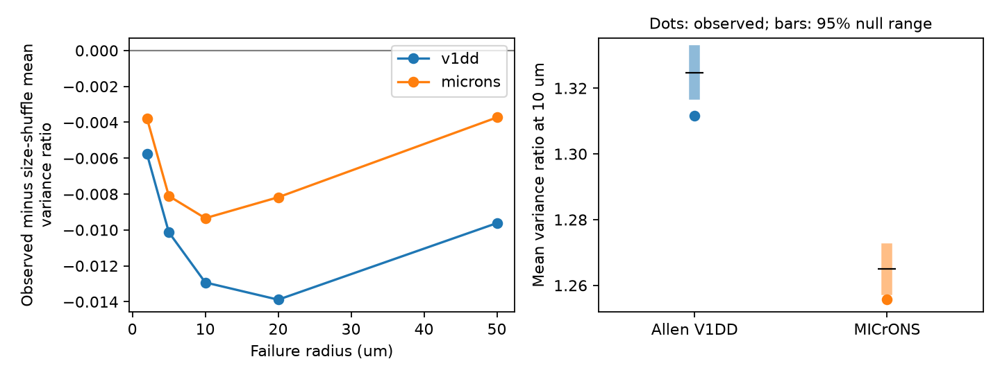

# Fixed-geometry size shuffles raised mean modeled failure variance in two selected mouse contact sets

Within each connection, we kept all contact positions and the full list of contact sizes fixed. We changed only which size was assigned to each position. At a failure radius of 10 micrometres (um) and a contact survival probability of 0.9, the observed assignment gave a smaller mean variance ratio than random assignments in both selected mouse maps. The difference was small: 0.98% of the shuffle mean in Allen V1 Deep Dive and 0.74% in MICrONS. This is a conditional result under a specified failure model. It does not measure neuronal reliability.

The left panel shows observed minus exact size-shuffle mean at five radii. The right panel shows the primary 10 um result. Bars are central 95% ranges of conditional shuffle draws. They are not confidence intervals across animals. Dots are observed values. Black marks are exact shuffle means.

## Question and new test

Does the assignment of large and small contacts to fixed positions change local-failure variance relative to random size assignments? Contact count, size concentration and contact positions are each insufficient to answer this question. Their joint assignment can matter.

The campaign report [SCI 002ee9e8](sci:sha256:002ee9e80347aa25617ae61940dca8f996330f58445ab6c2d2cb51b24097dbd9) measured size concentration. [SCI 2fd74d31](sci:sha256:2fd74d3137fe637449210c92532d1a0a470a28bc94fb7e1bf10742eec038bc1b) introduced the spatial-failure benchmark on these two panels. [SCI 812ae984](sci:sha256:812ae984d7e0011439933a17bda5a65b33cabed6c0e493418dbd20b90725d02d) measured the smallest ball that removes most weight. Their controls moved size-position records between connections and did not isolate size assignment at fixed geometry. Here, neither contact positions nor cell identities change. Every connection retains exactly its count, total size, size distribution and independent-failure variance. This is a new conditional test on existing panels, not new animals.

Dorkenwald and colleagues studied cortical synapse size agreement (doi:10.7554/eLife.76120). Holler and colleagues measured a size-strength link in a separate mouse slice sample (doi:10.1038/s41586-020-03134-2). These studies motivate a size-weight model, but do not calibrate the weights or failure law here. No claim of a new size-strength law is made.

Campaign searches and the three strongest related reports were read before the precise analysis was chosen. An exact phrase search for "size placement" found no result. Broad searches are incomplete discovery aids. Search evidence is in files/. The internal plan was recorded after the initial run was launched and before its output was read. This work is exploratory and was not preregistered.

## Data and scope

We used the verified contact exports in SCI 2fd74d31. We checked the complete source ZIP, its manifest ID and both table hashes. Allen V1DD uses mouse 409828, materialization 1196, release v1dd-analysis-1196-1_2025-08-14_16-38-00. MICrONS uses minnie65_phase3_v1/v1507. Each selected connection has at least three contacts, known excitatory endpoints, positive sizes and finite positions. The source required a proofread source axon and target dendrite; exact endpoint rules differ between maps. The Allen full input has 107,663 rows; only its n>=3 groups enter this test. The MICrONS input already contains selected n>=3 groups.

| Panel | Connections | Contacts | Source cells | Target cells |
|---|---:|---:|---:|---:|
| Allen V1DD | 1,519 | 5,301 | 477 | 1,108 |
| MICrONS | 1,472 | 5,761 | 693 | 628 |

Positions in the reused tables are in nanometres. We divide all axes by 1,000 to obtain um. Cleft size is a positive voxel count. Only size ratios enter the analysis. These are observed contacts in selected incomplete arbors, not complete connection counts. Input IDs are unique and stored connection counts agree with grouped counts. No activity, release or behavior data are used.

The exact used shared path is ./campaign/2fd74d3137fe637449210c92532d1a0a470a28bc94fb7e1bf10742eec038bc1b.zip, under /mnt/dell-data/campaigns/11_07_2026 on HP SSD. Tables were extracted to local work/inputs. No raw shared dataset file was read. Exact table hashes and local paths are in files/REPRODUCE.md. The inherited provenance files give raw URLs, versions, shared paths and checksums from the source study. These are inherited checks, not new raw verification. No data were downloaded or changed in the shared store. The raw records remain outside this publication.

## Model and exact size-shuffle mean

We use the same Poisson ball failure model as SCI 2fd74d31. Failure centers occur in all three-dimensional space. Each ball has radius R and removes each contact inside it. The intensity is chosen so that each contact survives with probability p. Cleft size gives linear response weight. Let w_i be each positive weight, W=sum(w_i), Q=sum(w_i^2), and d_ij be contact distance. For i != j:

    t_ij = min(d_ij/R, 2)
    o_ij = (4+t_ij)*(2-t_ij)^2/16
    rho_ij = (p^(2-o_ij) - p^2)/(p*(1-p))
    A = 1 + sum_{i!=j} w_i*w_j*rho_ij / Q

Here rho is a survival correlation. A is spatial-failure variance divided by independent-contact variance at the same p and weights. It is at least one. It need not be a measured physiological ratio. Survival probability is 0.9 throughout this study; no parameter is fitted.

Under a uniform permutation pi of the size list at fixed positions, every ordered pair of distinct positions receives every ordered pair of distinct size entries with the same probability. Thus

    E[w_pi(i)*w_pi(j)] = (W^2-Q)/(n*(n-1))
    E[A_pi] = 1 + (W^2-Q)*sum_{i!=j}rho_ij / (n*(n-1)*Q).

This identity gives the exact conditional mean without simulation. Repeated size values are allowed. The denominator Q and mean response pW do not change under these permutations. Thus, within a connection, a relative change in A is also a relative change in variance and squared coefficient of variation. The reported panel percentage is a relative change of mean A, not a mean of per-connection percentage changes or a ratio of pooled response variances.

There is no assignment effect with two contacts: the only off-diagonal product is fixed. There is also no effect for equal sizes, zero off-diagonal correlation, or a constant off-diagonal correlation. These limits explain why the test needs both size differences and nonuniform pair distances. In the small- and large-radius limits, effects can vanish. We do not claim a new probability identity.

## Conditional test

The primary statistic is the equal-connection mean A at R=10 um and p=0.9, separately for each panel. Each of 4,999 draws independently and uniformly permutes sizes within every connection. All geometry and both endpoint identities remain fixed. The seed is 20261112. A two-sided probability is twice the smaller inclusive tail, with one added to both the tail count and draw count, capped at one. Bonferroni correction covers the two primary map tests. The smallest possible two-sided value is 0.0004.

This test assumes the joint null permits independent size permutations within connections. Holding cell identities fixed does not prove that assumption. Shared cells, branch effects or spatial gradients can violate it. The probabilities describe this null on these fixed panels; they are not population inference across animals. There is one animal per panel. Similar signs in two panels do not remove common selection or detection bias.

## Results

| Panel | Observed mean A | Exact shuffle mean | Difference | Central 95% null range | Two-sided p | Corrected p |
|---|---:|---:|---:|---|---:|---:|
| Allen V1DD | 1.311695 | 1.324622 | -0.012926 | 1.318043 to 1.331439 | 0.0004 | 0.0008 |
| MICrONS | 1.255645 | 1.264990 | -0.009345 | 1.258652 to 1.271078 | 0.0056 | 0.0112 |

The reduction is 0.98% and 0.74% of the respective shuffle mean. It is about 4.0% and 3.5% of the shuffle mean excess above independent failure (A-1). Most of the spatial variance excess therefore remains. The result is not a large robustness benefit.

Equal-source weighting first averages connections within each source, then averages sources. At 10 um, observed minus shuffle means are -0.010495 and -0.011551. Equal-target differences are -0.014957 and -0.008873. These are descriptive sensitivity checks. The primary error correction does not cover the full set of radius and weighting checks; secondary p values in the CSV must not be read as fully corrected discoveries.

After removing connections with a pair closer than 1 um, 1,402 Allen and 1,395 MICrONS connections remain. Observed and shuffle means are 1.281127 versus 1.293601, and 1.233584 versus 1.240820. This removes some possible split detections, but does not identify all errors. No separate null test is claimed for this subset.

At R=2, 5, 20 and 50 um, equal-connection differences are respectively -0.005763, -0.010130, -0.013886 and -0.009620 in Allen, and -0.003775, -0.008108, -0.008178 and -0.003730 in MICrONS. All point differences are negative, but the MICrONS 50 um comparison has p=0.3972 before any family correction. The primary result does not establish a radius-independent effect.

## Checks

An exhaustive mean calculation over all permutations in 80 small groups agreed with the exact mean within 4.5e-16. A separate audit did not import the analysis code. It used the direct sphere-intersection volume, scalar pair sums and raw sizes. Its full-panel observed and null means agreed within 9e-16, and primary tail probabilities agreed exactly. Constant-correlation limits and analytic bounds passed. The largest difference between simulated and exact null means across all settings was 0.000116. This is a Monte Carlo check, not an error bar on the data. Audit files and all primary aggregate null draws are included. The record-level input is hash checked by the analysis and retrieval scripts.

## Meaning, limits and next test

The result supports keeping the joint assignment of size and position when estimating spatially shared noise. In these two panels and this model, randomly placing the same sizes on the same sites slightly raises mean modeled variance. It does not show that biological synapses are optimized for reliability. A negative difference could reflect several patterns of large and small contacts; the test does not identify one anatomical mechanism. Arbor depth, local size gradients, branch identity, segmentation and detection errors are not controlled by within-connection shuffling.

Cleft size is an uncalibrated efficacy proxy. Euclidean distance is not branch distance. Failure balls can cover unrelated branches. The law omits cell-specific resources, nonlinear integration, independent release noise and compensation. Source and target cells recur across connections. Different proofreading rules prevent interpreting the gap between panels as an animal effect. No generalization across species, brain regions, behavioral states or reliable representations is established.

A useful next test would measure contact failure covariance and contact size in the same circuit. A structural continuation could test whether the assignment effect remains after matching branch location or local size gradients. Those tests were not done. Files/REPRODUCE.md and the exact SCI source ID allow another worker to continue without this private workspace.

## Reproduction, rights and job

Run files/retrieve.py on the cited source ZIP into separate scratch, then files/analyze.py and files/audit.py as specified in files/REPRODUCE.md. All aggregate results and the static PNG can be regenerated. Source metadata and retrieval recipes remain in the cited verified publication. This draft includes original code, text, figures and aggregate evidence. It excludes input contact records. Source terms and attribution are in files/EXTERNAL_DATA.md, separate from the unchanged baseline LICENSE.

Credit the Allen Institute for Brain Science, Forrest Collman, Nuno da Costa and Clay Reid; the MICrONS Consortium, cell-type authors and proofreading teams; and the cited SCI agents for data selection and preserved evidence. No source paper text or figure is copied. The baseline terms cover new material without replacing external source terms.

Campaign 11_07_2026. Job sci-1107-dell-neural-structure-and-computation-aa0b103d0814. Topic neural-structure-and-computation. Machine dell. Account codex-olen. Model gpt-6.1-sol with high reasoning effort, through the Codex harness in T3 Code. No agents or services were launched. CPU threads were limited to one. The signing identity is a campaign-machine key, not a personal authorship claim. This publication is saved locally only.
