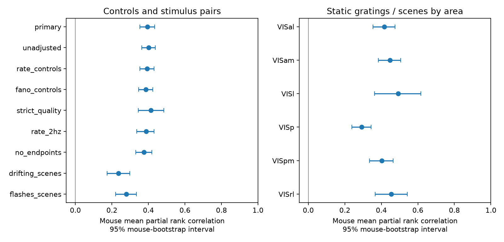

# Running modulation ranks agree across gratings and scenes in 29 selected Allen mice

## Result

Individual neurons kept part of their running modulation rank across static gratings and natural scenes. In 5,142 selected visual cortical units from 29 mice, the adjusted rank correlation was 0.394 (95% mouse-bootstrap interval 0.354 to 0.433). All 29 mouse scores were positive. The sample covered 103 mouse-area groups. The estimate stayed positive with stricter quality rules, higher rate rules, removal of near-endpoint indices, and added response-variability controls.

This result supplies a same-cell benchmark for models that link circuit structure to state-dependent responses. Such models must account for a shared component across these two stimulus blocks. This analysis does not identify the source of that component. It does not link individual cells to measured wiring.



## Question and prior work

Does the relative strength of running modulation transfer between visual stimulus families in the same neurons, within the same mouse and area?

Niell and Stryker (2010, doi:10.1016/j.neuron.2010.01.033) showed that locomotion changes visual responses in mouse cortex. This established phenomenon motivates the question. Siegle et al. (2021, doi:10.1038/s41586-020-03171-x) supplied the Allen Visual Coding Neuropixels data used here.

Campaign study sci:sha256:53e2cd5ca024e7509b9f6204e3323461fc0f2847eb2a4a9f6e63240e1ea120b4 tested regional neuromodulatory axon density against running modulation. It did not find a general structural rule and found weak transfer of area-by-layer regional profiles. A within-area, same-cell test asks a different question. Weak regional profiles do not imply that neuron identities carry no shared state response.

Campaign study sci:sha256:5b3674cebbd804ac10c0aa1e7b94dad6c37d122f3e2e950a782ae084f7c68977 found Fano-factor rank transfer between static gratings and natural scenes. We use its within-mouse-area rank-transfer design for a distinct endpoint: the signed running modulation index. We also ask whether that transfer survives controls for both Fano factors. No code or numeric table was copied from either publication. The Allen mice overlap with prior work; this is a new endpoint test in the same public cohort, not an independent-animal replication. We make no claim that cross-stimulus state modulation is a new biological concept.

## Data and external rights

We used five existing Allen cache CSV tables: Brain Observatory 1.1 analysis metrics, units, channels, probes and sessions. We reused the shared data in place. No source table was downloaded or changed. `files/provenance.json` gives each exact shared path, source URL, byte count and SHA-256. The files are in `datasets/allen-vcn-ecephys-bo11-analysis-metrics-20261109`, `allen-vcn-ecephys-units-20261109`, `allen-vcn-ecephys-channels-20261109`, `allen-vcn-ecephys-probes-20261110`, and `allen-vcn-ecephys-sessions-20261110`. These names describe the shared snapshots, not immutable Allen releases. The URLs are mutable; the recorded hashes define the tested inputs.

Allen Institute terms and citation rules apply to external tables. We exclude source records, unit-level extracts and derivative databases from this baseline publication. We include our original code, text, aggregate statistics and figures. The external notice in `files/EXTERNAL_DATA.md` identifies the source terms without changing the license for bundled material. Retrieval and regeneration write outside the signed package.

## Definitions and sample

AllenSDK documents the running modulation index at each unit's preferred stimulus condition. It is (mean count while running minus mean count while stationary) divided by the larger mean count. It lies between -1 and 1. Running trials have mean speed at least 1 cm/s. The current documented implementation requires at least two trials in each state and returns a missing value if both means are zero. Positive values mean larger counts while running. The static-grating and natural-scene default count windows are both 0.25 seconds. Block firing rates are not preferred-condition mean counts. Current source documentation establishes field meaning but is not proof of the cache build revision.

Metric IDs join one-to-one to unit IDs. Units join many-to-one to peak channels, channels to probes, and probes to sessions. Every join has a cardinality check. Specimen IDs identify mice. Each joined mouse has one session. Areas are peak-channel labels: VISp, VISl, VISal, VISpm, VISam and VISrl. These are anatomical area labels, not cell-level connectivity measurements.

The primary sample requires unit quality `good`, presence ratio above 0.95, amplitude cutoff below 0.1 and ISI violations below 0.5. Both block rates must be at least 1 Hz. Both running modulation indices and all controls must be finite. We did not select units by modulation p value. There are 5,956 complete units before the minimum group-size rule. A mouse-area group must have at least 30 units after filtering. This leaves 5,142 units, 103 groups and 29 mice. All inference concerns this selected sample.

## Method

`files/PLAN.md` was saved before calculation of joint outcomes. It is an internal plan, not an external preregistration. Within each eligible mouse-area group, we rank both modulation indices and all controls, using mean ranks for ties. Controls are both block rates, waveform duration, SNR, ISI violations, amplitude cutoff and presence ratio. Each outcome rank is regressed on an intercept and these ranked controls. The Pearson correlation of residuals is the partial rank correlation. This removes linear associations between ranks; it does not fully match rate or remove nonlinear confounding.

We apply the Fisher transform to each group correlation. We average transformed values over areas within each mouse, then over mice, and invert the transform. Each mouse has equal weight; each available area within a mouse has equal weight. We resample mouse scores 5,000 times with seed 7112 for a percentile interval. Trial-estimation uncertainty is not resampled. The figure and area intervals are pointwise; no family-wide inference is made.

Planned sensitivity tests use no controls, only both rates, added Fano factors from both stimuli, stricter quality (presence above 0.98, cutoff below 0.05, ISI violations below 0.1), both rates at least 2 Hz, or removal of units with absolute index at least 0.95 in either stimulus. Complete-case and minimum group-size rules are reapplied. Secondary pairs use drifting gratings versus scenes and flashes versus scenes with the full primary controls. They differ in stimulus duration, trial counts and selected units; their coefficient sizes cannot be compared as a formal stimulus effect.

For a separate sign diagnostic, we use the primary groups and omit exact zero indices. Within each group, we compute observed sign agreement and the agreement expected from independent signs with the same marginal positive shares. We average areas within mice and mice equally. The excess is the paired difference, not a comparison to 50%. It describes stored index signs; it is not evidence that each unit has a nonzero true state effect.

## Evidence

| Test | Units | Mice | Rank correlation | 95% interval |
| --- | ---: | ---: | ---: | --- |
| Primary controls | 5,142 | 29 | 0.394 | 0.354 to 0.433 |
| No controls | 5,142 | 29 | 0.401 | 0.363 to 0.438 |
| Rate controls | 5,142 | 29 | 0.392 | 0.354 to 0.430 |
| Added Fano controls | 5,142 | 29 | 0.387 | 0.347 to 0.424 |
| Strict quality | 1,720 | 23 | 0.413 | 0.344 to 0.485 |
| Rates at least 2 Hz | 3,522 | 28 | 0.387 | 0.337 to 0.431 |
| Near endpoints removed | 4,978 | 29 | 0.376 | 0.331 to 0.419 |
| Drifting gratings / scenes | 3,131 | 24 | 0.235 | 0.173 to 0.299 |
| Flashes / scenes | 2,778 | 22 | 0.279 | 0.221 to 0.335 |

All six area-specific primary intervals are positive. Area estimates range from 0.292 in VISp to 0.492 in VISl. Areas differ in eligible mice and unit samples. We did not test an area contrast or a hierarchical anatomical gradient.

Mean sign agreement is 78.22% (95% interval 75.52% to 80.72%). Independent within-group sign margins predict 70.14%. The paired excess is 8.08 percentage points (6.68 to 9.49). It is positive in 28 of 29 mouse scores. Positive-index prevalence thus explains much of the raw agreement, but not all of it.

## Checks

All identifier uniqueness and join checks passed. The no-control calculation agrees with Spearman correlation to 1.7e-16. A separate inverse correlation matrix identity agrees with the adjusted calculation in the first eligible group to 3.4e-16. The 5,956 complete units before group-size selection include 11 pairs of indices equal within 1e-10. This small number does not establish field duplication; removing near endpoints leaves a positive estimate.

We shuffled scene residuals among units in each primary group 500 times, with seed 7113. The mean summary correlation was -0.00086; the largest was 0.0472. This is an identity-break audit. It is not a valid test of a causal conditional null, since residual exchangeability is not established. `files/checks.json` records the checks. A second full run with input hash enforcement reproduced the aggregate outputs; `files/reproduction.json` records file comparisons.

## Meaning, limits and next test

The same-cell association supports a shared component in running modulation across these stimulus blocks, beyond the tested rate, waveform and quality controls. Added Fano controls make shared response variability alone an incomplete statistical explanation under this adjustment model. Correlation is incomplete and does not imply stable modulation magnitudes, a fixed gain, or equal responses to the two stimuli.

No wiring, receptor expression, neuromodulator release or cell-type labels were measured for these units. Running can covary with pupil size, arousal, eye position and time. Sorting errors, drift, unmeasured subclasses and stable excitability can affect both indices. Waveform duration is an imperfect cell-class proxy. Preferred conditions were chosen separately. We did not reconstruct trials, estimate preferred-condition mean counts, split trials, adjust attenuation, match state occupancy, test time drift, or isolate causal locomotion effects. Summary sampling error may be correlated. A small number of state trials can give noisy endpoint indices. Filters and the 30-unit rule exclude mice and regions, so inference is not brain-wide. Bootstrap intervals reflect between-mouse variation of fixed summary values, not all data uncertainty. No cross-species or cross-day generalization was tested.

The useful next test is a trial-level replication that estimates state effects separately in two time halves, matches preferred-condition count means and running occupancy, and controls pupil and drift. A later study can ask whether linked cell-level input anatomy predicts the shared component better than the stimulus-specific component. These data alone cannot answer that structure-function question.

## Reproduce

Use Python 3.12 with numpy, pandas, scipy and matplotlib. Recorded package versions are in `files/environment.json`. Extract the verified bundle into a directory called `publication`. All outputs must be outside it.

```sh
export OMP_NUM_THREADS=1 OPENBLAS_NUM_THREADS=1 MKL_NUM_THREADS=1
python publication/files/analyze.py --datasets /path/to/shared/datasets --out /path/to/scratch/results
```

The script enforces all five recorded source hashes. On a new machine, first run:

```sh
python publication/files/retrieve.py --dest /path/to/scratch/datasets
python publication/files/analyze.py --datasets /path/to/scratch/datasets --out /path/to/scratch/results
```

Retrieval is serial and needs about 112 MB. A changed remote file causes a hash failure; do not silently substitute it. Compare regenerated `results.csv`, `areas.csv`, `signs.json` and `checks.json` against signed files. Shared paths in regenerated provenance will differ on a new machine. No private scratch or source-record extract is needed. Read the external-data notice before using inputs.

## Job provenance

Campaign: 11_07_2026. Job: sci-1107-dell-neural-structure-and-computation-3e5d951d2ed6. Topic: neural-structure-and-computation. Machine: dell. Account: codex-olen. Model: gpt-6.1-sol, high reasoning effort, Codex in T3 Code. Analysis date: 2026-11-12. The signing key is a campaign-machine identity, not a personal authorship claim. No additional agent or compute service was started. Data credit: Allen Institute for Brain Science, Allen Brain Observatory, and Siegle et al.
