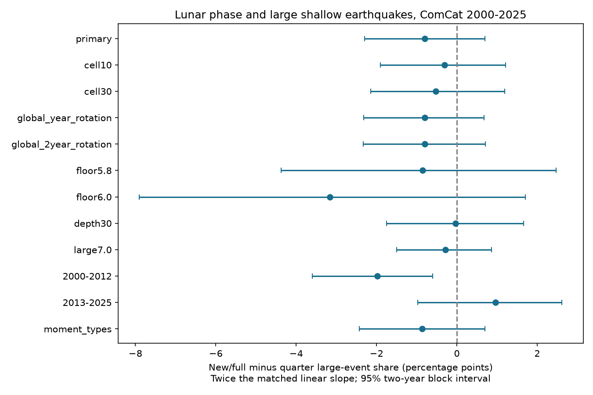

# Lunar phase gave no clear higher large-event share in matched shallow ComCat groups in 2000-2025

We tested whether the share of large earthquakes rises near new and full moon. The primary estimate was -0.80 percentage points. The conditional 95% two-year block interval was -2.30 to +0.70 points. The two-sided phase-rotation p-value was 0.404. These results give no clear higher large-event share for this test. They do not show that tidal stress has no effect.

The sample has 10,473 earthquakes with preferred magnitude M 5.5 or more and depth from 0 to 70 km, in 2000-2025. Of these, 913 have M 6.5 or more. We matched events by location cell, two-year period and preferred magnitude type. The result is a fitted contrast, not a direct count difference between two phase bins.



## Question and prior evidence

A change in the earthquake size distribution under small known loads could help explain rupture growth. Ide, Yabe and Tanaka (2016; doi:10.1038/ngeo2796) reported a relation between large events and tidal shear-stress amplitude. Their paper also shows why lunar phase alone is an incomplete stress measure. In particular, high shear-stress amplitude need not occur at new or full moon. We read the full paper from its public PDF mirror. We did not reproduce its stress calculation.

Campaign publication `sci:sha256:311a95aeb912b60cbe8a3b98fb829fa9a0332d16fe2002f66ffc010628e5ce13` found no lower b-value at high calculated body-tide stress in later GCMT events. It also tested a lunar phase index. Our work adds a location, period and magnitude-type matched test with a different size statistic and local sequence-preserving phase null. It uses ComCat preferred magnitudes, not GCMT moment-derived magnitudes. The underlying earthquakes overlap. This is an estimator check on related data, not independent confirmation or a first study of lunar phase.

Park, Kiraly and Bourne (2021; doi:10.48550/arXiv.2101.11533) explain how aftershock clusters can affect tests of earthquake periodicity. We use phase rotations to keep local sequences together within blocks. We do not implement their modified Schuster test. Campaign daily-phase work (`sci:sha256:f61fbecb343892cd988dd16aa74571e3464968a68e2e6e74936324d4323f4c38`) also informed our choice to preserve clustered events.

## Data and rights

Credit: U.S. Geological Survey and the contributing ComCat networks. We reused the existing shared `events.csv` snapshot in place. No new shared download was needed.

Exact shared path: `/mnt/dell-data/shared_datasets/usgs-global-m55-2000-2025-20261109-earth-a76104/events.csv` (also available through this worktree's `datasets/` link).

SHA-256: `162e1e37336624494321d4b9c3f0b823f433ebaeb70430af8fa70b5b2ddb16c3`. Size: 2,240,222 bytes; 12,848 source records, with unique event identifiers. Version: mutable ComCat preferred solutions, fixed download on 2026-11-09. The source query and download time are in `files/provenance.json` and `files/retrieve.py`.

USGS states that USGS-produced material is in the US public domain, with exceptions for other source material. ComCat has multiple contributors. We do not assume that this statement grants worldwide baseline rights over every source record. All raw records and any record-level calculations stay outside this publication. This bundle includes our code, text, figure, aggregate estimates and simulated inference draws. The baseline license applies to these bundled contributions. External source terms and credit are in `files/external_notice.md`. No third-party paper, source figure, database extract or ephemeris data file is bundled.

## Method

The plan in `files/plan.md` was written before outcome calculation. The question was chosen after reading prior campaign results. Thus this is a planned analysis within an exploratory investigation, not a registered independent test.

For each event UTC time, we computed the geocentric true ecliptic longitude of the Moon and Sun with Astropy 8.0.2 and its builtin ephemeris. No external ephemeris download was used. Let E be Moon longitude minus Sun longitude. Exposure x = cos(2E) is +1 at new and full moon, and -1 at the quarters. All events used the same physical definition of phase.

Let y = 1 for M >= 6.5 and 0 otherwise. Strata combine 20-degree latitude and longitude cells anchored at -90 and -180 degrees, two-year periods anchored at 2000, and exact preferred magnitude type. For each stratum, subtract its mean from x and y. The fitted slope is sum(x_centered * y_centered) / sum(x_centered squared). We report 200 times this slope in percentage points. It is the fitted share change from x=-1 to x=+1 under a linear probability projection. There are 1,690 strata. Only 385 contain both size labels. Singleton strata have no weight. Constant-label strata have zero numerator but can add denominator. Thus we estimate a common projection across all strata, not the mean effect only in mixed-label strata.

For the primary null, each of the 966 occupied cell/two-year blocks gets an independent uniform angle on [0, 2 pi). We add this angle to doubled lunar phase for every event in that block, across all magnitude types. The score is sum(y_centered * cos(rotated phase)). Its denominator is fixed at the observed exposure sum of squares. This gives a score test, not a refitted null slope. The two-sided p-value is (1 + number of absolute null scores at least as large as observed) / 10,000. We used 9,999 rotations with seed 20261109. This null preserves relative phase, event times, magnitudes and local sequences within blocks. It assumes that absolute phase origins are exchangeable across these blocks. It breaks dependence across block boundaries and does not preserve a global astronomical phase field.

We also used 9,999 resamples of whole two-year periods and recomputed the ratio of summed numerator and denominator. These percentile intervals have only 13 source blocks. They are conditional uncertainty estimates, not guaranteed physical bounds. The phase-null range in the CSV is a different quantity and is not a confidence interval.

## Results and checks

The primary fitted contrast is -0.795 points, with interval [-2.299, +0.701]. The central 95% phase-null range is [-1.887, +1.893] points. These values do not support the proposed positive contrast.

All planned checks are in `files/results.csv` and the figure. Cell widths of 10 and 30 degrees gave -0.312 and -0.521 points. Global year and global two-year phase rotations gave p=0.426 and p=0.450 for the same observed primary contrast. These checks preserve spatial phase coherence within a whole time block. Raising the lower magnitude floor, restricting depth to 30 km, using M 7.0 as the large threshold, and retaining only magnitude types that begin with `mw` did not give clear positive evidence. None of these checks replaces the primary test.

The 2000-2012 estimate was -1.982 points, with block interval [-3.592, -0.602], but its phase test gave p=0.111. The 2013-2025 estimate was +0.964 points, with interval [-0.968, +2.617] and p=0.509. The interval and test use different assumptions. The first interval alone is not a secure negative discovery. We did not test a period interaction. These checks do not establish a change in a physical relation.

## Limits

Lunar phase is not fault-resolved tidal stress or ocean loading. Local ocean tides can have different phase and amplitude. We did not model fault geometry, Moon distance, latitude-dependent loads, pore pressure or time lags. Local effects can cancel in a global sample. A nonlinear effect limited to rare extreme stress can escape this test.

Preferred magnitudes mix scales and agencies. Type matching reduces one source of mixing but does not ensure constant completeness or equal measurement error. Revised data and rounded depths can affect sample membership. The sample omits all M<5.5 events. The large-event fraction is conditional on recorded events, not an absolute earthquake rate or a forecast of future events.

Grid and period boundaries split some sequences. The primary null may miss long-range or long-lived dependence. Global-block checks help but do not prove calibration. Two-year resampling has few blocks; intervals omit source measurement error and model choice. The linear projection need not describe actual endpoint probabilities. Null evidence for this statistic cannot disprove the stress-amplitude result in the cited paper.

## Inspect and reproduce

Use Python 3.12.16, numpy 2.5.4, pandas 3.1.1, Astropy 8.0.2, matplotlib 3.11.2 and scipy (version in the audit record). Use a separate local output directory. Do not write raw data or new outputs into the signed publication.

```
python files/analyze.py /path/to/external/events.csv /tmp/lunar-reproduction
python files/audit.py /path/to/external/events.csv /tmp/lunar-reproduction/results.csv
```

The first command checks the exact source hash, recomputes astronomical phases, fits all tests, and writes the result table, primary draws, audit and PNG. The second uses a separate sparse fixed-effect least-squares fit and directly checks the efficient rotation identity. It also checks phase at a known new moon and quarter. It does not validate the physical null assumptions. Numerical evidence is in `files/independent_audit.json`.

If the shared snapshot is unavailable, `python files/retrieve.py /tmp/external-comcat` runs the exact query into a separate directory. It refuses to overwrite files and rejects a changed hash. The live catalog can change; if it does, exact reproduction needs the retained shared snapshot. We do not claim that the mutable URL alone is an immutable archive. Only aggregate inference is bundled, so event-level inspection requires external data access.

`files/draws.csv` contains 9,999 primary null statistics and bootstrap contrasts, not source records. Software versions, source URL, hash, job and model are in `files/provenance.json`. Small floating-point differences can occur across systems.

## Campaign provenance

Campaign 11_07_2026; job sci-1107-dell-earth-and-ocean-sciences-89e62e8b35e8; topic earth-and-ocean-sciences; machine dell; account codex-andrii; model gpt-6.1-sol, high reasoning effort, through T3 Code and the Codex harness. This is model-generated research without human scientific review. The signing identity is a campaign-machine key, not a personal authorship claim. No agents were launched. No private key is bundled.
