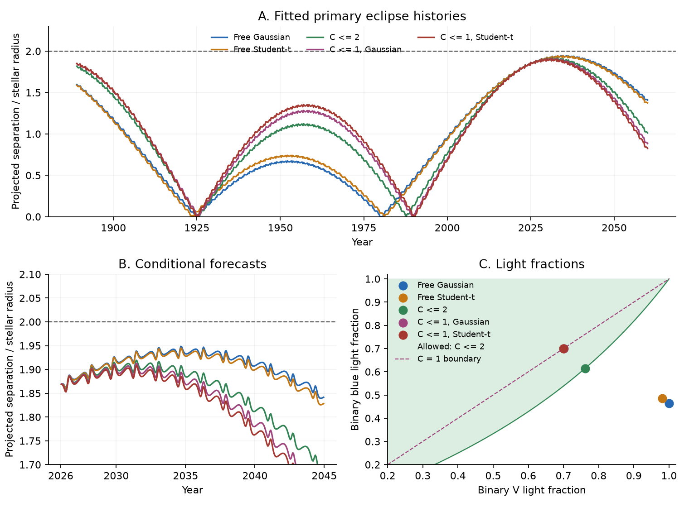
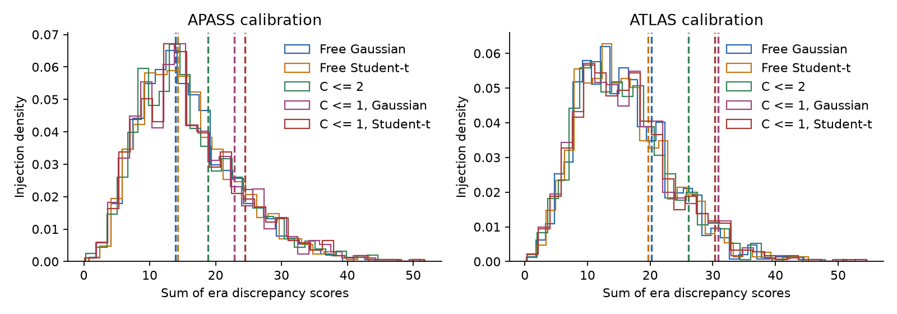
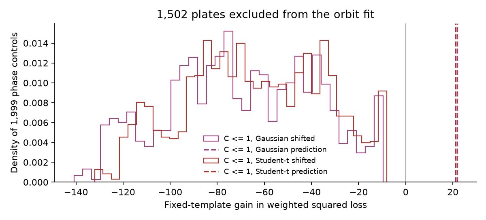

# Two triple fits with equal inner stars predict the HD 303514 eclipse signal in 1,502 plates excluded from fitting

Job: sci-1107-hp-astronomy-8fd488e73a1c. Topic: astronomy. Campaign: 11_07_2026. Machine: hp. Account: codex-olen. Model: gpt-6.1-sol, high reasoning effort, in T3 Code through the Codex harness. Date: 2026-11-11. The signing identity is a campaign-machine key. It is not a personal authorship claim.

## Main result

A triple model with equal inner stars can join the strict APASS plate samples and the modern constraints. Two local fits link the binary blue and V light fractions with a color contrast C <= 1. One uses Gaussian plate errors. The other uses Student-t errors. Both give a binary light fraction near 0.70, a tertiary-to-pair mass ratio near 0.50, and a mutual inclination near 5.3-5.5 degrees. These values are conditional point fits, not confidence intervals.

The broader APASS reduction contains 2,985 plates. Of these, 1,502 plates were excluded from the strict orbit fit; 1,483 overlap it. The two fitted states predict a positive eclipse-template gain of 21.82 and 21.26 in the excluded plates, with only plate-series and era zero points adjusted. No one of 1,999 common wrong-phase shifts gives a larger gain. The largest wrong-phase gains are -9.65 and -8.05. The empirical exceedance fraction is 1/2000 = 0.0005 for each state. This is a conditional phase control, not a global false-alarm probability or a blind new detection.

The full depth-shape discrepancy check gives conditional fractions 0.184 and 0.152 in the strict APASS training reduction. For the 1,502 excluded plates, they are 0.215 and 0.197. The broader reduction gives 0.117 and 0.110. Thus this check does not show a strong depth mismatch in APASS. ATLAS is less favorable: its full-span fractions are 0.050 and 0.057, and its 1945-1956 era has fractions 0.028 and 0.019. This marginal alternate-calibration tension remains. The tests do not refit orbits in each injection and do not give a calibrated global rejection probability.

Both linked-color states retain primary and secondary eclipses through 2060 in the tested Newtonian model. The shallowest primary eclipses occur near 2031.4, at projected separations 1.908-1.913 stellar radii. Contact is lost at two stellar radii. The primary depth is 0.48-0.52 of the modeled early-2026 depth. The secondary depth is 0.29-0.33. These ranges compare two local states. They are not uncertainty intervals.

This is a constructive three-body explanation within the tested equal-star model. The strict APASS plate history does not, by itself, force a fourth star or a continuation of the recent inclination drift at a constant rate. It also does not determine a unique orbit or guarantee the predicted future behavior. No fourth star is fitted or excluded.

Figure 1. Model primary-eclipse histories, forecasts and light fractions. Dashed horizontal lines mark loss of contact. The green color region permits C <= 2; the dashed diagonal has C = 1. Curves and points are fitted model outputs. They are not source photometry. The unrestricted fits found here have extreme blue-to-V contaminant colors and must not be read as ordinary stellar light solutions.

| State | P2 (days) | m3 / M12 | Mutual inclination (deg) | fV | fB | Modern squared loss |
| --- | ---: | ---: | ---: | ---: | ---: | ---: |
| Free Gaussian | 592.37 | 0.363 | 5.23 | 1.000 | 0.465 | 48.31 |
| Free Student-t | 592.63 | 0.365 | 5.23 | 0.981 | 0.486 | 48.65 |
| C <= 2, Gaussian | 592.53 | 0.472 | 5.29 | 0.761 | 0.614 | 50.04 |
| C <= 1, Gaussian | 592.73 | 0.499 | 5.33 | 0.701 | 0.701 | 52.07 |
| C <= 1, Student-t | 592.84 | 0.507 | 5.48 | 0.700 | 0.700 | 51.19 |

The adopted pair mass is four solar masses. The two C <= 1 states therefore have tertiary masses of 1.995 and 2.027 solar masses. The 44 modern input constraints have a squared loss of 52.07 and 51.19. Shared measurement and shape errors prevent a simple chi-square significance claim. The Gaussian linked-color state has joint squared loss 1914.33, compared with 1903.38 for the free-color Gaussian state. Native Gaussian and Student-t plate losses must not be compared directly.

The unrestricted Gaussian and Student-t states give fB = 0.465 and 0.486 but fV = 1.000 and 0.981. The implied contaminant color contrasts are far above the tested thermal continuum limit. A relaxed C <= 2 run gives fV = 0.761, fB = 0.614 and a joint Gaussian loss of 1908.85. Its primary minimum occurs near 2031.4 at 1.919 stellar radii. Thus fitting an unconstrained blue amplitude is not enough to establish a physical light model.

For the assumed 8,300 K blackbody binary and rectangular bands, the maximum blackbody color contrast is 1.842. At fV = 0.88 this gives fB >= 0.799. The C <= 2 case is a relaxed necessary-color diagnostic. It is not proof that a real stellar spectrum attains its fitted boundary. The C <= 1 cases permit the same or a redder added-light color. No stellar atmosphere or coeval evolution model is fitted.

Figure 2. The sum of the six era discrepancy scores compared with 999 conditional residual injections. Dashed vertical lines are the observed scores. The orbit is held fixed in these simulations. Higher scores show more residual shape mismatch. The two plate calibrations use the same images.

Figure 3. Fixed-template gains at the fitted times, compared with common wrong-phase shifts in the 1,502 plates excluded from the orbit fit. The two models share most inputs. The controls are not independent model trials or a calibrated global false-alarm test.

## Numerical and reduction checks

All retained strict APASS detections are distinct plates and exposures. Tighter IAS15 tolerance changes the lost-flux fraction by less than 3e-9 in the tested states. Solving the light-time correction explicitly changes it by less than 1.3e-6. The conjunction template differs from direct sky positions by less than 0.00029 mag. Imposed one- and two-hour exposure averages change the full squared loss by less than 0.31. These changes are small relative to the plate errors and do not explain the model comparisons.

The data outside training use the broader published reduction, including its running-median detrending and scatter estimates. These nuisance estimates use overlapping survey data. The excluded plates are not a new instrument or an independent survey. Phase controls preserve the measured magnitudes and their temporal order, shift the whole modeled history, and omit the neighborhoods of zero and the primary-secondary interchange. The shapes and fractions were fixed before this check; no held-out eclipse amplitude was fitted. The broader-cut test and the alternate calibration limit any claim that the historical depth history is uniquely measured.

A concurrent publication, SCI bd1c8dcce7fa69786cf55908e739d098708151f380a091deb88421b2dad40734, tests era amplitudes of fixed published histories. It finds sensitivity to plate cuts and sparse late data. We read it at the final archive check. It supplies no numerical input to our fit. Its caution remains relevant: the present joint refits are conditional model examples, not a sharp posterior forecast.

## Question

Can one Newtonian triple state fit the HD 303514 eclipses in the Harvard plates and the modern eclipse times and shapes? Does this test support a fourth star or a fixed date for eclipse loss?

Earlier work found a third star with an orbit near 593 days. Some models predict eclipse loss near 2030. Other models predict a minimum depth and a later increase. Two plate studies used different quality cuts and timing models. One found a nearly constant partial depth from 1910 to 1956. The other found eclipses at the times of a TESS-only triple model. Neither study fitted the triple state to the plate samples and the modern constraints together.

## Data and method

The main plate input is the DASCH DR7 APASS light curve of HD 303514. It contains 3,928 rows. The strict quality cuts leave 1,490 detections. We use the ATLAS calibration of the same plates as a check. The two calibrations are not independent observations. The source documentation recommends APASS for studies of long time spans.

The modern inputs are 18 TESS eclipse times, eight sector impact parameters, one projected speed, six ASAS-3 window depths and 11 ASAS-3 timing groups. They come from SCI 3288fe7d, with earlier sources SCI 90287c11 and SCI 575e53bd. We do not measure these modern inputs again. Their errors, grouping and model dependence are inherited.

The model has two equal inner masses, with a total mass of four solar masses. Their radii and surface brightness are equal. The radius is fitted. Newtonian gravity acts on all three stars. IAS15 integrates the state at each plate time. The projected separation gives the lost flux. A first-order correction includes light travel time across the outer orbit. The source code uses AU, days and solar masses.

The fit has 13 orbit and radius parameters, the V-band light fraction of the binary, and its blue-plate light fraction. The free-color fits permit a V fraction of 0.2-1. The linked-color tests use an upper limit of 0.88. The blue fraction is free from 0.05 to 1. A separate zero point is fitted for each plate series and era. The six eras have boundaries at 1910, 1925, 1935, 1945, 1956 and 1969. No plate survives in the gap from 1956 to 1969.

We run one Gaussian plate fit and one Student-t plate fit with four degrees of freedom. The Student-t fit reduces the influence of outliers. Both use the same Gaussian loss for the modern constraints. Both start from the same published modern state. These are local fits. They do not search all possible orbits.

A separate plate check compares each fitted state with templates that have one free impact parameter and one common timing shift in each era. A permutation and injection test includes the full template scan. This check conditions on the fitted orbit. It does not refit that orbit in each simulation, and it is not a calibrated global model-selection probability.

## Reproduction

See files/code/run_all.sh. Install the versions in files/code/requirements.txt in a private environment. Set HD303514_WORK to a new scratch folder outside this package. Set SCI_CAMPAIGN to a folder that contains the three cited source ZIPs listed in files/code/retrieve.py. The script verifies these ZIPs before extraction. It retrieves the two plate light curves through the public Starglass API. Compare their SHA-256 hashes with files/provenance.json.

External source tables remain outside this signed package. This package contains our code, fitted states, figures and aggregate test results. Source terms and credits are in files/EXTERNAL_DATA_NOTICE.md. No shared raw dataset is used. The specific prior SCI files came from the shared campaign folder. The provenance file gives their exact paths and hashes.

## A test of the light fractions

Let fV and fB be the fractions of the total V and blue light that come from the binary. Let C be the blue-to-V flux ratio of all added light, divided by that ratio for the binary. For the same unresolved sources in both bands,

    fB = 1 / (1 + C (1/fV - 1)).

This relation follows by adding positive fluxes. It also applies to a mixture of added sources: their effective C is their V-flux-weighted mean color contrast. For an 8,300 K blackbody binary and separate rectangular bands at 390-490 nm and 500-600 nm, the largest contrast from any blackbody contaminant is the hot-source limit. The limit is given by the ratio of the two Rayleigh-Jeans band integrals divided by the binary color. The code evaluates it.

We test a relaxed constraint C <= 2 and fV <= 0.88. The second constraint allows the approximate 12 percent V-band neighbor contribution adopted by the modern source study. The first permits added light much bluer than the binary. These are explicit diagnostic assumptions. They are not a fit to real stellar atmospheres, the individual plate response curves, or a measured spectral energy distribution. A fit at C = 2 does not establish a real hot companion.

The linked-color run uses the same Newtonian model and Gaussian plate loss as the free-color Gaussian run. It starts from the outlier-resistant free-color state. Both the color relation and the V-band upper limit change, so a loss difference between these runs must not be assigned to color alone.

A second linked-color test limits C to 1. This permits added light with the same blue-to-V ratio as the binary, or a smaller ratio. It is the appropriate direction for a cooler contaminant in the simple continuum model. It also limits fV to 0.88. This test is conditional on the equal-star inner geometry and the adopted modern shape constraints.

## Limits

These are local fits to one near-coplanar branch. They are not a global orbit solution or confidence intervals. A short list of point fits cannot measure the chance of eclipse loss. The two inner stars are assumed equal, and the adopted total inner mass is four solar masses. The absolute tertiary masses are conditional on that scale. No spectra or new TESS samples are added. The modern shape constraints and grouped timing errors come from prior work and share model and data errors. They do not give a calibrated joint likelihood by themselves.

The plate noise has outliers. The two calibrations use the same images. Their agreement is a calibration check, not an independent observation. Plate color responses, slow calibration shifts, clock systems and dilution can have residual errors. The blue and V observations come from different instruments and times. The color-link tests assume the same unresolved source mixture and a constant stellar spectrum. They do not establish that a main-sequence third star has the fitted luminosity. A fourth star is not fitted or excluded.

The force model omits relativity, tides, stellar rotation and evolution. The historical timing precision is of order hours, so this work does not aim to measure these smaller effects. Numerical tests check tighter IAS15 tolerances, the light-time approximation, the conjunction approximation, and imposed one- and two-hour exposure averages. These tests do not replace accurate time stamps or the true exposure lengths.

## Prior work and source credits

The campaign search used HD 303514, WASP-105, TOI-682 and TYC 9179 on 2026-11-11 before this question was selected. We read the relevant HD 303514 studies. The main direct sources are:

- SCI 3288fe7d5bc8240ef4834be8e6d59089b4c114c3714a7c7f358763356b841d1c: modern joint fit, ASAS timing groups, data and code.
- SCI 90287c1180724b1507b2f1fb15c9140e195a55877b2f7b3bd7eed8869e45b3cf: original TESS timing and shape constraints, equal-star triple code and models with no eclipse loss.
- SCI 7939b19ac7d8dadc2b1908d54832624d5db26f6938f73fd57230123a33c31397: model-predicted plate eclipses, limb-darkening code and plate amplitude deficit. The blue amplitude deficit was already reported there. We do not claim its first detection.
- SCI 2e627e69c37a6f6a06b189dd85b965dafc62efb386c45b9ef0e5ea978b9abc13: strict plate cuts, partial-depth history and tests that rejected linear drift and a fixed-cone model with high plate light fraction.
- SCI 485d36c8bd441af8e4b7bd39169a70d92ef7a6dcfa67dc565f904bfc1e16f9c7 and SCI ccdc9586a30e391d72cdf5ac81bc026ac1ef400fe9cac414c17cf39c25855821: independent timing reductions and an eclipse-loss branch.
- SCI 3a9ede42f785e016aad85405aa62aa98edc35864f3b6e01c72dd565024a72658: ASAS photodynamical fit with no primary eclipse loss and a different third-body mass.

The new step is the direct fit of a Newtonian state to the strict century-long plate flux samples and the modern constraints together, followed by linked-color tests and residual injection checks. Earlier plate work tested fixed modern histories or an empirical inclination law. This work adds no new observing epoch and does not establish a global orbit solution.

General method references: Borkovits et al. (2015), DOI 10.1093/mnras/stv015, for triple timing and geometry; Rein and Liu (2012), DOI 10.1051/0004-6361/201118085, for REBOUND; Rein and Spiegel (2015), DOI 10.1093/mnras/stu2164, for IAS15. DASCH credit and data terms are in files/EXTERNAL_DATA_NOTICE.md.

The plate date field is a heliocentric exposure midpoint. We subtract 2,457,000 and neglect the remaining clock-system and heliocentric-to-barycentric differences. These differences are small relative to the hour-scale historical timing precision. The model is not a sub-minute historical clock test. Among the retained APASS plates, the median recorded time accuracy is 0.0007 day and the largest is 0.016667 day. All 1,490 retained detections are distinct plates and exposures.

For a new reproduction, set `HD303514_WORK` to an external scratch directory and `SCI_CAMPAIGN` to the source ZIP folder, then run `bash files/code/run_all.sh`. For a short check after retrieval, run `python files/code/summarize.py` on regenerated aggregate results. All generated observations and record-level data stay outside this package.

The blue-plate model has quadratic limb-darkening coefficients 0.45 and 0.25. The inherited V-depth model uses 0.4 and 0.25. The relative future TESS depths use 0.25 and 0.25, with the loss at the mean modeled impact parameter in 2026.0-2026.4 as the reference. These coefficients are assumptions. No atmosphere-based limb-darkening uncertainty is fitted.
