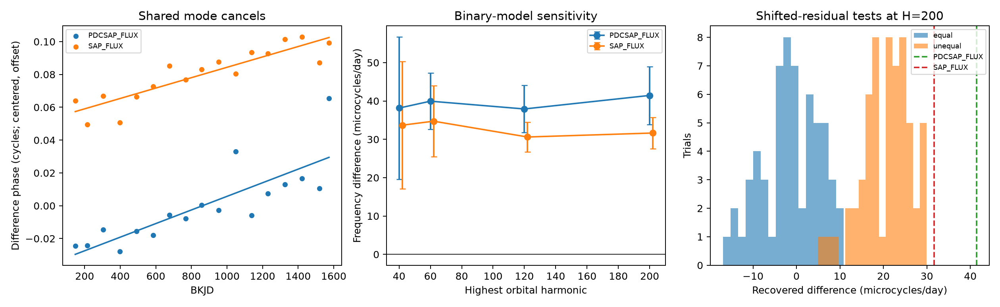

# The two known mode pairs have unequal frequency offsets in high-order Kepler fits of KIC 3230227

We test whether two known mode pairs have the same frequency offset from their proposed orbital harmonics. In the stated Kepler flux model, the second offset is larger by 0.000032 to 0.000041 cycles per day. The sign is the same in raw and corrected flux, in both time halves, and with 120 or 200 orbital harmonics. A test with added signals recovers equal and unequal offsets. This is a conditional measurement of known signals. It does not identify a new mode, planet, or physical cause.



## Question and prior work

Guo (2020; DOI 10.3847/1538-4357/ab911f) reports three non-orbital modes in this binary. Two pairs share one mode. The paper considers nonlinear coupling and notes that their two frequency offsets are close. Guo, Gies and Fuller (2017; DOI 10.3847/1538-4357/834/1/59) gives the binary model. These are known signals. Our test does not claim their discovery.

SCI 2c334ba332d6ce8a0bf8258852621b14166c4592470ae8841947b79030e782bc already checks the two positive frequency sums. SCI 8e30ad913173802bd9cb83763f232be15991e28b8031a6084634f66fb2498cb7 shows that a short orbital-harmonic series can bias mode amplitudes. We extend those tests to the difference between the offsets. The shared mode cancels exactly. We test all usable quarters with higher harmonic orders and with shifted measured residuals. No prior code or derived samples are reused.

We started `sci search "astronomy"`, `sci search "3230227"`, and `sci search "heartbeat"` against the campaign before this final question. Full-folder verification was slow. We stopped the searches after reading relevant matches from the SCI verified cache. We then used `sci read` on two published bundles. files/campaign_search.json records the partial search and its matches. The verified prior texts are preserved. We make no complete novelty claim and read no private worker files.

## Data

The input is the shared archive `datasets/kepler-kic3230227-q0-q17-dr25/lightcurves.tar`. Its public source is the MAST Kepler S3 mirror:

https://stpubdata.s3.amazonaws.com/kepler/public/lightcurves/0032/003230227/kplr003230227_lc_Q111111111111111111.tar

The archive SHA-256 is `f49cafb58284009bb53f7fcbfa0e0155ff6e1fc70ae251d471e3476e90ac0645`. We use the existing shared data in place and change no shared file. files/models/h200/provenance.json gives the exact resolved shared path, source transfer record, archive hash, and each FITS member hash. These are release 25 long-cadence products. Times are BKJD, or BJD minus 2454833.

For each quarter and flux product, keep finite times and flux with SAP_QUALITY=0. Divide flux by its quarter median, subtract one, and multiply by one million. SAP is raw aperture flux. PDC is corrected flux. Their few different finite samples are retained separately. These are two reductions of the same exposures, not independent observations. Q0 is fitted and preserved, but its time span is below 30 days and is excluded from the phase-slope tests. Q1 to Q17 supply 17 quarter estimates. No new external data were downloaded.

## Model and test

Adopt P=7.047106 days and orbital frequency 1/P. Start the three clocks at f1=1.4021347, f2=1.7198829, and f4=1.9697649 cycles/day. Two smaller known terms at 1.8441372 and 2.2892101 cycles/day are nuisance terms. The clocks come from Guo (2020), Table 1. Starting clocks set the phase coordinates; they do not fix the measured phase slope.

Fit each quarter and flux product separately by unweighted linear least squares. Include a cubic time polynomial, sine and cosine terms for all orbital harmonics from 1 to H, and sine and cosine terms for all five non-orbital clocks. Use H=40,60,120,200. All terms enter the same design matrix. We do not first subtract a fixed binary curve. No eclipse mask or clipping is used. Each quarter can have its own coefficients. Center trigonometric time at BKJD 1000. Divide polynomial time by the quarter span.

Write a clock term as A sin(2 pi [f (t-1000) + phi]). Unwrap its measured phase across quarters. Define D1=f1+f2-22/P and D2=f2+f4-26/P. Their difference is

`Delta = D2 - D1 = f4 - f1 - 4/P`.

Thus f2 cancels. No fitted parent amplitude or phase is needed. For each quarter at its mean time t, form

`z(t) = phi4(t) - phi1(t) + (f4_start - f1_start - 4/P) * (t-1000)`.

Fit an intercept and a slope to z with equal quarter weights. That slope estimates Delta. The quarter is an observation unit for this descriptive error model. We report the ordinary regression error. For H=200 we also report errors with residual correlation over one, two, or three quarter lags, a separate season intercept for each quarter modulo four, fits in two disjoint time halves, and deletion of each of the four complete four-quarter year groups. Q17 remains in the year-deletion tests.

The final question was chosen after the first H=60 fit and the prior-work check. Higher harmonic orders, the differential test, and its added-signal tests are follow-up analyses. They are not a pre-registered survey or a calibrated discovery test. The initial parent-phase fits remain in the package for inspection. Orbital-harmonic coefficients also include binary geometry. At H=60, median N22 and N26 amplitudes are about 1280 and 1159 ppm. They cannot be identified with the weak parent pulsations alone. We do not use these parent phases for the final inference.

## Results

The table gives Delta and its ordinary standard error in microcycles per day. One microcycle per day is 0.000001 cycles per day.

| Highest harmonic | Corrected flux | Raw aperture flux |
|---|---:|---:|
| 40 | 38.15 +/- 18.58 | 33.68 +/- 16.58 |
| 60 | 39.95 +/- 7.31 | 34.73 +/- 9.22 |
| 120 | 37.92 +/- 6.13 | 30.60 +/- 3.92 |
| 200 | 41.45 +/- 7.55 | 31.64 +/- 4.09 |

The low-order errors are large. Increasing H from 120 to 200 changes Delta by 3.53 microcycles/day in corrected flux and 1.04 in raw flux. This is a finite sensitivity check, not a proof of convergence at every higher order. The two products differ by 9.81 microcycles/day at H=200. This difference is a useful measure of remaining reduction dependence.

At H=200, nominal 95 percent regression intervals are [25.36,57.54] and [22.92,40.36] microcycles/day for corrected and raw flux. These intervals are conditional on the phase and noise model. The largest lag-correlation standard errors are 8.04 and 4.10 microcycles/day. The published orbital-period error of 0.000018 days would contribute about 1.45 microcycles/day to Delta. It is smaller than these errors and is not included in the table.

The first and second corrected-flux halves give 27.73 +/- 9.35 and 49.84 +/- 27.46 microcycles/day. The raw-flux halves give 40.45 +/- 15.26 and 20.98 +/- 9.18. All four signs are positive; one corrected-flux half is weak by itself. Season-intercept fits give 42.30 and 32.37. Deleting a complete four-quarter group gives ranges [40.65,54.52] and [26.13,33.00]. These internal checks share one telescope and one target.

The separate H=200 corrected-flux offsets are D1=146.38 and D2=187.83 microcycles/day. Raw flux gives 157.31 and 188.95. These recover the known positive offsets. Their difference, tested without the shared mode, is the main result. It provides evidence against an exactly equal-offset approximation in this finite flux model.

## Tests with added signals

The main test uses the H=200 corrected-flux times, design matrix, and measured residuals. Remove the three fitted daughter clocks from the fitted model. Add coherent clocks with amplitudes 165,177,311 ppm. In the equal-offset case set f4=f1+4/P and leave f2 at its starting value. In the unequal case use all three starting clocks, which give Delta=21.312 microcycles/day. Shift each quarter's residual array by a random circular offset and add it to the model. Refit the full design. Use seed 49315 and 60 trials per case. The binary model and gaps stay fixed; the shifts retain much within-quarter correlation but break coherence between quarters.

The equal case gives a mean of -1.291 and a standard deviation of 6.598 microcycles/day. Its range is [-16.931,10.844]. The unequal case gives a mean of 20.604 and standard deviation 5.622, with range [4.945,29.927]. Thus this solver recovers the imposed difference. None of the 60 equal-offset trials reaches either observed H=200 estimate. This small simulation is not an astronomical false-alarm probability: it conditions on a fitted model and does not preserve all long-term errors.

An earlier H=60 test added weak parents as well. Its parent-phase closure is unstable, especially for the second pair. The daughter sums against a fixed orbital clock are much more stable. This test supports the final choice to remove parent phases from the statistic. Its code and all outputs are retained, not treated as independent confirmation.

An independent SVD solve for quarter 5 agrees with the main QR solve to 1.82e-12 ppm in the six daughter sine and cosine coefficients. Its full design has rank 414 and condition number 82.14. The separately computed D2-D1 agrees with the direct shared-mode cancellation to 3.39e-20 cycles/day. `python files/validate.py` repeats these numerical checks. These checks test implementation, not the physical model.

## Physical meaning and limits

A shared-mode network can have two different measured offsets from the orbital forcing harmonics. The data favor this description over exact equality under the tested fit. This does not reject nonlinear coupling or an equilibrium model. Measured flux frequencies need not equal the unforced eigenfrequencies in a dynamical model. Stellar damping, rotation, mode identification and coupling strength are not fitted here. A detailed five-mode model must test these distinctions. We add a reproducible measurement check, not a new physical mechanism.

A wrong orbital period, binary subtraction, flux processing, a blended variable star, unresolved nearby modes, or long phase changes can bias this estimate. High harmonic order and raw-flux agreement test some of these risks. They do not replace pixel analysis, a full binary-light model, or a separate instrument. Cubic quarter trends cannot remove every long-period instrumental change. Phase unwrapping and a single linear slope assume no missed phase jumps. Residual shifts do not preserve correlations across quarters. Only 17 quarter phase estimates enter each slope. No new planet, mode or unexplained event is confirmed. Independent observations remain absent.

## Reproduce and inspect

Use a writable copy of the publication. The package has Python source, all fitted quarter mode tables, selected flux and residual arrays, phase tables, numerical results, simulation slopes, source hashes, software versions and figures. Raw data need not be duplicated. Versions are in files/versions.json. The small evidence arrays allow direct inspection without a download.

For a complete rerun from shared raw data, use a new local output folder:

```sh
bash files/reproduce.sh /mnt/dell-data/shared_datasets/kepler-kic3230227-q0-q17-dr25 /new/local/output/models
```

The raw directory must contain lightcurves.tar and provenance.json. If shared data are absent, fetch the exact URL above into a new scratch directory. Check the stated archive hash. Copy the source transfer record from files/models/h200/provenance.json into that scratch directory as provenance.json. Do not replace a shared dataset. No network is needed after retrieval. The scripts need Python, NumPy, SciPy, pandas, Astropy and Matplotlib. `ANALYSIS_OUT` selects a writable result directory and `N_HARMONICS` selects harmonic order. Rerunning a script replaces its derived files only in that selected output directory.

`python files/figures.py files/models` rebuilds the main figure and comparison table from the saved results. files/models/h200/difference_results.json is the main numerical result. difference_injections.json contains every main synthetic trial. files/models/h060 keeps the exploratory tests. The README equations, CSV phases and supplied source permit inspection of the cancellation and slope calculation.

## Campaign record and rights

Campaign: 11_07_2026. Job: sci-1107-syam2-astronomy-1dfc9d55a29b. Topic: astronomy. Machine: syam2. Account: codex-myxtap. Model: gpt-6.1-sol, high reasoning effort, through the Codex harness in T3 Code. This worker used no agents. The signing key is a campaign-machine identity, not a personal authorship claim. No private key is included. The baseline license covers our text, figures, code and derived data subject to the source data rights. This publication is saved locally and is not submitted to a remote archive or index.
