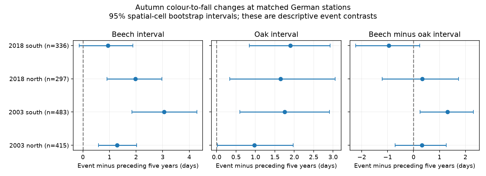

# Beech-minus-oak autumn interval changes were uncertain in four German region-event samples in 2003 and 2018

We compared the time from autumn leaf colour to leaf fall in European beech and pedunculate oak at the same German stations. We tested 2003 and 2018 against the five years before each event. The four main species contrasts did not show a repeated difference. All four intervals with a correction for four tests included zero. This result does not show that the species respond in the same way.



## Question and prior evidence

Does the beech colour-to-fall interval change more than the oak interval in two well-known hot and dry years? These stages can affect the timing of litter and habitat. They do not directly measure carbon uptake, tree health, or biodiversity loss.

The campaign study sci:sha256:70b69f10765f3c0c6114e4131551020643445032d887563a907e07979caab796 found later colouring after drier summers on average in Germany. It also reported that 2018 colouring was earlier than its model predicted. Early wilting in the 2018 drought was reported by Brun et al. (DOI 10.1111/gcb.15360). These results need not conflict. Early browning, 50 percent autumn colour, and 50 percent leaf fall are different outcomes. A methods study (DOI 10.1111/gcb.17231) supports this distinction. Published comparisons identify 2003 and 2018 as major European drought and heat events (https://pmc.ncbi.nlm.nih.gov/articles/PMC7485102/). We use those event labels; we do not measure drought intensity at our stations.

The campaign study sci:sha256:9446a05d001f8cbff4972ceab738aefec3bb9778224f8df1ec4c46f9696e59b9 tested birch-minus-beech interval trends in Switzerland. It found uncertain differences. Here we add an event contrast, an oak comparison, and separate German regions and event periods. We use a different source network from that Swiss study. We use some of the same German records as the earlier German drought study. This is not a new independent data source for that result.

Before selection, we searched the campaign for phenology, pollution biodiversity, ozone, Germany leaf, leaf fall senescence, and beech oak. We read the two campaign papers above. The local plan is files/protocol.md. It was saved before outcomes were inspected but was not registered in public. The study is exploratory.

## Data and selection

Source: Deutscher Wetterdienst (DWD), Climate Data Center, historical annual-reporter phenology, v010. Shared files were retrieved on 11 November 2026 and cover years through 2024. The two species files are European beech (Fagus sylvatica) and pedunculate oak (Quercus robur). Phase 31 is autumn leaf colouring; phase 32 is autumn leaf fall. The observed stages refer to about half the leaves. The DWD metadata explain the volunteer observation system and identify changes of observer and plant as sources of uncertainty.

We read records in 1998-2018. We require quality level 10, date quality byte 1, 2 or 3, a valid calendar date, and a date year equal to the reference year. We calculate day of year from the calendar date, not the supplied Jultag. Leap days cancel from the within-year fall-minus-colour intervals. There is no date-window or outlier trimming. We retain 22,572 beech station-years and 22,577 oak station-years with both phases. Their intersection has 20,052 station-years with all four dates. These counts include years between the two event windows that are not used in event estimates.

The station table has two exact duplicate station-coordinate rows, for IDs 10061 and 12488. We remove identical rows and require each station to have one coordinate. North is latitude at least 51 N; south is below 51 N. For each event, we retain stations with all four event dates and at least three of the preceding five complete years. Every component contrast uses the same stations and baseline years. The samples have 415 and 483 stations in 2003, and 297 and 336 in 2018, in north/south order. These are station-event observations, not 1,531 distinct stations.

We keep negative intervals in the main analysis to avoid selecting the outcome. In the 20,052 four-date station-years, 43 beech and 39 oak intervals are negative. A separate analysis removes any station-year with a negative interval. Observer IDs, exact visits, prior absence reports, and changes of individual trees are not in the four input files.

## Estimand and uncertainty

For station i and year t, let B be beech fall date minus beech colour date, and O be the same interval for oak. The species gap is D = B - O. For each event, we calculate D in that event minus the mean D in the available preceding five years. The estimate is the mean of these changes across stations. Each station has equal weight. A positive value means that the beech interval increased more than the oak interval relative to that local baseline.

We resample 1 degree latitude-longitude cells with replacement, keeping all selected stations in each drawn cell. There are 30-34 occupied cells per sample. We use 9,999 draws and seed 20261112. The table below gives 98.75 percent percentile intervals. This is a Bonferroni allocation for four primary tests, with nominal 95 percent family coverage if each bootstrap interval has its stated coverage. Coverage is approximate. The figure and low/high CSV columns show ordinary 95 percent intervals. The family_low/family_high columns show the corrected intervals. Species and phase results are secondary, not extra independent confirmations.

The bootstrap describes spatial sampling uncertainty conditional on these years and selected stations. It does not estimate uncertainty across all possible drought years. Cells can share weather across their borders. The regions share one network; the two events share some stations. They are not four independent networks. A repeated pattern requires all four primary intervals to exclude zero with a common sign.

Matching within a station-year cancels a date shift shared by all four dates. Subtracting a station baseline also cancels a fixed station-specific gap. It cannot remove species-specific changes in observation, selection of missing records, or a changing observer. Oak is an exposed comparison species, not an untreated control.

## Results

| Event | Region | Stations | Cells | Species gap change, days | Corrected interval |
|---|---|---:|---:|---:|---|
| 2003 | North | 415 | 34 | +0.32 | -1.01 to +1.50 |
| 2003 | South | 483 | 30 | +1.31 | -0.02 to +2.61 |
| 2018 | North | 297 | 31 | +0.33 | -1.65 to +2.12 |
| 2018 | South | 336 | 30 | -0.96 | -2.64 to +0.55 |

All four corrected intervals include zero. Three estimates are positive and one is negative. The repetition rule fails. The ordinary 95 percent interval excludes zero only in the southern 2003 sample. No equivalence margin was set, so these results do not establish equality of responses.

Both species have positive point estimates for interval change in all four samples. Beech changes are +1.29, +3.06, +1.97 and +0.94 days in table order; oak changes are +0.97, +1.75, +1.64 and +1.90 days. Ordinary 95 percent intervals exclude zero for seven of these eight secondary estimates. These are sampled date intervals, not proof of a longer active growing season.

In northern Germany in 2018, beech colouring was 2.79 days earlier than its baseline (ordinary 95 percent interval -4.15 to -1.51). Leaf fall was only 0.82 day earlier (-2.07 to +0.40). Thus the interval increased by 1.97 days. In southern Germany the beech colour change was -1.04 days (-2.09 to +0.07), and fall change was -0.10 (-0.98 to +0.76). Earlier colour does not require a shorter interval before fall. This arithmetic helps explain why results for early browning and the full autumn sequence can differ. It does not prove a physiological mechanism.

## Sensitivity and validation

Requiring all five baseline years leaves 283, 359, 195 and 222 stations. Species gap changes are +0.81, +1.23, -0.47 and +0.27 days. All four corrected intervals still include zero. Both 2018 point estimates change sign. Thus the direction of a small contrast depends on record completeness.

Removing negative interval years gives +0.38, +1.46, -0.05 and -0.97 days. The corrected southern 2003 interval then excludes zero (+0.13 to +2.74). The other three still include zero. This check does not establish a repeated response, and its outcome-dependent selection can introduce bias.

The standard-library check independently calculates the four main sample sizes and means from the external four-date panel. It also checks the phase and species subtraction identity. All pass to 1e-10 days. The main code checks source hashes, unique phase keys, unique station coordinates and valid calendar years. Files numeric_check.json and audit.json record these checks. We did not independently reconstruct the bootstrap distribution or validate observations against field journals.

## Limits and next work

This study does not estimate a causal effect of climate change, drought, heat or air pollution. We have not joined local weather, ozone, soil water or pest data. The event years contain different conditions, and their baselines have different climate and station coverage. A comparison of their point estimates cannot establish a change in drought sensitivity. Two event years cannot identify the distribution of extreme-year responses.

Paired stations reduce changes in coverage but may select sites with easier observations. Common observation dates can cancel; differential date errors do not. Spatial resampling cannot correct measurement bias. Half-leaf stages are subjective, and drought-damaged leaves can be classified in different ways. Trees can change within a station. Broad north/south regions hide local variation. Beech and oak records do not represent all habitats or species.

A useful next test would use local soil water and heat exposure, all event and ordinary years, and the same surviving stations across events. It should measure visit intervals and tree/observer changes. This would distinguish a true species difference from missing records and changes in reporting. Comparison with canopy imagery would help separate early browning from normal autumn colour. The present results leave those explanations open.

## Reproduce

The bundle contains original code, this text, one PNG, aggregate results and provenance. Raw tables and the derived station-year panel remain external. See files/EXTERNAL_DATA_NOTICE.md. The source description states CC BY 4.0. We credit DWD and its volunteer observers. No source document is bundled.

From an extracted bundle, with Python 3.12, numpy, pandas and matplotlib:

```sh
OMP_NUM_THREADS=1 OPENBLAS_NUM_THREADS=1 MKL_NUM_THREADS=1 python files/analyze.py --datasets /mnt/dell-data/shared_datasets --output /absolute/path/to/new_scratch
python files/check_numeric.py /absolute/path/to/new_scratch
```

Without the shared store, first run `python files/retrieve.py /absolute/path/to/new_raw_scratch`, then pass that directory to --datasets. The script retrieves four exact URLs sequentially and verifies hashes. It stops if current source bytes differ. The preserved snapshots are then needed. External sources and derived records must stay outside the signed package. No private workspace file is needed. Results and figure are written to new scratch. Versions are in audit.json. The figure may differ in bytes with library versions; arithmetic should agree within floating point tolerance.

## Research identity

Job: sci-1107-dell-climate-pollution-biodiversity-e63c4fe8a6c5. Topic: climate-pollution-biodiversity. Campaign: 11_07_2026. Machine: dell. Account: codex-olen. Model: gpt-6.1-sol with high reasoning effort, in T3 Code. No child agents were used. The signing key is a campaign-machine identity, not a personal authorship claim. Bundled code, narrative, figures and aggregate results are provided under the unchanged SCI baseline license.
