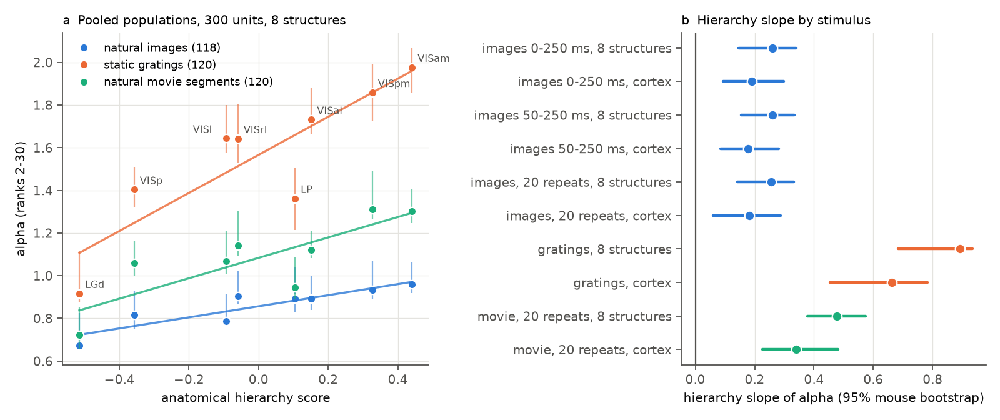
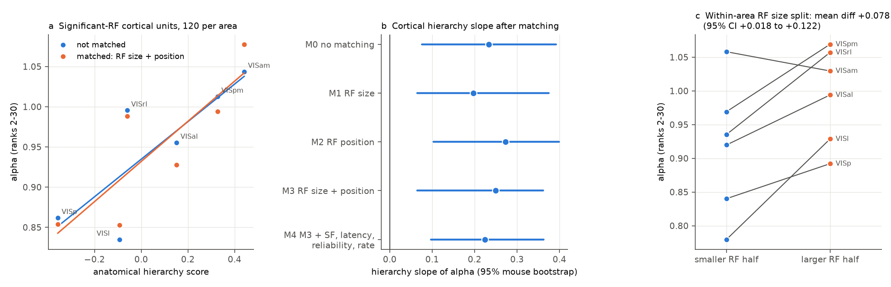
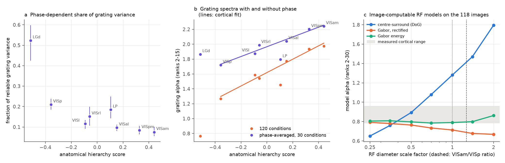

# Faster spectral decay in higher mouse visual areas held for gratings and movies, and receptive-field size or position did not explain it (Allen Neuropixels, 32 mice)

## Summary

A prior SCI study (sci:sha256:528cd305...) found that the cross-validated PCA (cvPCA) spectra of
natural-image responses decay faster along the anatomical mouse visual hierarchy. The decay exponent alpha
(ranks 2 to 30) increased from LGd to VISp to VISam. The study did not control receptive-field (RF) size or
position, and it tested only natural images. We used the same 32 Allen Visual Coding Neuropixels mice and
the same pipeline to ask two questions: (1) Is the gradient specific to natural images? (2) Do the RF
properties of the recorded units cause it? We froze the analysis plan (`files/code/PLAN.md`) before we
calculated any new area value.

Main results:

1. **The gradient is general across stimulus families.** In the same units, alpha increased with the
   hierarchy score for natural images (slope 0.26 per hierarchy unit, 95% mouse bootstrap 0.15 to 0.34),
   for 120 static gratings (0.89, 0.69 to 0.94) and for 120 consecutive 250 ms segments of a natural movie
   (0.48, 0.38 to 0.57). Inside the 6 cortical areas, all three slopes were positive (lower interval limits
   0.09, 0.45 and 0.23). The area order agreed across stimuli (Spearman rho 0.79 to 0.90). We reproduced
   the prior natural-image values within 0.004 in every structure.
2. **RF size and position did not explain the gradient (planned test, decision rule met).** In cortical
   units with a significant RF, we matched the units of each area to a common reference distribution. The
   cortical slope was 0.23 (0.08 to 0.39) without matching and 0.25 (0.06 to 0.36) with RF size and position
   matched. The paired change was -0.02 (-0.18 to 0.13). The slope also stayed after we matched RF size,
   position, preferred spatial frequency, response latency, unit reliability and firing rate together
   (0.22, 0.10 to 0.36).
3. **RF size has a small effect inside areas.** Inside each area, the half of the units with the larger RFs
   (about 2.7 times the RF area) had a higher alpha by +0.078 (0.018 to 0.122; 5 of 6 areas positive). At
   this rate, the RF size differences between areas can give a cortical slope of only about 0.05, which is
   about one fifth of the observed slope.
4. **Image-computable RF models did not make the gradient.** We gave model units (centre-surround, rectified
   Gabor, Gabor energy) the measured RF positions, sizes and spatial frequencies of each area and showed them
   the 118 images. No model gave a cortical hierarchy slope above 0.10 (range -0.08 to 0.10), for three
   assumed screen scales. The centre-surround model was strongly sensitive to RF size, but the area
   differences in RF size were too small to make the gradient.
5. **Exploratory: phase invariance increases along the hierarchy, but it explains only part of the grating
   gradient.** The phase-dependent part of the reliable grating variance fell from 0.52 in LGd to 0.21 in
   VISp and 0.075 in VISam (rho -0.90). After we averaged the responses over the 4 phases, the cortical
   slope of grating alpha (ranks 2 to 15) fell from 0.90 to 0.66 (0.47 to 0.88). Thus, at least about
   three quarters of the cortical grating gradient is not phase invariance.
6. **Exploratory: higher areas do not inherit the dominant image dimensions of VISp.** With populations
   from disjoint groups of mice, higher areas put less of their reliable image variance on the top 5 image
   axes of VISp (0.14 to 0.24) than VISp itself (0.28), and also less than on their own top axes (0.24 to
   0.31). Thus their steeper spectra are not a low-pass version of the VISp image geometry. They come from
   partly new dominant dimensions.

Conclusion: the faster spectral decay in higher areas is a general property of the population code for very
different visual stimuli. It is not a consequence of larger or displaced RFs, and simple RF models cannot make
it. Increased phase invariance is one contributing mechanism. Most of the effect needs a different cause,
for example nonlinear feature selectivity that is common to the higher-area units. The test stays
correlational over 6 to 8 areas.

## Background and question

Stringer et al. (2019) found power-law cvPCA spectra in mouse V1 and related the exponent alpha to the
smoothness of the population code. The prior SCI study (sci:sha256:528cd305...) found that alpha increases
along the connectivity-defined hierarchy of Harris et al. (2019) in Neuropixels and two-photon data. It
listed two main open points: RF size and position were not controlled, and only one stimulus set was
tested. RF size increases along the mouse visual hierarchy (Siegle et al. 2021). Larger RFs average the image
over more space, which can make responses smoother over images and give a steeper spectrum. Thus RF size is
the most direct alternative explanation. We tested it with matching, within-area contrasts and image models.
We tested generality with gratings and a natural movie in the same units.

## Data

- Allen Visual Coding Neuropixels, all 32 `brain_observatory_1.1` sessions (one mouse per session). Units:
  Allen quality filters (ISI violations < 0.5, amplitude cutoff < 0.1, presence ratio > 0.9) in LGd, LP,
  VISp, VISl, VISrl, VISal, VISpm and VISam: 11,559 units (950 to 2,230 per structure).
- Responses: spike counts 0 to 250 ms after onset. Natural scenes: 118 images, 50 repeats. Static gratings:
  6 orientations x 5 spatial frequencies x 4 phases = 120 conditions, 40 repeats (the lowest count in all
  sessions was 41). Natural movie one: 30 s movie, 20 repeats, split into 120 consecutive 250 ms segments.
- RF and tuning metrics: Allen `brain_observatory_1.1_analysis_metrics.csv` (RF area, azimuth and
  elevation from the Gabor mapping stimulus; preferred SF of static gratings; time to peak for natural
  scenes). Significant RF: p_value_rf < 0.01 and RF on screen. In this file the labels `p_value_rf` and
  `on_screen_rf` are swapped, and we corrected this. Significant-RF units per cortical area: 286 (VISpm)
  to 1,386 (VISp). LGd and LP had too few (145 and 166) for 120-unit matched populations.
- The 118 natural-scene template images (Allen S3, `natural_scene_templates/`).
- Hierarchy scores (Harris et al. 2019, as used by Siegle et al. 2021 and the prior study): LGd -0.515,
  VISp -0.357, VISl -0.093, VISrl -0.059, LP 0.105, VISal 0.152, VISpm 0.327, VISam 0.441.

The Allen files are not in this bundle (see `files/NOTICE_EXTERNAL_DATA.md`). Exact hashes, URLs and S3 ETags
are in the notice and in `files/provenance/`. The 32 NWB ETags are identical to the prior study's.

## Methods

Common pipeline (same as the prior study; `files/code/cv3lib.py`): each unit is scaled by its single-trial
SD. For each condition, the repeats are split at random into two halves and averaged. cvPCA: principal
components of half A, projected on both halves; the covariance of the projections is the reliable variance
per dimension (both directions, 4 splits). alpha is minus the OLS slope of log variance on log rank, ranks 2
to 30. Pooled pseudo-populations combine units from all mice (valid because all mice saw the same stimuli).
Hierarchy slope: OLS slope of area alpha on the hierarchy score. Intervals: mouse (session) bootstrap,
the same resampled mice for all areas in one replicate, 200 replicates (100 for the grating factor analysis).

1. Stimulus generality (`analysis3.py stim`): 300 units per structure, 50 random draws. Natural images
   also in the 50-250 ms window and with only 20 repeats (to match the movie).
2. RF matching (`analysis3.py rfmatch`, planned H1a): significant-RF units of the 6 cortical areas.
   For each draw, a reference set of 120 units (20 from each area) was drawn. For each area, greedy
   nearest-neighbour matching without replacement on standardized covariates selected 120 units. Models:
   M0 no matching (random 120); M1 log RF area; M2 RF azimuth and elevation; M3 M1 + M2; M4 M3 + log
   preferred SF + time to peak + split-half reliability + log firing rate. 50 draws; 200 bootstrap
   replicates. Planned decision: "RF properties explain the gradient" if the M3 interval includes 0 and the
   M3 slope is below half of M0; "do not explain" if the M3 interval excludes 0 and the M3 slope is at least
   half of M0.
3. Within-area RF split (`analysis3.py rfsplit`, H1b): inside each cortical area, a median split of the
   significant-RF units on RF area; 120 units from each half.
4. Image-computable RF models (`rf_model.py`, H1c): each model unit copies one real significant-RF unit (RF
   centre, RF diameter d = 2 sqrt(area/pi), preferred SF). Types: difference of Gaussians (centre SD d/4,
   surround 2x, random ON/OFF, rectified), rectified Gabor (random orientation and phase), Gabor energy.
   Noise-free responses to the 118 images (downsampled 4x), z-scored, PCA spectrum, alpha over ranks 2-30.
   120 units per population. Screen mapping assumption: image centre at the RF-grid centre (azimuth 50,
   elevation 10 deg); image width 60, 73 or 90 deg; no spherical warping. Size sweep: all RF diameters
   scaled by 0.25 to 2.
5. Grating factors (`analysis3.py sgfac`, exploratory, added after the planned results): the condition means
   of each split half were decomposed into orthogonal factorial parts (orientation, SF, orientation x SF,
   and all phase-dependent terms). The cross-half product of each part gives its reliable variance. Spectra
   of the full 120 conditions and of the 30 phase-averaged conditions were fitted over ranks 2 to 15.
6. Inheritance (`analysis3.py inherit`, H3, exploratory): 20 random partitions of the mice into two halves,
   both directions (40 cases). A lower area L from one half and a higher area H from the other (no shared
   trial noise); 250 units each. Image axes: left singular vectors of the trial-averaged response of L.
   Reliable variance of H along each axis from split halves of H. References: L on its own axes (axes and
   data from different mice) and H on its own axes. We report the fraction of reliable variance in the top 5,
   10 and 30 axes.

## Results

### 1. Stimulus generality (300 units, 8 structures)

| Structure | Hierarchy | alpha images | alpha gratings | alpha movie |
| --- | --- | --- | --- | --- |
| LGd | -0.515 | 0.672 | 0.917 | 0.723 |
| VISp | -0.357 | 0.816 | 1.403 | 1.058 |
| VISl | -0.093 | 0.786 | 1.643 | 1.069 |
| VISrl | -0.059 | 0.904 | 1.642 | 1.142 |
| LP | 0.105 | 0.892 | 1.362 | 0.945 |
| VISal | 0.152 | 0.894 | 1.731 | 1.120 |
| VISpm | 0.327 | 0.932 | 1.858 | 1.311 |
| VISam | 0.441 | 0.958 | 1.976 | 1.302 |

| Stimulus | Slope, 8 structures | Slope, 6 cortical areas | rho 8 / cortex | Higher cortex minus VISp |
| --- | --- | --- | --- | --- |
| Images 0-250 ms | 0.26 (0.15 to 0.34) | 0.19 (0.09 to 0.30) | 0.90 / 0.89 | +0.08 (-0.00 to 0.18) |
| Images 50-250 ms | 0.26 (0.15 to 0.33) | 0.18 (0.09 to 0.28) | 0.90 / 0.89 | |
| Images, 20 repeats | 0.26 (0.14 to 0.33) | 0.18 (0.06 to 0.29) | 0.90 / 0.89 | |
| Static gratings | 0.89 (0.69 to 0.94) | 0.66 (0.45 to 0.78) | 0.83 / 0.94 | +0.37 (0.27 to 0.46) |
| Movie segments | 0.48 (0.38 to 0.57) | 0.34 (0.23 to 0.48) | 0.79 / 0.89 | +0.13 (0.08 to 0.24) |

All 200 bootstrap slopes were positive for each stimulus, both over 8 structures and over the 6 cortical areas. The natural-image values agree with the prior
study (for example VISp 0.816 versus 0.813, VISam 0.958 versus 0.962). LP fits the hierarchy for images but
had a lower alpha than its score predicts for gratings and the movie.

### 2. RF matching (planned; 120 significant-RF units per cortical area)

| Model | Matched on | Cortical slope (95% CI) | rho | Largest area imbalance after matching (SD units) |
| --- | --- | --- | --- | --- |
| M0 | nothing | 0.23 (0.08 to 0.39) | 0.89 | RF area 0.58, azimuth 0.65, elevation 0.76 |
| M1 | RF size | 0.20 (0.07 to 0.37) | 0.89 | RF area 0.01 |
| M2 | RF position | 0.27 (0.10 to 0.40) | 0.83 | azimuth 0.24, elevation 0.17 |
| M3 | RF size and position | 0.25 (0.06 to 0.36) | 0.89 | RF area 0.07, azimuth 0.26, elevation 0.20 |
| M4 | M3 + SF, latency, reliability, rate | 0.22 (0.10 to 0.36) | 0.89 | reliability 0.15, azimuth 0.38 |

M3 minus M0 (paired bootstrap): -0.02 (-0.18 to 0.13). The M3 interval excludes 0 and the M3 slope is more
than half of M0. By the planned rule, RF size and position do not explain the gradient. In M3, alpha was
0.85 in VISp and 1.08 in VISam (M0: 0.86 and 1.04).

### 3. Within-area RF size split

| Area | alpha, smaller-RF half | alpha, larger-RF half | Difference (95% CI) | Mean RF area, small / large (deg^2) |
| --- | --- | --- | --- | --- |
| VISp | 0.840 | 0.892 | +0.052 (-0.06 to 0.17) | 320 / 808 |
| VISl | 0.780 | 0.929 | +0.149 (0.01 to 0.25) | 415 / 1,297 |
| VISrl | 0.935 | 1.057 | +0.122 (-0.07 to 0.26) | 486 / 1,333 |
| VISal | 0.920 | 0.994 | +0.074 (-0.03 to 0.18) | 524 / 1,483 |
| VISpm | 0.969 | 1.069 | +0.100 (-0.04 to 0.24) | 498 / 1,357 |
| VISam | 1.058 | 1.030 | -0.029 (-0.15 to 0.10) | 574 / 1,417 |
| Mean | | | +0.078 (0.018 to 0.122) | |

The two halves had the same mean reliability. The mean log RF area ratio between halves was 1.0 (a factor of
2.7). The mean log RF area increases by 0.64 per hierarchy unit across the cortical areas. Thus the
within-area rate (+0.078 per log unit) predicts a hierarchy slope of about 0.05, against the observed 0.23.

### 4. Image-computable RF models

| Model | alpha change per log unit of RF diameter (sweep) | Cortical slope with measured area RFs, image width 60 / 73 / 90 deg | Slope with size fixed to the pooled median |
| --- | --- | --- | --- |
| Centre-surround | +0.54 | 0.06 / 0.02 / -0.01 | -0.25 |
| Rectified Gabor | -0.06 | 0.10 / 0.02 / 0.00 | 0.05 |
| Gabor energy | +0.02 | 0.03 / -0.04 / -0.08 | 0.01 |

Observed slope in the same significant-RF units: 0.23. The centre-surround model gave alpha 0.65 to 1.80 over
the size sweep (Figure 3c), but with the measured parameters it gave about the same alpha in VISp (1.39) and
VISam (1.38). The Gabor models gave alpha values near the measured range (0.65 to 0.91) but no hierarchy trend.

### 5. Grating factors (exploratory)

| Structure | Phase-dependent fraction (95% CI) | alpha 120 conditions (ranks 2-15) | alpha 30 phase-averaged conditions (ranks 2-15) |
| --- | --- | --- | --- |
| LGd | 0.52 (0.43 to 0.60) | 0.77 | 1.86 |
| VISp | 0.21 (0.19 to 0.24) | 1.27 | 1.72 |
| VISl | 0.12 (0.09 to 0.13) | 1.59 | 1.87 |
| VISrl | 0.15 (0.11 to 0.20) | 1.54 | 1.99 |
| LP | 0.19 (0.14 to 0.25) | 1.45 | 1.80 |
| VISal | 0.10 (0.08 to 0.11) | 1.77 | 2.04 |
| VISpm | 0.08 (0.06 to 0.11) | 1.93 | 2.20 |
| VISam | 0.08 (0.06 to 0.10) | 1.98 | 2.24 |

Slope of the phase fraction: -0.36 (-0.43 to -0.29) over 8 structures, -0.16 (-0.20 to -0.12) in cortex.
Cortical slope of alpha (ranks 2-15): 0.90 (0.69 to 1.17) with 120 conditions, 0.66 (0.47 to 0.88) after phase
averaging (rho 1.00 over the 6 cortical areas). Over 8 structures the slope fell from 1.13 to 0.46, mainly
because the LGd spectrum is flat only across phases.

### 6. Inheritance of image-space geometry (exploratory)

Fraction of reliable variance in the top 5 image axes (mean over 40 mouse partitions; SD 0.01 to 0.03):

| Pair L -> H | L on own axes | H on L axes | H on own axes |
| --- | --- | --- | --- |
| LGd -> VISp | 0.138 | 0.131 | 0.282 |
| VISp -> VISl | 0.282 | 0.194 | 0.243 |
| VISp -> VISrl | 0.282 | 0.140 | 0.274 |
| VISp -> VISal | 0.282 | 0.176 | 0.272 |
| VISp -> VISpm | 0.282 | 0.244 | 0.309 |
| VISp -> VISam | 0.282 | 0.198 | 0.284 |
| VISp -> LP | 0.282 | 0.171 | 0.247 |
| LGd -> VISam | 0.138 | 0.149 | 0.284 |

If a higher area were a low-pass version of the lower area in image space, column 3 would be larger than
column 2. It was smaller in all six pairs with L = VISp. For the two LGd pairs the values were similar (difference 0.02 or less, about one SD). The same
held for the top 10 and top 30 axes (`files/results/summary_inherit.csv`).

## Interpretation

The prior result is not specific to natural images: spectra decay faster along the hierarchy for gratings and
natural movie segments in the same units, and the effect is larger for gratings. RF size and position differ
between areas, and RF size changes alpha a little inside an area, but these differences are too small to make
the gradient, by direct matching, by within-area rates and in image-computable models. For gratings, part of
the gradient comes from increasing phase invariance, a classical complex-cell-like pooling. Most of it does not.
The inheritance test shows that the dominant image dimensions of higher areas are partly new and are not the
top dimensions of VISp with the minor ones removed. Together, these results point to a nonlinear
transformation in higher areas that concentrates reliable variance into a few new stimulus dimensions,
whatever the stimulus family. The results do not identify this transformation.

## Limitations

- The test is correlational over 6 cortical areas (8 structures). The hierarchy score is one summary of
  connectivity. Other area properties that we did not control (for example the cell-type and layer sampling
  of each probe, temporal response properties) can still contribute. The prior study controlled layer and
  reliability for natural images; we did not repeat these controls for gratings and the movie.
- The RF tests use only units with a significant RF (19% of cortical units in VISrl to 62% in VISp), and populations of 120
  units. Units without a mapped RF can behave differently. Position matching was not perfect (largest area
  imbalance 0.20 to 0.38 SD), and VISrl has RFs in a different part of the visual field from the other areas.
- The RF metrics come from a Gabor mapping stimulus on a 10 deg grid. They are coarse estimates of the true RF
  size. The image models use an approximate screen mapping and no spherical warping. They are simple and
  noise-free. A model with a different nonlinearity could behave differently.
- Movie segments are adjacent in time. Their spectrum also depends on how slowly responses change. Gratings
  have a factorial structure, so their spectra are not power laws, and alpha is only a summary of decay. The
  grating and movie absolute alpha values are not comparable with the image values.
- The mouse bootstrap duplicates units when it resamples a mouse twice. This shifts the absolute alpha
  intervals upward (some intervals do not include the point estimate). We use these intervals mainly for
  slopes and differences.
- The grating factor and inheritance analyses were added after the planned results and need independent
  confirmation. The grating factor bootstrap used 100 replicates.
- All results use one dataset (32 mice). The two-photon replication of the prior study was not extended here.

## Reproduction

Run `bash files/code/reproduce.sh SCRATCH_DIR OUT_DIR` with Python 3.12 and `files/code/requirements.txt`
(remfile is needed for HTTP range reads). The script downloads Allen metadata and the 118 images, streams
spike times from the 32 NWB files into SCRATCH_DIR, and writes all CSV/JSON results and the four figures into
OUT_DIR. Seeds are fixed. On the shared, heavily loaded campaign machine (8 worker processes) the run took
about 5 hours. Allen may change hosted files; compare with the hashes
and ETags in `files/NOTICE_EXTERNAL_DATA.md` and `files/provenance/`.

Bundled results (`files/results/`): `summary.json` (all statistics in this README), `summary_*.csv`,
`stim_pooled.csv` and `stim_boot.csv` (per draw and per bootstrap replicate), `stim_spectra.npz` (cvPCA spectra
of every draw), `rfmatch*.csv`, `rfsplit*.csv`, `sgfac*.csv`, `inherit.csv.gz` (reliable variance per image
axis), `rf_model.csv`.

Run notes: the stimulus stage, RF matching draws and grating factor draws were computed in a first run that
was stopped by a 2 hour process limit after it wrote them. The remaining stages were run again with the same
code and seeds and they reused these files (the code skips completed parts).

## Provenance

- Campaign 11_07_2026; job sci-1107-dell-neural-structure-and-computation-0e95ed6ee8dc; topic
  neural-structure-and-computation; machine dell; account claude-olen; model Claude Opus 5.5
  (claude-opus-5-5). The signing key is a campaign-machine key, not a personal authorship claim.
- Prior work extended: sci:sha256:528cd3055e8110bfe80850a3d0f4df5233b0107c2e49b127939faec009c029a1 (we reuse
  its extraction and cvPCA code, adapted). Related: sci:sha256:19f7eb8e... (reliability gradient from the
  retina) and sci:sha256:39fdce58... (full-profile crossings of the saved spectra).
- Shared campaign datasets used in place: `allen-vcn-ecephys-units-20261109`,
  `allen-vcn-ecephys-channels-20261109`, `allen-vcn-ecephys-bo11-analysis-metrics-20261109` (hashes in the
  notice).

## References

- Stringer, C., Pachitariu, M., Steinmetz, N., Carandini, M., Harris, K.D. (2019) High-dimensional geometry of
  population responses in visual cortex. Nature 571, 361-365. doi:10.1038/s41586-019-1346-5.
- Harris, J.A. et al. (2019) Hierarchical organization of cortical and thalamic connectivity. Nature 575,
  195-202. doi:10.1038/s41586-019-1716-z.
- Siegle, J.H. et al. (2021) Survey of spiking in the mouse visual system reveals functional hierarchy.
  Nature 592, 86-92. doi:10.1038/s41586-020-03171-x.
