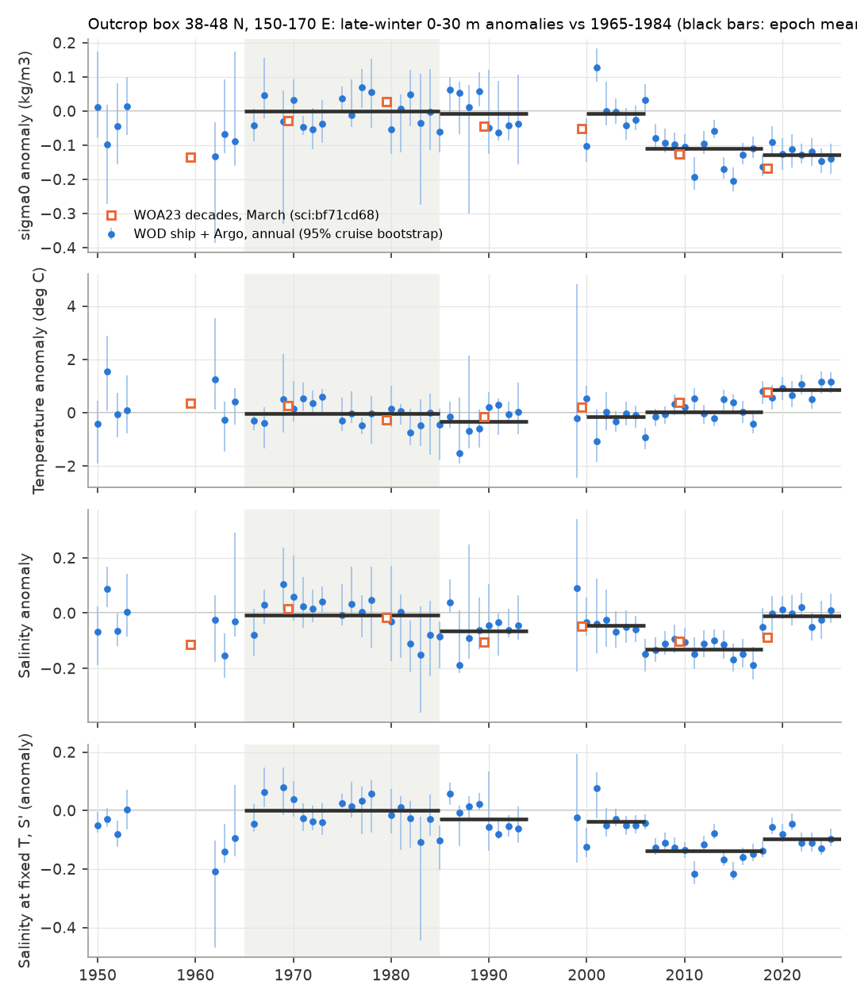
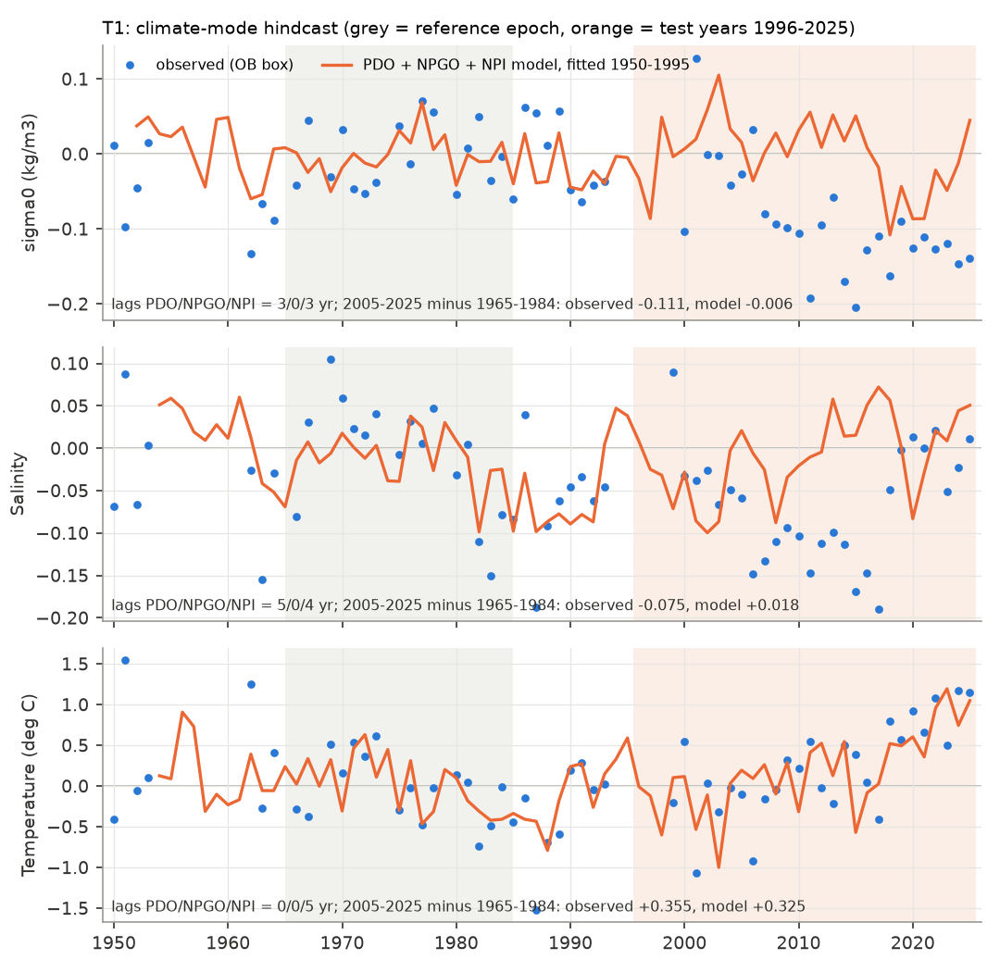
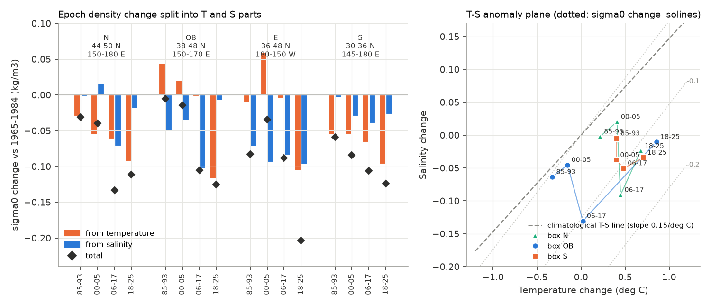

# Pacific climate-mode indices explain the recent warming but not the 2006-2017 freshening that made the western North Pacific sigma0 26.5 outcrop region lighter (WOD ship and Argo casts, 1950-2025)

Job sci-1107-hp-earth-and-ocean-sciences-87d6a9437bfc, campaign 11_07_2026, topic earth-and-ocean-sciences, machine hp, account claude-olen. Analysis and text by the model Claude Opus 5.5 (claude-opus-5-5) in Claude Code. The signing key is a campaign-machine key. It is not a personal authorship claim.

## Summary

Earlier campaign work found that oxygen (O2) on the sigma0 = 26.5 kg/m3 surface fell across the North Pacific (NP), and that the late-winter outcrop of this density class shrank (sci:sha256:84f111c0..., sci:sha256:f2580a7a...). In the outcrop box 38-48 N, 150-170 E, the March surface became lighter by 0.145 kg/m3 from 1965-1984 to 2005-2022 in WOA23, half by warming and half by freshening. Bias-corrected CMIP6 models warm this box but make it saltier (sci:sha256:bf71cd68...). That study could not tell if the freshening is a response to the Pacific climate modes, which can reverse, or a change that the modes do not explain. This study answers that question.

We built annual late-winter (January-April) anomaly series of the 0-30 m layer and of the mixed layer from 95,223 World Ocean Database (WOD23) ship and Argo casts at 30-50 N, 140 E-150 W, 1950-2025. We then tested, with a plan written before any series was calculated (`files/code/analysis_plan.md`), whether the Pacific Decadal Oscillation (PDO), the North Pacific Gyre Oscillation (NPGO) and the North Pacific Index of the Aleutian Low (NPI), with lags of 0-5 years, predict the change.

Main results (box OB = 38-48 N, 150-170 E; changes relative to 1965-1984):

- **The OB surface became lighter in a step near 2007, not gradually from 1990.** The 0-30 m sigma0 anomaly was -0.007 kg/m3 in 1985-1993, -0.008 in 2000-2005, -0.108 (95% cruise bootstrap -0.126 to -0.080) in 2006-2017 and -0.128 (-0.150 to -0.100) in 2018-2025. A step model (change year 2007-2008) fits much better than a linear trend (AIC difference 24.6). WOA23 decades agree (Fig. 1).
- **The cause of the lightness changed between two periods.** In 2006-2017 the layer was fresher by 0.131 (-0.159 to -0.094) at an unchanged temperature (+0.02 deg C). In 2018-2025 it was warmer by 0.86 deg C (0.58 to 1.08) at an unchanged salinity (-0.010). The 2006-2017 freshening is not a shift of the subarctic front along the climatological temperature-salinity (T-S) line: salinity at fixed temperature fell by 0.137 (Fig. 3). The 1985-1993 freshening (-0.063) was different: it came with cooling (-0.33 deg C), along the T-S line, and it did not change the density.
- **T1 (pre-registered hindcast): the climate-mode indices do not predict the freshening or the lightening.** A PDO + NPGO + NPI model fitted on 1950-1995 predicted +0.018 for the salinity change 2005-2025 minus 1965-1984 (observed -0.075; 90% interval of observed minus predicted -0.135 to -0.048) and -0.006 kg/m3 for the density change (observed -0.111; 6% predicted). It did predict the warming: +0.325 of the observed +0.355 deg C, and it reproduced the 2018-2025 warm years out of sample (Fig. 2). T1 fails for density, salinity and salinity at fixed temperature in all three boxes (OB; W 36-48 N, 145 E-180; E 36-48 N, 180-150 W), with the top level or the mixed layer, with an 18.6-yr nodal term, with training to 1990 and with weighted fits.
- **T2 (full-period attribution): the modes give 20% of the density change and none of the freshening.** Fitted on all years 1950-2025, the mode terms give -0.023 of the -0.111 kg/m3 density change and +0.003 of the -0.075 salinity change. An added linear trend is nonzero at 95% for density (-0.016 kg/m3 per decade; -0.025 to -0.006) and for salinity at fixed temperature, and gives 59% of the density change. The data prefer a step to a trend.
- **The freshening is a subarctic signal, and local precipitation did not increase.** The subarctic box N (44-50 N, 150-180 E) freshened by 0.091 in 2006-2017 at +0.45 deg C. The subtropical box S (30-36 N, 145-180 E) became lighter only by warming (salinity at fixed temperature +0.01 to +0.05). GPCP precipitation over OB was 4% lower in 2006-2017 than in 1979-1993.
- **The freshening is not an Argo artifact.** In the same cell, month and year, Argo salinity minus ship salinity was -0.011 (-0.051 to +0.045) in OB and +0.055 (+0.021 to +0.087) in W; Argo is not fresher than ships.
- **T4: the observed salinity change is outside the CMIP6 forced response plus internal variability.** In 11 CMIP6 models (one member each, raw March box series of sci:bf71cd68), the forced salinity change 2005-2022 minus 1965-1984 is +0.047 (range -0.016 to +0.139) and the internal-variability standard deviation of such a change is 0.044. The observed change is -0.085 (z = -2.7); it is within 2 standard deviations of only 3 of 11 models (Fig. 4).
- **T5 (exploratory): at 160-170 E, within-type O2 on sigma0 26.5 follows the part of the surface density that the modes do not explain.** With a 1-yr lag and 3-yr means, the residual part gives r2 = 0.51 (slope 166 umol/kg per kg/m3, 95% 94-227) and the mode part r2 = 0.03. At 170-180 E the mode part gives r2 = 0.24 and the residual 0.06. But about half of the O2 loss at 160-170 E (-12 of -20 umol/kg, 1994-2005 against 2006-2017) came before the 2007 surface step (Fig. 5). The OB surface density cannot explain this early loss.

Interpretation: the western NP outcrop region became lighter mainly because its subarctic-side surface water became fresher in 2006-2017, without cooling. The PDO, NPGO and Aleutian Low indices, which explain the 1985-1993 cold and fresh years and the 2018-2025 warm years, do not explain this freshening, and local rain did not increase. CMIP6 models make this region saltier, not fresher. The present lightness therefore has a mode-related part (the 2018-2025 warming, about 40% of the 2018-2025 density anomaly in the mode fit) that can reverse when the PDO reverses, and a part that the modes do not explain (the freshening, then a smaller residual). This agrees with the conclusion of sci:bf71cd68 that the outcrop loss is not the modelled forced response, and it removes the simple explanation that the loss is only PDO or NPGO variability. The timing result is a challenge to the outcrop mechanism of sci:84f111c0 at 160-170 E: the O2 decline there began before the OB surface became lighter, so the early part of the loss needs another cause (for example, a change east or north of OB, or a change in subduction that the surface density does not show).

## Question, hypotheses and tests

The plan (`files/code/analysis_plan.md`) was written before any box series, fit or residual was calculated. The pass rules are as written there. Post-hoc additions are marked "(added)".

| Test | Hypothesis | Pass rule | Result |
|---|---|---|---|
| T1 mode hindcast | The modes explain the lightening | Predicted change >= 50% of observed and observed inside the 90% interval | Fails for sigma0, S and S' in OB, W and E; passes in effect for T (92% predicted in OB) |
| T2 full-period attribution | A trend remains after the modes | Trend nonzero at 95% and >= 50% of change | Passes for sigma0 (59%) and S' (60%); for S the trend interval includes 0 (-0.025 to +0.001 per decade) although it gives 69% |
| T3 T-S decomposition | The freshening is a front shift along the T-S line | S' unchanged | Rejected for 2006-2017 (S' -0.137); supported for 1985-1993 (S' -0.029 of S -0.063, with cooling) |
| T4 CMIP6 variability | The observed S change is within forced + internal range | (comparison) | z = -2.7; 3 of 11 models within 2 SD |
| T5 O2 link | (exploratory) | - | Residual part carries the O2 link at 160-170 E; mode part at 170-180 E; early O2 loss precedes the surface step |
| Platform check (planned sensitivity) | Argo-ship offset | - | No fresh Argo offset |
| Step timing (added) | - | - | sigma0 step 2007 (OB), S' step 2007 (OB), 1995 (W) |
| N and S boxes, GPCP (added) | - | - | Freshening in N, not in S; no precipitation increase |

## Data

- **WOD23** (NOAA NCEI, public domain): OSD, CTD and PFL observed-level files for WMO squares 1314-1317 and 1414-1417 (30-50 N, 140-180 E) and 7315-7317 and 7415-7417 (30-50 N, 180-150 W). The squares 13xx and 14xx CTD and PFL files were added to the campaign dataset store for this job (`wod-geographic-{ctd,pfl}-obs-o<sq>-20261111`); the others were read in place. 42 files, 978 MB compressed; source URLs and SHA-256 in `files/provenance/inputs.json` (all 42 hashes equal the recorded store hashes).
- **Indices**: ERSSTv5 PDO (NCEI), NPGO (o3d.org, Di Lorenzo et al. 2008), NPI from NCEP/NCAR Reanalysis 1 monthly sea-level pressure, cos(latitude)-weighted mean over 30-65 N, 160 E-140 W. All as November-March means for the winter that ends in the year of the casts, standardised over 1950-2025.
- **GPCP v2.3** monthly precipitation (NOAA PSL), 1979-2025.
- **Prior campaign results**: the within-type O2 series on sigma0 26.5 of sci:84f111c0 (regions B160E and B170E, group ALL), and the raw March box series of 12 CMIP6 models and the WOA23 box values of sci:bf71cd68.

Terms and attribution: `files/NOTICE_external_data.md`. No raw external data file is in this bundle. The NPGO winter means are not bundled (no license on the source page); `files/code/indices.py` recalculates them.

## Methods

1. **Cast extraction** (`extract_winter.py`). January-April casts at 30-50 N, 1950-2025. WOD flag 0 for depth, temperature and salinity, profile flags 0, 30 < S < 36, -2 < T < 32. Per cast: the shallowest level (must be <= 12 m), the mean of levels in 0-30 m, the mixed-layer depth (sigma0 > value at 10 m + 0.03 kg/m3) and mixed-layer mean T and S. TEOS-10 (gsw 3.6.23).
2. **Annual series** (`series.py`). Casts -> cruise (Argo: float) x 1-degree cell x month means. A robust screen removes values more than 5 scaled MADs from the cell-month median. Least squares: value = cell-month effect + year effect, solved by alternating means; only cell-months seen in >= 2 years. Year effects relative to their 1965-1984 mean. Uncertainty: 200 bootstrap draws of cruises. Years with fewer than 2 cruises are not used. Salinity at fixed temperature: S' = S - S_clim(T), with S_clim a cubic fit to OB 0-30 m casts of 1950-1995 (1,998 casts; residual SD 0.14). Density split: dsigma_T = (dsigma0/dT) dT = -0.137 dT, dsigma_S = 0.787 dS, at the OB 1965-1984 mean state (7.06 deg C, 33.82).
3. **T1** (`attribution.py`). y(t) = c + b1 PDO(t - L1) + b2 NPGO(t - L2) + b3 NPI(t - L3), L in 0-5 yr chosen from all 216 sets by leave-one-out error on 1950-1995. Prediction for 1996-2025. Interval: 1000 refits on training residuals resampled in 5-yr blocks, plus block-resampled residual noise on the epoch means, plus the cruise bootstrap of the observed change.
4. **T2**. The same lags, fitted on 1950-2025, with and without a linear trend; trend interval by 5-yr moving-block bootstrap of residuals.
5. **T4**. For each model with SSP2-4.5 to 2100 (11; MIROC6 ends in 2039): 4th-order polynomial fit to the 1950-2100 March box series (forced part); differences of residual means 18 and 20 years long with starts 40 years apart (internal variability). z = (observed - forced mean) / sqrt(RMS internal SD^2 + observed SE^2).
6. **T5** (`o2_link.py`). Mode part = T2 mode-only fit of OB sigma0; residual = observed - mode part. 3-yr centred means, 1-yr lag; OLS with 5-yr block bootstrap of slopes.
7. **Checks** (`platform_check.py`, `epochs.py`, `steps_precip.py`). Argo-minus-ship offset as an added fixed effect on 1995-2025 data, with a cruise bootstrap and direct same cell-month-year crossovers; epoch means; step-versus-linear AIC with the change year as a parameter; GPCP box means.

## Results

### Epoch means, OB 0-30 m (`files/results/attribution/epochs.csv`)

| Epoch | Years with data | sigma0 (kg/m3) | T (deg C) | S | S' (at fixed T) | dsigma from T | dsigma from S |
|---|---|---|---|---|---|---|---|
| 1985-1993 | 9 | -0.007 (-0.055, 0.028) | -0.33 (-0.60, 0.23) | -0.063 (-0.096, 0.007) | -0.029 | +0.045 | -0.050 |
| 2000-2005 | 6 | -0.008 (-0.034, 0.032) | -0.15 (-0.48, 0.15) | -0.045 (-0.085, 0.004) | -0.038 | +0.021 | -0.036 |
| 2006-2017 | 12 | -0.108 (-0.126, -0.080) | +0.02 (-0.25, 0.21) | -0.131 (-0.159, -0.094) | -0.137 | -0.003 | -0.103 |
| 2018-2025 | 8 | -0.128 (-0.150, -0.100) | +0.86 (0.58, 1.08) | -0.010 (-0.034, 0.030) | -0.096 | -0.117 | -0.008 |

Change relative to 1965-1984; 95% cruise-bootstrap intervals. There are almost no winter casts in OB in 1994-1999. The mixed layer did not become shallower (mixed-layer depth +6 to +17 m in all later epochs).

### T1 and T2 (`T1_hindcast.json`, `T2_attribution.json`, `fit_*.csv`)

| Box, variable | Lags PDO/NPGO/NPI (yr) | Observed change | T1 predicted (90%) | T1 pass | T2 mode share | T2 trend share |
|---|---|---|---|---|---|---|
| OB sigma0 | 3/0/3 | -0.111 | -0.006 (-0.032, 0.017) | no | 0.20 | 0.59 |
| OB S | 5/0/4 | -0.075 | +0.018 (-0.018, 0.053) | no | -0.04 | 0.69 |
| OB S' | 3/4/3 | -0.117 | +0.006 (-0.025, 0.036) | no | 0.07 | 0.60 |
| OB T | 0/0/5 | +0.355 | +0.325 (0.141, 0.520) | (predicted) | 0.81 | 0.09 |
| W sigma0 | 0/5/5 | -0.091 | -0.021 (-0.038, -0.004) | no | 0.18 | 0.71 |
| W S | 2/4/1 | -0.065 | +0.017 (-0.016, 0.053) | no | -0.20 | 0.96 |
| E sigma0 | 0/0/1 | -0.162 | -0.084 (-0.130, -0.064) | no | 0.44 | 0.49 |
| E S | 0/3/0 | -0.125 | -0.018 (-0.045, -0.006) | no | 0.05 | 0.83 |

Change = 2005-2025 minus 1965-1984. Sensitivities (OB): with the nodal term the predicted density change is -0.032 (29%); with training to 1990 -0.005; weighted -0.011; top level and mixed layer give the same result (sigma0 7% and 31% predicted). In OB the mode-fit part of the density anomaly is -0.003 in 2006-2017 and -0.049 in 2018-2025; the residual is -0.096 and -0.070.

### T3 and the end-member boxes (`files/results/series/series_NS.csv`, Fig. 3)

The climatological T-S line of the OB layer (slope 0.15 per deg C at 7 deg C) is almost parallel to the sigma0 isolines: a shift along it changes the density little. The 1985-1993 change lies near this line (cold and fresh). The 2006-2017 OB and N changes lie far below it (fresh at unchanged or higher temperature). In 2018-2025 OB and S lie at higher temperature with little salinity change. Box N: S -0.091 in 2006-2017, -0.024 in 2018-2025; box S: S' +0.01 to +0.05 in all epochs. Step years (`step_timing.csv`): OB sigma0 2007 (2007-2008), OB S' 2007 (2006-2007), W S' 1995 (1990-1995), E sigma0 2011 (2008-2012).

GPCP precipitation (`gpcp_epochs.csv`), change from 1979-1993: OB annual -2.7% (1994-2005), -4.0% (2006-2017), +3.1% (2018-2025). A freshening of 0.13 in a 150-200 m winter mixed layer needs about 0.6-0.8 m of extra fresh water, or about +0.15 m/yr over 5 years; the observed precipitation change has the opposite sign. Evaporation was not examined.

### Platform check (`platform_check.json`)

| Box | Argo minus ship S (fixed effect, 95%) | Argo minus ship S' | Direct crossovers (n, median S) |
|---|---|---|---|
| OB | -0.011 (-0.051, 0.045) | +0.009 (-0.017, 0.027) | 22, +0.044 |
| W | +0.055 (0.021, 0.087) | +0.043 (0.015, 0.062) | 233, +0.035 |
| E | -0.010 (-0.020, 0.009) | -0.014 (-0.020, 0.009) | 2 |

An Argo fresh bias would be necessary to make the post-2005 freshening an artifact. The data show none; in W Argo is saltier than ships, so the true W freshening may be larger.

### T4 (`T4_cmip_variability.csv`, `files/results/synthesis/synthesis.json`)

| Variable (2005-2022 minus 1965-1984) | Observed, WOD+Argo 0-30 m Jan-Apr | Observed, WOA23 March | Model forced mean (range) | Internal SD (RMS) | z (WOD+Argo) | Models within 2 SD |
|---|---|---|---|---|---|---|
| S | -0.085 (SE 0.023) | -0.095 | +0.047 (-0.016, +0.139) | 0.044 | -2.7 | 3 of 11 |
| sigma0 | -0.107 (SE 0.017) | -0.145 | -0.053 (-0.108, +0.010) | 0.032 | -1.5 | 7 of 11 |
| T | +0.25 (SE 0.16) | +0.58 | +0.76 (+0.09, +1.43) | 0.29 | -1.5 | 5 of 11 |

The models warm the box more than observed and make it saltier. The observed lightening is within the model range only because the models warm more; the freshening is outside it.

### T5 (`T5_o2_link.json`, Fig. 5)

| O2 region (sci:84f111c0) | Predictor (OB sigma0, 3-yr, lag 1) | n years | r2 | Slope (umol/kg per kg/m3, 95%) |
|---|---|---|---|---|
| B160E 28-42 N, 160-170 E | observed | 46 | 0.54 | 147 (94, 192) |
| B160E | mode part | 46 | 0.03 | 67 (-79, 260) |
| B160E | residual part | 46 | 0.51 | 166 (94, 227) |
| B170E 28-42 N, 170-180 E | observed | 37 | 0.26 | 150 (74, 296) |
| B170E | mode part | 37 | 0.24 | 279 (169, 527) |
| B170E | residual part | 37 | 0.06 | 78 (-26, 204) |

Within-type O2 at B160E, change from 1965-1984: -5.8 (1985-1993), -11.7 (1994-2005), -20.1 (2006-2017), -20.9 (2018-2025) umol/kg. The best single step is in 1995 (N160E: 1991). Both series fall after 2005, so these correlations are partly a shared trend and have few independent degrees of freedom.

## Limitations

- Winter ship data in OB are sparse before 2000 (0-10 cruises per year) and nearly absent in 1994-1999. The reference epoch has 16 usable years with 1-10 cruises each. The fixed-effects estimator removes the cell and month sampling pattern but not errors of single cruises; the bootstrap includes them.
- The near-surface layer (0-30 m, January-April) is a proxy for the late-winter outcrop density. We did not recalculate the outcrop area; the earlier EN4 and WOA23 areas cover a wider region.
- The modes are three standard indices with lags up to 5 years and linear responses. A nonlinear or longer-memory response (for example, through slow Rossby waves or the Okhotsk Sea) is not excluded. The test shows that this standard set does not explain the freshening; it does not identify the cause.
- Evaporation, Ekman and geostrophic salt transport were not examined. The cause of the freshening at fixed temperature in the subarctic side remains open.
- T4 uses one member per model and compares a 0-30 m January-April anomaly with model March surface values. The internal variability is estimated from the model residuals, not from large ensembles.
- T5 is exploratory, with autocorrelated series and a published O2 series that has few cruises after 1996 at 170-180 E.

## Reproduction

`files/code/run_all.sh DATASETS_DIR SCRATCH CAMPAIGN_DIR` runs the full pipeline into SCRATCH. It needs the 42 WOD files, the PDO, NPGO, sea-level pressure and GPCP files listed in `files/provenance/inputs.json` (or their source URLs), and the ZIPs of sci:84f111c0 and sci:bf71cd68. Software: `files/code/requirements.txt`. Cast extraction took about 35 min on 2 processes; the series about 15 min; all other steps a few minutes on one core.

## Files

- `files/code/`: all code, the plan and `run_all.sh`.
- `files/results/series/`: annual anomaly series (boxes OB, W, E, N, S), bootstrap arrays (`bootstrap_series.npz`, key = box_variable, rows = draws, columns = 1950-2025), T-S relation, density coefficients.
- `files/results/attribution/`: T1, T2, T4, T5, fits, epochs, step timing, GPCP and platform checks.
- `files/results/indices/`: winter PDO and NPI (NPGO not bundled).
- `files/results/synthesis/synthesis.json`: key numbers.
- `files/figures/`: Figs. 1-5. `files/provenance/inputs.json`: input hashes, prior bundle hashes, software.

## Attribution

Text, figures and aggregate results: SCI baseline license (CC BY 4.0); code: MIT. WOD23 and the PDO index: NOAA NCEI. NCEP Reanalysis and GPCP: NOAA PSL. NPGO: E. Di Lorenzo. CMIP6: WCRP and the modelling groups (CC BY 4.0), through sci:sha256:bf71cd68.... See `files/NOTICE_external_data.md`.
