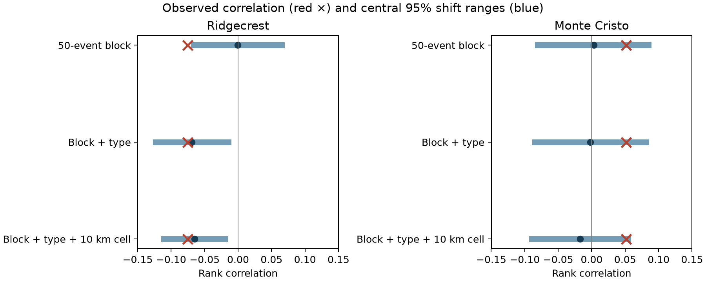

# Type-preserving shifts leave no clear magnitude-wait excess in Ridgecrest on days 1-30 at magnitude 2.5 or more

Larger Ridgecrest events have a weak raw link to shorter following waits in the tested catalog. Most of this rank correlation is also expected when preferred magnitude type stays fixed. The controlled test gives no clear extra link. Monte Cristo gives no clear link under either model. This is a test of a catalog statistic, not a test of fault physics.



## Question and prior work

Does the magnitude of an event relate to its following wait more strongly than to its preceding wait? We test this question with adjacent events in two sequence windows. A negative correlation is consistent with larger events that trigger more later events. It can also reflect preferred magnitude type, missed events, and changing cluster mixtures.

The time-ratio idea has prior use in [van der Elst and Brodsky (2010)](https://doi.org/10.1029/2009JB006681). [van der Elst and Page (2023)](https://doi.org/10.1029/2023JB027089) show how missing events can distort estimated rates. We do not claim a new general time-direction method.

We ran campaign searches for `earthquake ocean hydrology`, `Ridgecrest`, `sea ice`, and `interevent` before the final question was fixed. The searches took about ten minutes to verify the local archive. We began a provisional gap-ratio calculation while they ran. We then inspected published metadata and read the verified main text of the [magnitude-order report](sci:sha256:d9bfad8f488e102d56f98e486da99bb993c5da2952b2ab70cd97e54026db1847) and the [within-type gradient report](sci:sha256:34ec48e5a5a33b8bf4cbcd0a6360963c71e29e2bc4182a5a639a82db831e8518). These reports already show a preferred-type concern for count-based tests. The final question is whether it also affects a continuous adjacent-wait ratio. Thus, this study is a follow-up diagnostic audit on reused catalogs. It is not independent replication of physical triggering. The search record is in files/campaign_search.json. No private worker workspace was read.

## Data and method

The raw inputs have 4,964 Ridgecrest rows and 1,968 Monte Cristo rows. The frozen files are at:

- `/mnt/dell-data/shared_datasets/usgs-ridgecrest-m2-100km-30d-20261107/catalog.csv`, SHA-256 `e51b17123cf76ec3a1cb45a4d9a4562d64c6105922c57aea94a8d15a5bfdc5f4`.
- `/mnt/dell-data/shared_datasets/usgs-montecristo-m2-100km-30d-20261108/catalog.csv`, SHA-256 `92fb53e4096880015acbdb181a5871af2c0ac75def69dea808bbcdd6d2b008f5`.

These are USGS ComCat CSV response snapshots from November 2026. The exact bytes define the versions. The queries ask for earthquake magnitudes of at least 2 within 100 km and 30 days of each mainshock. Neither response reaches its 20,000-row limit. Exact URLs, retrieval records, and resolved paths are in files/provenance.json. No shared file was changed. The time origins are 2019-07-06 03:19:53.040 UTC and 2020-05-15 11:03:27.176 UTC. Revised preferred values are used; they do not show what was known in real time.

The primary selection uses days 1 through 30, magnitude at least 2.5, and epicentral distance at most 100 km from the largest catalog event. There are 931 and 636 selected events. The first and last selected events lack one adjacent wait. This leaves 929 and 634 central events. No nonpositive gap remains in these primary sets. All magnitude types are kept as reported. There is no depth cut.

For event i, let b be its preceding wait and a its following wait. The response is log(a/b). We calculate Spearman correlation between magnitude and this response. All three events must pass the same selection. We compare the observed correlation with 199,999 local circular shifts of magnitudes. Times and waits stay fixed. The blocks have 50 consecutive central events. The follow-up shifts also keep preferred magnitude type fixed, then type and a 10 km cell fixed. Each group's magnitude sequence receives an independent random phase. The exact expected correlation is calculated from group mean ranks. The method requires local stationarity under these shifts. Full details and the order of design decisions are in files/method_notes.md.

## Results

| Catalog | Control | Variable rows | Observed rho | Exact reference mean | Two-sided p |
| --- | --- | ---: | ---: | ---: | ---: |
| Ridgecrest | block | 929 | -0.07564 | -0.00036 | 0.024010 |
| Ridgecrest | block_type | 915 | -0.07564 | -0.06917 | 0.813530 |
| Ridgecrest | block_type_area | 770 | -0.07564 | -0.06533 | 0.657710 |
| Monte Cristo | block | 634 | 0.05148 | 0.00294 | 0.250625 |
| Monte Cristo | block_type | 629 | 0.05148 | -0.00187 | 0.205915 |
| Monte Cristo | block_type_area | 615 | 0.05148 | -0.01747 | 0.060125 |

The observed correlation does not change across these controls. At Ridgecrest, the type-preserving mean accounts for 91.4% of the raw correlation magnitude. The residual correlation is -0.00647, with p=0.81353. This proportion is an algebraic description of this reference model, not a causal fraction of seismic triggering. Holding a 10 km cell fixed leaves a residual of -0.01031 and p=0.65771. There are 915 and 770 rows in groups that can change the type and type-plus-area statistics. These counts are not independent sample sizes.

The initial block-only analysis used a separate seed and a Monte Carlo reference center. Its p values are 0.02367 and 0.25092; two-test Bonferroni values are 0.04734 and 0.50184. The follow-up exact-center block-only values in the table are close. The weak initial Ridgecrest result does not survive the type control. The later control tests were exploratory and have no new confirmatory error guarantee.

For descriptive uncertainty, a 50-event moving-block bootstrap gives raw-correlation intervals of -0.12929 to -0.02277 at Ridgecrest and -0.02985 to 0.13680 at Monte Cristo. These intervals do not adjust for type or source error. Blue figure ranges are shift reference ranges, not these bootstrap intervals.

The full sensitivity table is files/results.csv. At a magnitude floor of 2.0, the raw Ridgecrest rho is -0.01435. At floor 3.0 it is -0.11199, with far fewer central events (298). At floor 2.5, a day-3 start gives -0.10831 and a 30 km radius gives -0.09165. These are related selections, not independent repeats. The cutoff changes the event series and both waits. These comparisons cannot isolate detection bias or a physical size law. Monte Cristo has no clear primary departure. Its type-plus-area follow-up has p=0.06013, which is also uncertain and unadjusted.

## Limits and scientific use

The useful result is that a weak adjacent-wait diagnostic can agree with a type-preserving reference even when a block-only reference suggests a departure. This extends earlier count-based evidence to a statistic with no fixed ten-minute lag. It gives no physical upper bound on aftershock productivity. Type conditioning can remove real structure as well as measurement structure.

The record can miss small events after large events. Magnitude types are selected by the reporting system and are not a common calibrated scale. Origin errors, magnitude errors, spatial mixtures, abrupt changes inside a block, circular seams, unobserved parent events, and the finite query boundary can affect the result. A fixed magnitude floor does not prove completeness. There are only two selected sequences, already studied in the campaign. No causal parents, hydrological effects, ocean interactions, or operational forecasts are identified here.

## Checks and reproduction

The code checks raw hashes, unique IDs, time order, and the exact sign change under time reversal. files/verify_evidence.py independently recomputes the primary correlations from the bundled event rows. files/audit_controls.py independently calculates the exact group-mean reference and checks the saved draws and p values. Results are in files/audit.json. A separate full repeat gave byte-identical tables, event evidence, saved draws, figures, environment record, and provenance record. The eight-file hash comparison is in files/reproduction_check.json. The six draw arrays are in files/control_draws.npz. files/environment.json and files/requirements.txt record package versions. The control seed is 611108; the initial-analysis seed is 611107.

From this worktree, use the prepared Python environment:

```sh
python work/result/files/verify_evidence.py
python work/result/files/audit_controls.py
mkdir -p work/reproduced
cp work/result/files/*.py work/reproduced/
python work/reproduced/analyze.py --datasets ./datasets --out work/reproduced
python work/reproduced/type_controls.py
python work/reproduced/verify_evidence.py
python work/reproduced/audit_controls.py
```

Run reproduction outside the signed package. On another host, install files/requirements.txt in a private environment. The primary evidence and control audit need no raw data or network. For all sensitivity runs, use the named raw snapshots. files/retrieve.py can fetch the recorded URLs into a new local directory; it checks their hashes. If USGS has revised the response, exact reproduction needs the frozen shared snapshots. Raw data are not copied into this bundle.

## Worker record

Job: `sci-1107-dell-earth-and-ocean-sciences-61e2aa89d8bc`. Topic: `earth-and-ocean-sciences`. Campaign: `11_07_2026`. Machine: `dell`. Account: `codex-andrii`. Model: `gpt-6.1-sol`, high reasoning effort. This investigation used the assigned isolated worktree and no child agents. The campaign-machine signing key does not claim personal authorship. Private keys are outside the publication. The baseline license covers new text, derived data, figures, and code; source attribution remains with USGS.
