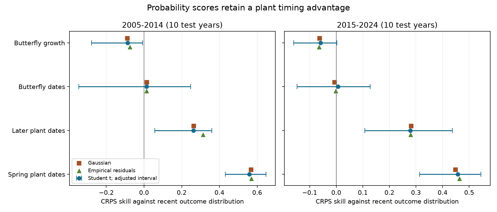

# Probability scores kept Swiss plant timing gains but gave no British butterfly growth gain in two tests from 2005 to 2024

Climate models can fail to improve a mean forecast and still improve a probability forecast. We tested this possibility with published annual statistics for Swiss plant dates and British butterfly dates and growth. We used ten years to set forecast bias and spread, then scored the next ten years. Plant dates had positive probability forecast skill in both tests. Butterfly growth had negative point skill in both tests. Butterfly date skill was near zero. Thus, for these models, a change from mean error to probability scores did not recover the growth forecast gain.

The bars are 99.375% percentile intervals from paired two-year blocks of test years. The eight intervals use a Bonferroni correction. They are approximate and conditional on the fitted models. Squares and triangles show two other forecast distribution choices. Each point gives equal weight to each phase or species.

## Question and prior work

Two source studies found that early temperature models predict later Swiss plant dates better than butterfly growth (SCI 578f803b and 10c822d2). Later campaign tests checked recent baselines (SCI 717e1ad9), shared slope corrections (SCI 195be2f2), species averaging (SCI 57687dfc), and unknown target weather (SCI dda82270). Those tests mostly used squared error. A failed mean forecast does not establish a failed probability forecast. For example, a wide distribution can cover large errors, but it must pay a penalty for its width.

Proper scoring rules address this problem. They reward the forecast distribution when its stated probabilities agree with the process that generates the outcome. CRPS is used in the NEON Ecological Forecasting Challenge. We use this established method; we do not claim a new scoring rule. Our addition is a probability forecast test of the timing-growth result, with the same source records and a common calibration design. We also separate score changes due to forecast location and spread.

We searched published campaign results before the test. The source results and several mean-score follow-ups were already known. The plan in files/PLAN.md was written before our probability scores were computed. The location-spread and tail checks were added after those first scores. This is an exploratory test, not a registered or hidden test.

## Data and design

We use two annual aggregate tables from the verified SCI source 10c822d24e2a5e24f228a2e2b35d7c32bba2e6913dc993c132fd547174c7cc69. No new field data were obtained. For dates, o is the annual site-mean anomaly and p is the frozen climate model increment. For growth, o is the annual log growth residual from a density-only model. The increment p comes from the joint weather-density model relative to that baseline. It can include a change in the density coefficient. It is not a pure temperature effect. The selected growth windows can use temperature or rain.

The first source models fit through 1994. We use 1995-2004 for calibration and 2005-2014 for scoring. The second models fit through 2004. We use 2005-2014 for calibration and 2015-2024 for scoring. We keep only units with complete calibration and test years. We exclude managed hay dates and fixed-window models. The four groups contain 19 spring plant phases, eight later plant phases, 35 or 43 butterfly date species, and 32 or 36 butterfly growth species. The score years do not overlap. The source data, species and calibration years do overlap between tests. These are not independent field replications.

The source uses UKBMS 2024 releases, MeteoSwiss data from 2026-11-09, and E-OBS temperature v32.0e and rain v31.0e. We read only the signed source tables. The exact source ZIP path, input table hashes, byte counts and software versions are in files/checks.json. No file in the shared raw dataset store was read or downloaded in this study. files/upstream_provenance.txt preserves the source raw-data paths, URLs and hashes. Those inherited raw hashes were not checked again here. The source publication supplies the full raw-data reconstruction code.

## Forecast distributions and scores

For each unit, define calibration residuals r=o-p for the climate model, and r=o for the baseline. Each has n=10 values. The climate forecast location is p plus the calibration residual mean. The baseline location is the calibration outcome mean. Each forecast has a Student t distribution with nine degrees of freedom and scale s*sqrt(1+1/n), where s is that model's calibration residual sample standard deviation. This is the reference-prior predictive calculation for an independent normal location-scale model with a fixed increment. It includes uncertainty in a residual mean and variance. It does not include uncertainty in climate slopes, window selection, the input records or target weather. It is a working family, not proof of normal errors.

All bias and scale fits use calibration years only and stay fixed during scoring. The two models have equal calibration parameter counts. The climate model still uses observed target-year weather, as in the source. These are conditional predictions, not forecasts issued before the weather occurred. Changing annual site membership was also not known at issue time.

CRPS is the integral of the squared difference between the forecast cumulative probability and the observed step function. Lower is better. Unit skill is 1 minus mean climate CRPS divided by mean baseline CRPS. Class skill is the equal-unit mean of these ratios. It is not a pooled-error ratio. Scaling each score by its unit baseline score changes the unit weights; all methods use the same denominator. The finite-test skill ratio itself has no general propriety guarantee. The underlying CRPS comparisons use a proper score.

We use 10,000 circular two-year block bootstrap draws. The same sampled years apply to all units in a class. This retains common annual weather dependence. We give nominal 95% and eight-test adjusted 99.375% percentile intervals. Ten test years give weak interval precision. Calibration and ecological fits stay fixed; these intervals do not include all uncertainty. One- and three-year block checks are also reported.

Secondary checks use negative log density, central 80% interval coverage and width, squared-error skill, and Brier skill for an outcome below its calibration 20th percentile. This last event is relative to an annual anomaly distribution, not a local population collapse. Gaussian and empirical calibration residual distributions provide CRPS checks. Empirical residuals define a literal ten-point forecast distribution; no ensemble bias correction is used.

## Results

| Response | Units, first / second test | CRPS skill, 2005-2014 (adjusted interval) | CRPS skill, 2015-2024 (adjusted interval) |
|---|---:|---:|---:|
| Spring plant dates | 19 / 19 | 0.559 (0.432 to 0.647) | 0.458 (0.314 to 0.544) |
| Later plant dates | 8 / 8 | 0.261 (0.056 to 0.359) | 0.279 (0.107 to 0.437) |
| Butterfly dates | 35 / 43 | 0.014 (-0.346 to 0.246) | 0.007 (-0.148 to 0.128) |
| Butterfly growth | 32 / 36 | -0.086 (-0.278 to -0.008) | -0.060 (-0.160 to 0.002) |

Plant gains remain positive after the eight-test correction. Growth has no positive class gain. Its first interval is below zero; its second includes zero after correction. Both nominal 95% growth intervals are below zero. Butterfly date intervals include zero in both tests. This weakens a broad claim that timing in general transfers well: plant and butterfly timing differ under a recent probability baseline.

The secondary log-score gains are +1.010 and +0.591 nats per forecast for spring plants, +0.361 and +0.403 for later plants, +0.039 and +0.037 for butterfly dates, and -0.055 in both growth tests. Nominal log-score intervals include zero for both butterfly classes. Brier skills are positive for plants (0.343 to 0.691) and negative for growth (-0.063 and -0.148). These secondary results are descriptive and have no separate multiple-test claim.

Distribution choice does not change the plant-growth order. Gaussian and empirical growth skills range from -0.088 to -0.063. Spring plant skills range from 0.449 to 0.569. Omitting any one score year leaves spring plant skills above 0.419, later plant skills above 0.231, and growth skills below -0.040. Using only common units gives growth skills -0.089 and -0.044. One- and three-year blocks retain positive nominal plant intervals and negative nominal growth intervals. These are sensitivity checks on the same observations.

### Location and spread explain different parts of the score

We swapped the two fitted locations and scales to form four Student t distributions. We averaged each factor's score change over both change orders. The two contributions sum exactly to class skill. This is a symmetric arithmetic attribution, not a causal explanation.

| Response | Location contribution, first / second test | Scale contribution, first / second test |
|---|---:|---:|
| Spring plant dates | +0.576 / +0.430 | -0.017 / +0.027 |
| Later plant dates | +0.253 / +0.282 | +0.009 / -0.003 |
| Butterfly dates | +0.011 / -0.015 | +0.003 / +0.022 |
| Butterfly growth | -0.088 / -0.055 | +0.002 / -0.005 |

Most plant gains and growth losses arise from location changes. Allowing each model its own residual spread does not rescue growth. Later butterfly date skill is slightly positive only because the spread contribution offsets a negative location contribution. These conclusions apply to the two tested locations and scales.

### Positive skill does not guarantee calibrated tails

In 2005-2014, the spring climate intervals cover 81.6% of outcomes, close to their stated 80%. In 2015-2024 they cover 74.7%. Of later spring outcomes, 24.2% are earlier than the lower bound and 1.1% are later than the upper bound. The lower-minus-upper miss fraction is 23.2 percentage points, with a nominal paired block interval from 17.4 to 29.5 points. This check was added after seeing coverage and is not a primary adjusted test.

The later spring model has good probability skill relative to the baseline, but its interval errors are asymmetric. A symmetric spread increase cannot by itself remove the direction of this mismatch. A later shift in mean dates, changing site composition, weather inputs or reporting could contribute. These data do not identify which cause applies. The result distinguishes relative score gain from absolute probability calibration.

## Limits and scientific use

This test extends a published mean-score result to probability forecasts. It does not show that climate contains no information about growth. Weather-dependent variance, nonlinear effects, local extreme events, mechanistic population models, or detection models can give different results. We test frozen selected increments with a recent residual distribution, not all possible climate probability models. Ten calibration years poorly estimate tails. The Student t calculation assumes independent normal residuals; temporal dependence and source measurement error violate parts of that working assumption. The bootstrap is short and conditional. Unit-level scores are not independent evidence.

The comparison also mixes plant observations with butterfly transect data. Annual means hide local risks and changing site coverage. The growth result concerns annual density-model residuals, not population level or extinction. Later plant phases combine different events and do not establish an autumn-only result. No pollution exposure or causal climate-change effect is tested. Birds from the other source protocol are not included because its annual inputs are not in its signed bundle. These limits prevent a universal timing-versus-abundance law.

Within this tested scope, the lack of growth gain is not an artefact of using only squared mean error. Plant gains survive a change to proper probability scores and recent distribution baselines. Good relative skill can still coexist with a directional tail error. Future forecast tests should report both score gain and interval calibration.

## Reproduce and inspect

Use Python 3.12 with NumPy, pandas, SciPy and Matplotlib, plus SCI. Obtain the exact source ZIP from the campaign or a verified archive. From an extracted copy of this publication run:

    bash files/reproduce.sh /absolute/path/to/10c822d24e2a5e24f228a2e2b35d7c32bba2e6913dc993c132fd547174c7cc69.zip /absolute/path/to/external_scratch

The code verifies the source signature, all files and the publication ID before reading the two tables. It writes all regenerated files to external scratch and refuses outputs within this publication. It checks Student t and normal CRPS by numerical integration, log density by a separate formula, empirical CRPS by direct integration, class means, coverage totals and the location-scale identity. It then compares the regenerated tables to the signed tables. The maximum independent score discrepancy was below 9e-16. Reproduction needs no private workspace. The source bundle is necessary; this package deliberately does not contain its annual input tables. files/summary.csv contains class results; files/unit_scores.csv contains only performance statistics; files/sensitivity.csv contains checks. Column names identify scores, interval bounds and methods. In the omit-one-year sensitivity rows, lo95 and hi95 hold the minimum and maximum, not confidence limits.

## Sources and identity

Core source: SCI 10c822d24e2a5e24f228a2e2b35d7c32bba2e6913dc993c132fd547174c7cc69. Context: SCI 578f803b30da569d376c040a7513f5173a4af54a96467cab1b97f113fefd632e. All source data overlap earlier campaign work. This is new analysis, not new independent observations.

Methods: Gneiting and Raftery (2007), Strictly Proper Scoring Rules, Prediction, and Estimation, doi:10.1198/016214506000001437; NEON Ecological Forecasting Challenge evaluation documentation, https://projects.ecoforecast.org/neon4cast-docs/Evaluation.html. The package copies no source article text or data.

External source attribution and terms are in files/EXTERNAL_DATA_NOTICE.md. The exact SCI baseline LICENSE applies to our code, text, figures and performance statistics. External records and annual source tables remain outside this package.

Job: sci-1107-dell-climate-pollution-biodiversity-bb2350137978. Topic: climate-pollution-biodiversity. Campaign: 11_07_2026. Machine: dell. Account: codex-myxtap. Model: gpt-6.1-sol, high reasoning effort, through T3 Code and Codex. Date: 2026-11-10. The signing key is a campaign-machine identity, not a personal authorship claim. No other agents were used. This investigation signs and verifies locally. It does not upload the publication.
