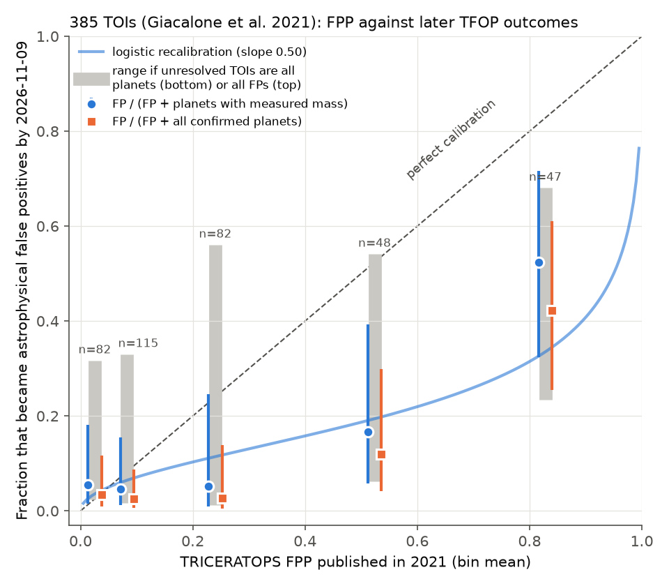
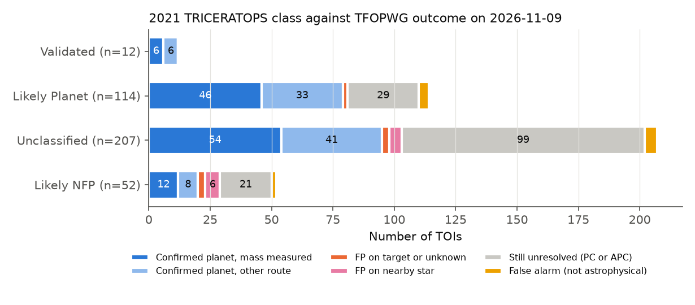
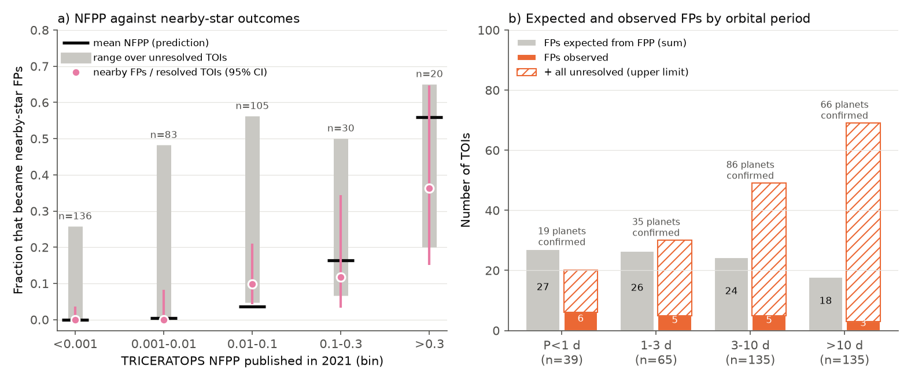

# TRICERATOPS false-positive probabilities from 2021 predicted too many false positives in later TESS follow-up of 385 TOIs

**Job:** sci-1107-dell-astronomy-524e11a15115 (campaign 11_07_2026, topic astronomy, machine dell, account claude-andrii).
**Model:** Claude Opus 5.5 (`claude-opus-5-5`), as an automated research worker. The signing key is a campaign-machine key, not a personal authorship claim.
**Date of the outcome snapshot:** 2026-11-09.

## Summary

TRICERATOPS (Giacalone et al. 2021, AJ 161, 24) is a Bayesian tool that many TESS papers use to vet and statistically validate planet candidates. It gives a false-positive probability (FPP) and a nearby false-positive probability (NFPP). In 2020-2021, Giacalone et al. published FPP and NFPP for 384 unclassified TESS Objects of Interest (TOIs). The VizieR table J/AJ/161/24 has 385 rows. At that time, these TOIs had no confirmation and no rejection. Five years of follow-up by the TESS Follow-up Observing Program (TFOP) have now resolved many of them. Thus the published values are true out-of-sample forecasts. We compare them with the TFOP Working Group (TFOPWG) dispositions on ExoFOP on 2026-11-09. We also use the NASA Exoplanet Archive to find which confirmed planets have a measured mass.

Main results:

1. **The planet classes are reliable.** All 12 "validated" TOIs are confirmed planets (6 have a measured mass). Of the 114 "likely planets", 79 are confirmed planets, 2 are false positives (FPs) on the target, 0 are nearby-star FPs, 4 are false alarms, and 29 are not resolved.
2. **FPP predicts too many false positives.** For the 137 TOIs that are now FPs or confirmed planets with a measured mass (at least 3 sigma), the FPP values add to 36.1 expected FPs. Only 19 FPs occurred. If we include all 225 resolved TOIs, the FPP values add to 51.8 expected FPs, and 19 occurred. In both cases, a simulation with the published FPP values gives p < 5e-6 for so few FPs.
3. **The excess is largest at high FPP, and it remains if all unresolved TOIs are FPs.** There are 79 astrophysical TOIs with FPP >= 0.5. Their FPP values add to 57.3 expected FPs. Only 13 are FPs, and 29 are confirmed planets (19 with a measured mass). If all 37 unresolved TOIs in this group were FPs, the total would be 50 (p = 0.035). For FPP >= 0.65 (mean FPP 0.83), at most 68% can be FPs under any outcome of the unresolved TOIs (p = 0.010).
4. **A logistic recalibration has slope 0.50 (95% bootstrap range 0.29-0.86) and intercept -1.47 (-2.12 to -0.96).** For FPs against planets with a measured mass, a published FPP of 0.5 corresponds to an observed FP probability of 0.19 (0.11-0.28). A published FPP of 0.9 corresponds to 0.41 (0.23-0.65). A published FPP of 0.01 corresponds to 0.023 (0.004-0.058). Thus, at the validation threshold, the data do not show that FPP is too high.
5. **FPP ranks TOIs well.** The area under the ROC curve (AUC) is 0.79 (0.65-0.91) for FPs against planets with a measured mass. A three-parameter logistic model with radius, period and TESS magnitude, with leave-one-out cross-validation, gives 0.71 (0.57-0.85).
6. **NFPP agrees with the outcomes.** NFPP separates nearby-star FPs from other resolved outcomes with AUC 0.88 (0.80-0.95). For the 223 resolved TOIs with a known FP location, the NFPP values add to 10.1 expected nearby-star FPs, and 11 occurred (p = 0.72). In the "likely nearby false positive" (Likely NFP) class, 20 of 52 TOIs became confirmed planets. This agrees with the class rule (NFPP > 0.1), which does not mean that most of these TOIs are FPs.
7. **Ultra-short periods have the largest excess.** For P < 1 d, the FPP values predict 26.9 FPs in 39 TOIs. We observed 6 FPs and 19 confirmed planets, for example LTT 9779 b, GJ 367 b, TOI-500 b, TOI-561 b and LTT 3780 b. If all 14 unresolved TOIs were FPs, the total would be 20 (p = 0.006). But a model with a free calibration slope fits the outcomes better than a model with a separate period term. We cannot separate the two explanations with these data.

Practical meaning: a published 2021 TRICERATOPS FPP above about 0.3 does not show that a TOI is probably a false positive. In this sample, about one third to one half of TOIs with FPP 0.65-1.0 became confirmed planets. FPP is useful as a ranking, and the validated and likely-planet classes held. Studies that remove TOIs because of high FPP lose many real planets, especially ultra-short-period planets.



## Data

| Input | Source | Version or date | SHA-256 |
| --- | --- | --- | --- |
| TRICERATOPS FPP, NFPP and class for 385 TOIs | VizieR J/AJ/161/24 table7 (Giacalone et al. 2021), `https://vizier.cfa.harvard.edu/viz-bin/asu-tsv?-source=J/AJ/161/24&-out.max=unlimited&-out.all` | catalog published 2022-04-04, downloaded 2026-11-09 | `ed9578f683000a1d2120e819f9ab65b86f91b7a4bf6cc9990ba7b0588932bd09` |
| TFOPWG and TESS dispositions, comments, TOI properties | ExoFOP-TESS TOI table, `https://exofop.ipac.caltech.edu/tess/download_toi.php?sort=toi&output=csv` | downloaded 2026-11-09 (8,175 TOIs) | `7431f69aadbbc2d40176e79a571748b4e0d043a554dffc817f25413a5552399e` |
| Planet mass provenance and discovery reference | NASA Exoplanet Archive TAP, table `pscomppars` | downloaded 2026-11-09 (6,464 planets) | `7eba4af344e407a7fd7069fe91f387c14b7d4fd6412f343d9c288703caffde64` |

All three files are in `files/data/raw/` (with `SHA256SUMS.txt`). `files/src/fetch_inputs.sh` downloads them again. Later downloads will differ, because ExoFOP and the archive change. No shared campaign dataset was used or added.

## Method

**Outcome classes.** We join the 385 rows to ExoFOP by TOI number (all rows match). We give each TOI one outcome:

- `planet_mass`: TFOPWG CP, and the archive planet (same TIC, nearest period) has `pl_bmassprov` = Mass or Msini, no limit flag, and mass/uncertainty >= 3 (118 TOIs). A measured mass shows that the companion is a planet on the target star. Thus this outcome does not depend on statistical validation.
- `planet_other`: other CPs (88 TOIs). Many of these are statistical validations, and many of those validations used TRICERATOPS with more data. Thus this class is partly circular, and we report it separately. TOI-263.01 (a brown dwarf, Palle et al. 2021) has no archive row and is in this class. One period mismatch (TOI-1835.01 / HD 110067 b) has a measured mass and stays in `planet_mass`.
- `fp_nearby`, `fp_target`, `fp_unknown`: TFOPWG FP (19 TOIs). We classified the location by hand from the ExoFOP comments, for example "retired as NEB", "centroid offset", "event is on neighbor" (nearby: 11), and "odd-even", "secondary eclipse", "SEB2" (target: 6). Two TOIs have no clear location. The labels and their basis are in `files/data/fp_type_labels.csv`.
- `false_alarm` (FA, 11): TRICERATOPS assumes an astrophysical signal. Thus we remove these from the main tests and include them in one sensitivity case.
- `apc` (14) and `unresolved_pc` (135): not resolved.

**Calibration.** We put TOIs into FPP bins [0, 0.05), [0.05, 0.15), [0.15, 0.35), [0.35, 0.65), [0.65, 1]. For each bin, we compare the mean FPP with the FP fraction among resolved TOIs. We use two planet definitions: (A) only planets with a measured mass, (B) all CPs. We give Wilson 95% intervals. Selection is the main risk. TOIs that stay unresolved can have a different FP rate. Thus we also give, for each bin, the FP fraction over all astrophysical TOIs if every unresolved TOI is a planet (lower bound) or a FP (upper bound). We also give a binomial tail probability for the upper bound. We fit a logistic recalibration, logit P(FP) = a + b logit(FPP), with FPP clipped to [0.005, 0.995] and 2,000 bootstrap samples.

**Selection checks.** (1) For each bin, we compute the FP rate in unresolved TOIs that is necessary for calibration. (2) We compute an inverse-probability-weighted FP rate. The probability of resolution comes from a logistic model with TESS magnitude, log radius, log period, log SNR, logit FPP and log NFPP. This method assumes that, for TOIs with the same properties, resolution does not depend on the true outcome. (3) We repeat the recalibration with APC as FP, with APC and FA as FP, for SNR >= 15 and SNR < 15, without nearby FPs, and without P < 1 d.

**Prior tests.** Giacalone et al. (2021, Sect. 2.4.1) removed the overall planet-to-binary occurrence prior (planets are 10-100 times more common than close binaries). They removed it because it gave too low FPP for FPs in their 68-TOI test set, and 40 of those 68 TOIs were FPs. Their planet period prior, p(P) ~ P^1.5 per unit P below 10 d, together with the binary prior p(P) ~ P^0.5, makes the planet-to-binary prior ratio fall as P^1 toward short periods. We confirmed that TRICERATOPS 1.1.0 (PyPI, installed 2026-11-09) has the same period priors, and that it does not use the stellar-mass occurrence prior. We test: (H1) a constant odds offset with slope fixed to 1; (H2) an added log-period term; (H3) a free slope. We use likelihood-ratio tests.

## Results

### Outcomes by 2021 class

| 2021 class | n | CP, mass | CP, other | FP target/unknown | FP nearby | APC/PC | FA |
| --- | --- | --- | --- | --- | --- | --- | --- |
| Validated (FPP < 0.015, NFPP < 1e-3) | 12 | 6 | 6 | 0 | 0 | 0 | 0 |
| Likely Planet (FPP < 0.5, NFPP < 1e-3) | 114 | 46 | 33 | 2 | 0 | 29 | 4 |
| Unclassified | 207 | 54 | 41 | 3 | 5 | 99 | 5 |
| Likely NFP (NFPP > 0.1) | 52 | 12 | 8 | 3 | 6 | 21 | 2 |



### FPP calibration (astrophysical TOIs)

| FPP bin | n | mean FPP | FP | CP mass | CP other | unresolved | FP frac (A) [95% CI] | FP frac (B) | range over unresolved | IPW FP rate | unresolved FP rate needed |
| --- | --- | --- | --- | --- | --- | --- | --- | --- | --- | --- | --- |
| 0-0.05 | 82 | 0.025 | 2 | 34 | 22 | 24 | 0.056 [0.015, 0.18] | 0.034 | 0.024-0.32 | 0.044 | 0.003 |
| 0.05-0.15 | 115 | 0.083 | 2 | 41 | 36 | 36 | 0.047 [0.013, 0.16] | 0.025 | 0.017-0.33 | 0.021 | 0.21 |
| 0.15-0.35 | 82 | 0.240 | 1 | 18 | 18 | 45 | 0.053 [0.009, 0.25] | 0.027 | 0.012-0.56 | 0.096 | 0.42 |
| 0.35-0.65 | 48 | 0.524 | 3 | 15 | 7 | 23 | 0.17 [0.06, 0.39] | 0.12 | 0.06-0.54 | 0.14 | 0.96 |
| 0.65-1 | 47 | 0.828 | 11 | 10 | 5 | 21 | 0.52 [0.32, 0.72] | 0.42 | 0.23-0.68 | 0.44 | 1.33 (not possible) |

For the two highest bins, calibration requires that 96% and 133% of the unresolved TOIs are FPs, while the resolved TOIs in the same bins have FP rates of 12% and 42%. The IPW rates agree with the resolved rates.

### Recalibration and sensitivity

| Case | n | FP | slope [95%] | intercept [95%] | P(FP) at FPP 0.5 | P(FP) at FPP 0.9 |
| --- | --- | --- | --- | --- | --- | --- |
| A: FP vs CP with mass | 137 | 19 | 0.50 [0.29, 0.86] | -1.47 [-2.12, -0.96] | 0.19 [0.11, 0.28] | 0.41 [0.23, 0.65] |
| B: FP vs all CP | 225 | 19 | 0.55 [0.34, 0.89] | -1.95 [-2.57, -1.50] | 0.12 [0.07, 0.18] | 0.32 [0.18, 0.53] |
| C: FP+APC vs CP with mass | 151 | 33 | 0.51 [0.33, 0.81] | -0.91 [-1.42, -0.44] | 0.29 [0.20, 0.39] | 0.55 [0.39, 0.75] |
| D: FP+APC+FA vs all CP | 250 | 44 | 0.49 [0.34, 0.72] | -1.06 [-1.46, -0.68] | 0.26 [0.19, 0.34] | 0.51 [0.36, 0.67] |
| A, SNR >= 15 | 40 | 9 | 0.49 [0.20, 1.31] | -1.50 [-3.66, -0.69] | 0.18 [0.03, 0.34] | 0.39 [0.15, 0.73] |
| A, SNR < 15 | 97 | 10 | 0.54 [0.10, 1.32] | -1.41 [-2.43, -0.72] | 0.20 [0.08, 0.33] | 0.44 [0.11, 0.84] |
| A, no nearby FPs | 126 | 8 | 0.59 [0.27, 1.33] | -2.52 [-4.51, -1.85] | 0.07 [0.01, 0.14] | 0.23 [0.07, 0.45] |
| A, P >= 1 d | 118 | 13 | 0.45 [0.19, 0.87] | -1.53 [-2.37, -0.86] | 0.18 [0.09, 0.30] | 0.37 [0.16, 0.68] |

The intercept is below zero in all cases. The 95% interval of the slope is below 1 in the full samples (A to D). The subsets have wider intervals.

### Discrimination (AUC, 95% bootstrap range)

| Score | A: FP vs CP mass (137, 19 FP) | B: FP vs all CP (225, 19 FP) |
| --- | --- | --- |
| FPP | 0.79 [0.65, 0.91] | 0.80 [0.66, 0.92] |
| NFPP | 0.73 [0.58, 0.86] | 0.73 [0.58, 0.87] |
| planet radius | 0.69 [0.55, 0.82] | 0.70 [0.56, 0.83] |
| logistic(radius, period, Tmag), LOO | 0.71 [0.57, 0.85] | 0.74 [0.60, 0.87] |
| logistic(radius, period, Tmag, FPP), LOO | 0.75 [0.60, 0.89] | 0.77 [0.61, 0.90] |
| FPP, SNR >= 15 | 0.85 [0.66, 0.98] | 0.84 [0.65, 0.97] |
| FPP, SNR < 15 | 0.73 [0.51, 0.91] | 0.73 [0.51, 0.91] |

### NFPP and orbital period



| Period | n | sum FPP | FP | CP (mass) | unresolved | max possible FP | p |
| --- | --- | --- | --- | --- | --- | --- | --- |
| P < 1 d | 39 | 26.9 | 6 | 19 (13) | 14 | 20 | 0.006 |
| 1-3 d | 65 | 26.5 | 5 | 35 (26) | 25 | 30 | 0.88 |
| 3-10 d | 135 | 24.2 | 5 | 86 (48) | 44 | 49 | 1.0 |
| > 10 d | 135 | 17.8 | 3 | 66 (31) | 66 | 69 | 1.0 |

Prior tests (sample A): a constant offset with slope 1 gives an odds factor of 0.22. Thus the published FP odds are approximately 4.6 times too high on average (8 times in sample B). With slope fixed to 1, an added log10(P) term is +1.56 +/- 0.66 (likelihood-ratio p = 0.021). This agrees with a period prior that is too steep. But the free-slope model fits better (negative log-likelihood 43.9 against 47.8, same number of parameters). After we add the free slope, the log-period term is not significant (p = 0.52), and neither are radius (p = 0.43) nor a small-host term R* < 0.5 Rsun (p = 0.39). Thus the data show general over-confidence of the FPP log-odds (slope approximately 0.5), and they agree with a part of this effect coming from the short-period priors. They do not isolate one cause. A slope below 1 is the usual sign that likelihood ratios are too large. A possible cause is correlated (red) noise in TESS light curves, which a model with independent points does not include. We did not test this.

The TOIs with FPP >= 0.5 that are now confirmed planets are in `files/results/high_fpp_confirmed_planets.csv`.

## Limitations

- **Selection of resolved TOIs.** 149 of 374 astrophysical TOIs are still unresolved. Planets on bright stars are easier to confirm by radial velocity. Thus the resolved sample can contain more planets than the full sample. We address this with the worst-case range and IPW. The worst-case range excludes calibration only for FPP >= 0.65 (and FPP >= 0.5 as a group), and for P < 1 d. In lower bins, calibration is possible only if 21-42% of unresolved TOIs are FPs, while the resolved rate is 3-5%.
- **Small number of FPs.** There are only 19 FPs. The intervals are wide, and the subset results (for example by SNR) are not decisive.
- **Circular confirmations.** Sample B contains planets that were validated with TRICERATOPS. Sample A avoids this but is biased to bright stars.
- **FP location labels** come from free-text ExoFOP comments. They are hand labels, and 2 FPs have no location.
- **Version.** We test the values published in 2021 (TRICERATOPS 1.0 era, Gaia DR2, TRILEGAL background, TESS data to about mid-2020). TRICERATOPS 1.1.0 keeps the same period priors and still does not use the occurrence prior. But other parts changed, for example Gaia DR3 background stars. We did not run the current version. Its calibration can be different.
- **Recalibration transfer.** The recalibration curve applies to TOIs like this sample: SPOC 2-minute TOIs from 2018-2020, Rp < 8 Earth radii, P < 50 d, without ground-based data in the FPP. It does not apply directly to FPP values that include ground-based photometry or high-resolution imaging.
- TFOPWG dispositions can change. Some CPs can become false later (none is known in this sample).

## Reproduction

From `files/`, with Python 3.12, numpy, pandas, scipy, scikit-learn and matplotlib:

```
sh src/run_all.sh
```

This runs `build_outcomes.py` (join and outcome labels), `analyze.py` (bins, bounds, recalibration, AUC, NFPP), `selection_checks.py` (needed unresolved FP rate, IPW, list of high-FPP planets), `prior_tests.py`, `sensitivity.py` and `figures.py`. The random seeds are fixed. Single-thread BLAS is set because the bootstrap is slow with thread oversubscription. On a heavily loaded 24-core machine the run took about 15 minutes. Outputs go to `files/results/` and `files/figures/`. To use new data, run `sh src/fetch_inputs.sh` first. Then review `files/data/fp_type_labels.csv` for new FPs.

## Files

- `files/data/raw/`: the three input files and `SHA256SUMS.txt`.
- `files/data/fp_type_labels.csv`: FP location labels and the comment that supports each label.
- `files/data/tri2021_outcomes.csv`: joined table (one row per TOI, with FPP, NFPP, class, TFOPWG disposition, archive match, mass significance and outcome).
- `files/results/`: `results.json`, `fpp_calibration_bins.csv`, `nfpp_calibration_bins.csv`, `class_by_outcome.csv`, `selection_checks_bins.csv`, `selection_checks.json`, `high_fpp_confirmed_planets.csv`, `prior_tests.json`, `period_strata.csv`, `sensitivity.json`.
- `files/src/`: all code.

## References

- Giacalone S., Dressing C. D., et al. 2021, AJ 161, 24, "Vetting of 384 TESS Objects of Interest with TRICERATOPS and Statistical Validation of 12 Planet Candidates", doi:10.3847/1538-3881/abc6af; VizieR J/AJ/161/24, doi:10.26093/cds/vizier.51610024.
- ExoFOP-TESS, https://exofop.ipac.caltech.edu/tess/
- NASA Exoplanet Archive, Planetary Systems Composite Parameters, doi:10.26133/NEA13.
- TRICERATOPS code, https://github.com/stevengiacalone/triceratops
