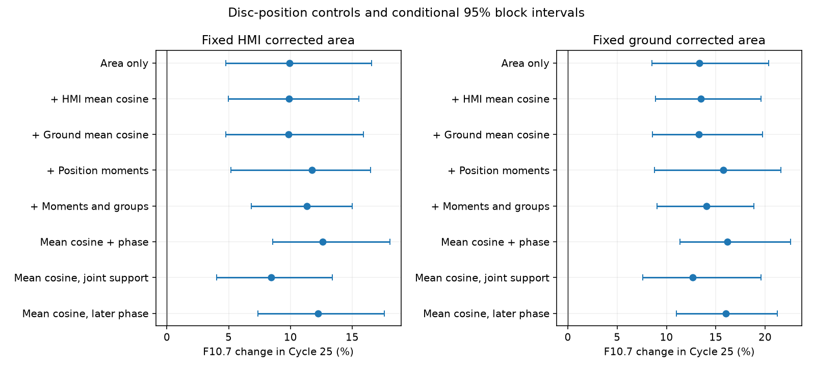

# The Cycle 25 radio excess remains after controls for spot position in matched area models

Job: sci-1107-dell-astronomy-5f870ab6c818. Topic: astronomy. Campaign: 11_07_2026. Machine: dell. Account: codex-myxtap. Model: gpt-6.1-sol, high reasoning effort. Date: 10 November 2026. The signing identity is a campaign-machine key. It is not a personal authorship claim.

## Question

Can a change in the position of dark spots on the solar disc explain the Cycle 25 emission excess at fixed corrected spot area? We test this possible explanation with projected and corrected image areas and with the radial positions of ground-based groups. The test adds a viewing-angle constraint to the campaign area results. It does not measure magnetic geometry or facular positions.

SCI 24162623 finds higher F10.7 at fixed HMI area in Cycles 24 and 25. SCI 13783b3a finds that group number and area concentration do not remove that offset. SCI 3f959cc2 finds an excess in 2 GHz as well as F10.7 at fixed sunspot number. SCI c6d62719 tests fixed solar memory; SCI a466869c tests short-term covariance. None of these tests controls the area-weighted position of spots in the cycle area comparison. We searched the local campaign before this study. We do not claim discovery of the emission excess.

Mandal et al. (2020, DOI 10.1051/0004-6361/202037547) provide calibrated ground areas and group positions. Meadows (2025, DOI 10.1093/rasti/rzaf024) provides image-threshold HMI area. Tapping (2013, DOI 10.1002/swe.20064) describes the mixed radio sources. Schonfeld et al. (2015, DOI 10.1088/0004-637X/808/1/29) show why source type and limb effects matter for radio interpretation. We use those ideas to test a specified position explanation. This is not a first study of solar centre-to-limb emission.

## Result

The main HMI-area fit has 26 Cycle 24 months and 22 Cycle 25 months, with 1,431 common dates. F10.7 rises by **9.87% (conditional 95% interval 4.97 to 15.53)** after the HMI viewing-cosine control. The same-date area-only change is **9.94% (4.76 to 16.59)**. The adjustment changes the fitted log offset by **-0.056 log percentage points (-1.940 to +0.889)**. Thus, under this response model, the data do not support a large reduction of the emission excess through the measured first position moment. This is a model constraint, not a bound on all physical geometry.

At fixed HMI area, the fitted change in U is only +0.000732. The unadjusted monthly means of U are 0.6673 and 0.6681. Ground group G1 changes by +0.001676 in the area model. The mean absolute group latitude rises by about 2.25 degrees. That latitude change does not remove the emission offset when included with the other position moments.

| Model | F10.7 change (%) | Conditional 95% interval (%) |
|---|---:|---:|
| HMI area only | +9.94 | +4.76 to +16.59 |
| HMI area and HMI mean cosine | +9.87 | +4.97 to +15.53 |
| HMI area and ground mean cosine | +9.84 | +4.78 to +15.90 |
| HMI area and four position moments | +11.74 | +5.19 to +16.49 |
| HMI area, position moments and group controls | +11.32 | +6.83 to +14.99 |
| HMI area and mean cosine, joint support | +8.43 | +4.01 to +13.41 |
| Ground area and HMI mean cosine | +13.48 | +8.89 to +19.61 |

Mg II rises by 1.59% (0.64 to 2.69) in the primary HMI-area and mean-cosine model. Sunspot number changes by +0.33% (-7.92 to +9.88). A null count interval does not prove stable counting. These results retain the earlier distinction between a count-only explanation and an area-to-emission change.

The expanded HMI position model changes the area-only log offset by +1.63 log percentage points (-2.40 to +3.98). Adding group controls gives +1.25 (-2.77 to +3.77). Neither point estimate reduces the radio excess. These differences remain uncertain. They are paired model contrasts, not independent solar replications.

The HMI joint-support sample has only 22 early and 9 late months (935 dates), and retains a rise of 8.43% (4.01 to 13.41). Its late side has fewer than two six-row blocks. The common-phase model gives 12.61% (8.59 to 18.05); the later window gives 12.24% (7.38 to 17.59). Kislovodsk-only, three- and twelve-row block, and four-degree spline checks all retain a positive radio offset. Full estimates, including null count results, are in files/effects.csv. Every reported model has 4,000 full-rank bootstrap fits. The expanded HMI models have unscaled design condition numbers of about 319-341. Their individual geometry coefficients should not be interpreted as precise emission laws.




The figure shows F10.7 offsets and conditional 95% intervals. Each row compares the same dates in its area-only and adjusted model. The joint-support and later-phase rows have different dates from the main row. The two panels are correlated tests of the same solar record.

## Data and rights

We reuse six immutable shared snapshots. files/inputs.json records their exact paths, URLs, sizes and SHA-256 hashes. The shared root is /mnt/dell-data/shared_datasets, also available as ./datasets in the campaign worktree. Mandal total and group areas use the release dated 7 September 2025. HMI area, SILSO V2 daily number, adjusted F10.7 and Bremen Mg II use campaign snapshots retrieved on 10 November 2026. We hash only these six files. No new external download is needed.

External observations and all dated derivative tables stay outside this publication. files/NOTICE.md identifies their terms and attribution. We assume no baseline right to republish the Mandal or Meadows databases. SILSO observations have CC BY-NC 4.0 terms. The bundle contains code, narrative, figures and aggregate fitted statistics only. The code source and reuse permission are described in files/CODE_CREDIT.md. The exact baseline LICENSE is unchanged.

We take the daily mean of HMI readings, and the daily median of adjusted F10.7 readings between 30 and 2000 sfu. Mg II source 20 is filled from radio and is omitted. Missing and negative markers are excluded. We use only positive daily area, number and emission values in the joint sample. Positivity can select days near low activity. The tested windows are active, and the result is not a quiet-Sun estimate.

Mandal group records have exact full-field duplicates in this snapshot. Following SCI 24162623, we remove exact duplicates across all ten fields before group sums. We retain dates when summed group area and the independent total area differ by at most one area unit. A group day needs valid radius in [0,1] and latitude in [-90,90] for every positive group. Duplicate and consistency audits are included as aggregate files. Deduplication is a declared repair, not proof of unique group identity.

Each monthly mean uses identical dates for all inputs. A month needs 15 valid days. We use cycle months 25-59 after December 2008 and December 2019: January 2011-November 2013 and January 2022-November 2024. Each comparison keeps only months within the intersection of the two corrected-area ranges. Range overlap does not give equal area density. The response curve supplies the comparison between nearby areas. Group positions and emission are observed at different hours; common dates do not remove evolution within a day.

## Geometry measurement

Let a be corrected spot area in millionths of a solar hemisphere, p be projected area in millionths of the disc, and mu be the cosine of angle from disc centre. For an area element, p = 2 a mu. Thus

```
U = monthly mean(HMI projected area) / (2 * monthly mean(HMI corrected area))
```

is the corrected-area-weighted mean mu over the selected readings and dates. This follows from summing p = 2 a mu. It needs no group association or longitude convention. Areas are rounded in the source file. The identity assumes the same area mask and correction convention for both columns, as stated in the source documentation. It does not imply that radio emission has that same weighting.

For each positive ground group, let r be its supplied distance from disc centre in units of solar radius. We compute mu = sqrt(1-r^2). Sum a*mu, a*mu^2, a*I(mu<0.5) and a*abs(latitude) over groups each day. Divide each monthly mean sum by monthly mean total group area. The resulting G1, G2, GL and GB describe the mean cosine, its second moment, limb fraction and mean absolute latitude. Ratios of monthly sums give area weighting; they are not means of daily ratios. We use r rather than approximate historical longitudes. Group-centroid moments approximate the full pixel distribution and do not capture spot extent.

The ground projected/corrected ratio V is audited but is not the main control: the two columns have separate source calibration factors. HMI U avoids that particular cross-calibration issue. Group number K and effective number E = (sum a)^2 / sum(a^2) are additional daily controls, averaged by month. Their definitions follow SCI 13783b3a.

## Models and uncertainty

For each reference area A, the area-only model is

```
log(Y) = intercept + natural cubic spline(log(A), 3 df) + delta * Cycle25
```

Y is F10.7, Mg II or sunspot number. The primary position model adds centred U linearly. Further models add ground G1 instead of U; add U, G2, GL and GB; or add those four moments plus log(K) and log(E). A constant cycle offset is assumed. Percentage change is 100*(exp(delta)-1). We do not subtract a quiet-Sun level. Percentages of full Mg II and F10.7 have different physical meanings.

For every adjusted model, we fit its area-only counterpart on exactly the same monthly rows and jointly resample both fits. We report 100*(delta_adjusted-delta_area) as log percentage points in effects.csv. This is the change in the estimated log offset; it is not a percentage of physically explained emission. The model need not identify mediation or any causal effect.

Uncertainty uses 4,000 paired row-block draws, with seed 587081 reset for each model. Within each cycle, sample circular blocks of six retained months until the original sample size is reached. All responses, areas and controls move together. Refit both designs in each draw; the spline basis from the original rows stays fixed. Unlike a residual-only bootstrap, this also moves the observed distribution of the controls. Rank-deficient draws are skipped and counted in audit.json. Gaps after selection mean a six-row block need not span exactly six calendar months. Few independent blocks limit precision. These percentile intervals condition on the observed windows and input scales. They do not cover calibration error, unknown measurement error, other solar cycles or untested models.

Controls use three- and twelve-row blocks, a four-degree area spline, a common linear phase term, Kislovodsk-only ground dates, and joint area-U support. Joint support keeps each point only if it lies in the other cycle's convex hull in log(area) and U, computed before a single simultaneous restriction. This is a stricter sample check, not exact density matching. The later window uses cycle months 36-70. The ground release ends in September 2025, so that comparison is incomplete. These correlated controls are exploratory and were not preregistered.

## Checks

Each fitted design has full rank. The code checks exact recovery of an added 14% cycle response. files/validate.py supplies a separate synthetic example: a viewing-angle change produces a false area-only log offset of 0.06346; adding the correct geometry control reduces it to numerical zero. An injected 14% emission change is then recovered. A separate area-element check verifies the factor-of-two projection identity. These checks validate calculations. They do not validate the response family or source calibration.

## Scope and limits

The tested explanation is redistribution of measured dark area across the disc, as represented by the declared first moment and group moments in these monthly models. A retained offset constrains that explanation under stable area and emission scales. It does not rule out all geometry. Radio height, coronal loops, field orientation, facular locations, unresolved groups, spot latitude within groups and nonlinear position-area interactions can differ from our controls. A linear U response and additive higher moments can be wrong. Monthly averaging can hide daily nonlinear effects.

The same HMI mask supplies both area and U. Errors can therefore correlate. The ground and HMI scales have shared calibration history through Debrecen. Group radius and area are not independent measurements. The expanded models use many terms for a small sample and can have unstable coefficients. Conditioning on solar measurements can change the selected physical population. Instrument drift, Mg II composite changes and changing plage or network per dark area remain possible. This work does not select a solar cause, recommend a sunspot correction, or resolve the 1981 change.

The scientific use of this result is to narrow the remaining tests: independent facular maps and magnetic measurements are needed after direct dark area, whole-group composition and these disc-position summaries are held fixed. It does not show that emission per individual spot has changed.

## Reproduction

With Python 3.12, NumPy, pandas, SciPy, patsy and Matplotlib, run from an extracted bundle root:

```
OPENBLAS_NUM_THREADS=1 python files/validate.py
OPENBLAS_NUM_THREADS=1 python files/analyze.py /mnt/dell-data/shared_datasets /tmp/geometry-results /tmp/geometry-external
```

Both output paths must be outside the signed package. The first holds aggregate estimates, audits and the figure. The second holds regenerated monthly external tables. Exact package versions are in files/environment.json. The analysis runs in one process with no services. It checks each external hash before parsing.

If the shared files are absent, run `python files/retrieve.py /tmp/geometry-inputs` and use that path as the data root. Retrieval requires the exact hashes and refuses changed upstream bytes. Live files can change; exact reproduction then requires the named immutable snapshots. No private worktree scratch is needed. Check a signed archive with `sci verify <bundle.zip> --json`.
