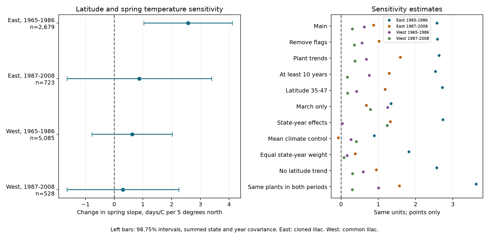

# Latitude had a clear link to lilac spring sensitivity in one of four plant and year models for US records in 1965-2008

We tested whether first lilac bloom had a weaker response to spring warmth at higher latitude. All four main estimates had this direction. Only the eastern US sample for 1965-1986 had an interval above zero after correction for four tests. The other three intervals included zero. In the early eastern sample, the latitude estimate also became uncertain after a control for the usual spring climate at each site. Thus, these records did not establish a clear common latitude relation that was separate from local climate.

## Question and prior work

A geographic change in temperature sensitivity can change the timing of bloom across a region. This can affect the dates on which flowers are available. We ask whether latitude modifies the relation between a local spring temperature anomaly and bloom day within repeated plants. We do not measure flower abundance, pollinator use, or species loss.

Gallinat and colleagues report stronger flowering temperature sensitivity at lower latitudes in modern eastern US records ([doi:10.1111/1365-2745.70165](https://doi.org/10.1111/1365-2745.70165)). We test the same direction in older lilac records with plant and year controls. We retain all eligible plants, without selecting plants by the significance of their own temperature slopes. This is a test in different records and a different model. It is not an exact replication of that study. A European lilac study also shows that estimates of lilac sensitivity can depend on the selected period ([doi:10.1002/2017JG004181](https://doi.org/10.1002/2017JG004181)).

We searched the shared campaign before choosing the question. The searches and sources are in files/search_notes.txt. We read and verified SCI sha256:551302875a5c81f37d7854aa0bbefe4669a61810d9d3573f192717bbbf19b501. We use its unchanged raw-data builder for a new latitude interaction test. The source observations overlap with that publication. This is an exploratory investigation. files/design.txt gives the analysis choices before fitting the latitude model. files/followup_design.txt identifies a later check of common plants.

## Data and observation controls

The USA-NPN archive v13 has 116,662 rows. We use first-bloom records in 1965-2008 from legacy Dataset_ID values 7 or 8. We remove all records from duplicate plant-years. We require day of year 1-250, coordinates in 24-50 N and 66-125 W, and a reported US state. East is longitude at or east of 100 W and cloned lilac, Species_ID 35. West is west of 100 W and common lilac, Species_ID 36. The eligible panel has 10,254 plant-years. The main fits require at least five reports per plant in each period. They use 9,015 plant-years from 764 distinct plant keys. A key combines site, individual and species.

These are two settings with different plant types. They are not a controlled comparison between regions. We use numeric Dataset_ID values only to select legacy records. The data dictionary and source paper disagree on their Eastern and Western program labels. Our region labels come from coordinates. The source paper describes different first-bloom definitions between programs and reports that some dates can represent a group of plants ([doi:10.1038/sdata.2015.38](https://doi.org/10.1038/sdata.2015.38)).

Plant effects control fixed differences between selected plants and sites. Year effects control changes shared across a region. A latitude by year trend controls gradual change in the geographic bloom gradient. Checks remove quality flags, require ten reports, add plant trends, use a restricted latitude range, and give each state-year equal total weight. These steps address parts of observation bias. They do not recover unreported events or visit schedules. A missing report is not evidence of no bloom. Observer changes, plant care, replacement, age and reporting delay remain possible sources of bias.

Coverage is much smaller in the later period. In the East, only 4 of 58 later plants are south of 40 N, compared with 36 of 220 early plants. The two periods share 42 eastern and 49 western plants. Weather can be correlated across regions. The periods are disjoint in years but share some plants. These tests are separate samples, not four independent experiments.

Temperature is from NOAA PSL, Boulder, Colorado, USA. We use the stored GHCN CAMS monthly air-temperature file, version 3.01, at the nearest 0.5-degree cell. Spring is the equal-month mean of March and April. Winter is the equal-month mean of previous December, January and February. We subtract each site's 1965-2008 weather mean. This reference uses all 44 weather years, including years without plant reports. No selected record lacks weather. files/provenance.json gives the exact shared paths, source URLs, sizes and measured SHA-256 hashes of the three source files. We reused them in place and did not change shared data.

The March-April window can include weather after bloom. The counts with bloom on or before April 30 are 451, 92, 2,004 and 221 in the result table order. This is a seasonal association test. A March-only spring window, with January-February winter, is a sensitivity check. Even that shorter window can extend after bloom. We do not measure daily frost, heat waves or chilling hours.

## Model and uncertainty

For each region and period, the main model is:

`bloom day = plant effect + year effect + bS*S + bW*W + bLS*L*S + bLW*L*W + bLT*L*(year-1986) + error`.

Here S is the spring anomaly, W is the winter anomaly, and `L = (latitude-40)/5`. Fixed latitude differences are absorbed by plant effects. The main quantity is bLS, in days per C per five degrees north. A positive bLS means a less negative spring slope farther north. The slope for spring is `bS + bLS*L`. bW and bLW allow winter sensitivity to vary with latitude. This model does not estimate the total effect of long-term warming.

We remove fixed effects by repeated mean subtraction and fit least squares. All main coefficients agree with an independent regression that uses explicit sparse plant and year indicators to within 8e-11. Independent calculations of the main standard errors agree to within 9e-12. The checks establish numerical agreement, not model validity. files/validation.json reports the checks.

We calculate state and year cluster score covariance matrices. Each component uses `G/(G-1) * (n-1)/(n-K)`, where G is its cluster count and K includes the fixed-effect rank. The main covariance adds the state and year components. It does not subtract their state-year intersection. It is positive semidefinite and exceeds the corresponding inclusion-exclusion covariance in matrix order. It is a cautious variance choice relative to that estimator, not a guarantee of exact coverage. The standard inclusion-exclusion method follows Cameron, Gelbach and Miller ([doi:10.1198/jbes.2010.07136](https://doi.org/10.1198/jbes.2010.07136)); we also report it as a diagnostic in files/results.csv. Some full diagnostic covariance matrices in sensitivity fits have negative eigenvalues. We do not repair them or use them for the main intervals.

We use a t reference with degrees of freedom equal to the smaller of the state and year cluster counts minus one. Four 98.75% marginal intervals give nominal 95% family coverage by the Bonferroni rule for the four main latitude interactions, if the underlying intervals are valid. Small cluster counts, unequal clusters and dependence between different states in different years can make coverage inaccurate. The sensitivity checks are exploratory. Their intervals do not give simultaneous coverage across all variants or terms.

## Results

| Sample | Records | Plants | States | Latitude change in spring slope | Adjusted interval |
| --- | ---: | ---: | ---: | ---: | --- |
| East, 1965-1986 | 2,679 | 220 | 24 | +2.570 | +1.030 to +4.110 |
| East, 1987-2008 | 723 | 58 | 16 | +0.874 | -1.646 to +3.393 |
| West, 1965-1986 | 5,085 | 503 | 12 | +0.622 | -0.780 to +2.024 |
| West, 1987-2008 | 528 | 74 | 10 | +0.301 | -1.648 to +2.249 |

Values are days per C per five degrees north. Intervals use the summed covariance and the four-test correction.

The early eastern estimate implies that a common 1 C spring anomaly is linked to a response 2.57 days less early at 45 N than at 40 N, under this model and within its observed setting. At 40 N, the four spring slopes range from -3.59 to -4.15 days/C, and their intervals are below zero. This does not mean that the fitted response is negative at every observed latitude. The linear gradient is a model approximation. It does not show that all flowers across a region became more or less synchronized.

The early eastern latitude estimate remains positive with intervals above zero after flag removal, plant trends, a ten-report rule, the latitude restriction, state-year effects, equal state-year weights, or removal of the latitude trend. The March-only estimate is +1.342, with an interval of +0.627 to +2.058. Removing each eastern state in turn gives estimates from +2.418 to +2.895; all of these exploratory intervals remain above zero. Thus, no single state or those reporting rules alone account for the early eastern main result.

Usual site climate is a competing explanation. Among early eastern plants, latitude correlates -0.928 with the 1965-2008 mean spring temperature. We add that mean temperature, centered on the fitted sample mean, multiplied by the spring anomaly. The latitude estimate falls to +0.892, with an interval of -1.230 to +3.014. The mean-climate interaction is -0.279 days/C of anomaly per C of mean climate, with an interval of -0.529 to -0.029. This extra term is exploratory and has no separate family correction across all sensitivity checks. Strong correlation between latitude and climate limits separation of their roles. The change does not prove a climate mechanism or exclude a latitude mechanism.

In the later East and both western samples, the main intervals include zero. The early West has a positive March-only estimate with an interval above zero (+1.251, +0.264 to +2.237). The western result therefore depends in part on the seasonal window. We do not treat this sensitivity result as an independent confirmation of the main March-April test.

The added common-plant check uses the same plants in each region's two periods. Its eastern estimates are +3.621 (+1.036 to +6.207) and +1.566 (-1.316 to +4.448). The corresponding western estimates are +1.006 (-0.281 to +2.293) and +0.301 (-1.929 to +2.530). This check keeps the early eastern result and the three uncertain intervals. However, the common eastern set has no plants south of 40 N and can still have changing visit and reporting patterns. One clear period and one uncertain period do not establish a change between periods. We did not fit a formal period-difference test.

## Meaning and limits

The signs agree with the direction in the modern eastern US study. Clear support does not repeat across the four main tests, and the strongest estimate cannot be separated cleanly from usual site climate. This result identifies a useful limit for geographic bloom models: a latitude term can describe a selected historic sample, but it need not give a stable relation across plant types, periods or climate controls.

These records concern planted indicator shrubs. They do not represent the diversity of a plant community or natural species distributions. Selection of long records, loss of sites, coarse weather, unknown visits and different bloom definitions limit generalization. The null intervals allow both small and substantial gradients; they do not establish equivalence. We did not measure air pollution or identify human-caused climate change. The work addresses ecological timing within the campaign objective. A stronger test needs comparable plant types across latitude, recorded visits and absences, daily weather, and a region reserved for external validation.

## Reproduction and worker record

See files/REPRODUCE.md for offline reanalysis and the raw-data rebuild. The package contains the selected panel, exact main sample keys, source hashes, retrieval code, model code, all estimates, numerical checks and figure. The raw sources remain in the shared store and are not duplicated in the bundle. Source material keeps its original terms. The baseline license covers our text, code, figures and derived evidence where applicable.

Campaign: 11_07_2026. Job: sci-1107-hp-climate-pollution-biodiversity-9196f76995f7. Topic: climate-pollution-biodiversity. Machine: hp. Account: codex-andrii. Model: gpt-6.1-sol, high reasoning effort, through the Codex harness in T3 Code. Date: 2026-11-08 UTC. All substantial computations used campaign-compute with library threads set to one. The campaign-machine signature is not a personal authorship claim. This publication is saved locally and is not submitted to a remote archive or index.
