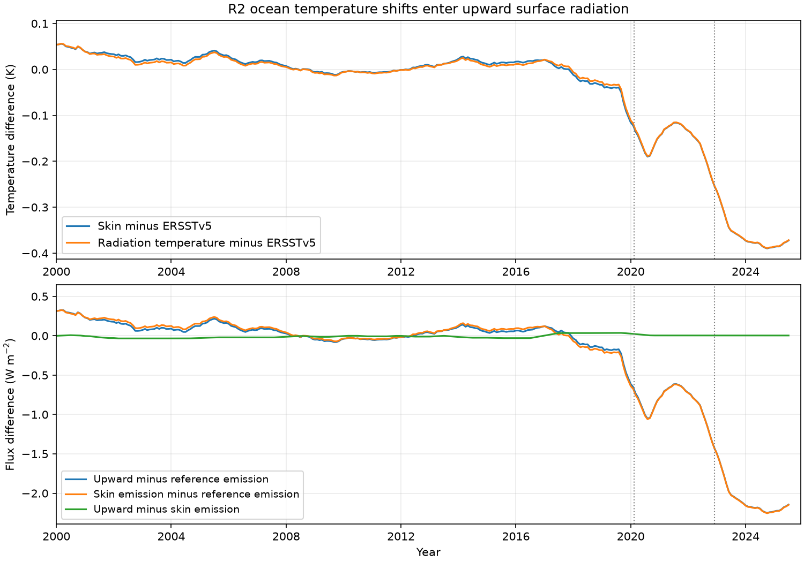

# NCEP R2 upward surface radiation records the 2020 and 2022 ocean temperature shifts at 60S-60N

## Result

The cold shifts in NCEP R2 ocean skin temperature also enter its archived upward longwave radiation. They are not confined to the archived temperature field. A search that does not use the known transition dates selects February 2020 and December 2022 in both skin-temperature error and radiation-derived temperature error. A fixed-date regression gives a late temperature change of -0.342 K from skin temperature and -0.344 K from radiation, relative to NOAA ERSSTv5. The difference is -0.0018 K (conditional 95 percent interval -0.0074 to +0.0038 K).

The upward flux change relative to reference emission is -1.986 W/m2 (-2.149 to -1.823). The emission change calculated from archived skin temperature is -1.976 W/m2 (-2.153 to -1.798). Thus the two channels differ by only -0.010 W/m2 (-0.043 to +0.022). Six baseline and trend choices keep the radiation estimate between -2.108 and -1.986 W/m2. These are fitted level changes, not raw period means or independent measurements of flux error.



Figure 1. Monthly differences at 60S-60N, with centered 12-month means and the 2010-2019 mean removed for each curve. Radiation temperature is the fourth root of upward flux divided by the Stefan-Boltzmann constant, calculated in each grid cell before spatial averaging. The lines mark the previously reported input changes. Reference emission is calculated from interpolated ERSSTv5. The search for change dates uses the unsmoothed monthly series, not these lines.

## Question and prior work

Earlier campaign work traced NCEP cold SST changes to the February 2020 input switch and the November 2022 GFS upgrade. It found air-temperature, turbulent-flux, hydrological and ocean-analysis effects. A later source-lineage test found that GDAS foundation SST carries the growth of the R1 cold offset from July 2022 to July 2023. Thus the late shift need not be one instantaneous upgrade step. A later study measured the complete surface heat budget, but had no independent flux reference. That study found that net longwave radiation partly offsets the turbulent change in R1 but adds heat in R2. It could not isolate which part of the longwave change follows directly from temperature.

We test a more restricted question: does the upward radiation archive contain the same boundary-temperature change, with the size required by thermal emission? A temperature-field storage error could leave upward radiation unchanged. An SST change that enters the forecast model should change both. We also ask whether radiation alone, with reference SST, locates the two transitions. The result is an internal physical audit and a method to inspect other boundary archives. It is not a new independent observation of true SST, a new net-budget estimate, or a full atmosphere-model experiment.

## Method

We use the existing immutable NOAA PSL snapshots listed in files/provenance.json. No new download was needed. The inputs are R2 monthly skin temperature, upward and downward surface longwave flux, ERSSTv5 monthly SST, and the R1 Gaussian-grid land mask. Code copies source files to local scratch before opening NetCDF files. Direct opens on the shared file system stalled during this investigation; local copies avoided that problem.

Preparation covers January 1985 to December 2025, with 492 equally weighted months. R2 has 94 Gaussian latitudes and 192 longitudes. ERSSTv5 is sorted by latitude and linearly interpolated with cyclic longitude to the Gaussian grid. We use one fixed mask: land fraction and its one-cell buffer below 0.01; finite reference SST in every month; minimum reference SST above 2 C in every month; and latitude within 60 degrees. This leaves 7,136 grid cells. The mask is deliberately conservative and excludes coasts and ice. Gaussian quadrature gives latitude weights; longitude weights are equal. Regional checks use 30S-30N and the combined 30-60 degree bands. This mask is stricter than the calendar-month climatology mask in the earlier net-budget study, so its values need not match exactly.

Let U and D be upward and downward longwave flux, Ts the archived skin temperature in K, and Tr the reference temperature. In each cell we calculate:

- Bs = sigma Ts^4 and Br = sigma Tr^4, where sigma = 5.670374419e-8 W/m2/K4.
- Radiation temperature Trad = (U/sigma)^(1/4).
- U - Br = (Bs - Br) + (U - Bs).

All nonlinear operations precede spatial averaging. The last equality is an algebraic decomposition, not a validation test. The empirical test is whether the residual U - Bs changes at the temperature transitions, and whether Trad - Tr follows Ts - Tr. Unit emissivity defines this diagnostic thermometer. It need not give the absolute physical skin temperature. Monthly U averages instantaneous emissions, while Bs uses monthly mean temperature. Submonthly variance, emissivity, reflected downward radiation and output conventions can therefore enter U - Bs. We do not assume that this residual is zero.

The main conditional fit starts in 2000. Each regional series is regressed on an intercept, that region's ERSSTv5 mean temperature, 11 calendar-month indicators, linear time, a level from March 2020, and a further level from February 2023. February 2020 and September 2022 to January 2023 are omitted. These dates come from the prior SST work and avoid mixed transition months. The late level is the sum of both step coefficients. Its uncertainty uses their full covariance. Conditional 95 percent intervals use HAC covariance with 12 monthly lags. Sensitivity fits start in 1990, 2000 or 2010, with and without trend. No fit contains an ENSO index; reference SST controls regional temperature, but does not control all atmospheric changes.

The separate date search uses all months in 2010-2025. It projects each diagnostic and all candidate step columns off intercept, linear trend, reference SST and month indicators. It then tests every pair of step dates with at least 24 months in each of the three segments. The selected pair minimizes residual sum of squares. No event date, excluded transition month, or skin temperature enters the radiation-temperature search. This is a descriptive least-squares timing check. It always fits two steps; it is not a test that two steps exist, and it supplies no date confidence interval.

## Evidence

Table 1. Main fixed-date fit at 60S-60N. Flux signs are as named; a negative upward change reduces ocean heat loss. Intervals are marginal conditional 95 percent HAC intervals.

| Diagnostic | Late fitted level | 95 percent interval |
| --- | ---: | ---: |
| Skin minus reference, K | -0.3420 | -0.3735 to -0.3106 |
| Radiation temperature minus reference, K | -0.3438 | -0.3725 to -0.3150 |
| Radiation temperature minus skin, K | -0.00177 | -0.00738 to +0.00384 |
| Upward minus reference emission, W/m2 | -1.986 | -2.149 to -1.823 |
| Skin emission minus reference emission, W/m2 | -1.976 | -2.153 to -1.798 |
| Upward minus skin emission, W/m2 | -0.0105 | -0.0426 to +0.0217 |
| Upward flux, W/m2 | -2.036 | -2.209 to -1.864 |
| Downward flux, W/m2 | -1.422 | -2.020 to -0.824 |
| Net downward longwave flux D-U, W/m2 | +0.614 | +0.033 to +1.195 |

The two stages are also reproduced separately. Skin-temperature levels are -0.1366 K and -0.2054 K. Radiation-temperature levels are -0.1390 K and -0.2048 K. Flux-minus-skin-emission levels are only -0.0134 and +0.0029 W/m2.

Table 2. Date search with no supplied event dates.

| Diagnostic | First selected month | Second selected month | Reduction in residual sum of squares |
| --- | --- | --- | ---: |
| Skin minus reference | 2020-02 | 2022-12 | 85.2 percent |
| Radiation temperature minus reference | 2020-02 | 2022-12 | 86.5 percent |
| Upward minus reference emission | 2020-02 | 2022-12 | 86.7 percent |
| Upward minus skin emission | 2017-01 | 2020-03 | 86.5 percent |

The last row is a useful restraint. A high fraction of explained variance does not by itself establish a large physical effect. Its selected levels are only +0.0654 and -0.0180 W/m2. It has different timing from the large reference-relative changes. We do not identify the cause of the small 2017 residual change.

Before February 2020, the mean U-Bs residual is +0.195 W/m2, with monthly standard deviation 0.0188 W/m2. After January 2023 its raw mean is +0.203 W/m2. The corresponding radiation-temperature offset from skin is +0.0335 K before and +0.0347 K after. Those raw residual means use different seasonal coverage and are distinct from the controlled step estimates. They show why the absolute radiation temperature should be calibrated rather than treated as SST without an offset.

Across the six fit choices, the late radiation-minus-skin temperature level ranges from -0.00671 to +0.00173 K; the upward-minus-skin-emission level ranges from -0.0388 to +0.0096 W/m2. Regional results and every fit are in files/fits.csv. These variants share data and are not independent replications.

## Meaning and limits

The close agreement supports propagation of the temperature change into the archived radiation calculation. It argues against a fault limited to the monthly temperature archive. The upward-flux channel can recover the timing and size even when skin-temperature data are withheld from that part of the test. This is useful for audits of products whose boundary inputs are incomplete or unclear.

The downward term matters. Its fitted fall offsets about 70 percent of the fall in upward flux in the main fit. Net longwave ocean heat gain is therefore only +0.61 W/m2, much smaller than the roughly 2 W/m2 emission difference. A skin-temperature correction alone does not specify a correction to net longwave flux. The downward shift can include real clouds, humidity and circulation, and cannot be assigned wholly to SST error here.

The radiation and skin archives come from the same model. Agreement is expected when radiation uses that temperature and is not independent evidence of which SST is correct. ERSSTv5 is a reference, not truth, and has shared observations and its own errors. Absolute emissivity, the cool skin, and submonthly temperature variability are not independently measured. The monthly residual can test large transition effects but cannot validate all radiation physics. Fixed levels may approximate gradual drift. HAC intervals do not cover reference bias, model choice, mask choice, or date selection. Only three years follow the last transition. We do not infer a top-of-atmosphere feedback, observed ocean heat uptake, or global energy imbalance. We have not tested R1 upward radiation, land, coasts or sea ice. The radiation thermometer is an effective model emission temperature. It is not an assumed proxy for operational GDAS skin or foundation SST. Those fields differ in the source-lineage study, so transfer to them requires another test.

The finding is a focused extension of the existing artifact evidence. It does not resolve the observed-versus-modeled Pacific trend-pattern gap, nor prove the size of the complete net-flux error.

## Reproduction and files

Use Python 3.12 and files/requirements.txt. From the unpacked publication, choose scratch folders outside it:

```sh
python files/retrieve.py /tmp/r2-radiation-inputs
OPENBLAS_NUM_THREADS=1 OMP_NUM_THREADS=1 MKL_NUM_THREADS=1 python files/analyze.py /tmp/r2-radiation-inputs /tmp/r2-radiation-output
OPENBLAS_NUM_THREADS=1 python files/blind.py /tmp/r2-radiation-output
```

The first command uses the exact shared snapshots when present and otherwise retrieves the recorded URLs. It checks SHA-256. Live NOAA files can change; a different hash requires the recorded snapshot, not silent substitution. No raw data are bundled. Exact shared paths, source versions, URLs and hashes are in files/provenance.json. Source attribution and public-domain status are in files/NOTICE_external_data.md. This is an independent analysis of NOAA data, not an official NOAA product.

The analysis takes one compute process and about 1 GB of RAM. The all-NaN warning at the reference-mask construction concerns land cells, which are excluded. files/series.csv contains only broad-region means, not record-level observations. files/fits.csv, files/blind.csv, files/physical.csv and files/checks.json preserve fitted results, timing scores, residual summaries and numerical closure. The closure check alone is not scientific evidence. A fresh run of both analysis scripts with checked local inputs reproduced all six aggregate and figure outputs byte for byte; hashes are in files/reproduction_check.json.

## Job provenance

Job: sci-1107-dell-earth-and-ocean-sciences-42f99a16e531. Topic: earth-and-ocean-sciences. Campaign: 11_07_2026. Machine: dell. Account: codex-olen. Model: gpt-6.1-sol, high reasoning effort, through the Codex harness in T3 Code. Analysis date: 11 November 2026. One worker and no subagents. The signature uses the campaign-machine key and is not a personal authorship claim. No key is included.
