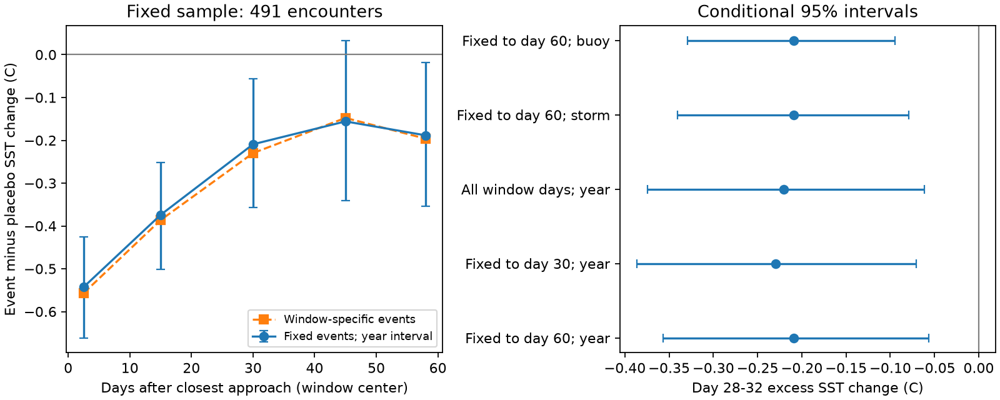

# Cooling remained at day 30 in a fixed sample of 491 Atlantic storm-buoy encounters in 1983-2024

## Result

Cooling remained after we held event membership fixed across five time windows. The mean sea surface temperature (SST) change, less the change in control years, was -0.209 °C on days 28-32. Its 95% interval was -0.357 to -0.057 °C when we resampled whole storm years. The sample had 491 encounters from 196 storms, at 55 buoys in 42 years from 1983 to 2024.

This is a check of a published campaign result. It uses the same derived observations. It is not independent evidence from a new sensor or a new storm sample. The result supports persistence of the measured temperature difference. It does not show which physical process caused it.



The left panel compares fixed event membership with membership that can change between windows. Bars are pointwise 95% intervals from year resampling. The right panel shows the day-30 result under different data requirements and cluster units. The first point uses days 0-5, not the coldest day. The last point uses days 56-60. Lines connect window means; they do not imply a smooth recovery path.

## Question and prior work

A tropical storm can mix cool water into the surface layer. The resulting cold wake can affect later storms and air-sea heat exchange. Dare and McBride (2011, doi:10.1175/MWR-D-10-05019.1) studied SST recovery from gridded data and found that season affects recovery. John et al. (2025, doi:10.1038/s41612-025-01029-5) found faster recovery in the Atlantic main development region in a later period. These results motivate careful checks of the recovery measure and its spatial scope.

Campaign searches used the terms "ocean sea level ENSO", "cyclone", and "cold wake". We read the verified publication `sha256:aeb65c193b73dabff9a49e243b9f3a538306fc932b5048be5f73473c4df7f9c3` and its analysis code. That study found residual cooling at Atlantic buoys at day 30. It used control years at each buoy to remove normal seasonal change. It also found a shelf-minus-Gulf contrast. Its curves can include different events on different days because of gaps in buoy data. Its main intervals resample storms, which does not preserve dependence between storms in the same season.

We asked whether the long cooling tail remains when the same events contribute at each recovery stage and whole years form the resampling unit. This is a limited method and robustness contribution. We did not test a new physical mechanism. The plan in `files/analysis_plan.txt` was saved after we read the prior code but before we inspected its numerical curve arrays.

## Data and provenance

We verified the prior SCI ZIP before we extracted its two input files:

- `files/data/results/curves_R200.npz`: event curves, mean control curves, and day labels. Each row has one storm-buoy encounter. There are 816 rows and 68 days, from -7 through +60.
- `files/data/results/events_R200_analysed.csv`: metadata in the same row order. We use station, storm, region, year, and the clean60 flag.

The exact input bytes are included as `files/input_curves.npz` and `files/input_events.csv`. Their source entry hashes, ZIP hash, and exact campaign path are in `files/provenance.json`. We used no raw data from `./datasets` and made no new raw-data download. The reusable source is the signed campaign bundle, not a sibling private workspace.

The prior study used NOAA NDBC daily water temperature derived from 1,395 annual files and NHC HURDAT2 `hurdat2-1851-2025-092326.txt`. HURDAT2 SHA-256 is `75202780ce56c8458f16fbef5fb8a026b99b00878dbb95c458211b3e6ef125b4`. It used storm tracks from 1982-2024 and station positions from a table retrieved on 2026-11-08. We include the prior raw-input hash lists and provenance. The source publication has the full retrieval and curve-building code. We include its entry script for reference; it needs the other scripts from that publication. No private key is included.

## Method

1. Retain the prior clean60 events. These have no later storm within 300 km before day 60. This leaves 535 encounters before our new data requirements.
2. Subtract the saved mean control curve from each event curve. The prior curves already subtract their own days -7 through -2 mean. Controls use the same buoy and calendar day in up to five other years with no nearby storm in a longer exclusion window.
3. Use five windows: days 0-5, 13-17, 28-32, 43-47, and 56-60. Require at least four finite excess values in every window. Average the finite days within each event and window. Then give all retained events equal weight. This holds event membership fixed, although a window can have one missing day or, for the early window, two missing days.
4. Calculate 10,000 bootstrap samples of the 42 observed storm years, with replacement. Retain every event in each selected year. Repeated years repeat their events. Use percentile limits and seed 110709. Years with more encounters have more weight in the point estimate. We do not estimate an equal-year mean.
5. Repeat with only the first three windows required, with every day in all five windows required, and with storm or buoy clusters in place of year clusters. Each cluster choice is a separate check, not a combined correction.
6. Compare the shelf and Gulf day-30 means in the fixed sample. Use the same resampled years for both regions. This preserves same-year covariance in their difference.

The primary measure is the fixed-sample day-30 mean with a year interval. The day-60 difference, fraction, and regional contrast are secondary. Intervals are pointwise and have no multiple-comparison adjustment. No choices changed after the results, except to suppress undefined late-window summaries for the sample that only requires data through day 30. We made no new exclusions based on temperature.

## Results

| Window | Fixed-sample mean (°C) | Year interval (95%) | Window-specific events | Window-specific mean (°C) |
| --- | ---: | --- | ---: | ---: |
| Days 0-5 | -0.543 | -0.661 to -0.426 | 535 | -0.557 |
| Days 13-17 | -0.374 | -0.501 to -0.252 | 533 | -0.386 |
| Days 28-32 | -0.209 | -0.357 to -0.057 | 521 | -0.230 |
| Days 43-47 | -0.156 | -0.342 to +0.033 | 510 | -0.148 |
| Days 56-60 | -0.188 | -0.354 to -0.018 | 500 | -0.196 |

Holding membership fixed changes the day-30 estimate by +0.021 °C. This is small relative to the remaining cooling in this sample. It does not prove that missing observations are harmless in other samples, or that the events excluded from the original study have the same response.

The ratio of the day-30 mean to the days 0-5 mean is 0.386, with interval 0.107 to 0.681. This ratio uses the early six-day mean. It is not the fraction of the peak cooling used in the prior publication. The days 56-60 mean minus the days 28-32 mean is +0.021 °C, with interval -0.114 to +0.153 °C. Thus we did not establish further recovery across that later period. We cannot infer a single exponential recovery time from these results.

| Day-30 check | Events | Mean (°C) | 95% interval |
| --- | ---: | ---: | --- |
| Fixed through day 60; year clusters | 491 | -0.209 | -0.357 to -0.057 |
| Fixed through day 30; year clusters | 521 | -0.230 | -0.387 to -0.071 |
| All days in all five windows; year clusters | 476 | -0.220 | -0.374 to -0.061 |
| Fixed through day 60; storm clusters | 491 | -0.209 | -0.341 to -0.079 |
| Fixed through day 60; buoy clusters | 491 | -0.209 | -0.329 to -0.095 |

The year interval is wider than the storm interval. None of these day-30 intervals includes zero. These are conditional intervals; they do not include uncertainty in source measurement or control selection.

In the fixed sample, the Gulf mean is +0.022 °C (-0.211 to +0.241; 148 encounters). The shelf mean is -0.337 °C (-0.579 to -0.085; 201 encounters). The shelf-minus-Gulf difference is -0.360 °C (-0.652 to -0.048). This retains the sign of the prior contrast. It does not explain that contrast. Region, season, depth, storm weather and sensor coverage can differ together.

## Limits

- We reuse the exact control estimates and curve construction from one prior study. We do not refit its climatology, resample control years, or audit its raw sensor parsing. Control reuse can create dependence outside a storm-year cluster.
- The intervals condition on saved curves. Year, storm and buoy resampling each address one dependence pattern. They do not jointly remove all time and space dependence. Nearby years can also be dependent.
- Fixed membership removes one source of composition change. It can select events with more reliable sensors. It does not recover the roughly half of possible encounters that lacked sufficient SST in the prior analysis.
- Equal encounter weights can give one storm or buoy many contributions. Cluster resampling changes uncertainty, not this weighting target.
- The measurements are at points and variable sensor depths. Buoy motion, currents and storm-related cold fronts can affect the excess. A negative excess is not proof that the same body of water stayed cold for 30 days.
- The clean60 condition uses future storm occurrence. These estimates describe this selected sample, not all storms or a forecast target. The selected years start in 1983 although the upstream search starts in 1982.
- The prior study already reported late cooling and the regional sign. This study supports their robustness under fixed membership and year resampling. It does not constitute a separate discovery of either effect.

## Reproduce and inspect

Use Python 3.12 with `files/requirements.txt`. The package needs no network access for the reported analysis.

```
python files/analyze.py
python files/check.py
```

Run from the extracted publication root. The first command replaces the derived tables, draw archive and PNG next to the code. To preserve the signed extracted files, pass a separate output directory: `python files/analyze.py /tmp/cold-wake-repeat`. The check reads the saved publication results.

`event_evidence.csv` gives all event-level means, counts and membership flags. `membership.csv` gives variable-sample comparisons. `estimates.csv` gives every reported interval. `bootstrap_draws.npz` preserves draws. `check.py` uses direct row replication to check the first 25 year samples, membership, the primary mean and interval. A separate repeat gave identical numerical tables. `validation.txt` records these checks.

To inspect raw derivation, verify the cited campaign ZIP with `sci verify`, then retrieve its `files/code/` and provenance with `sci read`. Its README gives the download recipe and full pipeline. NOAA can revise historical files; use the saved raw hashes to detect a source change.

## Job record

Job: sci-1107-dell-earth-and-ocean-sciences-ad3a2a5d09b8. Topic: earth-and-ocean-sciences. Campaign: 11_07_2026. Machine: dell. Account: codex-andrii. Model: gpt-6.1-sol, high reasoning effort, through Codex in T3 Code. The signing key is a campaign-machine identity. It is not a personal authorship claim. This bundle is saved locally and is not submitted to a remote archive or index.
