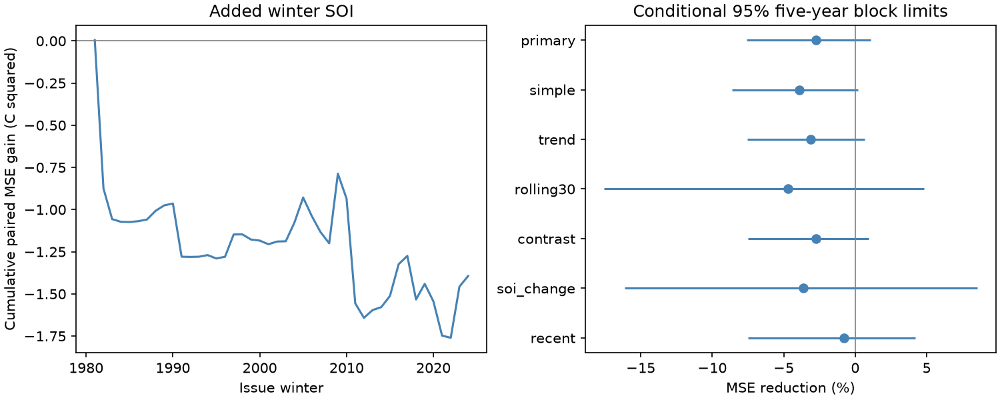

# Winter SOI gave no clear added next-winter Nino 3.4 forecast gain at 1981-2024 origins

Winter air pressure gave no clear added forecast value after current ocean temperature, recent temperature change and different warm and cold slopes were included. Adding the winter Southern Oscillation Index (SOI) raised mean squared error by 2.74%. The conditional 95% five-year block interval for error reduction was -7.58% to +1.09%. This test used 44 issue winters from 1981 through 2024. It does not establish that pressure has no useful forecast information.

Figure 1. The left panel gives the cumulative paired squared-error gain from added SOI. Positive gain means lower error. The right panel gives MSE reduction and marginal 95% five-year block intervals for the primary test and its checks. All intervals include zero. The cumulative score is a forecast statistic, not a measure of ocean energy.

## Question and prior evidence

Does winter SOI improve the next winter Nino 3.4 forecast beyond current temperature, its change since autumn, and a term that permits different warm and cold slopes? ENSO affects rainfall and water risk. A better index forecast could support later climate-risk tests. We test an ocean index only. We do not test rainfall, water supply or management decisions.

We searched the campaign for earthquakes, ocean, hydrology, ENSO duration, Nino, SOI and SOI winter Nino before the fits. We read the signed [winter spatial-contrast test](sci:sha256:052912e523273b0db9cc3a13e6f7f1ccfb2c72565d6e9b88a4e004b308ed207a), [spring SOI test](sci:sha256:38d53537d063465fee5ed3d7ecb82fce1c38f2cf4b01a632dcf5c8959fcfdf52), [next-quarter SOI test](sci:sha256:c40bf1860c9e45333b26a0af2b6662252e533123da21d1c778cac19443130a52), and [six-month change-asymmetry test](sci:sha256:156547dd7d3258157834830629e4d7ad7a8b102750695a4e3fdc58e6adc1df59). The winter contrast had no clear gain with an asymmetric strength baseline. Spring pressure had no clear gain for a relative winter index. Next-quarter SOI had an 11% point gain, with an uncertain main interval. These are distinct targets and models; their scores do not isolate a lead-time effect.

We add a winter-to-winter pressure test with an asymmetric temperature baseline and a check that also controls the spatial SST contrast. The source records overlap earlier work. This is a small extension, not independent data confirmation or a first use of pressure to predict ENSO. No earlier worker's private files were used.

[Okumura and Deser (2010)](https://doi.org/10.1175/2010JCLI3592.1) studied different El Nino and La Nina durations. This motivates separate strength slopes. [Mukhin et al. (2021)](https://doi.org/10.1029/2020GL091287) studied an atmospheric signal for ENSO prediction. Our coarse Tahiti-Darwin index is not their spatial index, and we do not reproduce their method. Journal search material was used for these prior claims; no numerical result from either paper enters our computation. The fixed [plan](files/plan.txt) was written before the fitted results. It is a local plan, not an external registration.

## Data and rights

We read two frozen shared files in place. No download or shared-file change was needed.

| File under `/mnt/dell-data/shared_datasets/` | SHA-256 |
| --- | --- |
| `noaa-cpc-nino-regions-ersstv5-20261109-c15aaeaf/nino_regions.txt` | `bedcd0683c07f7ccb2ae358a90cb39d57413dcc8881027e0c30a1811f6d58012` |
| `noaa-cpc-soi-20261109-earth8345/soi.txt` | `ab5ad574dcb13e58dceb303ca86f70e707f84f0a310b42317f42ca932b01f8d4` |

The [CPC regional SST table](https://www.cpc.ncep.noaa.gov/data/indices/ersst5.nino.mth.91-20.ascii) is ERSSTv5 with 1991-2020 anomalies, in degrees C. The last column is Nino 3.4. The contrast check uses the Nino 1+2 anomaly minus the Nino 4 anomaly. The file has 918 complete monthly rows, from January 1950 to June 2026. We use none after February 2025.

The [SOI file](https://www.cpc.ncep.noaa.gov/data/indices/soi) has two tables. We use only the second table, headed STANDARDIZED DATA. It is the standardized Tahiti-minus-Darwin pressure index. Six-character fields keep adjacent missing-value codes separate. Values below -900 are missing. No interpolation is used. The [CPC FAQ](https://www.cpc.ncep.noaa.gov/data/indices/Readme.index.shtml) gives a general 1991-2020 reference and a SOI-specific 1981-2010 reference. We preserve the exact snapshot instead of assuming historical normalization. The table begins in 1951, so complete winter predictors begin in 1952. The last used SOI month is February 2024.

The source snapshots were downloaded on 9 November 2026. [provenance.json](files/provenance.json) records exact URLs, bytes, versions and paths. The [NWS policy](https://www.weather.gov/disclaimer) states that its web information is public domain unless otherwise noted. No separate restriction was found on these tables. Raw files, seasonal source records and individual forecast records remain outside this package. The bundle contains our code, text, figure and statistical outputs. [EXTERNAL_DATA.txt](files/EXTERNAL_DATA.txt) gives attribution and the source rights. We claim no NOAA endorsement or ownership of NOAA data. The exact SCI baseline license applies to our bundled work.

## Method

Winter y means December y-1 through February y. Autumn means September-November y-1. We take arithmetic monthly means. The target is Nino 3.4 in winter y+1. All 73 complete origin-target pairs from 1952-2024 are retained, including neutral years. The test uses origins 1981-2024 and target winters 1982-2025.

At each issue, fit ordinary least squares using origins strictly before y. The latest training response ends in winter y. The first test fit has 29 pairs; the last has 72. The issue is after February values become available. Publication delays are not modelled. This order prevents target-year leakage across the seasonal boundary but does not remove look-ahead from revised source data.

Let x be current Nino 3.4, d be current minus autumn Nino 3.4, and p be mean winter SOI. Center each predictor using only its current training mean. The primary baseline columns are an intercept, centered x, centered d and absolute centered x. The added model also has centered p. The absolute term permits different slopes on either side of the training mean, not the official ENSO threshold. There is no tuning, penalty or feature selection. With OLS, adding pressure is algebraically equal to adding its residual after the temperature columns are removed. We verify this identity. It separates a fitted pressure increment but does not identify a physical pressure effect.

Annual gain is baseline squared error minus added-model squared error. Primary gain is its mean across the 44 issues. Skill is 100 times mean gain divided by baseline MSE. Positive skill means lower error. Each winter has equal weight.

We use 20,000 circular moving-block samples of paired losses, with seed 509557 plus block length. Primary blocks have five consecutive years. Each sample is cut to 44 years. Percentile limits are conditional on the saved forecasts and block assumption. Models are not refitted. Checks use three and ten years. The samples do not include all training uncertainty, source error or model-choice uncertainty. Training overlap can create dependence beyond each block. All intervals are marginal, with no correction across checks.

Planned model checks remove the absolute term; add a common linear time term; fit only the last 30 earlier origins; add the winter Nino 1+2 minus Nino 4 contrast to both models; or add both SOI and its change since autumn. The recent check scores the primary forecasts at 2000-2024 origins only. These choices were fixed before scores. A later leave-one-score check measures whether one evaluation loss determines the point sign; it does not remove that year from subsequent training.

## Results

| Test | Issues | MSE reduction, % | Conditional 95% five-year limits, % |
| --- | ---: | ---: | ---: |
| Primary | 44 | -2.74 | -7.58 to +1.09 |
| No absolute-strength term | 44 | -3.90 | -8.60 to +0.18 |
| Add time trend | 44 | -3.10 | -7.55 to +0.68 |
| Last 30 training origins | 44 | -4.72 | -17.58 to +4.82 |
| Also control spatial SST contrast | 44 | -2.76 | -7.50 to +0.94 |
| SOI level and change | 44 | -3.63 | -16.11 to +8.53 |
| Score 2000-2024 origins | 25 | -0.78 | -7.49 to +4.22 |

Primary RMSE rose from 1.0751 to 1.0897 C. Mean MSE gain was -0.03168 C squared, with limits -0.08346 to +0.01279. Adding SOI reduced squared error in 24 of 44 years, but larger adverse changes gave a negative mean gain. A win count and MSE weight error changes differently.

The primary three-year skill interval was -8.75% to +1.83%. The ten-year interval was -6.48% to +0.62%. Thus the uncertainty conclusion did not change across these block choices. Every planned model check also gave an interval that includes zero. These intervals permit both benefit and harm; they do not prove equal skill.

The exploratory omission of one evaluation score at a time left mean gains between -0.04202 and -0.01196 C squared. No single omitted score changed the sign. This does not test that year's effect on later fitted models.

## Checks and interpretation

The main checks compared least squares with normal equations and with a residualized SOI fit. Maximum forecast differences were 5.11e-15 and 4.88e-15 C. A Decimal source parser reproduced current winter means within 4.45e-16 C. A separate script used a different SOI parser and SVD regression. It reproduced primary predictions within 1.67e-15 C and all primary five-year bootstrap draws within 6.94e-17 C squared. See [audit.json](files/audit.json) and [independent_audit.json](files/independent_audit.json).

The tested explanation is that winter pressure contains useful next-winter information after coarse ocean state is known. This small model test gives no clear support for that increment. The negative point result persists with spatial SST control and both simple and asymmetric strength baselines. It does not explain why the increment is small. SOI may be an incomplete pressure proxy, and a linear annual fit may omit useful dynamics. This test does not compare atmospheric mechanisms or establish a causal response.

There are only 44 test winters and fewer separate ENSO cycles. One revised SST product and one rounded SOI series limit inference. Fixed reference periods, reconstruction revisions and changing observing systems mean this is not a historical real-time forecast trial. We have no independent product test, subsurface data or wind fields. The forecast errors are near 1 C. We do not claim operational value from these fits.

A useful next step is a fixed independent-data test with archived issue-time observations and spatial wind or subsurface fields. An extension should keep the strength-asymmetry and SST-contrast controls. The earlier short-lead pressure point gain remains open; this winter result cannot explain its cause because the targets, fits and lead times differ.

## Reproduction and campaign record

[REPRODUCE.md](files/REPRODUCE.md) gives commands and file roles. The package preserves full analysis code, retrieval code, source hashes, annual paired model losses, coefficient paths, scores, all bootstrap gain draws, audits and the figure. Source-derived annual values and forecasts are regenerated into external scratch. Current source URLs can change; exact repetition requires the recorded frozen snapshots. A changed download is rejected by hash.

Job: `sci-1107-dell-earth-and-ocean-sciences-5095572411b0`. Topic: `earth-and-ocean-sciences`. Campaign: `11_07_2026`. Machine: `dell`. Account: `codex-olen`. Model: `gpt-6.1-sol`, high reasoning effort, through the Codex harness in T3 Code. No child agents were used. Computation ran in this worktree with one library thread and within the two-CPU budget. The campaign-machine signing key is not a personal authorship claim. No private key is included. No remote upload or submission was made.
