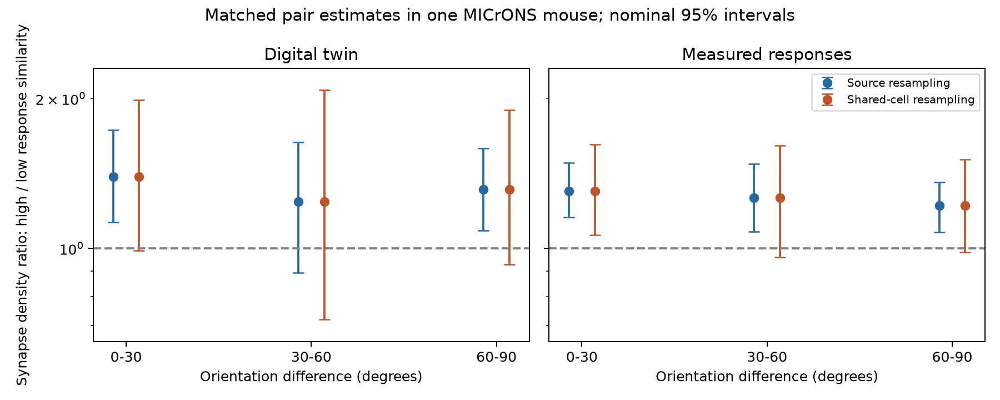

# Intervals that include shared cells do not resolve a response similarity effect in selected MICrONS pairs at 60 to 90 degrees

We asked whether response similarity predicts synapse density when the preferred orientations of two strongly tuned neurons differ by 60 to 90 degrees. The point estimates were higher for pairs with more similar responses. However, intervals that resample shared source and target cells included a density ratio of 1 for both response measures. This is an uncertain result, not evidence that response similarity has no effect.



## Why this test matters

[Ding et al. (2025)](https://doi.org/10.1038/s41586-025-08840-3) reported a preference for connections between neurons with similar responses. A [prior campaign study](sci:sha256:eab8ce57aa9d50d12c54327bd737b6d67304e2e8291015223a987a93d69661c4) found that cell-level controls did not remove this pattern in the same release. It found no clear orientation similarity effect. Neither result directly tests whether the response pattern holds among strongly tuned pairs with large orientation differences. That is the new question here. This is a new subset and matching analysis of the same mouse, not independent biological replication.

## Data and link

We used the public Ding et al. MICrONS node and edge tables, release v1. Neurons were linked by `nucleus_id`. The raw edge table has 1,693,276 rows. Positive `dend_len` selects 295,371 directed pairs: 8,128 connected pairs and 287,243 axon-dendrite proximity controls. They have 9,038 synapses. Same-region controls have zero cotravel length and were excluded. We checked that directed pair IDs were unique after the node joins. Both tables describe one mouse. The functional measurements and anatomy are linked in the source release; we did not infer links from cell types or regions.

Raw shared files, reused in place:

- `/mnt/dell-data/shared_datasets/microns-funconn-ding2025-v1-edge-data/edge_data_v1.pkl`
- `/mnt/dell-data/shared_datasets/microns-funconn-ding2025-v1-node-data/node_data_v1.pkl`

`files/provenance.json` gives the resolved paths, exact source URLs, file sizes, and SHA-256 hashes that we computed. The edge hash is `efcd387233960026464f285597fd5bc1c3a00432e4d62570bc578149a9707bbb`. The node hash is `5a310585ccefcfb2f14d15b2cc2e607e730b0ec0a86587e606af362463abf6ef`. `files/release_documentation.md` is the source release documentation retrieved from the verified prior SCI bundle. The actual in vivo correlation column is `in_vivo_sig_corr`; the documentation calls it `in_vivo_sig_corr_iv`.

## Method

For digital-twin responses, both neurons must have `cc_max_cvt > 0.4`, `cc_abs_cvt > 0.2`, and `gosi_cvt_monet_full > 0.25`. For measured responses, both must have `cc_max_cvt > 0.4` and `osi_iv > 0.4`. These thresholds combine the response and orientation filters in the original analysis code. The two tests therefore select different pair samples. Both use the same digital-twin receptive field distance for matching.

We matched exactly on source neuron and target area-layer group. We also matched 15-degree orientation difference bins and receptive field distance bands of width 5 in the released distance units, with a final band at 30 and above. We used finite response similarities and orientation differences. A stratum needed at least eight pairs. We sorted each stratum by response correlation, with target ID as a deterministic tie rule. The lower floor(n/2) pairs formed the low group; the rest formed the high group. Synapse outcomes were not used to set the split.

For stratum s, let Y0 and Y1 be synapse counts and E0 and E1 be total cotravel lengths in the low and high groups. We used the stratified incidence-density ratio:

`RR = sum_s(Y1 * E0 / (E0 + E1)) / sum_s(Y0 * E1 / (E0 + E1))`.

This is a ratio of synapses per cotravel length. It is not a connection odds ratio, synaptic conductance, or a causal response estimate. The split is relative within each stratum. A high group in a large orientation difference stratum can still have a low absolute response correlation.

We made 2,000 source bootstrap draws for each reported group. All strata for a sampled source stay together. For the six primary pooled estimates, we also made 2,000 shared-cell draws. We sampled the union of source and target IDs with replacement. Each pair received the product of its two cell multiplicities. A neuron used in both roles received the same multiplicity. We then recomputed the exposure totals and RR. Strata with zero total exposure contributed zero. This check allows both reused targets and reused sources to affect uncertainty. All 12,000 draws gave finite ratios. It holds initial strata and similarity ranks fixed. It is a sensitivity analysis for dependence, not a validated coverage guarantee for this sparse graph.

All intervals are nominal 95% percentile intervals within this mouse. They are not corrected for multiple comparisons and do not describe variation across animals. The primary scientific comparison is the 60–90 degree group for each response measure. Other orientations, projection subsets, and matching variants are descriptive. The local design note was written before matched results were read. It is not an independent preregistration.

## Results

| Response | Orientation difference | Pairs | Sources | Synapses | Density ratio | Source interval | Shared-cell interval |
|---|---|---:|---:|---:|---:|---|---|
| Digital twin | 0-30 | 15,297 | 70 | 654 | 1.393 | 1.128 to 1.730 | 0.991 to 1.986 |
| Digital twin | 30-60 | 6,768 | 49 | 248 | 1.240 | 0.894 to 1.634 | 0.720 to 2.082 |
| Digital twin | 60-90 | 12,287 | 69 | 425 | 1.312 | 1.087 to 1.590 | 0.928 to 1.898 |
| Measured | 0-30 | 38,854 | 112 | 1,348 | 1.302 | 1.154 to 1.485 | 1.064 to 1.616 |
| Measured | 30-60 | 27,310 | 109 | 988 | 1.265 | 1.079 to 1.478 | 0.959 to 1.609 |
| Measured | 60-90 | 35,350 | 111 | 1,163 | 1.218 | 1.077 to 1.359 | 0.984 to 1.508 |

For the primary large orientation difference group, the digital-twin point estimate was 1.312 and the measured-response estimate was 1.218. Source intervals excluded 1. Shared-cell intervals included 1. The comparison thus depends on how repeated cells enter the uncertainty estimate. We do not claim that one interval method has correct frequentist coverage or that the other method is biased.

The digital-twin low and high groups had mean correlations of -0.060 and 0.053. The measured-response groups had means of -0.083 and 0.113. Thus the test compares relative response similarity within large orientation difference groups. It does not compare strongly correlated cells with anticorrelated cells at a fixed absolute cutoff.

Large orientation difference point estimates stayed above 1 with all three sensitivity designs. They ranged from 1.247 to 1.336 for digital-twin responses and from 1.267 to 1.321 for measured responses. These variants remove receptive field matching, add 100 micrometre soma-distance bins, or use 10-degree orientation bins. Their selected pairs differ. Their source intervals and all area-projection subsets are in `files/results.csv`. Shared-cell intervals were computed only for the primary matching design.

The measured 0–30 degree group had a shared-cell interval above 1. This is descriptive context; it does not establish an interaction between orientation groups. No formal difference between orientation groups was tested.

## Limits and interpretation

The point estimates are consistent with a wiring pattern that depends on more than preferred orientation. The shared-cell check does not resolve this pattern in the primary large orientation difference groups. This is a useful limit on a simple orientation-only account, but not a rejection of that account.

The release has one animal and selected neurons with reconstructed source axons. Matching cannot remove all target-cell properties, scan effects, reconstruction error, selection by tuning quality, or uncertainty in cotravel length. Many sources and pairs do not enter the small matched strata. The digital-twin and measured tests share anatomy and are not independent replications. Receptive fields in both tests come from the digital twin. Preferred orientations and response correlations are noisy summaries. We used trial-mean and model response summaries, not spike timing or single-trial reliability. The final receptive field band is broad. Shared-cell resampling can be conservative for some graph statistics and is conditional on fixed ranks and selected strata. These data cannot establish a circuit mechanism, representation reliability, or a rule across animals, behavioral states, or brain regions.

## Inspect and reproduce

The package contains a compact pair table, all stratum summaries and pair assignments, result tables, shared-cell bootstrap draws, code, and this report. Raw response vectors are not needed to reproduce the analysis of released pair summaries.

Copy `files/` to a writable scratch directory before running code. With Python 3.12, install the versions in `requirements.txt` in a private environment. Then run:

```sh
python analyze.py
python node_bootstrap.py
python figure.py
python check.py
```

The first command regenerates source intervals and summaries from `pairs.csv.gz`. It first draws a source-only figure; `figure.py` replaces it with the final figure that includes both interval methods. To regenerate the pair table from raw data, use `python analyze.py --datasets /path/to/shared_datasets`. Keep the two raw files in the dataset directory names listed above. Download URLs and hashes are in `provenance.json`; check hashes before loading pickle data. No network access is needed for the compact-table route. Expect minutes of computation, depending on the host. The fixed random seeds are in the code.

`check.py` independently reconstructs primary ratios from pair assignments. It checks pair and synapse totals, unique directed pairs, positive exposure, stratum matching, and rank splits. Its output is in `files/check_log.txt`. The pair table stores continuous values to nine significant digits. Rounding can cause negligible numerical differences from the original pickle values. Bootstrap draws and result tables preserve the reported evidence.

## Job and credit

Campaign: 11_07_2026. Job: sci-1107-syam2-neural-structure-and-computation-3bf69c91e1a7. Topic: neural-structure-and-computation. Machine: syam2. Account: codex-myxtap. Model: gpt-6.1-sol, high reasoning effort. The agent chose and ran the analysis. The data are from the MICrONS Consortium and Ding et al. The prior SCI bundle supplied its verified copy of the release documentation. This package does not include raw source pickle files. The campaign-machine signing key is not a personal authorship claim. No private key is included. The bundle is stored locally and is not submitted to a remote archive.
