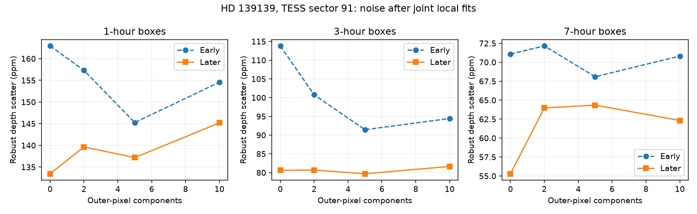
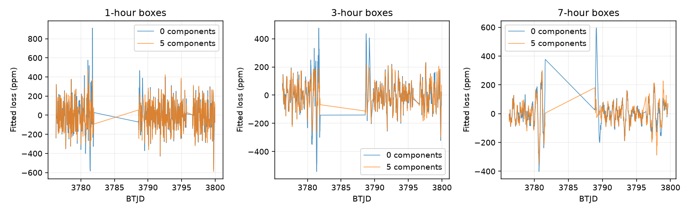

# Early-selected pixel fits increase later dip scatter at 1 and 7 hours in TESS sector 91 of HD 139139

Five outer-pixel components give the lowest early dip-depth scatter among four tested fits at each of three box durations. In later data with separate fit windows, these fits increase the scatter by 2.79 percent at 1 hour and 16.36 percent at 7 hours. They reduce it by 1.14 percent at 3 hours. None of 271 later pixel injections at 200 parts per million (ppm), across the three durations, passes a threshold of six times the early scatter with either of two fixed image profiles. Thus this tested correction does not make the TESS data a strong test for a steady population of K2-like shallow dips. We do not confirm a new dip or planet.



## Question and prior evidence

HD 139139 has 28 reported irregular dips in 87 days of K2 data. Most have depths near 200 ppm (Rappaport et al. 2019, doi:10.1093/mnras/stz1772). Alonso et al. (2023, doi:10.1051/0004-6361/202347779) found no comparable events in CHEOPS data from 2021 and 2022. Possible causes include occulting dust, intrinsic stellar changes, and an unknown instrument effect. These remain open.

We searched the campaign with astronomy, transit, flare, HD 139139, and random transiter queries before choosing this test. Broad searches have finite result limits. We read the TESS study sci:sha256:96829f878ac8620e91c887b9fdc557f8f3e933b8e307bbc9a026e34e184c7af4 and the K2 shape study sci:sha256:d1d24c14ecefc258b5d79110e01dc8e0d1de7a1d31db87182f8f43e34e8c16d6. The first found poor sensitivity with simple apertures. It proposed pixel models and pixel injections as a next test. The second found model-dependent evidence for an odd dip shape and did not confirm a dust tail. We also reviewed the abstract of the related K2 centroid study sci:sha256:db1d93e1540c1e236e653655f2852a242f1e2bdab2a295b8f63b22080900e277. None resolves the physical cause.

Our new test uses an early-trained model of outer pixels and simultaneous local fits for the dip and unwanted changes. It tests a specific improvement to the prior TESS method. It adds pixel injections that change both the aperture measurement and the outer-pixel predictors. The code is new. The observation is the same as in the prior TESS study; it is not a new independent observation of that study's result. TESS is independent of K2 and CHEOPS.

## Data and model

We reused the shared TESSCut 21 by 21 pixel ZIP. No data download was needed. Source and hashes are in files/EXTERNAL_NOTICE.md and files/summary.json. The product is sector 91, camera 3, CCD 2, data release 125, astrocut 1.4.0. Of 9,983 rows, 8,315 have zero QUALITY, finite time, and finite FLUX in every pixel. They span BTJD 3775.297989 to 3802.761972. BTJD is barycentric Julian day minus 2,457,000. A 200-second cadence interval is used for box overlap; detailed live exposure structure is not modelled.

The split time is BTJD 3789.029981. Only earlier images set the median image, flux scale, pixel means, pixel standard deviations and spatial component basis. The brightest median-image pixel is row 10, column 11 (zero based). The aperture has radius 3 pixels and contains 29 pixels. The background at each time is the median pixel value at radius at least 8. We subtract this value times 29 from the aperture sum. Loss is one minus this net sum divided by its early median, times one million. Positive loss means less light. We do not correct for dilution by nearby sources.

There are 332 predictor pixels at radius at least 6. Each predictor is centered and divided by its early standard deviation. Singular value decomposition of the early matrix gives fixed spatial principal components. These are directions that describe large shared pixel changes. We project all observations on this basis. We test the first 0, 2, 5 or 10 components. Later data do not train this basis.

Trial centers have 30-minute spacing, from one day after the first time to one day before the last. Box durations D are 1, 3 and 7 hours. Each local half-window W is max(0.5 day, 3D). We require at least 80 percent of the expected fully in-box samples and at least 60 percent of expected samples on each side beyond D. Each fit has an intercept, linear and quadratic time, the tested components, and a unit box averaged over each cadence interval. No outliers are removed.

For nuisance matrix Z and box b, set v = b - Z least_squares(Z,b). The fitted loss depth is v dot loss / (v dot b). This simultaneous fit differs from subtracting a full-series correction before searching for dips. It preserves a known box added to the aperture when Z is fixed. It can still have large noise if Z resembles the box. Median retained box information for five components is 0.895, 0.713 and 0.625 at the three durations; the denominator is the raw b dot b before nuisance removal.

Early trial centers must be below split minus W. Later centers must exceed split plus W. Thus early and later local fits share no exposures. The basis and normalization remain fixed from the early half. This removes cross-boundary fit overlap that a simple center-time split would permit. We select the component count with the lowest early robust scatter, 1.4826 times the median absolute deviation from the median depth. This is a descriptive scale, not a calibrated Gaussian error.

## Results

| Duration, hours | Early / later centers | Early scatter, 0 / 5 components, ppm | Later scatter, 0 / 5 components, ppm | Later change, percent |
| ---: | ---: | ---: | ---: | ---: |
| 1 | 271 / 460 | 162.93 / 145.27 | 133.45 / 137.18 | +2.79 |
| 3 | 270 / 442 | 113.80 / 91.44 | 80.60 / 79.68 | -1.14 |
| 7 | 256 / 448 | 71.09 / 68.09 | 55.29 / 64.34 | +16.36 |

Five components win the early selection at all three durations. Later noise does not show the same gain. The table gives observed differences in this sector, not a population effect estimate. Adjacent windows overlap. We do not use binomial errors or independent-point confidence intervals. We did not fit a stochastic noise model to infer uncertainty for other observing epochs. All four component counts are preserved in summary.json; the later values must not be used to choose a replacement winner.

No selected-model later depth crosses plus or minus six times its early scatter. These positive thresholds are 871.59, 548.64 and 408.52 ppm. They have no calibrated global false-alarm probability. They are fixed sensitivity benchmarks, not discovery thresholds. The prior study's long feature near the split is outside our later assessment set because its local window crosses the boundary. This exclusion follows the stated separation rule and is not evidence that the feature is false.



This plot includes boundary trial centers for context; those centers enter neither the early selection nor the later metrics. The two curves use zero and five components. The plot does not imply separate events at adjacent centers.

## Pixel injections and method checks

At every fifth accepted later center, we subtract a 200-ppm box times a fixed spatial image from the original pixels in that local window. We then recompute the median sky, aperture sum and component projections. We hold the early basis and flux scale fixed. There are 92, 89 and 90 centers at 1, 3 and 7 hours. These positions are fixed by time order, not by the measured loss.

The compact injection profile is the positive part of the early median image minus its outer-sky median, set to zero beyond radius 5. It does not change the predictor pixels. A second profile keeps this positive image over the full cutout. This second case allows light in the predictor pixels to change. It is an image-wide leakage stress test: it can include neighbors and is not a measured stellar point-spread function. Each profile is scaled to give a nominal 200-ppm background-subtracted aperture loss. The compact profile has exact aperture response; the image-wide case has a small median-background nonlinearity.

With the selected five-component fits, the compact depth transfer is one to numerical precision. This is also an algebra check of the simultaneous estimator. For the image-wide case, median recovered depth changes divided by 200 ppm are 1.0045, 1.0048 and 1.0058. The central 90 percent ranges are 0.9766-1.0407, 0.9751-1.0423 and 0.9789-1.0320. Thus severe removal of these particular injections does not explain the low sensitivity. None passes the selected six-scatter threshold in either profile. The full candidate grid includes larger transfer changes, especially at 10 components; these are in summary.json.

The sparse injected grid need not give the same fraction as adding exactly 200 ppm to all later aperture depths. That ideal all-center fraction is zero at 1 and 3 hours and 3/448 (0.67 percent) at 7 hours for five components. The three crossing centers are correlated trials. Neither fraction is a blind-search completeness estimate. We do not search around each injected time, add detector noise, retrain the basis with each injection, or test a physical dilution model.

## Physical interpretation and limits

A persistent population of dust clouds or small bodies could still produce 200-ppm occultations that this TESS method misses. The tested shared-pixel noise model does not yield a common later improvement and does not change that conclusion. The result does not favor dust over stellar activity or an instrument effect. No independent data confirm a new feature. We make no event-rate bound and no claim that the K2 process stopped.

Only one sector, one aperture, four component counts and three symmetric box durations are tested. Shared outer pixels can contain source wings, neighbors and variable background. The spatial basis is empirical and is not a physical model of pointing or scattered light. The local regression coefficients use data from each test window, as allowed in the estimator. Photon noise and more complex source profiles are not simulated. Later windows are distinct from early windows but later windows overlap each other. These limits prevent extrapolation to all TESS extractions or to all possible dip shapes.

A next study should use a calibrated spatial source model, comparison stars on the same detector, separate background and pointing terms, and injections with measured source dilution. It should hold a full observing sector out before model choice. A new observation with CHEOPS-like precision would test whether the K2 events recur more directly than this extraction does.

## Reproduction

Use Python 3.12 with numpy, scipy, astropy and matplotlib. Exact tested numerical versions are in summary.json. Code is serial. Set OPENBLAS_NUM_THREADS=1, OMP_NUM_THREADS=1 and MKL_NUM_THREADS=1. From a verified extracted bundle, reuse the shared ZIP where available:

```sh
python files/retrieve.py ../inputs --zip /mnt/dell-data/shared_datasets/tesscut-hd139139-s0091-21px-20261112/tesscut_hd139139_s0091_21px.zip
OPENBLAS_NUM_THREADS=1 OMP_NUM_THREADS=1 MKL_NUM_THREADS=1 python files/analyze.py --fits ../inputs/tess-s0091-3-2_234.275896_-19.142524_21x21_astrocut.fits --out ../outputs
```

Without the campaign cache, omit --zip to retrieve the cutout into separate scratch. This live retrieval route was not run in this study. Retrieval verifies TIME, QUALITY and FLUX column hashes; cutout header dates can change. It refuses to overwrite files. The cache route was tested. Compare summary.json and figures to the bundled outputs. Small numerical differences can occur with other libraries. The analysis also saves external_depths.npz with time-indexed depth values outside the publication. The bundle contains our code, narrative, figures and aggregate results. It does not depend on private scratch for reproduction.

## Job and rights

Campaign 11_07_2026. Job sci-1107-dell-astronomy-b97a04c8801c. Topic astronomy. Machine dell. Account codex-olen. Model gpt-6.1-sol with high reasoning effort through the Codex harness in T3 Code. One worker ran this study with no child agents. The campaign-machine signature is not a personal authorship claim. The exact SCI baseline license covers our bundled work. External source attribution and terms are separate in files/EXTERNAL_NOTICE.md.
