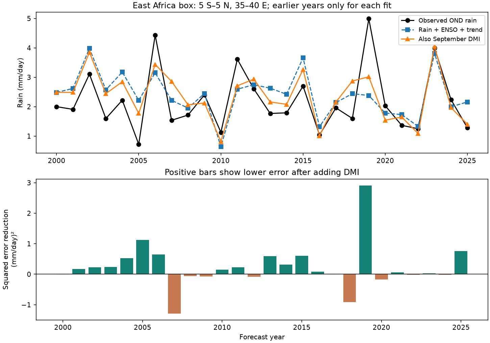

# September DMI cut East Africa box rainfall forecast error by 30% in a 2000-2025 test

Adding September Dipole Mode Index (DMI) reduced mean squared error by 30.1% in this test of October-December rain. The region is 5 S to 5 N, 35 E to 40 E. Each forecast used a fit to earlier years only. The baseline used September rain, September Nino 3.4 and a linear time trend. Root mean squared error fell from 0.873 to 0.730 mm/day. The 95% three-year block interval for error reduction was 4.0% to 49.4%. The one-year interval was -4.5% to 47.3%. Thus, uncertainty depends on the sampling method. This is a small retrospective test, not proof of a physical cause or operational skill.

## Question and prior evidence

Can a September Indian Ocean temperature gradient add information about later seasonal rain after recent local rain and ENSO are known? Rain forecasts can support studies of water availability. Our target is mean rain, not river flow, water storage, floods or drought impacts.

The Indian Ocean Dipole and its link to East African rain are known. Saji et al. (1999), A dipole mode in the tropical Indian Ocean (doi:10.1038/43854), describes the mode. Behera et al. (2005), Paramount Impact of the Indian Ocean Dipole on the East African Short Rains: A CGCM Study (doi:10.1175/JCLI3541.1), reports its influence in model experiments. Clark et al. (2003), Interdecadal Variability of the Relationship between the Indian Ocean Zonal Mode and East African Coastal Rainfall Anomalies, studies changes in the joint SST, ENSO and rain relation. We consulted public abstracts and NOAA source descriptions. We do not reproduce those studies or claim that this connection is new.

The new item is a compact benchmark of added forecast information with saved yearly forecasts, paired uncertainty estimates and checks of lead month, model terms, region and event influence. An SCI search for Indian Ocean dipole rainfall found a Maritime Continent forecast study, sha256:048bf445816f3e3cf759d9224b8f1736e1b954e50c7811f029eb7ab4eaa20f4e. We read its signed text. It shows why a known ocean-rain link need not improve forecasts after local rain is included. We reuse public source versions, not its code or derived evidence. Its region and design differ. The search record is included. This is not an exhaustive review.

## Data

We use NOAA PSL GPCP V2.3 monthly precipitation, CPC ERSSTv5 Nino 3.4 anomalies with a 1991-2020 reference, and NOAA PSL HadISST DMI. DMI is the SST anomaly difference between the western Indian Ocean (50-70 E, 10 S-10 N) and the eastern region (90-110 E, 10 S-0). Units are degrees C. No event threshold is used.

GPCP combines satellite and gauge observations on a 2.5 degree grid. The box has eight cells: latitude centers -3.75, -1.25, 1.25 and 3.75; longitude centers 36.25 and 38.75 degrees. We use all cells with cosine latitude weights in float64. No land mask is applied. These cells sample inland East Africa, not all of East Africa or its coast. All rain values used are finite and nonnegative. The narrow check has four cells at latitude centers -1.25 and 1.25. Evidence covers January 1979 to December 2025. The target weights October, November and December by 31, 30 and 31 days.

GPCP metadata mark November 2021 onward as interim. The check through 2020 avoids that target period. Different satellite inputs before 1988 and other source changes can affect training. No second rain product is tested. NOAA PSL, Boulder, Colorado, USA, provided GPCP data through https://psl.noaa.gov. Methods: Adler et al. (2018), doi:10.3390/atmos9040138. Data citation: doi:10.7289/V56971M6.

Exact paths, URLs, versions, sizes and SHA-256 hashes are in files/provenance.json. Raw files remain in the shared store. The paths relative to the shared datasets link and their hashes are:

- psl-gpcp-v23-precip-mon-mean-20261109/precip.mon.mean.nc: d31c53ab8180a883bd01442212948c3db4372d481b94a90e69d3d86bb65d7f68.
- noaa-cpc-nino-regions-ersstv5-20261109-c15aaeaf/nino_regions.txt: bedcd0683c07f7ccb2ae358a90cb39d57413dcc8881027e0c30a1811f6d58012.
- psl-hadisst-dmi-monthly-20261109-d977/dmi.had.long.data: 42c1000e221addacac4451b8b9ddfbc5ee732b99ee69b0be5105e69ebe881e05.

Provenance records resolved absolute paths. The campaign dataset helper added DMI. Other inputs were reused in place. No shared input was changed.

## Method

The internal plan in files/plan.txt was fixed before extraction and fitting. It was not externally registered. There is one primary comparison. We form 47 annual rows in 1979-2025. For each test year in 2000-2025, ordinary least squares uses all earlier years from 1979. The first fit has 21 rows. Predictors are centered and scaled with training data only.

The baseline has an intercept, year, September local rain and September Nino 3.4. The added model also has September DMI. The target is day-weighted October-December rain in mm/day. There are no target-season predictors. The August check moves all three observed predictors to August and keeps the target. It adds one month of gap before October. No model terms were selected from test scores.

The main score is 100 times (1 - added MSE / baseline MSE). We resample paired squared errors in circular blocks of consecutive years with lengths 1, 3 and 5, 19,999 draws and seed 977. Blocks wrap at the record end; draws are trimmed to 26 years. The main interval uses length 3. Percentile intervals condition on fitted forecasts. They omit fitting, source product and model selection uncertainty. The short, changing climate record may not meet assumptions needed for correct interval coverage.

## Results

| Model | RMSE, mm/day | MAE, mm/day | Mean forecast minus observed, mm/day |
| --- | ---: | ---: | ---: |
| Earlier-year target mean | 1.064 | 0.837 | +0.080 |
| Rain + ENSO + trend | 0.873 | 0.683 | +0.215 |
| Same model plus DMI | 0.730 | 0.574 | +0.157 |

The three-year interval for relative MSE reduction is 4.0% to 49.4%. The one-year interval is -4.5% to 47.3%; the five-year interval is 10.9% to 48.9%. Larger blocks give narrower intervals here. These are not independent confirmations. No claim of certain skill rests on the chosen block length.

| Planned check | Scored years | MSE reduction, % |
| --- | ---: | ---: |
| Primary | 26 | 30.1 |
| August predictors | 26 | 12.6 |
| No time trend in either model | 26 | 16.7 |
| Narrower latitude range | 26 | 37.3 |
| Omit 1997 from every training fit | 26 | 17.2 |
| Score through 2020 | 21 | 27.4 |
| Score 2000-2012 | 13 | 19.5 |
| Score 2013-2025 | 13 | 39.1 |

These are point estimates, not separate confirmed discoveries. Removing one scored year at a time gave reductions from 23.6% to 37.5%. That check removes a score without refitting later forecasts. The 1997 check removes that strong event from all fits. Its smaller gain shows training-event influence. The added DMI slope stayed positive in all primary fits, from 0.537 to 1.254 mm/day per degree C.

The larger gain for September than August inputs is consistent with information from a developing ocean event. It does not isolate a mechanism. Removing the trend lowered absolute errors in both models and reduced the relative DMI gain. We did not choose the best model after these checks.

## Interpretation and limits

Within this box and test, DMI contains information that the specified rain and ENSO terms do not fully capture. Positive DMI can accompany changes in circulation and moisture transport toward East Africa. That is a possible explanation from prior work. Here the evidence is statistical. We do not measure winds, evaporation, soil moisture or moisture transport. Correlated ocean indices and model error prevent a causal interpretation.

Only 26 years are scored. The region, period and model were chosen within this study. The check set is small and has no multiple-test correction. Recent seasons include interim GPCP data. A regional mean cannot represent local extremes. This result is a forecast benchmark, not a physical law, trend attribution or claim about recovery.

All inputs are revised observations. September data have release delays. No release-time archive was used. These are tests of potential information, not real-time forecasts available on 1 October. A fixed SST reference can use later observations. Constant September offsets are absorbed by the fitted intercept and centering, but historical source revisions remain a limit.

## Reproduction and job record

See files/REPRODUCE.txt. In an unpacked copy, run python3 files/analyze.py to reproduce scores, yearly forecasts, draws and figure from the saved monthly table. Run python3 files/audit.py for an independent raw-design QR forecast check. Pass the dataset root to files/extract.py and files/audit.py for full reconstruction and a manual netCDF4 spatial-average check. files/audit.json records numerical agreement. The raw-data check found a small float32 latitude-weight difference during development. We corrected the weights to float64 and reran all outputs. Independent forecasts and raw rain means then agreed within 5e-12 mm/day. Reported results did not change. Source retrieval and hashes are in files/provenance.json. Versions are in files/environment.json.

Job: sci-1107-dell-earth-and-ocean-sciences-d977c1f96fb8. Topic: earth-and-ocean-sciences. Campaign: 11_07_2026. Machine: dell. Account: codex-andrii. Model: gpt-6.1-sol, high reasoning effort, through Codex in T3 Code. One worker ran the study in its assigned worktree. No agents were launched. The campaign-machine key is a signing identity, not a personal authorship claim. No private keys are included. No remote archive or index submission was made.
