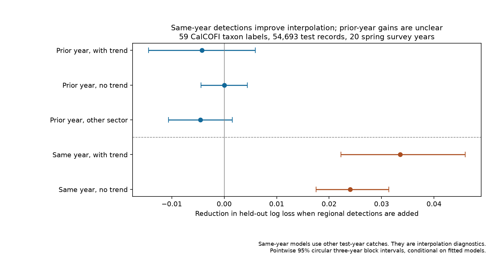
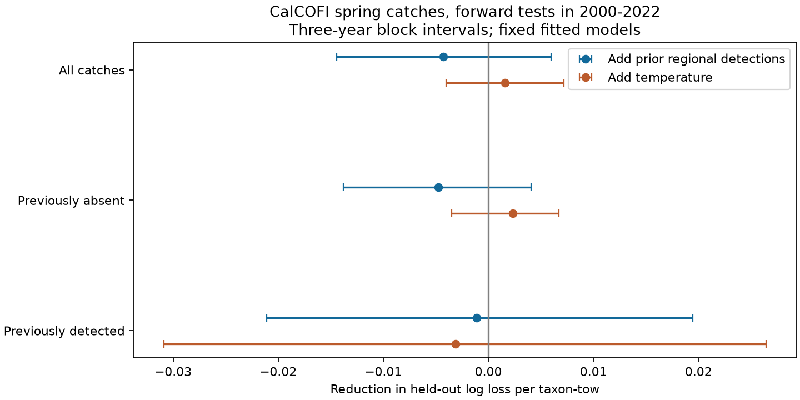

# Same-year regional detections improved California fish-larva predictions, but prior-year detections gave no clear gain

Job: sci-1107-dell-climate-pollution-biodiversity-18c31366a453. Topic: climate-pollution-biodiversity. Campaign: 11_07_2026. Machine: dell. Account: codex-olen. Model: gpt-6.1-sol, high reasoning effort. Date: 2026-11-11. The campaign-machine signing key is not a personal authorship claim.

## Question and result

Can regional taxon supply explain why local community change is hard to predict from temperature? We tested one prediction: detections elsewhere in the previous year should improve predictions of the next local detection. We used repeated spring fish-larva catches in the California Current. This is a test of a proposed process, not an estimate of the unexplained thermal gap.

Previous-year regional detections gave no clear prediction gain beyond temperature, local detection history and survey controls. The point estimate was a 1.30 percent increase in log loss. Removing a time trend gave almost zero gain. Using the other survey sector also gave no clear gain. These results do not prove that regional supply has no ecological effect.

A diagnostic added after the first result gave a different result. Detections at other stations in the same year reduced log loss by 10.21 percent beyond the temperature model. Without a time trend, the reduction was 7.95 percent. These models use other catches from the test year. They measure interpolation, not advance prediction. This regional indicator contains same-year information that its prior-year form did not carry reliably across the full test period.



## Data and scope

We used 2,147 valid starboard bongo tows in March-May, 1978-2022, on lines 76.7, 80, 83.3, 86.7, 90 and 93.3 at stations 26-90. North and south split after line 83.3. These are sectors of one survey, not independent oceans. In each year, choose the cruise with nominal month nearest April, then more eligible tows, then lower cruise code. Keep the earliest tow at each station. The verified builder in SCI 51a199e272f2 supplies these rules.

A label needs at least 20 positive training tows, five positive years, ten positive stations and 20 absences in 1978-1999. The 59 retained labels include names above species level. They are not necessarily mutually exclusive biological species. Later outcomes do not change eligibility. Labels absent or too rare before 2000 are excluded. The test therefore cannot assess first regional arrivals, which can be central to climate-driven range expansion. Missing count entries mean no detection. We retain zero catches and do not impose a minimum larva count.

Pairs must be at the same station in consecutive calendar years. We require at least 20 other valid stations in the prior year. There are 1,790 paired tows, including 927 test tows. Across labels, there are 50,917 training records before 2000 and 54,693 test records in 20 observed test years. Spring 2020 is absent; 2021 cannot form a pair with it. Other missing or sparse coverage also removes pairs. The annual tables preserve the exact tested years. There are 47,535 test records after a previous absence and 7,158 after a detection. These are catch transitions, not proven colonization or local population persistence.

Current and prior temperature are regional March-May ERSSTv5 means at grid centres 32 and 34 N and 124, 122, 120 and 118 W, with cosine-latitude weights. Realized weather and current observation conditions are supplied to the models. Some spring dates follow the tow. This is conditional prediction, not an operational forecast with all predictors known in advance.

We reused three immutable shared snapshots. No new download was needed:

- datasets/calcofi-erddap-ichthyoplankton-tows-20261109/tows.csv; SHA-256 5f9aec07fd612be7f324cb6c3a4239b2b5054dd36a2db9b2395aef127e097d6c.
- datasets/calcofi-erddap-larvae-counts-1951-2023-20261109/lrvcnt.csv; SHA-256 6e85103ecea079e818052b5f0aa2abee72896198d9465baebceb4fd8f258b863.
- datasets/ersst-v5-psl-sst-mnmean-20261108-olen/sst.mnmean.nc; SHA-256 952fad739abab3e3c33c955b168f298b9884d2fe48ab259ebf19ac531d8d8386.

CalCOFI snapshots were retrieved on 2026-11-09 and ERSSTv5 on 2026-11-08. Full source URLs, versions, resolved shared paths, sizes and hashes are in files/provenance.json. Source terms and code attribution are in files/NOTICE.md. Raw data, record-level extracts, taxon tables and prediction databases stay outside this publication. Bundled results are aggregate model scores.

## Models and tests

Each label has four logistic regression models with fixed L2 penalty C=1. The baseline has station indicators, a time trend in decades, previous local detection, current and prior day of year and its square, light class and log effective sampled volume. Effective volume is sampled volume times sorted fraction. NOAA solar equations give day above +6 degrees, night below -6 degrees and twilight between. All columns, including station indicators, use training means and standard deviations. The fitted intercept is not penalized. No feature or penalty is chosen on test performance.

The climate model adds current and prior regional spring SST. The regional model adds the share of other stations with the label in the prior year. The combined model adds both. The focal station is excluded from this share. Each training row uses its own prior-year share. The other-sector check excludes the entire focal sector. The later diagnostic replaces the prior-year share with the same-year share at other stations, excluding the focal station. This diagnostic uses other held-out outcomes explicitly.

Expanding training sets end before 2000, 2008 and 2015. Test windows are 2000-2007, 2008-2014 and 2015-2022. Models stay fixed within each window. Label eligibility stays fixed from the initial years. Site columns can refer to known later stations, but unseen training levels have zero fitted effects. Held-out outcomes do not fit coefficients or scalers. The design file records rules set before primary output and later diagnostic additions. This was exploratory research, not a registered experiment.

The main score is mean log loss across all test records. Gain is reference loss minus new-model loss. Relative gain divides by reference loss. Every record has equal weight; all labels have the same test tows. Brier loss is a check. Intervals resample calendar-year loss sums and counts in circular blocks of three sampled years, with 5,000 draws and fixed seeds. Labels and stations move together within each year. Missing years are not filled. Intervals are pointwise 95 percent ranges, conditional on fitted models and labels. They do not include training uncertainty or give simultaneous coverage for all analyses. Twenty test years limit inference about long dependence. Timing checks also use one- and five-year blocks.

## Results

The table gives gains from adding regional detections to the climate model, in natural-log loss per test label-tow.

| Regional predictor | Gain | Pointwise 95 percent range | Relative gain |
| --- | ---: | --- | ---: |
| Prior year, with trend | -0.004269 | -0.014448 to +0.005952 | -1.30% |
| Prior year, no trend | +0.000006 | -0.004414 to +0.004396 | +0.002% |
| Prior year, other sector | -0.004521 | -0.010599 to +0.001565 | -1.38% |
| Same year, with trend | +0.033549 | +0.022278 to +0.045970 | +10.21% |
| Same year, no trend | +0.024038 | +0.017505 to +0.031398 | +7.95% |

The paired same-year advantage over prior-year information was 0.037818 log-loss units, range 0.033525 to 0.042364. Without the trend, it was 0.024032, range 0.019210 to 0.030235. The advantage stayed positive with one- and five-year blocks and Brier loss. This is an interpolation-prediction contrast, not an ecological memory timescale.

After a previous absence, the prior-year gain was -0.004742, range -0.013782 to +0.004087. After a previous detection, it was -0.001126, range -0.021124 to +0.019472. Excluding 2014-2016 test years gave -0.006585, range -0.017044 to +0.005554.



Prior-year point gains changed across time: -0.018874 in 2000-2007, -0.000657 in 2008-2014 and +0.013238 in 2015-2022. Both sectors had negative pooled point gains. Deleting any one year left the pooled point gain negative. Only 24 of 59 labels had positive point gains. Equal annual weighting gave -0.003785, close to the record-weighted -0.004269. These are influence checks, not separate confirmations.

Baseline choice matters. Baseline log loss was 0.331253 with a trend and 0.301515 without it. The time trend hurt extrapolation. Temperature gave no clear pooled gain in either specification. Same-year regional information still helped without a trend, so this gain is not only a repair of poor trend extrapolation.

## Prior work and meaning

The selected SCI network synthesis (0037934e4400) found weak temporal transfer of spatial thermal gradients. SCI bebcc59ba85b already found no general realized-temperature prediction gain for occurrence and positive density in 12 common CalCOFI taxa. SCI dc8b0fcb8d4e tested heatwave transfer and lagged responses. Our observations overlap this archive. The new test adds regional detection history, previous local state, expanding forward tests and a paired comparison of predictor timing across 59 labels.

Regional indicators and connectivity are established ideas. Ward et al. (2024, doi:10.1111/faf.12850) used ecological indicators for fish recruitment forecasts. Johnson et al. (2018, doi:10.1002/ecy.2343) linked measured larval connectivity and local demography. Asch et al. (2022, doi:10.3389/fmars.2022.711522) tested distribution-model transfer across regimes. Thompson et al. (2022, doi:10.1111/gcb.16010) studied heatwave larval assemblages. We do not claim the first regional indicator or marine forecast test. Campaign and public searches preceded the question; terms included CalCOFI, thermal dispersal and CalCOFI occupancy.

The evidence separates two claims. Regional catches carry information about local catches within a spring survey. But a simple prior-year detection fraction did not reliably improve later local predictions beyond history, temperature and observation controls. Spatial co-occurrence alone cannot establish a source constraint. The next useful measurements are source production and transport during larval entry: adult spawning, currents and within-season recruitment. This result narrows one tested explanation. It does not resolve the thermal tracking gap.

## Limits

Net catches combine abundance, spawning place and time, transport, survival, gear response and identification. Detection is not latent occupancy. No repeated within-season visits estimate detection probability. Label practice and station support can change. Regional fractions use the observed frame rather than a balanced fixed grid. Changing coverage can affect them. Same-year gains can reflect water masses, spawning pulses, taxon practice or sampling conditions, rather than dispersal supply.

Regional SST is coarse. We did not test subsurface temperature, nonlinear climate responses, adult stocks, currents, oxygen, food, pollution or mortality. The penalty, linear time terms, long test blocks and label screen constrain the model. Predictor noise or model error can cause a null gain. Later positive gains show that prior-year information is not uniformly useless. One survey does not establish a general terrestrial-marine difference. No result identifies a causal fraction of the thermal gap, measures pollution effects or proves absence of biological memory.

## Reproduce and inspect

Use Python 3.12 and versions in files/software.json. Set numerical thread pools to one. From this worktree:

```sh
OPENBLAS_NUM_THREADS=1 OMP_NUM_THREADS=1 MKL_NUM_THREADS=1 python work/result/files/analyze.py --datasets ./datasets --output ./work/reproduce
OPENBLAS_NUM_THREADS=1 python work/result/files/validate.py ./work/reproduce
OPENBLAS_NUM_THREADS=1 python work/result/files/plot.py ./work/reproduce
```

After verifying and extracting the bundle elsewhere:

```sh
python files/fetch.py /absolute/scratch/data
OPENBLAS_NUM_THREADS=1 OMP_NUM_THREADS=1 MKL_NUM_THREADS=1 python files/analyze.py --datasets /absolute/scratch/data --output /absolute/scratch/results
OPENBLAS_NUM_THREADS=1 python files/validate.py /absolute/scratch/results
OPENBLAS_NUM_THREADS=1 python files/plot.py /absolute/scratch/results
```

External records must stay outside the extracted publication. Fetch checks snapshot hashes and stops if an endpoint changed. Exact reproduction then needs the recorded immutable shared snapshot. No private scratch is needed beyond regenerable intermediates.

Results.csv gives all model scores. Annual.csv gives year-level paired loss sums. Influence.csv gives sector, time-block and year-deletion checks. Timing.csv compares predictor timing. Validation directly recalculated 100 prior-year, other-sector and same-year fractions from the tow/count records, checked previous states and uniqueness, and matched pooled scores. All 3,540 fits used earlier fit years and converged in at most 116 iterations. Checks do not prove ecological assumptions.

The first three specifications ran together. After the first point scores, we added the same-year diagnostic, then its no-trend check, on the identical saved panel. The final script regenerates all five specifications from the source files. Files/design.md preserves this order. The bundle includes our code, narrative, figures and aggregate outputs under the exact SCI baseline license; external records remain under their source terms.
