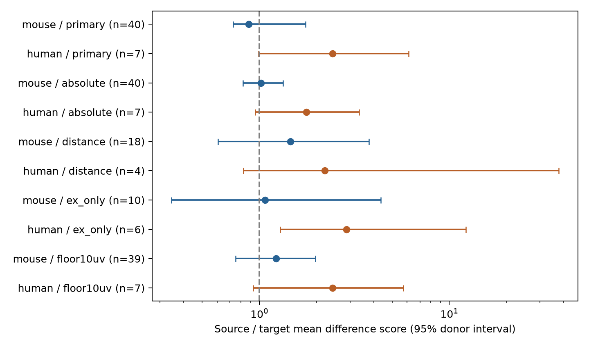

# Matched Allen slice circuits do not resolve a source-versus-target difference in resting voltage magnitude

## Result

We found no corrected evidence that source sharing or target sharing gives closer resting voltage magnitudes in these selected circuits. This does not show that the roles are equal. The mouse estimate changed direction with the score or selection. The human estimate favored target sharing, but the primary test did not pass correction and used only seven inferred donors.

Figure 1. Points show source-to-target mean difference-score ratios. Lines show descriptive 95% donor bootstrap intervals. Values below one mean greater source similarity. n is the number of inferred donors. These ratios are not fractions of explained variance. The human distance interval is wide because only four donors remain.

## Question and prior evidence

Circuit models must assign strength as well as decide which connections exist. If one cell gives similar strengths to its outputs, a source term can be useful. If its inputs have similar strengths, a target term can be useful. We compare these roles after we fix measured cell labels and recording conditions. A difference would not identify a release or membrane mechanism.

[Song and colleagues (2005)](https://doi.org/10.1371/journal.pbio.0030068) studied incoming and outgoing strength correlations in rat cortex. [Letellier and colleagues (2019)](https://doi.org/10.1371/journal.pbio.2006223) studied source and target contributions to strength control. Those studies use other systems and tests. This report tests a matched contrast in a public Allen release. It does not claim that the biological question is new.

[Campagnola, Seeman, and colleagues (2022)](https://doi.org/10.1126/science.abj5861) measured local connectivity and response properties in mouse and human slices. Their study gives the data and cell-class context. We searched the campaign with connectome, Scholl, shared, amplitude, and source target strength. We read the published shared-neuron variability test (SCI 2d5154c104221cb8c0445b435ec790f7de7ad193fe910837bceeaf5959f9d9f8), plasticity test (SCI 774028f84c600f1b3ccbc6db2f3dd42bd83e5bac4c2147392bdb78872f415f06), and reciprocal-strength test (SCI 3660af3e941c858b081907633ca3fa44640f6d2660d32d6710e1ee9cb288fca8). The first supplied the matching design. The second tested another endpoint. The third motivated the small-amplitude check. We wrote new code and used no private worker files.

## Data and scope

The only shared raw file used was:

    /mnt/dell-data/shared_datasets/allen_synphys/r2.1_small_2023-01-26/synphys_r2.1_small.sqlite

Source: https://allen-synphys.s3-us-west-2.amazonaws.com/synphys_r2.1_small.sqlite . Version: r2.1 small, schema 22; Last-Modified 2023-01-26. Size: 176771072 bytes. SHA-256, checked on raw-data runs:

    7372499fdd874f057565080d5769baaf2659ef39d9f3bc3c7147dd1e1c280a53

We opened it read-only and did not change shared data. These are detected chemical connections in small multipatch slice recordings, not a complete anatomical connectome. Pair and cell IDs link circuit topology to voltage magnitude in the same cells. We do not join unmatched anatomy and activity from different animals.

The SQL in files/analyze.py joins pair, synapse, cell, experiment, and slice. It selects pair.has_synapse=1 and uses no poly_synapse records. There are 3297 joined detected records, including 2781 mouse VisP and 394 human TCx records. Finite nonzero voltage estimates remain for 1790 mouse and 231 human edges. Missing values are excluded, not set to zero. No additional dynamics QC filter is used. We use stored resting-state fits, not raw-trial means or the release's pulse-train arrays.

The [pinned Allen schema](https://github.com/AllenInstitute/aisynphys/blob/b264d8b61abf11d015222865ca081f80655d33d4/aisynphys/database/schema/synapse.py) defines psp_amplitude as resting-state PSP amplitude in volts. We use y = ln(abs(psp_amplitude)). Exact synapse-type matching prevents excitation and inhibition from mixing within strata. The log unit cancels in all differences. This is response magnitude, not synapse count, conductance, failure probability, or noise correlation.

Mouse donor labels are the first six-digit number in the public specimen name. Human labels are its initial Hxx.xx.xxx fields. No selected row needs the slice-ID fallback. These labels are inferred, not a verified donor registry. Example names and selection counts are in files/evidence/selection_audit.json.

## Method

The plan in files/analysis_plan.txt fixed the primary endpoint, test family, and checks before role-effect calculation. It is a local plan, not an external registration. An amendment before first completed result inspection added a descriptive 10 microvolt floor based on the published reciprocal-strength audit.

A stratum fixes experiment, synapse type, ordered nonsynaptic cell classes, Cre labels, and target-layer labels. Empty labels are explicit categories. Nonsynaptic class avoids class assignment from synaptic evidence. We retain a stratum only if it has at least one pair of distinct edges with a common source and at least one with a common target. Both roles therefore use the same strata. A reciprocal pair alone does not count as either shared role.

For each role and stratum, we average (y_i - y_j)^2 over eligible edge pairs. We average equally over strata within experiment, experiments within inferred donor, and donors within sample. Dense recordings do not receive weight in proportion to edge-pair count. Delta is the source mean minus the target mean; R is source mean divided by target mean. Negative delta and R below one favor greater source similarity.

The primary test shuffles edge values within each retained stratum 4999 times. Topology stays fixed. Each shuffled edge value enters all its role pairs. The two-sided p-value is (1 + number of absolute shuffled deltas at least as large as the observed absolute delta) / 5000. Seed is 110773. Holm adjustment covers the two primary regional samples. This tests edge-value exchangeability within strata, which is stronger than a general null of equal role means.

Descriptive 95% percentile intervals use 4999 resamples of whole inferred donors. They are not adjusted for multiple tests and do not include within-edge fit uncertainty. We also compute leave-one-donor deltas. Permutation and bootstrap use different assumptions. Sensitivity runs start the same random seed, but changed samples consume different random draws. Thus Monte Carlo intervals and p-values can differ even for unchanged human edges.

## Primary evidence

| Sample | Donors / recordings | Edges | Source / target pairs | Delta [95% interval] | Ratio [95% interval] | Raw p | Holm p |
|---|---:|---:|---:|---|---|---:|---:|
| mouse | 40 / 41 | 188 | 84 / 79 | -0.535 [-2.573, 0.859] | 0.876 [0.728, 1.753] | 0.9194 | 0.9194 |
| human | 7 / 9 | 40 | 15 / 16 | 1.776 [-0.018, 4.030] | 2.422 [0.987, 6.098] | 0.0544 | 0.1088 |

Mouse uses 43 strata and human uses nine. Retained fractions of finite edges are 10.5% and 17.3%. Mouse retained edges comprise 49 excitatory and 139 inhibitory edges. Human retained edges comprise 37 excitatory and three inhibitory edges. The samples differ in circuit type, region, and selection. Their contrast cannot isolate a species effect.

Mouse leave-one-donor deltas range from -0.691 to 0.309, so one donor removal can change direction. Human deltas range from 0.850 to 2.287 and keep the target-similarity direction. Stability alone does not establish an effect.

## Sensitivity checks

| Check | Sample | Donors | Ratio [95% interval] | Nominal p |
|---|---|---:|---|---:|
| absolute | mouse | 40 | 1.020 [0.821, 1.333] | 0.9190 |
| absolute | human | 7 | 1.764 [0.949, 3.344] | 0.0520 |
| distance | mouse | 18 | 1.459 [0.607, 3.782] | 0.2714 |
| distance | human | 4 | 2.209 [0.825, 37.640] | 0.2886 |
| ex_only | mouse | 10 | 1.071 [0.345, 4.350] | 0.8788 |
| ex_only | human | 6 | 2.878 [1.289, 12.251] | 0.0232 |
| floor10uv | mouse | 39 | 1.225 [0.750, 1.966] | 0.3304 |
| floor10uv | human | 7 | 2.422 [0.926, 5.729] | 0.0524 |

The absolute check uses abs(y_i-y_j). The distance check requires separation at most 500 micrometres and adds an exact 100 micrometre distance bin to each stratum. It changes both selection and matching. ex_only keeps excitatory edges. floor10uv excludes magnitudes below 10 microvolts. Each check rebuilds matched strata. All secondary p-values are nominal and exploratory.

The human excitatory subset has a nominal p-value below 0.05 and an interval above one. It is the same selected sample with one inhibitory stratum removed, not independent replication. Six donors remain. It suggests a candidate target-similarity effect for a larger study, not a general rule.

One retained mouse amplitude is 0.00325 microvolts. All other retained mouse magnitudes are at least 10 microvolts. Removing this edge also removes its now-ineligible stratum, for four fewer retained edges in total. The primary ratio is 0.876; the floor-check ratio is 1.225. The small fit therefore changes the pooled direction. It is not evidence for a precise biological response at that scale.

## Checks and limits

files/check_evidence.py uses only the Python standard library. It reconstructs strata, role pairs, donor weights, point estimates, counts, and primary p-values from the bundled edge table and null deltas. It does not import analysis code. files/evidence/validation.json records the outcome. This does not verify upstream fits or independently repeat the bootstrap.

The graphs contain dependent edge pairs. Matching removes most finite records. Slice damage, detection thresholds, missing fits, unmeasured cell types, dendritic location, fit error, common electrodes, and shared recording artifacts can affect the contrast. Exact broad labels cannot remove all biological variation. The two samples have different regions and type mixtures. Bootstrap intervals from four to seven donors can be unstable. The permutation requires exchangeable values within strata, which unequal fit errors can violate.

This result does not establish independent strengths, equal roles, correlated release, intact-brain dynamics, or reliable behavioral representations. It gives a reusable matched test and a measured limit on this release. More matched circuits with per-edge error estimates are needed to separate cell-level rules from measurement effects.

## Reproduce

Use Python 3.12.16 with files/requirements.txt. The selected edge table supports analysis without the raw database. The package preserves code, derived data, null deltas, tables, figure, and checks. Keep output outside shared data.

    export OPENBLAS_NUM_THREADS=1 OMP_NUM_THREADS=1 MKL_NUM_THREADS=1
    campaign-compute -- python files/analyze.py --edges files/evidence/edges.csv --out reproduced --resamples 4999
    campaign-compute -- python files/analyze.py --db /mnt/dell-data/shared_datasets/allen_synphys/r2.1_small_2023-01-26/synphys_r2.1_small.sqlite --out reproduced_raw --resamples 4999
    python files/check_evidence.py
    python files/audit.py

Run in an extracted publication with its dependencies installed. The checker writes validation.json in a writable extracted copy. The edge-only run does not check SQL extraction or the raw-file hash. Raw runs check SHA-256 before reading. On another host, use equivalent resource limits. Runs take about one minute here.

If raw data are absent, retrieve the exact object with the campaign helper:

    campaign-dataset allen-synphys-r21-small-20230126 --url https://allen-synphys.s3-us-west-2.amazonaws.com/synphys_r2.1_small.sqlite --filename synphys_r2.1_small.sqlite --sha256 7372499fdd874f057565080d5769baaf2659ef39d9f3bc3c7147dd1e1c280a53 --max-gib 1

Use its returned completed path. Do not replace an existing dataset. The raw database is not redistributed. Allen data remain under [Allen Institute terms](https://alleninstitute.org/legal/terms-use/). Credit the Allen Institute for Brain Science and source study. The baseline license covers new material only to the extent allowed by those terms.

## Job and attribution

Campaign: 11_07_2026. Job: sci-1107-syam2-neural-structure-and-computation-73a16432a575. Topic: neural-structure-and-computation. Machine: syam2. Account: codex-myxtap. Model: gpt-6.1-sol with high reasoning effort through the Codex harness in T3 Code. No child agents were used. Substantial computations used campaign-compute and one library thread. The campaign-machine key is not a personal authorship claim. The publication is saved locally and is not uploaded to a remote archive or index.
