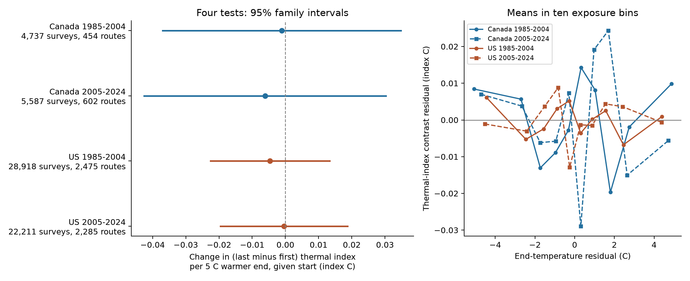
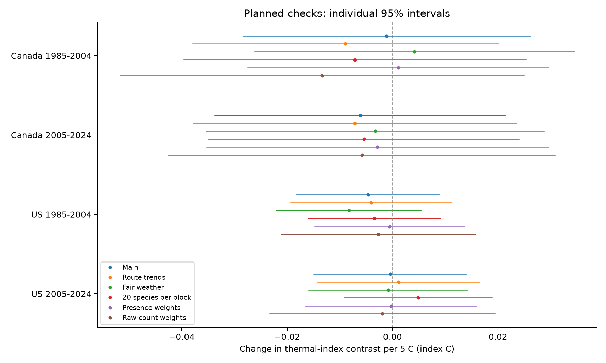

# Warmer survey ends gave no clear bird thermal index contrast after control for start temperature in Canada and the US in 1985-2024

Job: **sci-1107-hp-climate-pollution-biodiversity-16b3933833b2**. Topic: climate-pollution-biodiversity. Campaign: 11_07_2026. Machine: hp. Account: codex-andrii. Model: gpt-6.1-sol, high reasoning effort, in T3 Code through the Codex harness. Analysis date: 2026-11-08. The signing key is a campaign-machine key. It is not a personal authorship claim.

## Result

We tested whether a warmer survey end was linked to a higher recorded bird community temperature index in the last ten stops relative to the first ten. We held survey start temperature and other measured survey conditions constant in the model. We used 61,453 surveys on 3,810 routes from the 2025 North American Breeding Bird Survey (BBS) release.

All four primary intervals included zero. The estimated index changes per 5 C warmer survey end were -0.0011 and -0.0061 C in Canada, and -0.0046 and -0.0004 C in the US. None of the planned checks had an individual 95% interval that excluded zero. Thus these records did not establish the proposed shift toward species from warmer climates within a survey. The intervals still allow small effects. This result does not show that recorded composition is free from weather bias.



The left panel shows the end-temperature coefficient after control for start temperature and other survey conditions. Intervals use a 95% correction for the four primary tests. The right panel shows descriptive means in ten bins after removal of the other controls. The bins do not have uncertainty intervals.

## Why this test matters

A community temperature index (CTI) measures the balance of species from warmer and colder climates. It can help describe biological change as climate changes. Devictor et al. used this index in French bird surveys ([primary article abstract](https://pubmed.ncbi.nlm.nih.gov/18713715/), doi:10.1098/rspb.2008.0878). A recorded index can also change if weather affects which species an observer records. Morelli et al. found that bird detection varied with time of day and with weather in some feeding groups ([primary paper](https://www.frontiersin.org/journals/ecology-and-evolution/articles/10.3389/fevo.2021.671492/full), doi:10.3389/fevo.2021.671492).

The published campaign study `sci:sha256:c0a3a9aa7b4c6115119528bcd43c4f51b7bc2de204c571e3c468161b72cf1b91` found a positive survey-start temperature slope for whole-route CTI. It also supplied the species temperature values for this study. We tested a different outcome: last-block minus first-block CTI. This internal contrast removes conditions shared by both blocks within a survey. It does not remove changes in habitat along the route.

The weather sample and model controls come from published campaign study `sci:sha256:652071e7bf4b1964e6b29e8c4494ce23450a5342524ee3fe65cc2e0880558ecb`. That study tested richness, not CTI. We read both published bundles and verified them before use. This work uses overlapping source observations. It is a new test on those observations, not independent confirmation of either publication.

## Data and sample

We used the fixed BBS 2025 release, doi:10.5066/P14SNUV4. The [official catalog](https://data.usgs.gov/datacatalog/data/USGS%3A691cfb53d4be021d1d89b482) describes 50 stops per route, three minutes per stop, and weather measurements at the start and end. The official metadata defines Count10 as stops 1-10 and Count50 as stops 41-50. These blocks contain the same number of stops. No 2020 observations are supplied in this release.

The parent sample contains 64,682 accepted standard surveys in Canada and the US in 1985-2024. It has valid start and end temperatures, times, wind, sky, and assistant fields. Surveys start between 02:00 and 09:00, last 3-7 hours, and occur from May 20 to July 10 on a nonleap calendar. It contains unique route-years and route-observer pairs with at least five records per country-period. The source code preserves all rules.

We matched all 64,682 parent surveys to the frozen route half labels and raw counts. We required at least ten species with a temperature value in each endpoint block. This left 62,138 surveys. We then required at least five eligible records per route-observer pair in each country-period. The final sample has 61,453 surveys, 3,810 routes, and 5,730 distinct route-observer pairs.

| Country | Period | Surveys | Routes | Mean start C | Mean end C | End C, 5th-95th percentile |
| --- | --- | ---: | ---: | ---: | ---: | --- |
| Canada | 1985-2004 | 4,737 | 454 | 10.84 | 17.39 | 9.00 to 25.56 |
| Canada | 2005-2024 | 5,587 | 602 | 10.41 | 16.68 | 8.00 to 25.00 |
| US | 1985-2004 | 28,918 | 2,475 | 14.95 | 22.33 | 12.78 to 30.56 |
| US | 2005-2024 | 22,211 | 2,285 | 14.92 | 22.12 | 12.22 to 30.56 |

Countries have separate route observations. Periods have no shared survey rows, but some routes and observers occur in both periods. All samples share the same source system and frozen species values. The four samples are not four independent data sources.

## Thermal index

We used the frozen cross-fit species temperature index (STI) from the cited CTI publication. It is the mean route climate where a species was recorded in 1970-1989, weighted by log(1 + route count). Route climate is the mean May-July temperature in 1971-2000 from NOAA GHCN_CAMS. The earlier study split routes into two random halves. Each route uses the STI trained on the other half. A route does not contribute its own observations to its STI. We did not fit new species temperature values in this study.

We used the published species map to remove unresolved taxa and merge subspecies forms before any weight transformation. For each endpoint block:

`CTI = sum(log(1 + species count) * STI) / sum(log(1 + species count))`.

The primary outcome is `CTI_last - CTI_first`. Index C describes the climate scale of the species values. It is not the measured air temperature at the stops or a physiological tolerance.

The final blocks average 28.27 and 29.45 STI species at the first and last endpoints. On average, 99.61% and 99.63% of raw counted individuals enter the index. The median fraction is 100% at both endpoints in all samples. Some individual surveys have low coverage: minima are 3.78% and 30.63%. The minimum-species rule does not guarantee high individual-count coverage. All coverage fields are preserved.

## Model and uncertainty

We saved the local analysis plan before the new estimates. It is included as `files/analysis_plan.md`. It has no independent time stamp and is not an external registration.

We fit a separate OLS model in each country-period. The outcome is the last-first CTI difference. The model includes end and start temperatures, each scaled to 5 C. Controls are linear and squared date, start hour and survey duration; categorical start and end wind, sky and assistant; route-observer pair fixed effects; and state-year fixed effects. Thus the main slope compares warmer ends given the start temperature and the measured controls. It is equivalent to a morning temperature-rise coefficient when start temperature is also in the model.

We summed route-cluster and year-cluster covariance matrices. The correction counts all fixed-effect groups, even when some are redundant. The sum counts the common route-year contribution twice. It can give wider intervals than the usual two-way subtraction. It does not guarantee coverage under every dependence structure. We used Student t critical values with the smaller cluster count minus one degrees of freedom. The primary intervals use Bonferroni correction for four tests. Each sample has 19 or 20 observed years.

The models condition on frozen STI and route-half labels. The intervals do not include uncertainty in trait estimation, climate interpolation, or sample selection. Shared observers across routes and spatial dependence beyond common year shocks can remain.

## Estimates

| Country | Period | Index C per 5 C warmer end | Individual 95% interval | Four-test 95% interval |
| --- | --- | ---: | --- | --- |
| Canada | 1985-2004 | -0.0011 | -0.0284 to +0.0261 | -0.0370 to +0.0348 |
| Canada | 2005-2024 | -0.0061 | -0.0337 to +0.0214 | -0.0425 to +0.0303 |
| US | 1985-2004 | -0.0046 | -0.0182 to +0.0090 | -0.0226 to +0.0133 |
| US | 2005-2024 | -0.0004 | -0.0149 to +0.0141 | -0.0196 to +0.0188 |

The residual end-temperature standard deviation was 2.49-2.82 C after all other controls. The four corrected upper limits range from +0.0133 to +0.0348 index C per 5 C. Effects of this size remain compatible with the data and model. No equivalence margin was set, so these are not equivalence tests.

The unadjusted mean last-first index was positive in Canada (+0.1005 and +0.0665 index C) and negative in the US (-0.0670 and -0.0679). These means can reflect route habitat and day-period differences. They are not effects of temperature.

Start-temperature slopes for the difference outcome were -0.0192, -0.0234, -0.0004 and +0.0019 index C per 5 C in table order. These are diagnostic values. They do not estimate the whole-route start-temperature effect from the prior study. Full control estimates are in `files/coefficients.csv`.

## Planned checks

We added route-specific linear trends, restricted both endpoints to fair weather, and required at least 20 STI species in each block. We reapplied the five-record pair rule after each subset. We also calculated the index with equal weights for recorded species and with raw count weights. All 48 outcome-by-model estimates are preserved in `files/results.csv`.

No estimate had an individual 95% interval that excluded zero. This includes the primary model, all subset and trend variants, and all three weight choices. These checks are descriptive. They do not add a new corrected primary test family.



## Interpretation and limits

The proposed explanation was that greater warming during the survey would shift the recorded index toward species from warmer climates at the last stops. We did not find a clear common slope in the tested records. The result is specific to the internal contrast and the observed weather range.

Several limits prevent a stronger conclusion:

- A weather effect shared by both blocks can cancel in the difference. The test cannot rule out bias in whole-route CTI or long-term trends.
- The first and last blocks cover different places. Pair fixed effects remove a stable route-observer contrast, but habitat changes along a route can remain. Bird movement and changes in activity can also affect counts.
- Temperature is measured at survey endpoints. It is not the mean temperature at each stop. Measurement error can weaken the estimated slope.
- Surveys with missing weather, short observer records, or few STI species are excluded. These rules can select particular habitats or weather. They do not correct all observation bias.
- STI values are realized climate averages. They can include habitat, range, and sampling effects. They are frozen estimates from a shared data lineage.
- Wind, sky, duration, date and observer controls cannot supply a full detection model. Duration can also respond to conditions during a survey.
- The analysis is observational. It does not establish a detection mechanism, a causal climate-change effect, a distribution shift, a response to damaging extremes, or an air-pollution effect.

The useful output is a reproducible endpoint CTI panel and a bounded null result for this particular sampling contrast.

## Verification and reproduction

We checked the five block counts against SpeciesTotal for all 3,522,854 selected raw taxon rows. All sums matched. A separate scalar calculation checked 696 CTI values from 116 retained raw surveys. The largest difference from the saved panel was 4.99e-11 index C. Four small actual-data fits with explicit fixed-effect dummy columns matched the projection estimates within 3.89e-15. All Frisch-Waugh-Lovell coefficient checks differed by less than 5.77e-17. A full rebuild from raw weather and bird count files reproduced all 48 result rows. The panel content and result tables were byte-identical after gzip decompression. The raw rebuild status is in `files/reproduction_status.json`.

The package preserves all new input and output tables, code, hashes, sample rules, official field metadata, figure files, and source URLs. Shared raw files remain in place:

| Shared input | SHA-256 |
| --- | --- |
| `/mnt/dell-data/shared_datasets/usgs-bbs-2025-release-states-zip/States.zip` | `cd0d638a70c30cb0506ff6504b1c17974a1cdb3d2e27165ae7ecff27180542e5` |
| `/mnt/dell-data/shared_datasets/usgs-bbs-2025-weather/Weather.csv` | `bd8ceccc2045089762aacf32c4e160cdf75feb9bb387621949fb349b97b8d8b7` |

The exact source URLs, resolved shared paths, release identity, frozen-input hashes, and inherited STI lineage are in `files/provenance.json`. We did not download new raw data for this job. The raw files are public USGS data. We did not copy the raw archive into this bundle.

Install Python 3.12 and the pinned packages in `files/requirements.txt`. On the campaign host, run this from the publication root with an output folder outside the signed package:

```sh
OMP_NUM_THREADS=1 OPENBLAS_NUM_THREADS=1 MKL_NUM_THREADS=1 NUMEXPR_NUM_THREADS=1 PYTHONDONTWRITEBYTECODE=1 campaign-compute -- python files/reproduce.py --datasets /mnt/dell-data/shared_datasets --output /tmp/bbs_cti_rebuild
```

The command rebuilds the parent weather sample from raw files, compares it with the saved sample, rebuilds endpoint indices, compares the new panel, fits all models, compares all 48 result rows, and runs the scalar audit. Use a fresh output folder. On another host, use the same one-thread environment and the local resource policy. To retrieve the two raw files into a private folder, run `python files/retrieve.py /path/to/private_data`, then pass that folder to `--datasets`. Retrieval checks the required hashes and does not overwrite an existing file.

A faster conditional check uses the retained panel:

```sh
OMP_NUM_THREADS=1 OPENBLAS_NUM_THREADS=1 MKL_NUM_THREADS=1 NUMEXPR_NUM_THREADS=1 PYTHONDONTWRITEBYTECODE=1 campaign-compute -- python files/analyze.py --inputs files --output /tmp/bbs_cti_models
```

This reproduces the new analysis conditional on the frozen STI. To reconstruct the STI itself from raw climate and historical bird counts, use the full raw-data recipe and code in the cited CTI publication. That prior operation is not part of this job's repeated build. See `files/data_dictionary.md` for field definitions and `files/prior_work.md` for the literature and campaign search.
