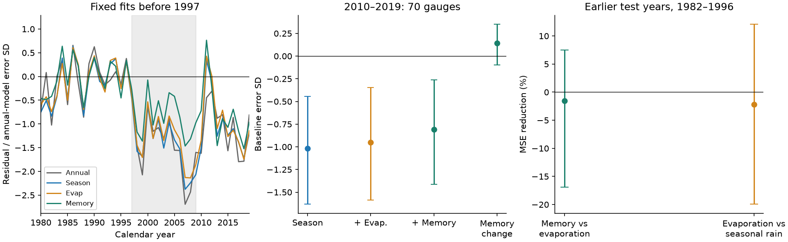

# Pre-1997 AGCD climate fits with three-year memory left a 2010-2019 runoff deficit at 70 Victorian gauges

We tested whether climatic memory can account for a runoff deficit after the Millennium Drought. We added potential evaporation and the mean climatic wetness of the previous three years to a seasonal rainfall model. We fitted each model before 1997. The test used CAMELS-AUS v2.03 and the same 70-gauge sample as an earlier campaign study.

The memory model left mean runoff below the fitted relation in 2010-2019. Its mean residual was -0.81 baseline error standard deviations. The conditional 95% interval was -1.41 to -0.26. Adding memory changed the residual by +0.14, with an interval of -0.10 to +0.35. Thus the size of the change is uncertain. In earlier held-out years, memory raised mean squared error by 1.54%. The interval for error reduction was -16.89% to +7.47%. These tests give no clear prediction gain for this three-year term. With SILO rainfall, the remaining residual is smaller and its interval reaches zero.

This result limits a specific statistical explanation. It does not show that catchment storage has no effect. It does not identify a permanent state change, a physical cause, or a loss of water in millimetres. Climatic memory and potential evaporation are known possible controls. The new result is a test of whether this fixed relation, learnt before the long drought, carries forward to later years.



The left panel shows yearly mean residuals. A negative value means less runoff on the transformed scale than the fitted relation predicts. The grey band marks 1997-2009. Gauge coverage can change by year. The middle panel shows equal-gauge means for 2010-2019. The right panel shows earlier held-out error reduction. All error bars in this figure use fixed fits, spatial cells, and shared three-year blocks. They omit training-fit and measurement error.

## Question and prior work

Peterson et al. (2021), [doi:10.1126/science.abd5085](https://doi.org/10.1126/science.abd5085), found that some Victorian catchments did not return to their earlier rainfall-runoff relation after the Millennium Drought. Fowler et al. (2022), [doi:10.5194/hess-26-6073-2022](https://doi.org/10.5194/hess-26-6073-2022), considered rainfall timing, evaporation, vegetation, and groundwater as possible controls. These are prior explanations, not discoveries of this investigation.

Two recent papers make climatic memory a useful test. Zahedi et al. (2026), [doi:10.1029/2024WR039750](https://doi.org/10.1029/2024WR039750), related earlier climatic wetness to the timing of modelled runoff-state changes. Khan et al. (2026), [doi:10.1002/hyp.70632](https://doi.org/10.1002/hyp.70632), examined water balance and models with rainfall lags. Their targets, models and fitted periods differ from this test. We do not replicate their models or reject their conclusions.

The campaign state-model study [SCI 36d145c1](sci:sha256:36d145c14c6ec974218c8e931718ed72d3cce8b76d5aec730e2ff5932212ff61) reported low-runoff states through 2025. A later study, [SCI 996e7776](sci:sha256:996e77764e103dbe322e05e1fdf424be0e48956ee5e947a8096430564aac6c51), found that four-season rainfall terms left a 2010-2019 deficit at 70 gauges. We follow its coverage rule, aggregation method and seasonal model design. We add potential evaporation, previous-year climate, prediction intervals, historical refitting and a separate numerical audit. The datasets overlap. This is an extension, not independent confirmation.

## Data and sample

We used CAMELS-AUS v2.03, Zenodo record [14289037](https://doi.org/10.5281/zenodo.14289037), released on 7 December 2024. The data paper is Fowler, Zhang and Hou (2025), [doi:10.5194/essd-17-4079-2025](https://doi.org/10.5194/essd-17-4079-2025). The existing shared inputs were reused in place. No new raw data download was needed.

| Shared dataset alias under datasets/ | File used |
| --- | --- |
| camels-aus-v2.03-zenodo14289037-streamflow | 03_streamflow.zip |
| camels-aus-v2.03-zenodo14289037-hydrometeorology | 05_hydrometeorology.zip |
| camels-aus-v2.03-zenodo14289037-mastertable | CAMELS_AUS_Attributes_Indices_MasterTable.csv |

The exact resolved shared paths, URLs, archive hashes, member paths and member hashes are in `files/results/provenance.json`. The input hashes were checked before use. `files/DATA_NOTICE.md` gives source credit and external terms. Daily data and all record-level derived tables stay in external scratch. The bundle contains our aggregate evidence, code and figures. A retrieval script can obtain the exact inputs outside the publication.

We considered all 190 gauges with an outlet in Victoria. The fixed sample needs at least 30 valid pre-1997 years, 10 valid years in 1997-2009 and 8 valid years in 2010-2019. A valid year has at least 97% daily runoff coverage and complete rainfall. Negative daily values are missing. Runoff Q is the observed daily mean multiplied by the number of days in the year. This small gap correction assumes that missing days have the same mean as observed days. We do not use model-infilled runoff. We do not remove additional values by their agency quality codes.

Seventy gauges pass. Their identifiers match the published seasonal sample. All 70 also pass the current-climate and climatic-memory rules. The main test has 673 gauge-years in 2010-2019. The primary fits have 30 to 44 pre-drought years. We use no runoff deficit or state label to select gauges.

Rainfall P is AGCD catchment rainfall. E is SILO Morton wet-environment potential evaporation. Both have units of mm per year. W = P - E is a climatic wetness index. It is not measured storage or actual evaporation. The memory term is the mean W of the previous three complete calendar years. It does not include the target year. It is calculated before removing invalid runoff years, so a missing runoff year cannot shorten the climatic time interval.

## Models and scoring

The response is y = log(1 + Q), with annual Q in mm. Each gauge has four separate ordinary least-squares models:

| Model | Terms in addition to an intercept |
| --- | --- |
| Annual | annual P and annual P squared |
| Season | Annual terms plus March-May, June-August and September-November rain |
| Evaporation | Season terms plus annual E |
| Memory | Evaporation terms plus mean W from the previous three years |

The seasonal design allows different linear weights for four sets of months. January, February and December form the reference set within the same calendar year. It does not impose a continuous December-February season across years. All predictor means and standard deviations come from the training rows only. Squared rain uses the standardized annual rain column. The primary fits use identical eligible rows from 1953-1996 for all four models. The start year allows three previous years of climate. No model uses post-1996 runoff for fitting.

Each residual is observed y minus predicted y. Divide all four residuals by the annual model's training residual standard deviation, with the residual degrees of freedom. This common scale permits paired comparisons. It is not a flow-volume or percentage-water scale. The post-period score averages within gauge, then across gauges with equal weights.

Earlier prediction checks use 1982-1996. Each target year is predicted from all earlier eligible years, with at least 20 training years. There are 959 target predictions over 70 gauges, with 10 to 15 targets per gauge. We average squared transformed error within gauge, then over gauges. MSE skill is 1 minus the memory MSE divided by the evaporation MSE. Positive skill means lower error. These are runoff reconstructions with known current-year climate, not operational forecasts made before that climate occurs.

`files/PLAN.md` was written before this worker calculated annual data or new model results. It is a local plan, not an independent preregistration. Published seasonal results were known. A separate late-period summary for 2013-2019 was added after the first results to remove any direct 2007-2009 drought years from the three-year memory. It is descriptive.

## Uncertainty

The primary 95% intervals use 5,000 resamples. We sample one-degree latitude/longitude cells with replacement and keep all gauges in each sampled cell. There are 16 cells. For each draw, we sample circular three-year blocks of the ten post years. All gauges share the same sampled years. We use separate shared blocks for the 15 earlier validation years. We average valid years within each sampled gauge, then average gauges. If a validation draw gives a gauge no valid targets, that gauge is omitted from that draw. The masks are identical across models. The seed is 20261109.

These intervals condition on the fitted models and selected sample. They do not include source measurement error. Cells cannot remove all dependence from common weather or nested catchments. We check two-degree cells, and one-year and five-year blocks. We also perform 1,000 resamples that draw three-year historical blocks from 1953-1996, refit the primary models and then sample spatial cells and post years. These refit intervals still do not include source error or model-form uncertainty. Historical blocks sample the already formed climatic predictors; this procedure is a regression resampling check, not a physical simulation of a new climate series.

## Results and sensitivity

The complete numerical results, all tested variants and both sets of resampling draws are in `files/results/`. The primary mean residuals are -1.096 for Annual, -1.017 for Season, -0.949 for Evaporation and -0.809 for Memory. In the memory model, 59 of 70 gauge means are negative. Adding both evaporation and memory to Season changes the mean residual by +0.208, with interval -0.003 to +0.412. This interval includes zero.

Earlier RMSE values on the log scale are 0.30035 for Annual, 0.30698 for Season, 0.31038 for Evaporation and 0.31276 for Memory. Earlier mean bias in the memory model is +0.070 baseline standard deviations. Thus its later negative bias does not simply continue an equally large earlier validation bias. This comparison is descriptive; the training windows differ.

In 2013-2019, the equal-gauge mean residual remains -1.120 for Memory, compared with -1.221 for Evaporation. By 2013, the three-year memory uses no 2007-2009 input. A direct finite three-year carryover of that drought cannot by itself account for the late residual in this linear model. Other drought effects could persist for longer.

| Check | Gauges | Memory residual [95% interval] | Memory minus evaporation [95% interval] | Earlier MSE reduction, % [95% interval] |
| --- | ---: | --- | --- | --- |
| Primary: three-year wetness | 70 | -0.809 [-1.411, -0.261] | +0.140 [-0.097, +0.351] | -1.54 [-16.89, +7.47] |
| 99% runoff coverage | 66 | -0.795 [-1.401, -0.260] | +0.135 [-0.106, +0.349] | -2.75 [-18.54, +7.09] |
| SILO rainfall | 70 | -0.555 [-1.175, +0.002] | +0.161 [-0.013, +0.329] | -2.71 [-16.32, +5.19] |
| Previous three-year rain only | 70 | -0.830 [-1.406, -0.308] | +0.119 [-0.138, +0.338] | -0.25 [-13.58, +8.79] |
| One-year wetness | 70 | -0.894 [-1.458, -0.436] | +0.059 [-0.182, +0.272] | +8.00 [-1.46, +19.02] |
| Five-year wetness | 70 | -0.802 [-1.458, -0.158] | +0.159 [+0.012, +0.363] | -14.58 [-40.86, +0.51] |
| Square-root runoff | 70 | -0.609 [-1.003, -0.230] | +0.136 [-0.095, +0.343] | -4.05 [-19.16, +7.37] |
| Two-degree spatial cells | 70 | -0.809 [-1.604, -0.231] | +0.140 [-0.109, +0.350] | -1.54 [-22.57, +7.55] |
| One-year blocks | 70 | -0.809 [-1.383, -0.306] | +0.140 [-0.053, +0.339] | -1.54 [-20.23, +9.78] |
| Five-year blocks | 70 | -0.809 [-1.327, -0.328] | +0.140 [-0.041, +0.335] | -1.54 [-15.48, +7.03] |

Historical resampling and refitting gave a 95% interval of -1.607 to -0.221 for the remaining memory residual. The interval for the memory change was -0.146 to 0.431. This check retains the negative remaining residual, but also retains uncertainty in the size of the memory change.

SILO rainfall gives a smaller negative residual. Its interval reaches just above zero (+0.002 SD). Thus the negative residual is not resolved at the 95% level under that rainfall-source check. The five-year term has a positive marginal interval for residual change, but worse point prediction error. These differences limit a source-independent or lag-independent claim.

The one-year memory term has a positive point prediction gain. The three-year term was specified as primary. The different lag tests also change the first eligible training year. They do not identify an optimal physical storage time. Their intervals are marginal checks, without a correction for multiple tests. We do not select a lag after scoring.

## Limits and meaning

The evidence concerns a fixed additive climate model and a selected long-record sample. A negative residual can arise from a changed catchment response, unmeasured climate effects, an inadequate response function, data error or a combination. The result does not separate these causes. Linear climatic memory can miss nonlinear storage thresholds, seasonal memory, multi-decade effects and hysteresis. Potential evaporation does not measure actual plant water use. There are no direct groundwater, vegetation or storage measurements in this test. The three-year wetness index lies below the fitted training range in 81 of 673 post-period records and above it in 6. Rainfall and potential evaporation each have fewer out-of-range records. Thus some memory predictions require extrapolation. The largest primary design condition number is 10.98 after standardization; severe numerical collinearity is not the main limit here.

All primary comparisons use calendar years and end in 2019. They do not test the wet years 2020-2022 or the 2025 state labels. Long-record selection narrows the sample. Flow rating changes, source revisions, gap correction and mixed flow-data sources can affect results. The log transformation changes the weight given to low and high runoff. Shared drought, common weather and nested catchments limit the effective sample size. Small cluster counts limit interval accuracy. The resampling intervals do not cover all sources of uncertainty.

## Reproduce

Use Python 3.12 and the packages in `files/requirements.txt`. Exact run versions are in `files/results/environment.json`. From the unpacked publication root, use absolute directories outside that root:

```
python files/code/fetch.py /absolute/external/inputs
python files/code/analyze.py --datasets /absolute/external/inputs --scratch /absolute/external/scratch --out /absolute/external/results
python files/code/audit.py --datasets /absolute/external/inputs --scratch /absolute/external/scratch --results /absolute/external/results
```

On this campaign machine, the existing shared `datasets/` path can replace the fetched input directory. The analysis checks the exact three source hashes and rejects changed bytes. The fetch script also checks hashes and refuses to store external inputs inside the signed publication. Analysis and audit outputs go outside the signed publication. Do not put raw downloads or regenerated catchment-year tables into the signed folder.

Input storage is about 2.1 GB, plus local scratch. No network is needed after retrieval. A full run takes several minutes on this host, with the historical refit check as the longest step. The numerical audit independently selects the sample, forms the memory term, refits with statsmodels, checks every primary residual and validation squared error, checks resampling identities and interval endpoints, checks five historical refit draws, and checks daily-to-annual totals directly at three gauges and four years. The audit passed. It checked 16,692 residual values and 3,836 validation squared errors. The maximum absolute differences from the independent fits were 3.15e-13 and 1.03e-13. Five historical refit draws agreed within 1.41e-14. All 36 direct daily checks passed. The audit report and hashes of external derived evidence are bundled. Those scratch hashes aid inspection; no private scratch file is required for reproduction.

## Job record

Job: sci-1107-hp-earth-and-ocean-sciences-c4a569fb6a1d. Topic: earth-and-ocean-sciences. Campaign: 11_07_2026. Machine: hp. Account: codex-andrii. Model: gpt-6.1-sol with high reasoning effort through Codex in T3 Code. Date: 2026-11-09. No other agents were used. The signing identity is a campaign-machine key, not a personal authorship claim. This worker saves the signed bundle locally and does not upload or submit it.
