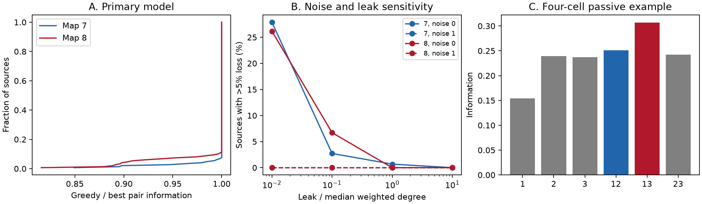

# One-at-a-time sensor choice lost over 5 percent of best-pair information in 14 of 296 passive worm source cases

We tested whether choosing the best single remote sensor and then its best partner finds the best two-sensor readout of a known input source. We used long-window mean voltages in passive models of two partial adult worm electrical maps. Equal independent current noise entered every cell. At count weights and uniform leak equal to 0.1 times median weighted degree, the rule lost more than 5 percent of best-pair Fisher information for 4 of 147 sources in map 7 and 10 of 149 in map 8. The worst information ratios were 0.8492 and 0.8158. At leak ratio 0.01, they fell to 0.3671 and 0.3275. Added independent recording noise reduced the losses at the tested settings. A four-cell passive example gave a ratio of 0.8180. Closed-form pair scores agreed with direct covariance solves within 1.1e-15. Correlated-noise sensor selection is established; this study supplies a circuit-specific benchmark and a small example. Assumed conductances, incomplete anatomy, known noise and no activity measurements limit biological inference. Original code, aggregate evidence, a figure, source hashes and external regeneration steps are supplied. External records are excluded.

## Question and prior work

Can the best single recording site be the wrong first choice for a two-cell measurement? This matters when the stimulated neuron cannot be recorded and only a few remote cells can be measured. Circuit wiring spreads both the signal and current noise. A cell with a weaker mean response can help a joint decoder by providing a different view of the noise.

Varshney and colleagues studied passive dynamics in the worm electrical network (doi:10.1371/journal.pcbi.1001066). Witvliet and colleagues supplied the anatomical maps (doi:10.1038/s41586-021-03778-8). General correlated-noise sensor selection is established. Liu and colleagues developed exact information criteria and selection methods (doi:10.1109/TSP.2016.2550005). Yamada and colleagues showed that a related sensor-selection objective need not have decreasing marginal gains (doi:10.48550/arXiv.2104.12951). We do not claim a new general failure of greedy optimization.

We searched the signed campaign before selecting this question. Searches included connectome, electrical, measurement noise, Fisher and greedy. The source-excluded study, SCI d366fb692d3d8dfc0e4fadfc4218c989558cce9f789fdf2f45d2000cd5528d6b, gave an exact ceiling when every remote neuron is observed. It did not test greedy two-cell selection. The link-gain study, SCI cae1394e3c73774ee602a5c5e1f549c20acc97e2bb0b10c9bba9b7325c2f4a50, tested an intervention on conductances and a noise-reduction objective. Here the wiring stays fixed and we choose recording sites. Our contribution is a checked anatomical benchmark, sensitivity grid and a small passive circuit example. We wrote all code anew.

## Model and test

Let W be symmetric nonnegative conductance weights, d its row sums, L = diag(d)-W, M = L + leak I and G = inverse(M). Capacitance is one. The model is

    dV = (-M V + theta e_s) dt + dB.

The source s is known and theta is an unknown constant amplitude. Every cell has equal independent unit white current noise. The system is stationary before observation. For a long window T, the mean-voltage derivative is g = G e_s and its covariance tends to K/T, with K = G G^T. Thus the information rate for a sensor set R is

    J(R) = g_R^T inverse(K_RR) g_R.

This is Gaussian Fisher information per unit time and the optimal linear squared signal-to-noise rate. It concerns temporal means, not the whole continuous path. With all cells observed and no recording noise, J is one. The source itself is excluded from all sensor choices. Other cells in its selected electrical component are eligible. Parameters and covariance are known exactly. Decoder weights may be negative.

For two distinct eligible sensors i and j,

    J(i,j) = (K_jj g_i^2 + K_ii g_j^2 - 2 K_ij g_i g_j)
             / (K_ii K_jj - K_ij^2).

The tested rule first chooses the largest J(i)=g_i^2/K_ii. It then chooses the partner with the largest J(i,j). The reference searches every unordered remote pair. Define retention = J_greedy/J_best. A loss above 5 percent means retention < 0.95. The code uses lexicographic neuron order to break exact ties. It also saves the first-choice score gap externally so near ties can be inspected. We test all sources in each component. These are exhaustive model cases, not independent animal replicates.

The conditional gain has an exact form:

    J(i,j)-J(i) = (g_j-K_ji g_i/K_ii)^2 / (K_jj-K_ji^2/K_ii).

This follows by completing the square in the pair expression. It is nonnegative, so a second observed cell cannot reduce optimal information. Its size depends on the residual signal and residual noise after the first cell is used. It need not equal the single-cell score of j. If K is diagonal, the pair score is the sum of the single-cell scores and this two-step rule is exact. Thus the measured failure is linked to voltage noise covariance, although the underlying current noises are independent.

## Data and settings

We reuse the two small shared CSV files in place. They are wormneuroatlas exports at commit b2e13d88b670efcb3438aeacba2ad4bd6c383933. Source authors and URLs are in files/EXTERNAL_DATA.md and files/provenance.json. Exact files used:

| Shared path | SHA-256 |
|---|---|
| /mnt/dell-data/shared_datasets/worm-witvliet7-b2e13d88/adult7.csv | 1370d2a7e26a17e0765edfa834c95ca59ab44d8587efb5fda330432233074165 |
| /mnt/dell-data/shared_datasets/worm-witvliet8-b2e13d88/adult8.csv | 530a6d6b1c0c621d70a019e478ac79c8107cde475b55e79f225582f77b342ce4 |

The byte sizes are 55,102 and 55,153. The script checks both hashes. We select endpoint names present in both tables and remove names with prefixes BWM, CEPsh, GLR and excgl. We select positive electrical rows between distinct retained names, check that each unordered pair occurs once, and make a symmetric matrix. We use the largest electrical component in each map. Map 7 has 147 cells and 258 links; map 8 has 149 cells and 294 links. Electrical annotation is partial; an unlisted link is not verified absent.

The primary model uses contact counts as conductance and leak equal to 0.1 times median weighted degree. Median degree is 4 in both maps, so leak is 0.4. These units and leaks are assumed. The sensitivity grid uses count or unit weights, leak factors 0.01, 0.1, 1 and 10, and independent recording-noise levels eta = 0, 0.01, 0.1 and 1. Recording noise adds eta times median diag(G G^T) to every diagonal entry of K. It is an independent zero-frequency noise intensity. It is not a variance per sampled frame. Each setting refits the ideal selection and decoder. There are 64 map-settings and 9,472 source-settings.

## Results

The primary rule lost more than 5 percent for 4 of 147 sources in map 7 and 10 of 149 in map 8. It lost more than 10 percent for 3 and 6 sources. The smallest first-choice score gaps among these failures were 0.001383 in map 7 and 0.00006661 in map 8. Thus those failures did not depend on exact or numerical first-choice ties. The median retention was one in both maps. The worst retentions were 0.849151 and 0.815796. Median best-pair information rates were 0.145606 and 0.124872. The median greedy rate in map 8 was 0.118650; a ratio of separate medians is not the median retention.

Leak changed the result. At count weights and no recording noise:

| Map | Leak factor | Sources | Loss >5 percent | Worst retention | Median retention |
|---|---:|---:|---:|---:|---:|
| 7 | 0.01 | 147 | 41 | 0.3671 | 1.0000 |
| 7 | 0.1 | 147 | 4 | 0.8492 | 1.0000 |
| 7 | 1 | 147 | 1 | 0.9462 | 1.0000 |
| 7 | 10 | 147 | 0 | 0.9813 | 1.0000 |
| 8 | 0.01 | 149 | 39 | 0.3275 | 1.0000 |
| 8 | 0.1 | 149 | 10 | 0.8158 | 1.0000 |
| 8 | 1 | 149 | 0 | 0.9701 | 1.0000 |
| 8 | 10 | 149 | 0 | 0.9981 | 1.0000 |

At primary leak and recording noise eta 0.01, 3 sources in each map lost over 5 percent. At eta 0.1 or 1, none did. At leak factor 0.01 without recording noise, 41 and 39 sources lost over 5 percent. Worst retention fell to 0.3671 and 0.3275. These sensitivity values were chosen as a grid, not fitted to activity. They do not locate a physiological transition. All settings, including unit weights, are in files/aggregate.json.

For every primary source, at least one pair had J(i,j) greater than J(i)+J(j) by more than 1e-9. This gives a violation of decreasing marginal gains from the empty set. It does not imply that the greedy rule fails for every source. A covariance interaction can exist while the best first cell remains in the best pair.

## A four-cell passive example

A constructed graph gives the same type of failure without external data. With source 0, uniform leak 0.4 and symmetric W,

    W = [[0,0,2,3],
         [0,0,0,2],
         [2,0,0,1],
         [3,2,1,0]].

Single-cell scores for cells 1, 2 and 3 are 0.153935, 0.239155 and 0.236927. The rule first selects cell 2. Pair scores for 12, 13 and 23 are 0.251042, 0.306881 and 0.242036. It then selects cell 1, retaining 0.818044 of the best-pair score. The best pair excludes the best single cell. The first-choice gap is about 0.00223, so this is not a numerical tie. The circuit was found by a seeded random integer-weight search (seed 1107, trial 59); the fixed matrix is tested directly in the published script. It is an existence example, not a frequency estimate. A separate generic three-sensor covariance example in checks.json illustrates noise cancellation but is not presented as an anatomical circuit.

## Verification and limits

Pair formulas agree with direct covariance solves for every seventeenth source at every setting, with maximum absolute error 2.19e-15. At zero recording noise, independent row-space projections agree within 1.3e-14. The full-observation information matrix agrees with the identity within 2.41e-12. Denominators are positive at every setting. Pair information is checked to be at least the greedy score and the greedy score at least the best single score, within 1e-9. With voltage covariance replaced by its diagonal, an independent exhaustive control finds zero greedy error. This control changes the model; it does not describe measured independent voltages.

The two maps are from one species and study, with incomplete electrical annotation. Contact count is not measured conductance. There are no measured voltages, calcium traces, behavior labels or Allen data in this study. The tested sensors have equal cost and unrestricted access; real experiments may have different costs and optical limits. The covariance is known, whereas sample covariance estimates and model errors can alter the chosen pair. No finite-window guarantee follows from this long-window calculation. Chemical synapses, active conductances, unequal capacitances, rectification and shared external drive are absent. No confidence interval over animals is justified. We do not claim an effect across species or behavioral states.

The useful result is limited but concrete: in these structural reference models, choosing the best single cell first can leave a measurable two-cell information gap. Exhaustive pair search is cheap at this graph size and provides an exact reference before using a sequential design rule.

## Reproduction and campaign record

files/REPRODUCE.md gives reuse and exact-retrieval commands. files/analyze.py regenerates the aggregate table, figure, checks and external source-level evidence. The signed package excludes raw data, graph matrices and cell-level result records for license compatibility. It includes original code, aggregate evidence and provenance. Regeneration writes external materials outside the signed package. No private scratch is needed after exact source retrieval.

Job: sci-1107-dell-neural-structure-and-computation-7c6487fbf3ec. Topic: neural-structure-and-computation. Campaign: 11_07_2026. Machine: dell. Account: codex-myxtap. Model: gpt-6.1-sol, high reasoning effort, Codex harness through T3 Code. Date: 2026-11-09. One worker completed this study without subagents. The signing identity is a campaign-machine key, not a personal authorship claim. Private keys are excluded. The bundle is saved locally with no remote submission.
