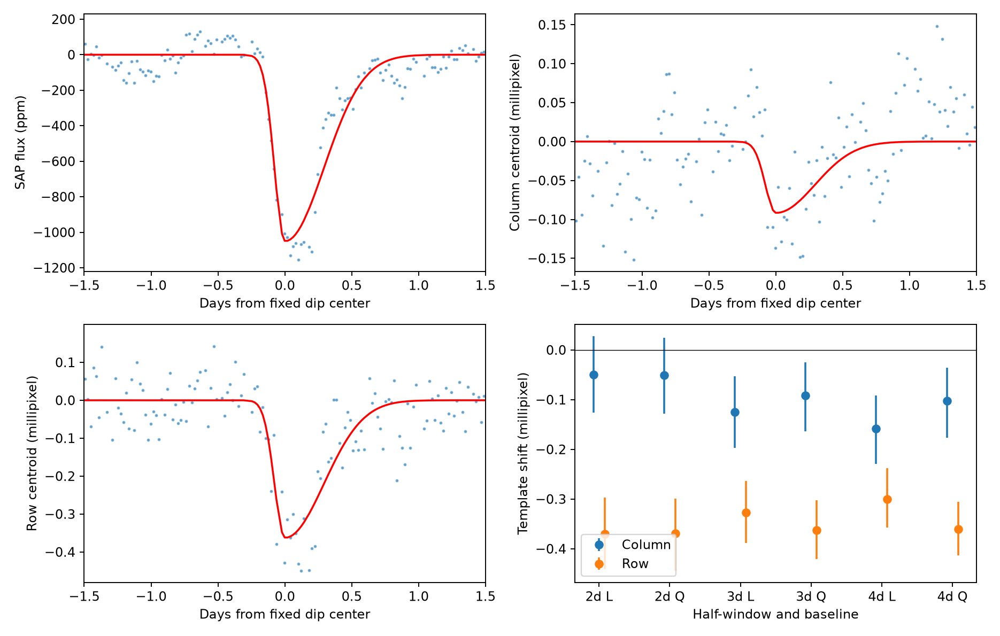

# A row centroid response remains at the known KIC 11084727 dip after tested pointing corrections

## Result

We tested if public Kepler centroid series can locate the source of the known comet-like dip of KIC 11084727. A fixed dip profile gives a row-coordinate response of -0.363 millipixel after a quadratic baseline and fitted pointing terms. Its conditional 95 percent residual-block interval is -0.421 to -0.303 millipixel. The response remains negative across all tested baselines and block sizes. This is a measured image response, not a source position.

The column-coordinate response changes sign with the pointing treatment. The star has Kepler magnitude 9.987. Saturation and charge transport can change the centroid when flux changes. Thus, these series do not by themselves establish a blended source or a detector cause for the flux dip. We find no new planet or comet. We do not challenge the prior pixel-based assessment that the known dip is associated with this star.

The first three panels show aperture flux and moment centroids after fitted polynomial and pointing terms are removed. Red curves show the fixed profile times its fitted coefficient. The last panel shows six baselines with fitted pointing terms. L and Q mean linear and quadratic. Labels give the half-window in days. Bars show conditional 95 percent intervals for 12-row residual blocks. All panels use the same telescope event.

## Prior work and physical question

Rappaport et al. (2018), doi:10.1093/mnras/stx2735, discovered this event and validated it with pixel checks. They discussed saturation problems for the similar bright star KIC 3542116 and stated that validation for KIC 11084727 was essentially the same. Kennedy et al. (2019), doi:10.1093/mnras/sty3049, recovered the event. We claim neither the event nor the first centroid check.

We searched the campaign for astronomy, the target number, and the target number with centroid terms before this test. Saved target search results are in files/. We read publication sha256:eef3f5bcf1f677f4f36a85b080e40a0c85afabb8795a076402c58c9eba1a0206. It supplied the fixed time and shape, raw-data provenance, and a repeat-search result. Other published target studies searched for extra events or tested a background model. Our addition is a numerical comparison of moment centroids, pointing treatments, fits trained outside the dip, and control times. We did not inspect sibling private workspaces.

In a stable linear image, a source at position cs that removes a fraction d*g(t) of the total light gives a centroid shift of -d*g(t)*(cs-c0)/(1-d*g(t)), where c0 is the initial light centroid. At small d this has the dip shape. It can test a blended source. A saturated image need not obey that model. We therefore measure coefficients but do not convert them to a source separation.

## Data

We reused /mnt/dell-data/shared_datasets/kepler-kic11084727-q0-q17-dr25/lightcurves.tar in place. Source: NASA Kepler DR25 long-cadence observations, public MAST S3 copy. The exact source URL and resolved shared object path are in files/provenance.json. Archive SHA-256: a302c57e7ae4a1c50133d100967d5676d55083d6b5de67845d3d93b5d0f102d9.

Only member 011084727/kplr011084727-2012004120508_llc.fits supplies observations. Its SHA-256 is f27463890b136172ed2539f8e9fc1201aceab5eac2c6edec7771fb00dcd4e52e; its size is 506880 bytes. It is quarter 11, channel 28, pipeline release 9.3.29 r60484. Time is BKJD, or BJD minus 2454833. We retain SAP_QUALITY equal to zero and finite time, both flux series, both moment centroids, and both POS_CORR coordinates. This leaves 3634 rows across BKJD 1001.24917 to 1098.32606. No other quarter supplies measurements.

The raw archive is not copied into the bundle. The selected local data, fitted residuals, all fit intervals, and all control coefficients are preserved. Retrieval code checks the archive hash before writing to local scratch. No shared data were changed.

## Method

The fixed split Gaussian has center BKJD 1075.993785 and widths 0.077793 day before the center and 0.292738 day after it. These values come from the cited campaign fit. Seven equally spaced samples average the profile over a 0.02043365-day exposure. Shape and time are not refitted. This is a descriptive profile, not a physical dust model.

Flux is divided by its retained quarter median and expressed in parts per million (ppm). Centroid and pointing series have their medians removed. MOM_CENTR1 is the column coordinate and MOM_CENTR2 is the row coordinate. A millipixel is 0.001 pixel. Ordinary unweighted least squares fits a polynomial plus the profile. A positive coefficient means a coordinate or flux increase; a dip has a negative flux coefficient.

Fits use half-windows of two, three, or four days and linear or quadratic baselines. We test raw centroids, subtraction of the corresponding POS_CORR coordinate, and inclusion of both POS_CORR coordinates as fitted linear terms. Flux is unchanged by the subtraction test. The regression test gives flux the same two fitted pointing terms. The reported principal configuration uses a three-day half-window, quadratic baseline, and fitted pointing terms. This is a stated reference configuration, not a preregistered choice. All alternatives are reported.

We resample joint flux and centroid residual vectors in circular moving blocks of 6, 12, or 24 retained rows, with 1999 draws. We add each residual series to the fitted model and refit. The 2.5 and 97.5 percent quantiles give conditional intervals. Seed: 11084727. This preserves short correlations within blocks and between series. It assumes transferable residuals, conditions on the pointing series, and joins block ends. Retained rows can span gaps. These are not calibrated bounds for arbitrary instrument noise. Shape uncertainty is not included.

Controls move the profile in 0.4-day steps through the same quarter with the principal model. We exclude centers within six days of the event, require at least 220 local rows and 35 rows within half a day, and stay three days from quarter edges. There are 147 retained control times. The absolute rank is (1 + number of control magnitudes at least as large as the event magnitude)/148. Windows overlap and can contain other variability. These are descriptive ranks, not independent-trial false-alarm probabilities.

## Measurements

The table uses the three-day half-window, quadratic baseline, and 12-row blocks. Each event fit has 261 retained rows.

| Pointing treatment | SAP dip depth (ppm) | Column response (millipixel) | Row response (millipixel) |
| --- | ---: | ---: | ---: |
| Raw | 1232.5 | -0.793 | -1.210 |
| Subtract POS_CORR | 1232.5 | +0.429 | -0.517 |
| Fit both POS_CORR terms | 1051.0 | -0.092 | -0.363 |

The principal PDC depth is 1053.4 ppm with interval 910.8 to 1188.2 ppm. The SAP depth interval is 911.1 to 1182.5 ppm. The column interval is -0.163 to -0.025 millipixel. Both flux products retain the dip.

Across six baselines with fitted pointing terms, row coefficients range from -0.370 to -0.300 millipixel. All 18 row intervals across these baselines and three block sizes lie below zero. The union of endpoints is -0.445 to -0.229 millipixel. This union is a sensitivity description, not a joint coverage statement.

The 95th percentiles of absolute control coefficients are 0.09285 millipixel in column and 0.09946 millipixel in row. Event ranks are 9/148 and 1/148, respectively. The row response exceeds every tested control magnitude. This shows it is unusual under these controls; it does not identify its cause.

## Checks and limits

A separate script trains the polynomial and pointing relation outside -0.5 to +1.2 day from the dip and projects the remaining residuals onto the profile. Across six baselines this gives row responses from -0.489 to -0.281 millipixel. The three-day quadratic value is -0.420 millipixel. Thus, the response remains when the dip cannot train the pointing relation. These diagnostic values have no new error bounds. Column values again have both signs. All held-out baseline matrices have full column rank.

An independent projection calculation agrees with direct joint least squares within 5.8e-13 pixel. Added fixed profiles of -1000 ppm in each flux series, +0.001 pixel in column, and -0.002 pixel in row are recovered within 4.4e-12 in the corresponding numerical units. This checks algebra at a fixed time, not pipeline or sky-source recovery.

A polynomial plus a linear function of POS_CORR does not remove the row response with the dip shape. This limits that specific pointing-only explanation. Unmodeled pointing, aperture losses, saturation, and source variability remain possible. POS_CORR is an estimate from the same instrument. Its regression can remove or distort real event structure. The change in column sign shows why small formal centroid errors do not ensure a reliable source position.

We have no pixel-level saturation model, difference-image source fit, neighbor-star test, or independent telescope data. The profile and time come from the same event and their errors are not propagated. A real dip on a saturated target can change its light moment. Thus, a centroid response alone does not prove a blended source. We establish no new object and do not identify the cause. The result supplies a reproducible response measurement and shows the limits of source identification from these series alone.

## Reproduce

Use Python 3.12 and files/requirements.txt. From the worktree, create a local environment with uv venv work/repro-env --python 3.12. Install requirements with uv pip install --python work/repro-env/bin/python -r work/result/files/requirements.txt.

Run each script with the archive path as its sole argument: work/result/files/analyze.py and work/result/files/validate.py. In this campaign, prefix each run with OPENBLAS_NUM_THREADS=1 OMP_NUM_THREADS=1 MKL_NUM_THREADS=1 campaign-compute -- work/repro-env/bin/python. Use datasets/kepler-kic11084727-q0-q17-dr25/lightcurves.tar as the argument. Scripts write beside their source, so use a writable package copy.

If the shared data are unavailable elsewhere, run files/retrieve.py with a new local scratch destination and use that archive. Retrieval verifies the expected hash. Do not download to a shared mount without the campaign helper. Analysis is offline after retrieval. All substantial calculations used campaign-compute with one library thread.

## Campaign record

Campaign: 11_07_2026. Job: sci-1107-dell-astronomy-ec1a93fa1409. Topic: astronomy. Machine: dell. Account: codex-andrii. Model: gpt-6.1-sol, high reasoning effort, through T3 Code and the Codex harness. The campaign-machine signature records integrity; it is not a personal authorship claim. Observations are from NASA Kepler and MAST. No private key is included. The publication is stored locally only.
