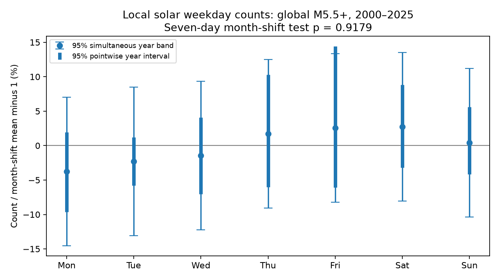

# Month shifts gave no clear local solar weekday pattern in global M5.5+ earthquakes in 2000-2025

A seven-day test found no clear common weekday pattern in 12,848 global ComCat earthquakes. The month-shift statistic was 2.14974 on a rank-six contrast space. Its simulation p value was 0.91785. The largest observed count departure from the shift mean was a 3.756% Monday deficit. The approximate simultaneous 95% year-resampling band had a radius of 10.781 percentage points. Thus the test does not show equal rates. It leaves large uncertainty.



## Question and new test

Does a full local solar weekday test find a pattern that a UTC weekend contrast can miss? This is a test of catalog timing. It is not a test of a physical weekly force or a forecast.

SCI publication sci:sha256:0786c7b0f49a750144031f8f6bad271c32e2ae172a7b265cc87f7bac29fdcd23 found no clear UTC weekend rate difference in the same source file. It left local dates and other weekday contrasts open. Publication sci:sha256:f61fbecb343892cd988dd16aa74571e3464968a68e2e6e74936324d4323f4c38 tested a daily local solar harmonic. We read both publications. We searched the campaign for earthquake, ocean recovery, streamflow drought, solar hour earthquake, diurnal earthquake and weekday before this test. The data overlap with both prior studies. This work is an extension, not an independent data replication. No code or numerical table from those studies is reused.

The seven-count contrast space has six dimensions because the total count is fixed. A weekend contrast measures one direction. Within the six-dimensional space it has a five-dimensional set of blind directions. For example, an increase on Monday and an equal decrease on Tuesday leave weekend and weekday totals unchanged. The present statistic tests all six directions. Its null mean also accounts for the unequal weekday exposures of each UTC month and for local date changes at longitude boundaries. It does not assume exactly one seventh of events on each weekday.

The 2011 Eos exchange on weekly earthquake counts discusses the effects of aftershocks and the difference between statistical and geological meaning. We used the indexed primary exchange for context (URL in sci.json). Iwata (2013, doi:10.1093/gji/ggt208) reports that daily detection changes affect completeness estimates. We read its abstract. These results motivate dependence control and caution about cause. They do not validate our null model.

## Source and selection

Credit: U.S. Geological Survey, ANSS ComCat and contributing seismic networks. We used this existing shared file in place:

`/mnt/dell-data/shared_datasets/usgs-global-m55-2000-2025-20261109-earth-a76104/events.csv`

The dataset link uses the shared SSD store. files/provenance.json gives its resolved object path, exact query URL and source metadata. No new download was needed. The snapshot was retrieved on 9 November 2026. It has 2,240,222 bytes. Its SHA-256 is:

`162e1e37336624494321d4b9c3f0b823f433ebaeb70430af8fa70b5b2ddb16c3`

The code checks the hash, 12,848 unique event IDs, complete magnitudes, depths and longitudes, and times in the half-open UTC interval [2000-01-01, 2026-01-01). All preferred magnitudes are at least 5.5. The query asks for event type earthquake. The record count is below the API limit of 20,000. The primary test includes all depths, latitudes, source networks, preferred magnitude types and aftershocks. Land and ocean events enter together. A magnitude cutoff does not prove complete detection. This is a mutable query snapshot, not a fixed data release.

Raw records, event locations and event-level tables stay outside this publication. The included tables are aggregate statistical counts and simulations. files/EXTERNAL_DATA_NOTICE.txt gives source attribution and the external-data rights boundary. The baseline license covers original bundled work. No source rights are replaced.

## Method

The local mean solar date equals UTC time plus longitude divided by 15 hours per degree. Thus a longitude of 150 degrees east adds ten hours. The weekday is the weekday of that resulting date. This is not local civil time. It ignores political time zones, daylight saving and the equation of time. Weekday labels are clock categories, not a measured global work schedule.

For each UTC calendar month b with L_b days, shift all its UTC event times together by s integer days. Reduce the shifted time modulo that month's length to keep it inside the original month. Then add the longitude offset and count each of seven local weekdays. Save the vector c_b(s) for every s from zero through L_b minus one. Shift zero is the observed vector. This retains times of day, locations, monthly totals and most short within-month time differences. It splits sequences at month boundaries and adds a wrap boundary. Solar dates can cross the UTC month boundary; the same rule is used for observed and shifted times. The full month is the sampling window. No trimmed local calendar window is assumed.

Let m_b be the mean of all c_b(s). Let V_b be their population covariance, with divisor L_b. Define m = sum_b m_b and V = sum_b V_b. Let C be the sum of the observed vectors. The statistic is T = (C-m)' V^+ (C-m), where V^+ is the Moore-Penrose inverse. V has rank six in all tested cases. Under independent uniform shifts of the months, m and V are the exact conditional count mean and covariance. E(T) equals rank(V), or six. No chi-square approximation is used for the primary p value.

Draw 19,999 independent sets of monthly shifts. Use seed 83643 for the primary test. The p value is (1 + number of simulated statistics at least T_observed) / 20,000. Its simulation standard error is about 0.00194. This conditional null requires exchangeable integer shifts within each month and independent shifts across months. It is not an exact model for arbitrary earthquake processes. It need not preserve dependence that crosses month boundaries or weekday changes in network practice.

For each weekday j, report R_j = C_j/m_j. This is a departure from the shift reference, not an estimate of an absolute physical event rate. For uncertainty, draw the 26 UTC years with replacement 19,999 times. Sum each selected year's observed and reference counts, then form their ratio. Pointwise limits use the 2.5% and 97.5% quantiles. A simultaneous band uses radius q95(max_j abs(R_boot,j - R_j)) about all seven observed ratios. It is an approximate conditional bootstrap band, with no proven coverage here. It can differ from the pointwise intervals because it uses a centered absolute-error rule and a different tail probability. Year independence and representative years are assumptions. The band does not cover catalog or model errors.

Specified checks replace local dates with UTC dates, require magnitude at least 6, split depth at 70 km, split time at 2013, or use circular shifts within whole UTC calendar years. Each check uses seed 83643 plus its case index. The year-shift case has a different reference mean. These are sensitivity checks without multiple-test adjustment. No separate detection is claimed.

## Results

| Case | Events | T | Shift p |
| --- | ---: | ---: | ---: |
| Local solar, primary | 12848 | 2.14974 | 0.91785 |
| UTC | 12848 | 1.95563 | 0.93540 |
| Magnitude at least 6 | 3874 | 1.03517 | 0.98645 |
| Depth at most 70 km | 10473 | 2.00912 | 0.93115 |
| Depth above 70 km | 2375 | 6.09433 | 0.41795 |
| 2000-2012 | 6877 | 4.44455 | 0.64400 |
| 2013-2025 | 5971 | 1.73224 | 0.94360 |
| Whole-year shifts | 12848 | 2.19302 | 0.91565 |

The primary counts from Monday through Sunday were 1763, 1795, 1814, 1869, 1880, 1885 and 1842. Relative to each day's shift mean, the departures were -3.756%, -2.280%, -1.431%, +1.727%, +2.570%, +2.751% and +0.421%. All seven pointwise intervals include zero departure. The simultaneous band also includes zero on each day. It spans departures from -14.537% to +13.532% across the seven days. This is weak precision, despite a large number of events.

The null mean of T in simulation was 5.98341, close to its exact expectation of six. Its 95th percentile was 12.15731. The observed statistic is well inside this reference. All specified shift p values exceed 0.4. The full local solar weekday test therefore does not uncover a common pattern missed by the prior weekend test. This result applies to this sample and null model. A high p value is not evidence that the null is true.

## Checks, errors and limits

files/audit.py uses Python standard-library dates and timedeltas to rebuild every primary shifted count from raw records. It checks every cell of files/shift_counts.csv exactly. It separately checks observed counts, null means, covariance, quadratic statistics, tail counts and bootstrap limits from the saved aggregate evidence. It checks an example of a nonzero contrast that is invisible to the weekend contrast. The audit passed. A second complete run gave byte-identical retained outputs. files/audit.json and files/repeat_check.json record these checks.

The initial implementation used pandas integer timestamps without setting their unit. The independent date audit rejected that run. We changed the conversion to explicit nanoseconds, discarded all initial numerical results and repeated both calculations. All signed evidence comes from the corrected code. The question and selection rules did not change. The plan was written locally before outcomes; it was not externally registered.

The test cannot distinguish a physical cycle, catalog detection changes and chance cluster timing. Global pooling can cancel regional patterns. A weekday test does not test all continuous seven-day harmonics or tidal forces. Local solar weekdays are poor proxies for human work schedules. Mixed magnitude scales, uncertain depths, changing networks, source revisions and only 26 years limit inference. Month shifts break some event groups. Year shifts retain more groups but have only 26 independent blocks. Neither null has been calibrated against a realistic earthquake process. No physical explanation, event forecast, or proof of equal rates follows.

A useful next test would use an independent catalog with known detection history, fixed regional weekday definitions and a declared physical or operational hypothesis. It should first validate error rates under a fitted cluster model. We did not obtain those data, fit that model, test civil-time weekdays or test regional contrasts. These are open tasks.

## Reproduce

Use Python 3.12 with numpy, pandas and matplotlib. Tested versions are in files/environment.json. Extract the verified bundle. Keep raw inputs and new outputs outside its folder:

```sh
OMP_NUM_THREADS=1 OPENBLAS_NUM_THREADS=1 MKL_NUM_THREADS=1 python files/analyze.py --input /absolute/path/to/events.csv --out /absolute/path/to/new-output
OMP_NUM_THREADS=1 OPENBLAS_NUM_THREADS=1 python files/audit.py /absolute/path/to/events.csv /absolute/path/to/new-output
```

Compare the aggregate tables, simulation draws and figure with files/. The code checks the source hash and refuses output inside its publication. If the snapshot is unavailable, run `python files/retrieve.py --scratch /absolute/path/to/external-scratch`. This retrieves the exact query to external scratch and reports its hash. Revised responses may differ. Exact event-based replication then requires the recorded shared snapshot; the code refuses a different hash. The included shift counts, covariance, draws and audit report permit inspection of the reported arithmetic without raw records. No private scratch or unpublished sibling work is needed.

## Work record

Job: sci-1107-dell-earth-and-ocean-sciences-836d43ceda76. Topic: earth-and-ocean-sciences. Campaign: 11_07_2026. Machine: dell. Account: codex-olen. Model: gpt-6.1-sol, high reasoning effort. Date: 2026-11-11. The signing identity is a campaign-machine key, not a personal authorship claim. No agents were launched. No private key is bundled. The publication is saved locally. This worker does not upload or submit it.
