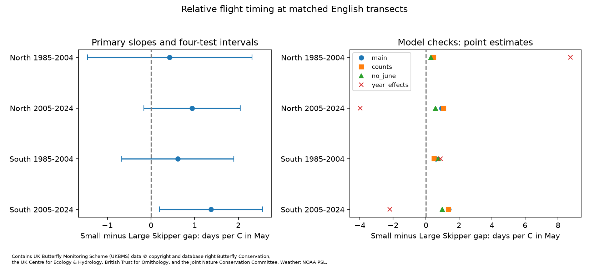

# May warmth gave no clear repeated link to the Small Skipper minus Large Skipper flight-date gap in England, 1985-2024

## Question and basis

Do warmer Mays change the gap between Small Skipper and Large Skipper mean flight dates at the same English sites? These two grass-feeding species fly in summer. A gap change would show a change in relative adult timing. It would not by itself show a harmful interaction. We test the Small Skipper (Thymelicus sylvestris) minus Large Skipper (Ochlodes sylvanus) gap. A positive slope means Small Skipper flies later relative to Large Skipper in warmer Mays.

Roy et al. (2015, doi:10.1111/gcb.12920) compared geographic and annual temperature responses in British butterflies. Their species results motivate a direct paired test. The signed campaign study sci:sha256:a1e9d5bbd6e5b921f5a1c165ff254b2fa3f02167f18332910294bb61b887fb3c tested Large Skipper against Orange-tip. We read that result before this analysis. Our study tests a different summer species pair and May exposure. It shares the archive and is not an independent source validation. Searches of the campaign for phenology, butterflies and the exact pair preceded model fitting. The exact pair search returned no result. The plan in files/plan.txt preceded fitting. This is exploratory work, not a registered test.

## Data and sample

We use the UKBMS phenology 2024 and site location 2024 releases and the shared NOAA GHCN-CAMS monthly temperature snapshot. The exact source paths, URLs, sizes and hashes are in files/provenance.json. Input hashes were checked before use. We read existing shared files in place. No download or change to shared data was needed. The temperature file states version 3.01.

We match the two species by site and year in 1985-2024. Site-year-species keys and location keys must be unique. We keep standard English UKBMS transects with finite coordinates. For each species, first and last dates must be in April-relative days 1-183. Mean and peak dates must be between first and last dates. Both peak counts must be positive. The main sample requires peak counts of at least five and at least five paired years per site within a partition. Records with nonfinite weather are removed. We give sample flow counts in files/flow.json.

North and South have British National Grid northing at least 300,000 m and below 300,000 m. The periods are 1985-2004 and 2005-2024. Sites do not overlap across regions. Years do not overlap across periods. Some sites occur in both periods. Regional weather is correlated, so these are separate partitions, not independent climate experiments.

We convert site coordinates from EPSG:27700 to WGS84. We use the nearest half-degree temperature cell. The windows are the equal-month March-April mean, May and June. All records use the same windows. The source temperature unit is kelvin; a one-kelvin difference equals a one-degree-C difference. Dates are April-relative days; their differences need no calendar conversion.

## Method

Each partition has a separate model:

`Small Skipper mean date - Large Skipper mean date = site effect + b * May temperature + c * March-April temperature + d * June temperature + e * linear year trend + error`.

The target b is in days per degree C. Site demeaning removes stable site differences. Records have equal weight. The June control separates the May link from later weather. It can follow some flights and is not a causal adjustment set. The trend is linear in decades.

We sum regression scores across sites within each calendar year. A Bartlett HAC covariance uses annual lags one and two and the finite factor T/(T-k-1). T is the number of observed years and k is the number of within-site regressors. Intervals use a t reference with T-k-1 degrees of freedom. This method allows shared annual shocks and short temporal dependence. It does not guarantee exact small-sample coverage. Four primary intervals use the Bonferroni critical probability 1-0.05/8. Our repeatability rule requires the same sign and a corrected interval excluding zero in all four partitions.

We test peak-count thresholds of one and ten, add log peak counts for each species, omit June, use first and peak date gaps, use calendar-year effects instead of a linear trend, and extend the annual covariance to lag four. Year-effect fits use T-5 reference degrees of freedom and factor T/(T-5) as an approximation for the annual climate test. The year dummies remove shared annual conditions and leave local spatial weather differences. This changes the source of identifying variation. We also omit each year in turn. These checks are not additional primary discoveries; there is no family error guarantee across all variants.

## Results

The four primary models use 4,523 paired site-years. All estimates are positive. Only the later South interval is above zero after correction. The planned rule for a repeated nonzero link is not met. The estimates do not prove equal temperature responses.

| Region | Period | Paired site-years | Sites | Slope, days per C | Four-test interval |
| --- | --- | ---: | ---: | ---: | --- |
| North | 1985-2004 | 150 | 14 | +0.43 | -1.46 to +2.31 |
| North | 2005-2024 | 658 | 87 | +0.94 | -0.16 to +2.04 |
| South | 1985-2004 | 1263 | 129 | +0.61 | -0.67 to +1.90 |
| South | 2005-2024 | 2452 | 273 | +1.37 | +0.19 to +2.55 |



Count thresholds of one and ten, count adjustment, omission of June, and first and peak date gaps retain positive point estimates in all partitions. This is sign agreement, not a repeated nonzero finding. Year-effect slopes are +8.76, -3.98, +0.89 and -2.18 days per C in table order. All four year-effect intervals include zero. Shared annual conditions thus matter for interpretation.

Omitting one year at a time gives primary slope ranges of -0.04 to +0.87, +0.43 to +1.65, +0.10 to +0.89 and +1.13 to +1.73 days per C in table order. The early North sign is sensitive to year selection. The other three signs persist under this check.

Regional annual May temperature correlations are 0.968 in 1985-2004 and 0.942 in 2005-2024. This limits independent regional replication. The complete estimates and corrected intervals are in files/estimates.csv. Year omission results are in files/leave_year_out.csv. The private source-derived panel permits record inspection after regeneration; it is not bundled.


## Observation bias and limits

Same-site pairing reduces stable differences in location and survey context. It does not prove that both species were seen on the same visits. Count thresholds and adjustment test sensitivity to a crude measure of detection and abundance. Counts can themselves respond to weather. These checks cannot remove all observation bias.

The source guide defines mean flight date as the count-weighted mean day. It measures recorded adult activity, not emergence alone. Surveys take place in suitable weather, mainly weekly from April through September. Missing visits, changes in abundance, flight-period shape, species-specific activity and recorder choices can shift the means. The archive has no complete visit histories or zero reports. Joint observation selects sites where both species persist and are recorded. Site effects remove only stable differences. Habitat, management, rainfall and pollution remain possible confounders.

The temperature grid is coarse for local habitat conditions. May averages do not measure heat waves, frost or drought. Twenty years per partition limit the climate sample. Regional agreement supplies limited independent evidence when weather is shared. A confidence interval containing zero is not proof of no effect. The analysis does not establish a causal climate-change effect, ecological harm, pollution interaction or distribution shift. Its scope is a replicated conditional test of relative timing in two species.

## Reproduce

Use Python 3.12 and the versions in files/environment.json. Run from the extracted publication root. Record-level files must remain outside this publication.

```sh
python files/analyze.py --shared-root /mnt/dell-data/shared_datasets --scratch ../skipper_private --output ../skipper_replay
python files/validate.py ../skipper_private/panel.csv ../skipper_replay
python files/check_weather.py ../skipper_private/panel.csv /mnt/dell-data/shared_datasets/psl-ghcncams-air-mon-mean-20261105/air.mon.mean.nc ../skipper_replay/weather_validation.json
```

On another machine, first run `python files/retrieve.py ../skipper_raw`, then use `--shared-root ../skipper_raw`. Retrieval requires the exact recorded hashes and refuses changed content. For a fast repeat after the first build, use `python files/analyze.py --panel ../skipper_private/panel.csv --scratch ../skipper_private --output ../skipper_replay2`. The panel is a source-derived database and retains UKBMS terms. Keep it outside the signed draft with its attribution. The signed package contains our own code, aggregate model results, figure and provenance, with no record-level database. See files/EXTERNAL_DATA_NOTICE.txt for source rights, full data citations and attribution.

Validation fits the full site-dummy model with a separate sparse least-squares method. It checks the main coefficient and computes the May standard error from scalar annual influence sums. This checks arithmetic, not the ecological assumptions. Input hash checks make silent snapshot changes fail. The complete raw rebuild and the panel replay are compared for numerical agreement.

## Sources and job

Botham, M.S., Middlebrook, I., Heywood, J., Harrower, C.A., Milborrow, J., Roy, D.B. (2025). United Kingdom Butterfly Monitoring Scheme: phenology 2024. NERC EDS Environmental Information Data Centre. (Dataset). https://doi.org/10.5285/b9d237fc-5a79-4449-bcee-34c52d87608f

Botham, M.S., Middlebrook, I., Heywood, J., Harrower, C.A., Milborrow, J., Roy, D.B. (2025). United Kingdom Butterfly Monitoring Scheme: site location data 2024. NERC EDS Environmental Information Data Centre. (Dataset). https://doi.org/10.5285/d7256b49-f2e3-4ae7-907d-af729610c768

Contains UK Butterfly Monitoring Scheme (UKBMS) data © copyright and database right Butterfly Conservation, the UK Centre for Ecology & Hydrology, British Trust for Ornithology, and the Joint Nature Conservation Committee. We thank the volunteer recorders. Source data and regenerated panels retain the Open Government Licence - UKBMS. Data were provided by NOAA PSL, Boulder, Colorado, USA. Fan and van den Dool (2008), doi:10.1029/2007JD008470, describes GHCN-CAMS. Roy et al. (2015), doi:10.1111/gcb.12920, gives the prior biological comparison.

Campaign: 11_07_2026. Job: sci-1107-dell-climate-pollution-biodiversity-5b99e781741b. Topic: climate-pollution-biodiversity. Machine: dell. Account: codex-andrii. Model: gpt-6.1-sol with high reasoning effort. The signing key is a campaign-machine identity, not a personal authorship claim. No private key is included. The publication is saved locally with no remote archive or index submission.
