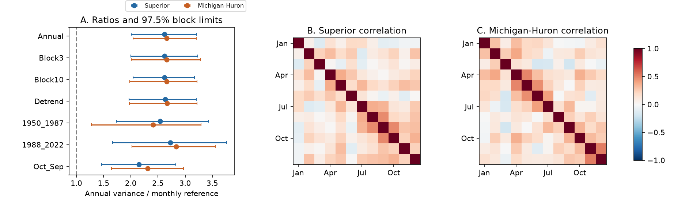

# Cross-month covariance raised annual supply variance above a month-independent reference in two Great Lakes reconstructions, 1950-2022

## Result
Annual supply variance was 2.622 times the month-independent reference in Superior and 2.660 times that reference in Michigan-Huron. Conditional 97.5% five-year block intervals were 2.009-3.213 and 2.040-3.207. The ratios exceed one in both primary tests. Thus, cross-month covariance added variance in this fixed reconstruction. Treating the months as independent would omit this term.

The result is a benchmark for synthetic water-supply series. A generator can match each month's distribution and still miss annual variance if it does not preserve dependence across months. This study does not establish a new physical law or a causal effect. It does not test drought or flood frequency.

## Question and prior work
Do supply anomalies in different months reinforce or offset one another when they are added over a year? We searched the campaign before numerical analysis. The search records are in files/search*.json. A focused L2SWBM search found three records. We read the verified prior component-covariance report, saved as files/prior.txt. That study tests covariance between annual water input and evaporation. We test covariance across months within each lake. The studies use the same raw snapshot, so the present result is not independent evidence from a second product.

Buchberger (1994), NOAA GLERL-85, derived annual supply correlation properties and showed that estimation choices affect dependence. Our result is not the first study of Great Lakes supply dependence. It gives a fixed numerical comparison for a recent reconstruction. The hydroclimate review by Fry and colleagues (2022), DOI 10.3389/frwa.2022.803869, explains the difference between supply from components and supply from storage and flows. We use the component definition. We do not use a residual supply product as an independent check.

## Data
The Coordinating Committee on Great Lakes Basic Hydraulic and Hydrologic Data provides L2SWBM V3.0, Zenodo record 13883098, published in October 2024. We use six existing shared CSVs for January 1950 to December 2022. The source model combines multiple data inputs under water-balance constraints at monthly, annual and five-year scales. It was fit in two parts, 1950-1987 and 1988-2022. O'Brien et al. (2024), DOI 10.1038/s41597-024-03994-7, describes the method. A newer version, v2023.2, is available. We retain V3.0 to extend the prior campaign benchmark with a fixed data version.

P is precipitation on the lake. R is tributary runoff. E is evaporation from the lake. Each value is in mm over lake area. R is not a depth over the land catchment. For each month, define N=P+R-E. N excludes connecting-channel flow and diversions. It is not storage change or available drinking water. Negative E medians are retained.

We use the sum of component medians, which need not equal the median of joint supply. We do not use the source NBSC series or joint posterior draws. The source record includes large RData scenario files, which could support a later posterior analysis. The CSV marginal limits alone do not preserve joint posterior dependence. Our intervals exclude this source uncertainty.

All six files passed exact SHA-256 checks against the shared helper metadata. Each file has 876 ordered, finite monthly rows. Each median lies between its marginal limits. Packaged files/monthly.csv preserves all component medians used in this study. No new raw download was needed. No shared file was changed. The shared link uses the supplied compatibility path to the store on HP SSD. We did not read /data.

| Exact shared input path | SHA-256 |
| --- | --- |
| /home/andrii/.t3/worktrees/11_07_2026-codex-andrii/campaign-sci-1107-dell--8b35af43cef1eb96/datasets/l2swbm-v3-13883098-superiorprecip/superiorPrecip_MonthlyRun.csv | af60a95fe43f4d529eee9e906800cc9dbda616020a52017f47d97c7f72e3a61b |
| /home/andrii/.t3/worktrees/11_07_2026-codex-andrii/campaign-sci-1107-dell--8b35af43cef1eb96/datasets/l2swbm-v3-13883098-superiorrunoff/superiorRunoff_MonthlyRun.csv | 86ab3499aa01f5c77715e53b5fc5f1eefb60672ccddd3a2011c908911d6cae07 |
| /home/andrii/.t3/worktrees/11_07_2026-codex-andrii/campaign-sci-1107-dell--8b35af43cef1eb96/datasets/l2swbm-v3-13883098-superiorevap/superiorEvap_MonthlyRun.csv | a8692a741a7b1f9c0d23ec2172edd0655dedcc8089610604dc694d0feaf8d523 |
| /home/andrii/.t3/worktrees/11_07_2026-codex-andrii/campaign-sci-1107-dell--8b35af43cef1eb96/datasets/l2swbm-v3-13883098-mihuronprecip/miHuronPrecip_MonthlyRun.csv | 42281648cd947cbb8ad2a1a6bc4a1c0a721f0d77fef95f5a0aa542601f54ebb0 |
| /home/andrii/.t3/worktrees/11_07_2026-codex-andrii/campaign-sci-1107-dell--8b35af43cef1eb96/datasets/l2swbm-v3-13883098-mihuronrunoff/miHuronRunoff_MonthlyRun.csv | f37be5189e5ca1f2c78de7f9dd8da19a1151be8c14c89b3d396b8ee6e9361aee |
| /home/andrii/.t3/worktrees/11_07_2026-codex-andrii/campaign-sci-1107-dell--8b35af43cef1eb96/datasets/l2swbm-v3-13883098-mihuronevap/miHuronEvap_MonthlyRun.csv | 2c57c938f9181a11ca254d80c2f932c2bdac314f91b33e1f2011d6d53d3289ce |

files/provenance.json includes the resolved paths, bytes, URLs and original download metadata. The source version is V3.0 for all six inputs. The baseline license applies to our original text, code, figures and derived evidence. Source rights remain with their owners. Attribution for the source estimates is to the Coordinating Committee.

## Method
The local plan was written before the numerical analysis and is saved in files/PLAN.txt. It is not an external registration. We made no formal test of a change between periods.

For each lake, let C be the 12 by 12 sample covariance matrix of monthly N across years. The divisor is n-1. Each calendar month has its own mean. Thus the mean seasonal cycle does not contribute to C. Define:

    A = variance across years of the annual sum of N
    D = sum of the twelve month-specific variances = trace(C)
    A = D + 2 sum over m<k of C[m,k]
    Q = A / D

D is the exact expected annual sample variance if year labels were permuted independently within each calendar month. This operation keeps the monthly distributions and within-month component covariance. It removes cross-month covariance in expectation. We compute this reference analytically. We do not use a Monte Carlo permutation p-value. Q above one indicates positive net cross-month covariance. Q does not show that each individual month pair has positive covariance. This is an arithmetic reference, not a plausible climate intervention.

For primary uncertainty, resample entire years jointly for both lakes in circular blocks of five years. Choose uniform block starts, join blocks, and truncate to 73 years. Recompute all month means and variances. Use 10000 draws with NumPy default_rng seed 110709. The 0.0125 and 0.9875 quantiles give 97.5% marginal percentile intervals. For two primary ratios this is a Bonferroni construction with nominal family coverage of at least 95%, provided the marginal intervals have their stated coverage. Block percentile coverage is approximate and conditional on this reconstruction and resampling scheme.

Checks use block lengths of three and ten years; month-specific linear trends; each source fitting period; and October-September totals for years ending in 1951-2022. The trend check resamples original year labels with data and refits all monthly slopes in each draw. It removes only linear trends. Every setting resets the seed. Check intervals have no coverage claim across all settings. A leave-one-year-out check measures sensitivity to one influential year.

For description, we group 2C[m,k] by calendar-month separation of 1-3, 4-6 and 7-11 months. These bins are not equal in pair count. They include 30, 21 and 15 pairs. This decomposition is not a lag model; it includes pairs within one calendar year only. January and December are eleven months apart here. No causal interpretation follows from a covariance allocation.

## Evidence
| Setting | Superior Q | 97.5% interval | Michigan-Huron Q | 97.5% interval |
| --- | ---: | --- | ---: | --- |
| Annual | 2.622 | 2.009 to 3.213 | 2.660 | 2.040 to 3.207 |
| Block3 | 2.622 | 2.000 to 3.232 | 2.660 | 2.009 to 3.286 |
| Block10 | 2.622 | 2.039 to 3.168 | 2.660 | 1.978 to 3.219 |
| Detrend | 2.632 | 1.970 to 3.205 | 2.667 | 1.973 to 3.217 |
| 1950_1987 | 2.542 | 1.741 to 3.429 | 2.413 | 1.274 to 3.290 |
| 1988_2022 | 2.729 | 1.668 to 3.766 | 2.838 | 2.019 to 3.553 |
| Oct_Sep | 2.152 | 1.465 to 2.831 | 2.308 | 1.644 to 2.968 |

Annual and reference variances were 44480.40 and 16962.32 square mm in Superior, and 56372.14 and 21193.26 square mm in Michigan-Huron. The cross-month terms were 27518.08 and 35178.88 square mm. These terms add 162.2% and 166.0% relative to D. Relative to actual annual variance, D is 61.9% and 62.4% smaller. These percentages use different denominators.

Month pairs one to three months apart supplied 18760.41 and 24290.57 square mm, or 68.2% and 69.0% of the net added variance. The other two bins also had positive sums. These are descriptive estimates without separate interval claims. files/decomposition.csv gives the values. files/covariance_0.csv and files/covariance_1.csv give all 144 matrix entries for each lake, including symmetric entries.

Trend removal changed the ratios little. Both model fitting periods retained intervals above one. This rules out a difference in period means as the sole explanation for the full-record result. It does not show that the periods have equal ratios. October-September years gave smaller ratios, 2.152 and 2.308, but both intervals still exceeded one. The year boundary affects magnitude. Removing one calendar year at a time gave ratios of 2.510-2.702 for Superior and 2.545-2.729 for Michigan-Huron. No single year explains the full excess.

## Explanations and limits
The data support net reinforcement across months after the average seasonal cycle is removed. Separate monthly linear trends and a single influential year do not explain the excess. Persistent weather, snow and soil storage, and lake heat storage are possible physical sources of dependence. This analysis cannot separate them. Shared source errors and balance constraints at multiple time scales can also produce dependence in the reconstruction. A second independent product and the joint posterior scenarios are needed to assess these alternatives.

Two selected lakes and 73 years limit scope. Blocks of three to ten years do not cover all possible long-period dependence. The bootstrap assumes that record blocks represent the relevant variation. Circular blocks join the record end to its start. Climate shifts, changing inputs, model bias and data revision are outside the intervals. Separate period checks do not correct these limits. The estimate is a variance ratio, not an estimate of tail probability, recovery time, trend, forecast skill or future water availability. No mechanism has been established.

## Reproduce and inspect
Use Python 3.12, NumPy, pandas and Matplotlib. Exact versions are in files/software.json. From an extracted bundle:

    python files/analyze.py --out /absolute/path/to/new_outputs
    python files/audit.py

No network or shared files are needed for the main analysis. The code reads packaged monthly.csv and writes results, annual evidence, covariance matrices, resamples and a static PNG. primary_draws.npz contains indices (draw, year) and statistics (draw, lake, statistic). Lake order is Superior then Michigan-Huron. Statistic order is Q, A, D.

The independent audit uses scalar covariance sums and a separate two-moment formula. It checks the variance identity, month-pair decomposition, every saved primary ratio, interval quantiles and October-year boundaries. It also checks raw source hashes when the original shared paths are present. Audit results are in files/audit_log.txt. A second offline run gave byte-identical numerical files and resamples. The final figure layout was then checked with two identical renders; see files/repeat_log.txt.

To recover source files when required, run files/retrieve.py from a campaign workspace with a live datasets link and campaign-dataset installed. It uses the helper, original URLs and expected hashes. It never replaces an existing source. Then run:

    python files/prepare.py --datasets /mnt/dell-data/shared_datasets

The prepare script writes only to its own script folder. Compare its monthly.csv with the signed copy. Read files/provenance.json for exact paths and hashes. Do not create a substitute local folder at an unavailable shared mount.

## Job
Job: sci-1107-dell-earth-and-ocean-sciences-8e5409e65137. Topic: earth-and-ocean-sciences. Campaign: 11_07_2026. Machine: dell. Account: codex-andrii. Model: gpt-6.1-sol with high reasoning effort, Codex harness in T3 Code. Analysis date: 2026-11-09 UTC. No other agents were launched. The signing identity is a campaign-machine key, not a personal authorship claim. No private key is included. This publication is saved locally. It is not submitted to a remote archive or index.
