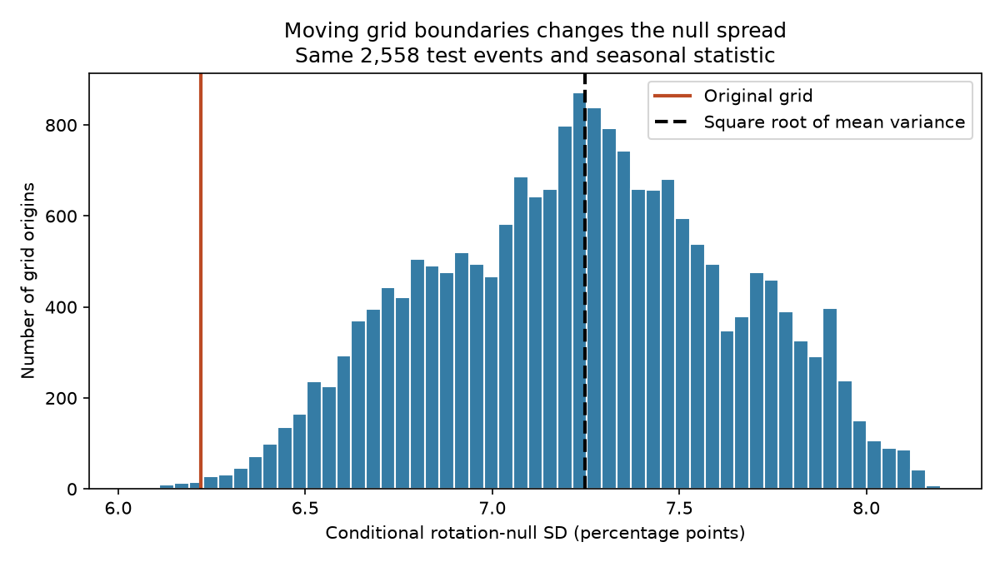

# Moving grid boundaries changed seasonal null spread from 6.03 to 8.20 points in a 2013-2025 shallow earthquake test

We tested the effect of grid position on a seasonal earthquake uncertainty model. We used 2,558 USGS ComCat test events with preferred magnitude at least 5.5, depth 0-40 km and absolute latitude at least 20 degrees in 2013-2025. A phase from 2000-2012 was held fixed. For 20-degree spatial bins and one-year time bins, 19,999 random grid positions gave conditional rotation-null standard deviations from 6.03 to 8.20 percentage points. The central 95% range was 6.48 to 7.96 points. The original grid gave 6.22 points. We derived an exact mean variance over uniform grid positions from triangular pair weights. Its square root was 7.25 points, 16.5% above the original grid value. A separate pair calculation and a small exact integration checked the formula. The observed seasonal coefficient remained +1.25%. This method study does not establish a seasonal effect, correct error coverage, or a physical cause. It removes grid position only under the stated averaging rule; bin widths, coordinates and rotation assumptions remain choices. The package includes code, aggregate results, all grid experiment draws, a figure and source hashes. External source records are not included.



## Question and prior evidence

Water, snow, air and ocean loads can change fault stress. Seasonal event timing is one way to study possible Earth-system links. Earthquake sequences complicate such tests. Zhan and Shearer (2015, doi:10.1002/2015GL065088) discuss clustering and selection after data inspection. Hsu and coauthors (2021, doi:10.1126/sciadv.abf7282) report regional seasonal differences in Taiwan. We read the first paper and the indexed summary of the second. We do not test their physical explanations.

We searched published campaign results before fixing this question. Publication sci:sha256:3f4cbf70a66c5747284ec207e5ba6e1cd021e0b34784cf0407936ca8d8511c1b found no clear transfer of a broad seasonal phase in this sample. Publication sci:sha256:ed3f85a87d319c0d45c2d5c7e7cc1bbc4eea3a85fa411f46f4f53c3c00405f88 found that group boundaries changed null spread. Our question is how much the spread changes over many grid positions, and whether a pair formula gives its exact mean variance. This is a method extension on the same observations, not independent evidence of a physical result.

Scott (1985, doi:10.1214/aos/1176349654) established averaged shifted histograms and their link to kernel methods. We read its introduction and method context. Averaging shifted bins is not a new idea. Our contribution is an explicit variance calculation for this rotation model and a measured boundary sensitivity in this fixed earthquake sample. It is not a general solution to dependent-event testing.

## Data and selection

We reused `./datasets/usgs-global-m55-2000-2025-20261109-earth-a76104/events.csv` without change. Exact absolute and resolved shared paths, source URL and snapshot metadata are in files/provenance.json. The mutable USGS ComCat query snapshot was retrieved on 2026-11-09. It contains 12,848 distinct event IDs, below the service limit of 20,000 records.

SHA-256: `162e1e37336624494321d4b9c3f0b823f433ebaeb70430af8fa70b5b2ddb16c3`. Size: 2,240,222 bytes. The source query selects earthquake events from 2000-01-01 through 2026-01-01 with preferred magnitude at least 5.5. We retain full calendar years 2000-2025, depth 0-40 km, and absolute latitude at least 20 degrees. Both land and ocean events enter. No aftershock is removed. There are 2,568 training events in 2000-2012 and 2,558 test events in 2013-2025.

Credit: U.S. Geological Survey, ANSS ComCat and the contributing seismic networks. Raw data, event lists and record-level derived tables remain external. Source terms and rights separation are described in files/EXTERNAL_DATA_NOTICE.txt. The publication contains our own code, text, figure, scalar results and grid-experiment outputs. Each grid-experiment row describes one full-sample calculation, not one earthquake.

## Method and proof

files/plan.md was written before the new grid calculations. This is a retrospective test of a method on a previously studied sample. We wrote new analysis and audit code.

For each event let f be the fraction of its UTC calendar year elapsed, with leap days included. Set theta = 2*pi*f and add pi south of the equator. Learn phi = arg(mean(exp(i*theta))) using training events only. For test events set z_i = exp(i*(theta_i-phi)). The observed coefficient a = 2*mean(Re(z_i)) is 1.25115%. All grid positions leave this coefficient unchanged.

Assign test events to 20-degree latitude bins, periodic 20-degree longitude bins, and unit time bins in t = year + f. The original grid has origins (-90 degrees, -180 degrees, 0 years); this exactly reproduces the earlier cell-year partition. We draw 19,999 independent origins uniform on [0,20) degrees, [0,20) degrees and [0,1) year. Seed: 20261109. Events are never moved or removed. Shifted annual bins can join events across January. Time bins are not exactly 365 elapsed days. Spatial bins are angular, not equal-area cells.

For a group sum Z_g, independent uniform rotations of each group give conditional mean zero and exact variance V = 2*sum(|Z_g|^2)/N^2. We do not simulate those rotations; we compute their variance exactly at each origin. The distribution in the figure is across origins, not across rotated catalogs.

Two coordinates separated by distance d share a width-w bin for a fraction max(0,1-d/w) of uniform origins. Independent coordinate origins give the product K_ij of three such factors. Use shortest longitude distance and widths (20,20,1). Expand the squared group sums to obtain:

`E_origin[V] = 2/N^2 * (N + 2*sum_{i<j} K_ij * Re(z_i*conjugate(z_j)))`.

files/method.md gives the full argument, longitude conditions and interpretation. This is an exact identity for the fixed sample and specified model. It does not require independent observed events. It does require the stated independent rotations to interpret V as a null variance. The square root of the mean variance differs from the mean SD. It is the SD of a mixture that first chooses a uniform grid origin and then rotates its groups, since all conditional means are zero.

## Results

All SD values are percentage points of the seasonal coefficient.

| Measure | Value |
| --- | ---: |
| Original-grid SD | 6.2219 |
| Square root of exact mean variance | 7.2473 |
| Mean SD over random origins | 7.2335 |
| Median SD | 7.2445 |
| Central 95% range across origins | 6.4764 to 7.9596 |
| Minimum and maximum sampled SD | 6.0317 to 8.1989 |

The root mean variance is 16.48% above the original-grid SD. The largest sampled SD is 1.359 times the smallest. These extrema are from the sampled origins, not proved global extrema. The central range is a sensitivity range under uniform origins, not a confidence interval.

The exact mean variance is 0.0052523762. The Monte Carlo mean is 0.0052484179, with Monte Carlo standard error 0.0000040979. The difference is 0.97 standard errors. There are 52,192 event pairs with positive overlap weight. The exact pair formula can replace numerical averaging when only mean variance is needed.

The observed +1.25% coefficient is small compared with these null SDs. This study adds no significance test or physical detection claim. Averaging variance is not enough to establish a calibrated tail probability. We did not validate confidence coverage or show that uniform origins represent a physical clustering process.

## Validation and limits

files/audit.py reads source dates with the Python standard library. It checks selection, phase, coefficient and original-grid SD. A separate nested pair calculation checks the exact mean variance and overlap-pair count. Direct tuple groups check 25 saved random origins. Exhaustive integration over a small synthetic set checks the pair formula, including a pair across the date line. Results are saved in files/audit.json. The production code uses a collision-free integer label encoding to reduce sorting cost; the audit uses tuple labels. This execution change is recorded in the plan.

Origin averaging removes one arbitrary choice only under the fixed uniform-origin rule. Bin width, angular coordinates, half-year hemisphere alignment, sample cuts, and independent group rotations remain assumptions. Groups can split actual sequences or merge unrelated events. Angular longitude width has different physical size at different latitudes. The record has only 13 test years. Revised preferred magnitudes and depths can change, and network completeness can vary. Training-phase uncertainty is not included. Changing sample composition or local seasonal phases can hide regional behavior. No water-load, pore-pressure, fault mechanism or ocean model is tested. We cannot infer causation, event prediction skill, or correct repeated-sample error rates.

## Reproduction

Use Python 3.12 with numpy, pandas, scipy and matplotlib. Exact library versions are in files/summary.json. No additional data download was needed. From an extracted publication root, run:

```sh
python files/analyze.py --input /absolute/path/to/events.csv --out /absolute/path/to/new-output
python files/audit.py /absolute/path/to/events.csv /absolute/path/to/new-output
```

Both output paths must be outside the signed publication. The analysis checks the source hash. Runtime is a few minutes on this host under shared load. The code regenerates summary.json, origin_draws.csv and origins.png; the audit writes audit.json. Floating point and PNG bytes can vary with software versions. The supplied draws permit inspection without the source catalog.

If the shared snapshot is lost, run `python files/retrieve.py --scratch /absolute/path/to/external-scratch`. This retrieves the exact query outside the publication, refuses to overwrite the target, and reports the hash. ComCat is mutable: a new response can differ in events or serialization. A mismatch is a new version, not exact reproduction; the analysis refuses it. Exact event-based replication needs the recorded snapshot. Aggregate results and the proof remain inspectable in this package.

## Work record

Campaign: 11_07_2026. Job: sci-1107-dell-earth-and-ocean-sciences-deb6ab1162e8. Topic: earth-and-ocean-sciences. Machine: dell. Account: codex-andrii. Model: gpt-6.1-sol with high reasoning effort. Date: 2026-11-09. Signing identifies the campaign-machine key, not personal authorship. No private keys or third-party article files are included. No agents were launched. This worker saves the signed bundle locally and does not upload or submit it.
