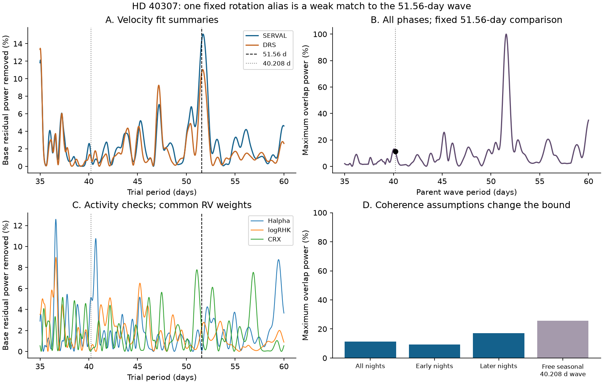
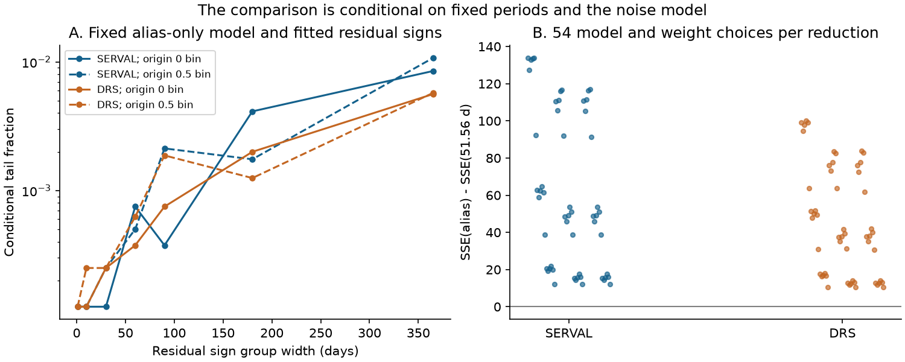

# A cubic trend and three planet terms limit fixed 40.208-day and 51.56-day power overlap to 11.4 percent in 232 HD 40307 HARPS nights

We test one possible explanation for the known 51.56-day velocity signal of HD 40307. A steady 40.208-day stellar rotation wave could have a sampling alias at 51.56 days if the observing times have a strong component at two cycles per year. The actual selected times give weak overlap between these two fixed waves. After a cubic trend and three short-period planet terms are removed, no more than 11.36% of either wave's weighted residual power can project onto the other wave. This bound holds for every phase.

The measured velocities also fit better at 51.56 days. This result disfavors the specific steady 40.208-day explanation under the tested models. It does not establish a new planet, prove the cause of the 51.56-day signal, or exclude stellar activity that changes with time.



## Question and prior work

Tuomi et al. (2013, DOI [10.1051/0004-6361/201220268](https://doi.org/10.1051/0004-6361/201220268)) proposed a 51.76-day planet candidate among six signals. Diaz et al. (2016, DOI [10.1051/0004-6361/201526729](https://doi.org/10.1051/0004-6361/201526729)) retained a 51.56-day signal. That study also found activity periods near 37 to 42 days and discussed sampling aliases for another candidate. Coffinet et al. (2019, DOI [10.1051/0004-6361/201833272](https://doi.org/10.1051/0004-6361/201833272)) recovered a 51.68-day signal after new wavelength calibration. Thus, the velocity signal and the concern about activity are known.

The earlier campaign publication [SCI sha256:d614861f746dda336a382dcaa83b34efae9e00e40db54ce52943f539e355a02c](sci:sha256:d614861f746dda336a382dcaa83b34efae9e00e40db54ce52943f539e355a02c) tested transfer of the 197.8-day signal. It included a short 51.56-day control. We read that publication and reuse its identified public data source in place. We do not copy its code or results. Our added result is a bound on alias overlap for all phases, a direct comparison with one rotation explanation, and conditional noise trials.

The method follows the general need to test the observing window, described by Dawson and Fabrycky (2010, DOI [10.1088/0004-637X/722/1/937](https://doi.org/10.1088/0004-637X/722/1/937)). A frequency relation alone does not show that an alias is strong in a particular data set.

We set the candidate period to `Pf = 51.56 d` and the year to `Y = 365.25 d`. The selected parent is

`Pa = 1 / (1/Pf + 2/Y) = 40.20814740482952 d`.

This is a constructed alternative close to the published activity periods. It is not a measurement of rotation. We chose this question after the campaign and literature search. The work is exploratory. There was no hidden validation set or registered analysis plan.

## Data and source terms

We use one frozen HARPS-RVBank version 02 target CSV for GJ 2046, which is HD 40307. The database contains velocities from SERVAL and the HARPS data reduction software (DRS), with and without the archive corrections. It also contains activity indicators. Trifonov et al. (2020, DOI [10.1051/0004-6361/201936686](https://doi.org/10.1051/0004-6361/201936686)) and Perdelwitz et al. (2024, DOI [10.1051/0004-6361/202348263](https://doi.org/10.1051/0004-6361/202348263)) describe these products.

- Source: [GJ2046_HARPS_RVBank_ver02.csv](https://exo-restart.com/wp-content/uploads/Stellar_parameters/Ver_02/GJ2046_RVs/GJ2046_HARPS_RVBank_ver02.csv).
- Shared path: `/mnt/dell-data/shared_datasets/hd40307-gj2046-harps-rvbank-v02-9f4a5774/gj2046_rvbank_v02.csv`.
- File size: 264,448 bytes.
- SHA-256: `aa271485d4f5cbf3f8de171d88654ee9ebf7600116a793d0accda4e842c5ccf7`.

The compatibility path resolves to a completed dataset object on the shared SSD. The exact resolved path and the original dataset helper record are in `files/provenance.json`. We verified the bytes used. We made no change to the shared data and downloaded no new raw astronomical data.

The [source repository](https://github.com/3fon3fonov/HARPS_RVBank) gives a CC0-1.0 notice. We record its exact license blob and hash in `files/source_terms.json`. The signed package contains our code, text, figures, and aggregate fit summaries. It does not contain the external CSV, accepted exposure rows, nightly rows, paper copies, or source license text. The retrieval and analysis scripts keep these external materials in separate local scratch. See `files/EXTERNAL_DATA_NOTICE.md`. The exact SCI baseline license applies to the bundled work. It does not replace the source terms or assert ownership of source observations.

### Selection and averaging

We require `f_RV = 0`, `MASK = K5`, and `BJD < 2457163`. This time cut precedes the 2015 fibre change. We require finite velocities and positive corrected formal errors below 10 m/s in both reductions. There is no cut on measured residuals. Of 478 source rows, 448 pass these cuts. They form 232 groups with `floor(BJD - 0.5)`. The first and last group times are BJD 2452942.8215829 and 2457080.5835274.

Every group uses exposure weights `1 / e_RV_mlc_nzp^2`. The same weights average times, velocities, and other columns. The group formal error is `1 / sqrt(sum(weights))`. Thus, corrected and uncorrected products use identical times and weights. The primary fit weight is `w = 1 / (group_error^2 + 1.0^2)`, in m/s units. The extra 1 m/s is a working noise scale, not a fitted physical jitter.

Six accepted exposures lack a valid calcium index. We mark them missing before averaging. The calcium check has 231 valid night groups. All other checks use 232. We average valid exposure values of `log10(RHKp)`. We require zero `vsinflag` and `metflag` for this index. The activity curves use the velocity weights to keep the comparison geometry explicit; they are not optimal significance tests for each activity measurement.

## Model and exact overlap bound

Let time be `t = BJD - 2454800`. The baseline contains a constant, a cubic polynomial in `t/1000`, and sine and cosine terms at 4.3115, 9.6207, and 20.4185 days. These are fixed periods from the earlier planet analysis. All coefficients are fitted together. The primary baseline has ten columns. It has no activity index or disputed long-period planet term.

For a period `p`, `S_p` has columns `sin(2*pi*t/p)` and `cos(2*pi*t/p)`. Let `Q` be an orthonormal basis for the weighted baseline, and define

`Z_p = (I - Q Q^T) sqrt(W) S_p`.

Here `W = diag(w)`. Let `U_f` and `U_a` be orthonormal bases for the two residual wave spaces. The largest singular value of `U_f^T U_a` is `rho = 0.3369811503`. For any nonzero vector `v` in the residual parent space,

`|| U_f U_f^T v ||^2 / ||v||^2 <= rho^2 = 0.1135562957`.

To see the bound, write `v = U_a c` and use the largest singular value to bound `||U_f^T U_a c|| / ||c||`. The reverse direction has the same singular values. This is a statement about sampled, weighted squared velocity after the baseline is removed. It is not a statement about stellar luminosity, a noise probability, or the fraction of a planet's physical motion caused by activity.

| Selected time set | Nights | Maximum overlap power |
|---|---:|---:|
| All selected nights | 232 | 11.36% |
| BJD below 2454855 | 137 | 9.29% |
| BJD at least 2454855 | 95 | 17.14% |
| All nights; free parent phase and amplitude per year bin | 232 | 25.54% |

The last row replaces the single parent by 22 columns, with a sine and cosine in each occupied bin `floor((BJD - 2452500)/365.25)`. It has rank 22 after baseline removal. No sparse bin is dropped. The larger bound shows how loss of phase coherence can weaken a fixed-wave check. It still does not represent arbitrary time-dependent activity.

## Fits to the measured velocities

For each candidate wave, we add its two columns to the same baseline. Let `SSE` be weighted squared error. Define

`D = SSE(parent) - SSE(51.56 d)`.

Positive `D` favors the 51.56-day fit. The two fixed models have equal dimension. We do not interpret `D` as a calibrated chi-squared variable.

| Product | 51.56-day amplitude (m/s) | Parent amplitude (m/s) | SSE decrease at 51.56 d | SSE decrease at parent | D |
|---|---:|---:|---:|---:|---:|
| Corrected SERVAL | 0.812 | 0.267 | 53.935 | 5.329 | 48.606 |
| Corrected DRS | 0.712 | 0.228 | 41.517 | 3.905 | 37.613 |
| Uncorrected SERVAL | 0.721 | 0.362 | 42.406 | 10.043 | 32.363 |
| Uncorrected DRS | 0.744 | 0.355 | 45.032 | 9.391 | 35.641 |

The corrected SERVAL base error is 379.159; the corrected DRS value is 390.617. The 51.56-day terms remove 14.22% and 10.63% of these base residual powers. Fitting both waves at once gives 51.56-day amplitudes of 0.842 and 0.739 m/s. A single parent wave does not absorb the main fitted term.

Separate fits in the two time ranges also give positive `D`. The early values are 49.015 and 23.653 for SERVAL and DRS. The later values are 7.599 and 18.479. Every coefficient is refitted in each range. These are descriptive checks on separate exposures. They are not forecasts or blind confirmation, and they do not test stable phase between the two ranges.

### Model and period checks

We report all 54 settings per product from three polynomial degrees (2, 3, 4), three extra noise scales (0.5, 1, 2 m/s), and six extra baseline choices. The extra choices are none; 34.62-day plus 197.8-day waves; Earth velocity plus its square; an annual wave; H-alpha; or log calcium activity. The last choice uses the 231 valid calcium nights. `D` stays positive in all 216 product-setting combinations. Across the corrected products it ranges from 10.378 to 133.900. The geometric overlap limit ranges from 9.99% to 12.48%. These are model ranges, not confidence intervals. Earth velocity is the `BERV` column. Its terms test one calibration explanation but do not isolate an instrument cause.

A separate grid sets `Pf` from 51.30 to 52.26 days in 0.002-day steps and recalculates the parent from the same two-cycles-per-year relation. This covers the original reported interval. The overlap bound ranges from 5.67% to 11.44%. Both reductions retain positive `D` at every grid node. This is a descriptive sensitivity test. We do not assign a new significance level after this search.

The wider period curves cover 35 to 60 days in 0.01-day steps. Activity indices show substantial structure in this band. In the 37-to-43-day range, the best velocity fits are near 37.22 and 37.23 days, with SSE decreases of 22.993 and 23.575. These remain below the fixed 51.56-day decreases, but their periods were selected from the data. They do not give a test of all physical rotation models. A chromatic-index peak near 51.08 days also prevents a claim that the full neighborhood is free of activity structure. We give the complete curves and make no new significance claim for these peaks.

## Noise checks and instrument checks



The exact overlap bound uses no stochastic noise assumption. The comparison of measured fits does. We therefore give explicit conditional residual-sign tests.

For each reduction we fit the parent-only model, including the baseline. In weighted coordinates we divide its residuals by `sqrt(1-h)`, where `h` is the full parent-model leverage. Each occupied time bin receives a random sign. All residuals in that bin receive the same sign. We add these signed residuals to the fitted parent-only values and refit both candidate waves. The same signs are used for SERVAL and DRS. Each setting has 8,000 trials. The reported tail fraction is `(1 + number with D_trial >= D_observed) / 8001`.

Bins have widths of 1, 10, 30, 60, 90, 180, or 365.25 days, with origins at zero or half a bin relative to the time epoch. The full table records counts and trial quantiles. Selected values are:

| Bin width and origin | Occupied bins | SERVAL tail fraction | DRS tail fraction |
|---|---:|---:|---:|
| 30 days; zero | 71 | 0.000125 (0 exceedances) | 0.000250 (1 exceedance) |
| 90 days; half bin | 35 | 0.002125 | 0.001875 |
| 180 days; zero | 22 | 0.004124 | 0.002000 |
| 365.25 days; zero | 13 | 0.008499 | 0.005624 |
| 365.25 days; half bin | 11 | 0.010749 | 0.005749 |

These are finite conditional fractions. They are not posterior planet probabilities or unconditional false-alarm rates. They assume that errors in different bins are independent and symmetric after the stated fit. The residuals and parent coefficients are estimated from the tested data. Leverage adjustment does not make the procedure an exact randomization test. The longest bins have only 11 or 13 occupied groups. Correlations between groups or a changing activity signal can invalidate the stochastic interpretation. At a fraction of 0.01, the simple Monte Carlo standard error from 8,000 independent draws is about 0.0011; this does not measure model error.

We also remove a joint two-wave fit and use its adjusted residuals for conditional trials. We add a wave with amplitude 0.8 m/s, uniformly random phase, and either fixed period. For 30-day and 90-day signs, the correct fixed model has lower SSE in 99.69% to 99.99% of trials across the two reductions and two parent choices. This shows discrimination under these fitted residual models. It is not detection completeness, a calibrated discovery threshold, or a simulation of evolving stellar activity.

The paired corrected difference, `SERVAL - DRS`, cancels an ideal common Doppler shift. Its fitted 51.56-day amplitude is 0.152 m/s. Residual-sign tail fractions for no such difference wave are 0.208, 0.183, and 0.257 for 30-, 90-, and 180-day groups. Thus this check does not resolve a wave that differs between reductions. It does not prove that either extraction is free of error. Both use the same photons, wavelength information, and instrument.

## Physical scope and limits

The tested explanation is a steady sinusoidal parent at exactly the frequency required by a twice-yearly alias. The observations do not have enough overlap between these two fixed waves for that parent alone to copy the fitted 51.56-day wave. The measured fits and the stated residual tests support this narrow conclusion.

A rotating star can have spots and plages whose contrast, latitude, lifetime, and phase change. Its velocity signal can include harmonics and a long activity cycle. Such behavior is outside the two-column parent model. A calibration effect shared by both reductions can also survive the paired check. Circular waves and fixed inner periods omit eccentricity and period uncertainty. The nuisance terms are empirical approximations. We do not fit a full stellar surface model, Gaussian process, general eccentric orbit, or planet dynamics.

Most observations overlap earlier published HARPS studies. We do not present a new independent detection. We searched for independent observations. Bertaux et al. (2024, DOI [10.1051/0004-6361/202348251](https://doi.org/10.1051/0004-6361/202348251)) analyzed 1,151 ESPRESSO spectra from a one-week 2018 campaign. That study provides a different instrument and line-shape diagnostics, but no ESPRESSO time series enters our calculation. We supply no independent telescope confirmation of this alias test. New observations across several rotation and candidate cycles would be needed to compare a changing activity model with stable orbital motion.

The useful output is a reproducible method and a target-specific limit on one explanation. The evidence supports neither a new planet claim nor a unique physical cause.

## Reproduce and inspect

The job is `sci-1107-hp-astronomy-e99675a40e1d`, topic astronomy, campaign `11_07_2026`, machine `hp`, account `codex-andrii`. The model is `gpt-6.1-sol` with high reasoning effort. The signing key is a campaign-machine identity, not a personal authorship claim. No private key is included.

Use Python 3.12 with NumPy, pandas, SciPy, matplotlib, and threadpoolctl. The exact numerical package versions are in `files/evidence/summary.json`. Run from the unpacked publication root. Choose a separate scratch location such as `/tmp/hd40307_reproduce`.

To reuse the campaign file in place:

```bash
python files/retrieve.py --existing /mnt/dell-data/shared_datasets/hd40307-gj2046-harps-rvbank-v02-9f4a5774/gj2046_rvbank_v02.csv
python files/analyze.py --raw /mnt/dell-data/shared_datasets/hd40307-gj2046-harps-rvbank-v02-9f4a5774/gj2046_rvbank_v02.csv --out /tmp/hd40307_reproduce/evidence --scratch /tmp/hd40307_reproduce/external
```

On another machine, retrieve the frozen source into separate scratch first:

```bash
python files/retrieve.py --dest /tmp/hd40307_reproduce/external/gj2046_rvbank_v02.csv
python files/analyze.py --raw /tmp/hd40307_reproduce/external/gj2046_rvbank_v02.csv --out /tmp/hd40307_reproduce/evidence --scratch /tmp/hd40307_reproduce/external
```

The retrieval script rejects a changed hash. It does not overwrite a destination. Both scripts refuse to write generated data under the publication root. If the mutable public URL changes, use the preserved shared file with the stated hash. Raw data are necessary for a full rerun. The bundle alone permits inspection of code, aggregate tables, figures, and numerical checks.

The main script uses fixed seed `110799675` and 8,000 draws per setting. It takes about one minute on this host. Last digits can depend on numerical libraries. `files/evidence/numerical_checks.json` records agreement with a direct regression, a grid of 8,192 phases, the reverse overlap identity, a large-offset check, and the paired coefficient identity. All checks passed. The tables give the fixed fits, time splits, joint fits, period grids, all sensitivity settings, sign trials, and conditional recovery rates. None contains one row per source observation.
