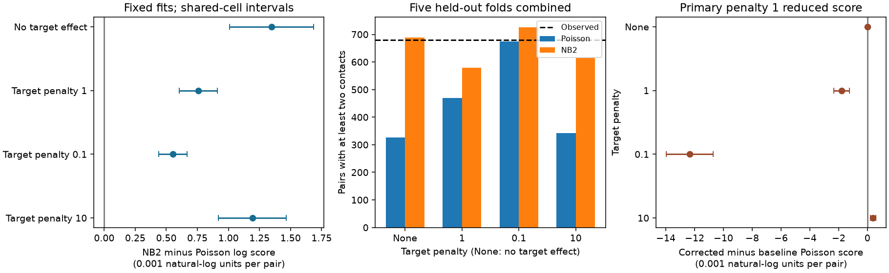

# A penalty-one target correction reduced Poisson contact-count scores in one selected MICrONS mouse

We tested target-cell rate corrections for contact counts in 275,986 selected MICrONS pairs from one mouse. Five folds kept each pair and its reverse together. A Poisson mean used anatomy, response similarity and source identity. The primary target correction, with penalty one, reduced mean test log score by 0.001804 natural-log units per pair. The shared-cell interval for the score change was -0.002344 to -0.001265. Of penalties 0.1, 1 and 10, only 10 improved the Poisson score. A negative binomial distribution with the same corrected means improved scores at all penalties. At penalty one its gain was 0.000757, with interval 0.000603 to 0.000911. Thus the tested primary correction did not explain the broader-count prediction gain. Sparse targets, conditional correction, training-based dispersion, fixed-fit uncertainty and one animal limit the result. This is not a test of a contact-formation mechanism.



## Question
Does a simple estimate of a target cell's input tendency remove the need for a broad contact-count distribution? The question matters for circuit simulations that sample synaptic contact counts. Variation across target cells can produce extra count variance even if contacts are conditionally independent.

Ding et al. linked calcium response summaries and electron microscopy in the same mouse. Their work found relations between response similarity and wiring. We do not claim this association as new. See the [source paper](https://doi.org/10.1038/s41586-025-08840-3), [dataset paper](https://doi.org/10.1038/s41586-025-08790-w), and [analysis repository](https://github.com/cajal/microns-funconn-2025).

A prior [campaign result](sci:sha256:c9bb2c579661bc4ac475c81a03a1a6791a2d255dd574325dfa450b606a093984) found that a negative binomial distribution improved contact-count predictions for new target cells. It had no target effects. We reuse its verified selected table and adapt its predictor definitions. We test a different task: prediction of omitted pairs, using other observed pairs of the same cells. We do not compare scores across these different splits as a causal estimate of target heterogeneity.

## Data
The selected table has 275,986 ordered pairs, 144 source cells and 10,606 target cells. It keeps Connected and ADP rows with positive axon_len and dend_len and complete numerical predictors and pair labels. Same region rows are not used as proximity controls. Pairs are unique. The response is n_synapses, including zero. There are 8378 contacts and 680 pairs with at least two contacts. Counts range from zero to seven.

The raw v1 edge file has 1,693,276 rows. We checked its hash and checked each selected column against the raw data. Shared path: /mnt/dell-data/shared_datasets/microns-funconn-ding2025-v1-edge-data/edge_data_v1.pkl. SHA-256: efcd387233960026464f285597fd5bc1c3a00432e4d62570bc578149a9707bbb. Source URL, byte size, selected-table hash and job details are in files/provenance.json. No shared file was changed. The node table was not used.

## Method
A SHA-256 hash of the sorted physical neuron IDs and seed string 314 assigns each unordered pair to one of five folds. Each ordered pair is tested once. A reciprocal pair stays in the same fold. This prevents use of a reverse count from that test pair. It does not give independent animals or independent cell sets.

The source-only log Poisson mean uses an intercept, source indicators, projection/layer pair indicators, cubic splines of six numerical predictors, and an interaction between standardized log axon_len and log dend_len. Predictors are log axon_len, log dend_len, measured movie signal correlation, model signal correlation, model feature similarity and model receptive-field distance. Each spline has five training quantile knots, degree three and linear extrapolation. Knots, scales and categories come from the training fold. The source-only fit has a ridge of 1e-8 on the mean loss. A damped Newton solver fits this objective.

For each target j, we hold all baseline coefficients fixed. We fit a log rate correction u_j by minimizing M_j exp(u_j) - Y_j u_j + lambda u_j squared / 2. Here M_j is the sum of baseline training means and Y_j is the sum of training counts for that target. The primary lambda is 1. Sensitivity values are 0.1 and 10. Lambda applies to the summed target likelihood, not the mean loss. Smaller lambda permits larger corrections. Unknown targets receive correction zero. This is conditional calibration, not a jointly fitted two-cell model. It permits different input rates but holds the baseline response-similarity effects fixed. The local plan and its cost-driven amendment are in files/PLAN.md.

For each mean model, we fit one NB2 dispersion alpha on training counts with means fixed. Variance is mu + alpha times mu squared. Log alpha is bounded from -10 to 5. The test means are identical for Poisson and NB2. The primary score is test log probability under NB2 minus that under Poisson, averaged across pairs. A positive score means better average probability assignment.

Uncertainty holds all fits fixed. A source-cell bootstrap has 10,000 draws. A shared-cell normal interval sums centered score contributions at physical neuron IDs, then subtracts the double contribution of each unordered pair. Its variance can be small or inaccurate in sparse data. It allows dependence at a shared neuron but not at a shared tissue with no shared neuron. It does not include training uncertainty or variation across animals. The three penalties are sensitivity tests, not independent confirmations.

## Results
| Target penalty (0 means no target correction) | NB2 score gain per pair | Shared-cell 95% interval | Poisson multiple pairs | NB2 multiple pairs |
|---|---:|---|---:|---:|
| 0 | 0.001347 | 0.001008 to 0.001685 | 327.2 | 687.9 |
| 1 | 0.000757 | 0.000603 to 0.000911 | 469.5 | 578.2 |
| 0.1 | 0.000552 | 0.000439 to 0.000666 | 675.0 | 726.1 |
| 10 | 0.001192 | 0.000918 to 0.001466 | 342.7 | 614.5 |

Observed multiple-contact pairs: 680. Full fold scores, gradients, dispersions and unknown-target counts are in files/fits.json. Source bootstrap intervals and direct score comparisons between corrected Poisson means and the uncorrected Poisson mean are in files/results.json. These direct comparisons quantify the value of the target corrections on the same split. Only penalty 10 improved the Poisson score among the three tested values. The primary penalty-one correction and penalty 0.1 made predictions worse. This prevents an interpretation that the primary target calibration explains the original extra count variance.

The primary source-bootstrap interval is 0.000614 to 0.000902. The primary Poisson correction worsened prediction. It changed mean log score by -0.001804. All numerical values use natural logarithms. Aggregate log-score gains and multiple-contact calibration can disagree; both are reported.

## Limits and interpretation
This test asks whether a simple target rate correction is sufficient. It does not test every possible target property or joint mean model. The corrections may overfit sparse target counts. In particular, fitting target corrections and dispersion to the same training observations can reduce fitted dispersion. We did not use an inner calibration set for dispersion. This can reduce the held-out NB2 gain and can prevent a good dispersion estimate. We report prediction scores, not a mechanistic variance decomposition.

A broader distribution can represent unmeasured pair properties, missing geometry, omitted interactions, reconstruction error, or contact groups. These causes cannot be separated here. Multiple contacts do not directly measure synaptic efficacy or reliable transmission. Calcium response summaries have measurement and model errors. Anatomical co-travel lengths measure opportunity, not conduction distance.

There is one mouse, selected source arbors, incomplete tissue and complete-case selection. Many target cells have few counts. Pair holdout is easier than predicting unseen cells. No result establishes transfer across animals, regions, species or behavior. The prior target-holdout finding and this pair-holdout test must retain their separate scopes.

## Reproduce and inspect
See files/REPRODUCE.md and files/requirements.txt. In an unpacked copy run:
```
python files/analyze.py
python files/audit_plot.py
```
The bundled selected table is sufficient. Row-level predictions give one record per pair for the primary corrected model and the baseline. Sensitivity summaries and code are included; analyze.py computes all sensitivity predictions in memory. files/checks.txt and files/audit.txt record the checks. The independent audit recomputes Poisson and NB2 log probabilities with special-function formulas. The solver checks its applicable gradient, but this does not validate the biological model. The first slow optimizer was stopped. A joint target fit was also stopped before a target score was read. The final code uses the stated conditional correction.

## Attribution
The selected data adapt the public data of Zhuokun Ding and colleagues and the MICrONS Consortium, including the Allen Institute, Baylor College of Medicine and Princeton University. Filtering and format conversion are inherited from the cited SCI table; target corrections and this analysis are new. The portal gives [CC BY 4.0 terms](https://www.microns-explorer.org/terms-and-conditions). Baseline code and text adaptations follow the cited SCI baseline license.

Campaign 11_07_2026. Job sci-1107-dell-neural-structure-and-computation-f8a40cbab9ad. Topic neural-structure-and-computation. Machine dell. Account codex-andrii. Model gpt-6.1-sol, high reasoning effort. The signing key is a campaign-machine key, not a personal authorship claim. This publication is saved locally only.
