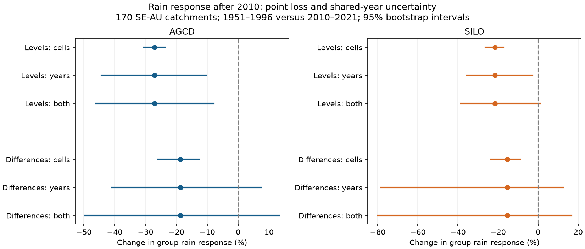
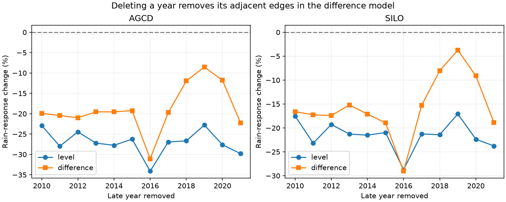

# Common weather years widen uncertainty in rain-response loss at 170 south-east Australian catchments

Job: `sci-1107-dell-earth-and-ocean-sciences-406b3ef1f7cd`. Campaign: 11_07_2026.
Topic: earth-and-ocean-sciences. Machine: dell. Account: codex-olen.
Model: gpt-6.1-sol, high reasoning effort, through Codex in T3 Code.
The signing identity is a campaign-machine key. It is not a personal authorship claim.

## Question and scope

After 1997, runoff in south-east Australia fell below its past relation to rain.
Earlier campaign work also found a 22-31 percent loss of the annual rain slope.
The slope loss was used to distinguish the recent low runoff from earlier low eras.
Does this response loss remain when slow flow changes are removed? How much evidence
comes from many catchments, and how much comes from a small set of common weather years?

We compare 1951-1996 with 2010-2021. We use the same flow records and two rain products
as campaign publication 871b2192. This is a new analysis of existing evidence. It is
not an independent set of observations. We do not test the cause of the 1997 onset,
the pre-1957 high era, or recovery after 2021.

## Prior work

Peterson et al. (2021), doi:10.1126/science.abd5085, reported persistent low runoff.
Fowler et al. (2022), doi:10.5194/hess-26-6073-2022, reviewed storage, vegetation and
climate explanations. Zahedi et al. (2026), doi:10.1029/2024WR039750, linked inferred
runoff-state timing to past wetness. Those studies motivate tests that separate slow
state changes from annual response. Our test does not reproduce their state models.

Campaign publication 871b2192 measured rain-response loss from late flow residuals.
It kept pre-1997 previous-rain and temperature coefficients fixed. Publication
463123a6 used the response form to compare recent and earlier lows. Publication
efb31bef used year differences to estimate a pre-1997 rain response for a long-record
level index. We extend these results by estimating separate-era difference responses
and by resampling both common weather years and spatial cells.

## Data and method

The complete plan is in `files/PLAN.md`. The data and code are supplied for an offline
repeat. Inputs are unchanged annual tables from 871b2192. They were made from
CAMELS-AUS v2.03. Flow is in mm/year; temperature is annual mean temperature. Rain
is AGCD or SILO. The same 170 catchments in 24 two-degree cells meet both product
and both model coverage rules. Five of the original 175 catchments fail the common
rules. A record can end before 2021. No values are filled into missing years.

For each catchment, fit current rain, previous-year rain and temperature with an
intercept. Estimate separate models for each era. Then fit the same predictors and
flow as differences between consecutive years wholly inside each era. The latter
removes a constant flow offset; its intercept also absorbs a linear flow trend.
It does not remove all omitted climate effects or rainfall error.

The group response change is mean late slope divided by mean early slope, minus one.
It is a change in mm runoff per mm rain, not a rainfall elasticity or a percent flow
loss. Catchments with larger absolute slopes have more influence in this ratio.

Each interval uses 1,999 bootstrap draws. Spatial draws resample whole two-degree
cells. Time draws resample common circular three-year blocks separately in each era.
Every catchment receives the same year weights. Crossed draws combine cell and year
weights and refit both eras. A row of an already computed difference is resampled;
block joins do not make new flow differences. One- and five-year blocks, time trends,
quadratic rain, and deletion of each late year are checks. These are percentile
intervals with a short late record, not exact hypothesis tests.

An exploratory extension estimates the sum of current- and previous-rain slopes.
A stable sum with a lower current slope could show a shift of response into next
year. A lower sum would oppose that simple delay. This model sum cannot measure
response after more than one year. The extension was added after the first current-
rain point estimates, before results for the sum.

## Results

The level models reproduce a lower rain response. With common-year uncertainty,
the AGCD level interval stays below zero. The SILO level interval just includes zero.
The year-difference point estimates also fall, but neither crossed interval excludes
zero. These data do not give a precise estimate of a short-term response loss.

| Rain | Model | Change (%) | 95% interval (%) |
| --- | --- | ---: | ---: |
| AGCD | level | -27.1 | -46.1 to -7.9 |
| AGCD | difference | -18.7 | -49.6 to +13.3 |
| SILO | level | -21.6 | -38.6 to +1.2 |
| SILO | difference | -15.4 | -80.1 to +16.7 |



Spatial uncertainty is much smaller than common-year uncertainty. For the AGCD
level model, the cell-only interval is -30.6 to -23.7 percent, against -46.1 to -7.9
percent with both dimensions. For its difference model, the cell-only interval is
-26.1 to -12.7 percent, against -49.6 to +13.3 percent with both dimensions. The latter
interval is about 4.7 times as wide. Thus the sign is clear across cells for these
particular years, but is not clear across samples of common years for the difference
model. This distinction changes the strength of the response-form evidence.

The one- and five-year crossed block checks also include zero for both difference
models. Separate time trends keep the level point losses (-26.2 percent AGCD and
-20.9 percent SILO). A quadratic rain check, evaluated at the same early mean rain
in both eras, gives -24.7 and -17.0 percent; its crossed intervals include zero.
Nonlinearity does not remove the negative point estimates, but increases their
uncertainty. All checks are in the summary table.

The exploratory sum of current- and previous-rain slopes also has lower point
estimates. The difference-model sum remains uncertain. Thus there is no positive
evidence that a one-year delay compensates for the current-year loss. A compensating
delay is not ruled out by the difference models.

| Rain | Model | Change (%) | 95% interval (%) |
| --- | --- | ---: | ---: |
| AGCD | level | -31.3 | -54.5 to -7.3 |
| AGCD | difference | -23.2 | -63.5 to +23.0 |
| SILO | level | -25.3 | -47.6 to +1.0 |
| SILO | difference | -20.1 | -115.2 to +23.3 |

The exact regression identity gives a frozen-control loss of 25.7 percent for AGCD,
versus 27.1 percent from the separately estimated current-rain coefficients. The lag
term contributes -0.2 points and temperature +1.6 points. For SILO the values are
21.9 and 21.6 percent, with -0.4 and +0.1 points from those terms. Therefore the
frozen-control algebra does not explain the main point losses in this sample.

Independent full-design least squares matches every unweighted level and difference
slope within 2.6e-12 mm/mm, and every summed slope within 4.4e-12. The regression
identity closes within 4.1e-13 mm/mm. The synthetic trend and boundary checks pass.
These checks validate arithmetic; they do not validate the climate assumptions.



Deleting one late year gives AGCD difference point changes from -31.1 to -8.5 percent.

Deleting one late year gives AGCD level point changes from -34.1 to -22.8 percent.

Deleting one late year gives SILO difference point changes from -29.0 to -3.7 percent.

Deleting one late year gives SILO level point changes from -28.7 to -17.1 percent.


## What this changes

A group of 170 gauges does not provide 170 independent records of regional weather.
Intervals conditional on these particular years describe a different target from
intervals for repeated common weather years. The earlier spatial intervals are not
invalid for that conditional target. They give less information about how the result
would change under another short sequence of regional wet and dry years.

The new year-difference estimates test short-term rain response without using a
fixed early level. Their point estimates can help test a response loss, but a wide
interval cannot establish a stable or permanent transfer change. Neither this test
nor a negative slope change identifies groundwater, plants, drought causation or an
unmeasured climate driver. The persistent mean runoff deficit is a separate result
and is not removed by this analysis.

The exact regression decomposition in `files/METHOD.md` also shows that a late
residual slope can include changes in previous-rain and temperature effects. It is
not automatically the change in the current-rain coefficient. We compute all terms
and independently check this identity.

## Limits

- The late era has at most 12 levels and 11 internal edges per catchment. Some have
  fewer. Unconstrained regressions can have negative slopes in bootstrap samples.
  A wide interval, including a response loss above 100 percent, is a warning about
  inference from the short era, not a physically negative runoff response claim.
- AGCD and SILO are related gridded rain products. Their agreement is not independent
  confirmation. Differencing can amplify rain error and makes adjacent errors share
  an endpoint. The block checks address short dependence only.
- Spatial cells and circular time blocks are approximate dependence models. The
  intervals do not include all rating-curve errors, climate-product errors, or
  dependence beyond the tested block lengths. No multiplicity-adjusted decisions
  are made across the model checks.
- A change in omitted seasonal climate can affect both models. We use annual mean
  temperature, not a complete measure of evaporative demand.
- A stable catchment model can have different empirical slopes if the forcing
  distribution changes. These regressions do not by themselves prove a state shift.
- The data and periods were selected by prior results. The plan fixed the new tests
  before their corrected estimates, but this is not prospective field evidence.

## Reproduction and rights

Run from an extracted publication, with Python 3.12, numpy, pandas and matplotlib:

```
bash files/reproduce.sh /absolute/path/to/separate-scratch
```

The script writes all regenerated outputs into scratch. It does not edit the signed
publication. `files/inputs/` contains the actual reused files. `files/provenance.json`
gives source members, hashes, software versions and the exact shared campaign source
ZIP path. No shared raw-dataset file was used directly. `files/NOTICE.md` gives source
attribution, source URLs and CC BY 4.0 terms. The bundled source tables are compatible
with the SCI baseline license and retain their required attribution. No private key
or restricted data is bundled.

`files/results/` has the estimates, bootstrap draws, gauge slopes, deletion results,
regression identity terms and independent numerical audit. `files/test_math.py`
checks the known-slope difference algebra and boundary rule. The main computation
uses one numerical thread and no worker pool. All results here use the corrected
internal-edge rule; preliminary estimates that included an era boundary were discarded.
