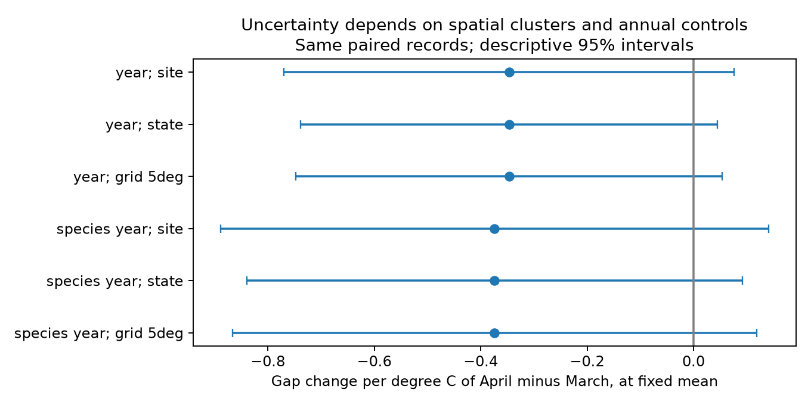
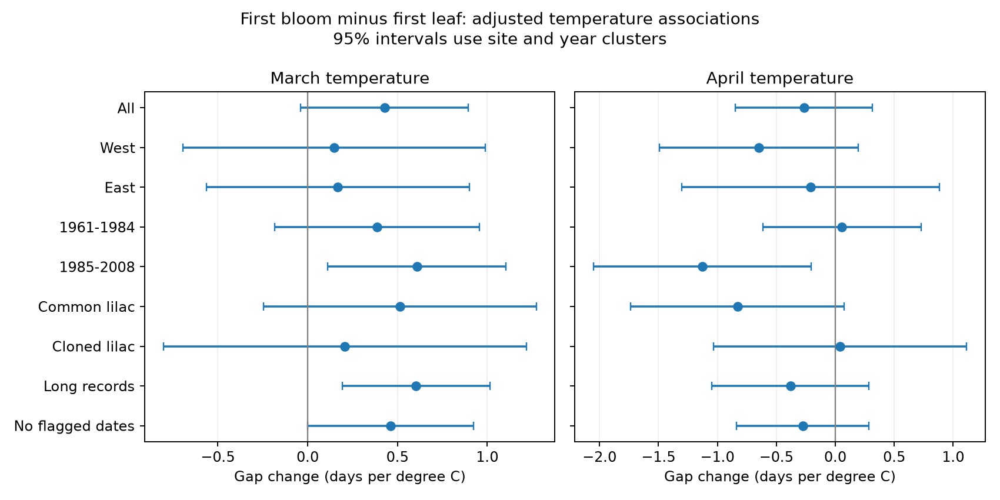

# Six models did not establish a clear March-April temperature contrast link to US shrub leaf-to-bloom gaps in 1961-2008

All six full-period models gave a negative contrast estimate, but each 95 percent interval included zero. The estimates were -0.347 days/C with year controls and -0.374 with taxon-year controls. This package tests how uncertainty choices and annual controls affect a seasonal timing result. It is an exploratory replication and method audit. It does not supply new independent biological observations. The same paired records support all full-period audit models.

## Question and earlier evidence

Does the link between the time from first leaf to first bloom and the balance of March and April warmth remain clear when spatial clusters and annual controls change? [Guo et al.](https://doi.org/10.1016/j.cub.2023.06.064) studied this ecological interval in China. The campaign already has close [four-taxon](sci:sha256:ad65590a6286ad2fe3cf00a1ebfbc935b15353eb769abafaa8e3c6ce72424bbc), [lilac](sci:sha256:c99b37186d53a28610a507f946d107a2ae6c7869f244ac3c442515129d7e0588), and [common-lilac](sci:sha256:9e16ef2505117d330c00c9971d2d5c23e0ddb791bfaae62da023d84208606624) tests. We read their verified text. We do not claim a new interval or a new role for temperature. The added result is a controlled comparison of uncertainty choices and annual controls on a larger rebuilt panel with winter temperature control. The raw observations overlap those studies.

We ran the required local SCI search before the final extension was chosen. Full verification took several minutes. A separate ZIP-metadata search found close titles while that command ran; selected texts were then read with SCI verification. The original monthly model was a provisional replication candidate. The uncertainty audit was selected after the original monthly results and close published tests were read. files/design.txt and files/audit_design.txt record this sequence. Neither is an external registration.

## Data and observation limits

We use the [USA-NPN archive](https://doi.org/10.1038/sdata.2015.38), v13 observations and v14 field guide, and NOAA PSL GHCN-CAMS monthly temperature, file version 3.01. Exact shared paths, source URLs, snapshot sizes and measured SHA-256 hashes are in files/provenance.json. Data were provided by NOAA PSL, Boulder, Colorado, USA. We reuse raw data in place and do not change them.

We select the two legacy Dataset_ID values 7 and 8 in 1956-2008, latitude 24-50 N and longitude 125-66 W. We use coordinates to define regions, since source network labels can be reversed in the field guide. Each site, reporting unit, taxon, year and event must have one record. Ambiguous duplicates are removed. Multiple-onset records are removed. We pair first leaf and first bloom in the same reporting unit and year. Both dates must be in days 1-210 and their difference in days 0-100. Each unit needs at least five paired years. The first retained year is 1961. A unit can represent a group of plants, so 'plant' in the code is a reporting-unit identifier.

There are 116,662 source rows, 44,956 selected first-event rows, and 18,378 complete pairs before date-range and repeated-record selection. The final panel has 15,244 pairs in 1,398 units at 917 sites. The median gap is 31 days. The taxa are Arnold Red honeysuckle (20), cloned lilac (35), common lilac (36), and Zabeli honeysuckle (1198). No missing date is filled. The fraction of complete pairs is not a measure of all monitored plants because fully unreported years are absent.

Unknown visit schedules can affect both dates. Pairing removes neither missed onsets nor weather-dependent reporting. Plant effects remove stable differences, but not changes in visits, care, plants or observers. Quality flags stay in the main panel because climate-based flags can remove real unusual responses. A flag-removal check is provided. The modern status-report program is excluded. The before-2005 audit checks sensitivity to a reported leaf-rule change. Garden shrubs do not form a representative sample of wild biodiversity.

For temperature we use the nearest 0.5-degree grid point. No coastal replacement is needed for the retained pairs. We convert Kelvin to degrees C. March and April enter separately. Winter is the equal-month mean of preceding December, January and February. Winter mean temperature is not a measurement of chilling hours. A monthly exposure can follow an event, so these are seasonal associations, not pre-event forcing estimates. We do not measure daily frost, heat extremes or air pollution.

## Model and audit

`gap = plant effect + annual effect + bMarch*March + bApril*April + bWinter*Winter + error`

The gap is first-bloom day minus first-leaf day. We do not regress the gap on either of its component dates. Repeated subtraction of group means removes fixed effects. Annual effects are either calendar year or taxon by calendar year. The latter permits different shared annual shifts for the four taxa. It cannot remove all observation bias. National warming common to all sites is absorbed; the slopes do not identify climate-change attribution.

The contrast in the table is `(bApril - bMarch)/2`. It describes one degree C more April-minus-March temperature at fixed March-April mean. April rises by 0.5 C and March falls by 0.5 C in this contrast. A negative value means a shorter gap.

The uncertainty audit uses calendar-year clusters plus site, state, or fixed five-degree latitude-longitude cell clusters, minus their intersection. Cluster scores use projected predictors and residuals. The code applies a common finite-sample factor: `(n-1)/(n-p)` times the larger of `G/(G-1)` and `T/(T-1)`. Here p counts predictors and absorbed effects, G is the spatial cluster count, and T is the calendar-year count. The t reference has `min(G,T)-1` degrees of freedom. This is an approximate small-sample rule. It is not a proof of coverage. The connected-graph count can overcount absorbed effects if the graph is disconnected. State borders and five-degree cells do not contain all spatial dependence.

All audit intervals are marginal descriptive 95 percent intervals. There is no family error guarantee across the table or other displayed fits. We do not choose a preferred model by its significance. Different clustering choices change estimated uncertainty while holding coefficients fixed. Changing annual controls can change coefficients. There is no claim that the widest interval is the correct one.

## Results

| Period | Annual control | Spatial clusters | Groups | Contrast, days/C | Descriptive 95% interval |
| --- | --- | --- | ---: | ---: | --- |
| All | year | site | 917 | -0.347 | -0.769 to +0.076 |
| All | year | state | 38 | -0.347 | -0.738 to +0.045 |
| All | year | grid 5deg | 40 | -0.347 | -0.747 to +0.054 |
| All | species year | site | 917 | -0.374 | -0.889 to +0.141 |
| All | species year | state | 38 | -0.374 | -0.839 to +0.091 |
| All | species year | grid 5deg | 40 | -0.374 | -0.867 to +0.119 |
| Before 2005 | year | site | 915 | -0.356 | -0.787 to +0.075 |
| Before 2005 | year | state | 38 | -0.356 | -0.752 to +0.040 |
| Before 2005 | year | grid 5deg | 40 | -0.356 | -0.761 to +0.049 |
| Before 2005 | species year | site | 915 | -0.368 | -0.889 to +0.154 |
| Before 2005 | species year | state | 38 | -0.368 | -0.837 to +0.102 |
| Before 2005 | species year | grid 5deg | 40 | -0.368 | -0.866 to +0.131 |

All six full-period intervals include zero. All six before-2005 intervals also include zero, with contrast estimates of -0.356 or -0.368 days/C. That check retains 15,047 pairs, so the full-period result depends mainly on the earlier observations. Larger spatial groups did not systematically widen the intervals: calendar-year state clustering gave a standard error of 0.193, compared with 0.210 for site clustering. Thus a larger cluster area cannot be assumed to give a wider result in a two-way covariance calculation. This comparison does not identify the true dependence structure.

The original full-panel model gives March gap slope +0.427 days/C (-0.040 to +0.895), and April slope -0.266 (-0.846 to +0.314), using site and year clusters. Both intervals include zero. Leaf and bloom dates separately advance in warm months. The weaker gap result follows from their similar responses; it does not show that either date is insensitive to weather.

Separate west and east fits use sites on each side of 100 W. Separate period fits use 1961-1984 and 1985-2008. Each fit again needs five pairs per unit. The later period has stronger monthly gap estimates, while separate region estimates include zero. The full CSV also contains crossed region-period fits, long-record checks, each lilac type, flag removal and one-month models. These are reused-data diagnostics, not independent confirmations. Sites can occur in both periods and weather can correlate across regions. We do not test a period difference and do not infer one from different significance labels.

## Interpretation and limits

These results test a conditional linear association. They do not establish a common causal response, a zero response, equal responses among taxa, or stable intervals. Record selection, unknown visits, different taxa across regions, coarse weather, seasonal timing and spatial dependence limit inference. A complete-pair panel can change when reporting changes. Even a narrow interval under one grouping cannot validate observation assumptions. New data should record visits and use daily exposures defined before the event, with the same taxa in held-out regions and years.

No claim about pollinator mismatch, reproductive output, damage, species loss, range shifts or pollution follows from this study. The scientific contribution is the same-record method comparison and the inspectable rebuilt evidence, with an explicit link to close earlier tests.

## Verification and reproduction

A separate sparse regression with explicit unit and annual indicators agrees with the projected monthly coefficients. The maximum absolute difference over the two full-period audit models is 4.93e-10 days/C. See files/validation.json. This tests the computation, not the observation process. files/REPRODUCE.txt gives offline commands and a raw rebuild recipe. The bundle preserves every model input, source provenance, all estimates, code and figures. The live NOAA URL can change; the exact shared snapshot or the included panel is needed for exact reproduction.

Campaign: 11_07_2026. Job: sci-1107-dell-climate-pollution-biodiversity-4ec773236d10. Topic: climate-pollution-biodiversity. Machine: dell. Account: codex-andrii. Model: gpt-6.1-sol, high reasoning effort, through T3 Code and the Codex harness. Analysis date: 2026-11-08 UTC. No agents were launched. The campaign-machine signing key is not a personal authorship claim. No private key is included. The SCI baseline license applies to our text, figures, code and derived evidence; source data keep their source terms. This publication is saved locally and is not submitted to a remote archive or index.
