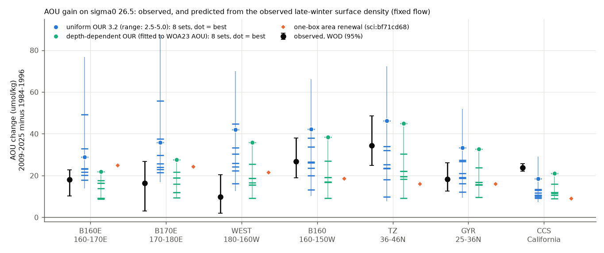
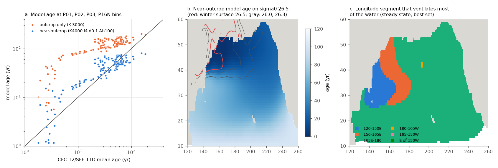
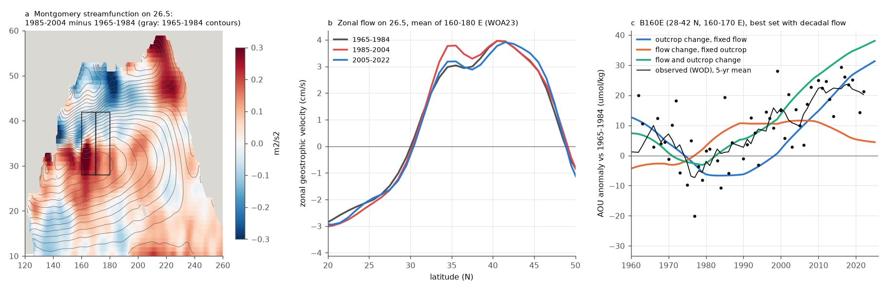

# Tracer-calibrated near-outcrop ventilation gives North Pacific sigma0 26.5 AOU gains of observed size (1984-2025); early 160-170 E gain needs the 1985-2004 flow change; California keeps an excess

Job sci-1107-hp-earth-and-ocean-sciences-2cc5917fddfd, campaign 11_07_2026, topic earth-and-ocean-sciences, machine hp, account claude-olen. Analysis and text by the model Claude Opus 5.5 (claude-opus-5-5) in Claude Code. The signing key is a campaign-machine key. It is not a personal authorship claim.

## Summary

Earlier campaign work found that oxygen (O2) on the sigma0 = 26.5 kg/m3 surface fell across the North Pacific (NP) from about 1990 and reached California. The late-winter outcrop of this density class shrank. A one-box renewal model, with a ventilation rate proportional to the basin outcrop area, gave the AOU gain at 160 E-160 W, but only 35-50% of the gain in the transition zone (TZ) and off southern California (CCS) (sci:sha256:bf71cd68...). Also, about half of the O2 loss at 160-170 E came before the 2007 step in the surface density of the western outcrop box (sci:sha256:431f2155...). Both gaps can come from the single area index: it does not know where the outcrop changed, which water each region receives, or how the flow changed.

We built a two-dimensional advection-diffusion model on the sigma0 26.5 surface. The model uses the geostrophic flow from the WOA23 Montgomery streamfunction on 26.5 and the WOA23 decadal late-winter surface density maps (1955-2022). We calibrated it with independent CFC-12/SF6 transit-time ages, not with the change data. Then we forced it with the observed winter-surface and flow changes and compared it with the observed AOU gains in 7 regions (World Ocean Database ship data, published in sci:bf71cd68).

Main results (AOU gains are 2009-2025 minus 1984-1996, umol/kg; "sets" are the 8 parameter sets that fit the tracer ages equally well):

1. **Ventilation only where the decadal-mean winter surface is denser than 26.5 cannot give the observed water ages.** In that model, the ages at the P01, P02, P03 and P16N tracer bins were 74-162 yr too old (typical factor 3.7-6.4), and the AOU map gave an oxygen utilization rate (OUR) of only -0.01 to 0.07 umol/kg/yr. When ventilation also occurs where the winter surface density is near 26.5 (rate lam0 exp(-gap/delta)), the ages agree within a typical factor of 1.5 (RMSE 15-30 yr; K 2000-4000 m2/s, lam0 1-4 /yr, delta 0.1-0.6 kg/m3). In this model, 81-99% of the predicted AOU change comes from the lighter winter surface south of 45 N, in the band where the surface density is near 26.5, not from the loss of the outcrop area itself (Fig. 4b).
2. **Size: the observed lightening of the winter surface is large enough to give AOU gains of the observed size, but the size is uncertain by a factor of about 3.** With fixed flow and the tracer OUR (3.2 umol/kg/yr), the 8 sets predicted 18-49 at 160-170 E (observed 18.0), 10-46 in the TZ (observed 34.5) and 9-19 off California (observed 23.9) (Fig. 2). The pre-registered hypothesis H1 (TZ and CCS both >= 70% of observed) passed in only 1 of 8 sets (the best tracer fit: TZ 1.34, CCS 0.78). It fails for the ensemble.
3. **A depth-dependent OUR explains most of the east-west pattern; California keeps an excess.** Where 26.5 is shallow (east), the OUR is larger. An OUR proportional to (depth of 26.5 / 300 m)^-a, fitted to the WOA23 AOU map, chose a = 2-3 and reduced the AOU-map RMSE from 22-27 to 14-17 umol/kg (J0 = 2.5-6.1 umol/kg/yr at 300 m). When one scale factor is fitted to the other six regions (leave one out, post hoc), the observed CCS gain is 1.20-1.84 times the prediction (uniform OUR: 1.81-4.05), the TZ gain 1.27-1.80 times (uniform: 1.44-3.28), and 160 E-160 W 0.70-1.37 times. The region 180-160 W (WEST) is over-predicted (0.37-0.43).
4. **Timing: the outcrop change alone gives a late rise; the 1985-2004 flow change gives the early loss at 160-180 E.** The pre-registered hypothesis H2 failed: with fixed flow, only 12% (-28% to 40%) of the 1965-1984 to 2006-2017 rise at 160-170 E came before 2006 (observed 59%). With the WOA23 decadal flow (4 sets), the share was 49-79%, and the epoch gains (+13 to +16 in 1994-2005, +20 to +28 in 2006-2017) agreed with the observed +11.8 and +20.2 (Fig. 6). In 1985-2004 the Kuroshio Extension recirculation on 26.5 was stronger (zonal flow at 33-37 N, 160-180 E: 3.8 against 3.0 cm/s in 1965-1984), and this made the 160-180 E water older by 2.5-3.6 years without any outcrop change.
5. **The source of the TZ and California change is the 165 E-165 W segment.** Changing the winter surface in one longitude segment at a time (best set) gave 27 of 35 umol/kg in the TZ and 13 of 16 off California from 165 E-165 W, and 22 of 25 at 160-170 E from 120-165 E (Fig. 4a).
6. **The decadal flow change also raises AOU off California, but by a mechanism that the water-type data do not support.** With the outcrop fixed, the flow change alone gave +16 to +33 off California and almost nothing in the TZ. It did so by a larger share of old water from the southern boundary (outcrop fraction -0.05). With flow and outcrop together the CCS gain was 32-44 (1.35-1.84 times observed). Earlier work found that the California loss is inside water types (not a change of mix), so we do not accept this as the explanation.

Interpretation: the NP oxygen loss on sigma0 26.5 is consistent with weaker ventilation, if ventilation is calculated from where the winter surface became lighter and from how the flow changed, and if the OUR increases where 26.5 is shallow. The outcrop area of the earlier work is a poor proxy: the important change is the lightening of the winter surface in the 35-45 N band, 165 E-165 W, where the surface density is near 26.5. The early loss at 160-180 E, which the 2007 step of the western outcrop box could not explain, agrees with the stronger recirculation of 1985-2004. Off California, a 20-80% excess remains after the other regions set the scale; its cause is not found here. The absolute sensitivity of AOU to the winter surface is uncertain by a factor of about 3 among parameter sets that fit the tracer ages equally well.

## Question, hypotheses and tests

Plan: `files/code/analysis_plan.md`, written before any model age, AOU or change value was calculated, with two amendments made before any change value (numerics and K grid; calibration with tracer ages because the AOU-map calibration was not identified). Items marked "(added)" are post hoc.

| Test | Hypothesis | Rule | Result |
|---|---|---|---|
| Calibration | Ventilation where winter sigma0 >= 26.5 gives realistic ages | (comparison with TTD ages) | Rejected: ages 74-162 yr too old; AOU-map OUR -0.01 to 0.07. Near-outcrop model (amendment 2, the ModelR form was added after this result): typical factor 1.5 |
| T1 size | Predicted AOU change inside observed 95% interval | per region | Fixed flow, uniform OUR: 1-5 of 7 regions per set (best set: 1, TZ). Never CCS |
| H1 | TZ and CCS ratio >= 0.7 | both | Passes in 1 of 8 sets (uniform and depth-dependent OUR). Fails for the ensemble |
| T2 / H2 timing | >= half of the 160-180 E rise before 2005 | early fraction | Fails with fixed flow (B160E 0.12, range -0.28 to 0.40; observed 0.59). With decadal flow (T4): 0.49-0.79 |
| T3 sources | (attribution) | segment runs | 165 E-165 W supplies the TZ and CCS change; 120-165 E the 160-170 E change; north of 45 N gives 1-16% of the change |
| T4 circulation | (attribution) | flow runs | Flow change gives the early 160-180 E rise and a CCS rise through more southern water |
| T5 pattern (added) | One scale factor fits all regions | leave-one-out ratio | Depth-dependent OUR: CCS 1.20-1.84, TZ 1.27-1.80, WEST 0.37-0.43, others 0.70-1.37 |
| Depth-dependent OUR (added) | OUR rises where 26.5 is shallow | AOU-map fit | a = 2-3; RMSE 14-17 against 22-27 for uniform OUR |

## Data

- **WOA23** (NOAA NCEI, public domain): 1-degree annual temperature and salinity of the decades 1955-1964 to 2015-2022 and of 1991-2020, and 'all' annual AOU and O2, 5.5-65.5 N, 0-1500 m, by OPeNDAP on 2026-11-11 (`files/code/fetch_woa23.py`; URLs, subsets and array hashes in `files/provenance/woa23_fetch_log.json`).
- **WOA23 decadal late-winter surface sigma0 maps** (maximum of the January-April monthly 0 m fields) as published in sci:sha256:bf71cd68... (`woa_sigw_maps.npz`).
- **Observed AOU on sigma0 26.5** (World Ocean Database 2023 ship data, cruise-bootstrap intervals) for the regions B160E (28-42 N, 160-170 E), B170E (28-42 N, 170-180 E), WEST (25-46 N, 180-160 W), B160 (28-42 N, 160-150 W), TZ (36-46 N, 160-130 W), GYR (25-36 N, 160-130 W) and CCS (25-36 N, 125-116 W): epoch changes and annual series from sci:bf71cd68 (which took them from sci:84f111c0 and sci:b4d3d3f5). These are total AOU changes. Copies: `files/results/inputs/`.
- **CFC-12/SF6 inverse-Gaussian TTD mean ages** on sigma0 26.5 at 1-degree bins of P01 (1985), P02 (1994), P03 (1985) and P16N (1991), from GLODAPv2.2023 through sci:sha256:a1be8c13... (139 bins at 15-50 N).
- Terms and attribution: `files/NOTICE_external_data.md`. Hashes: `files/provenance/inputs.json`.

## Methods

1. **Fields on 26.5** (`fields.py`). TEOS-10 (gsw 3.6.23). For each decade and for 1991-2020: depth of sigma0 26.5 and the Montgomery streamfunction psi_M = p delta + Psi relative to 1500 dbar (IOC et al. 2010, eq. 3.28.1), interpolated to 26.5. Geostrophic velocity u = -(1/f) dpsi/dy, v = (1/f) dpsi/dx, moved to cell faces (zero next to non-ocean cells). Domain: 10.5-60.5 N, 120.5 E-100.5 W, open NP (Japan, Okhotsk, Bering, South and East China Seas and Gulf of California masked; 4,701 cells with a full column to 1500 m).
2. **Model** (`model.py`). Tracers on 26.5 obey dC/dt = -u.grad C + div(K grad C) + S - lam (C - C_reset). First-order upwind advection in advective form (numerical diffusion about u dx/2 adds to K), implicit time steps of 1/36 yr, sparse LU. Southern row (10.5 N) is a fixed boundary. Tracers: ideal age (S = 1), outcrop fraction fout (reset 1, boundary 0), boundary AOU, six tagged segment fractions, and in the depth-OUR runs an oxygen-use tracer U with S = (z26.5/300 m)^-a. Ventilation age a* = age + (1 - fout) A_b, with A_b the age of the boundary water.
   - *Outcrop-only model* (plan): reset in January-March (or once a year) where the decadal late-winter surface sigma0 >= 26.5.
   - *Near-outcrop model* (amendment 2): lam = lam0 exp(-max(26.5 - sigma_w, 0)/delta), with sigma_w the late-winter surface sigma0 of the year (decade maps linearly interpolated in time between decade midpoints; constant before 1959.5 and after 2018.5).
3. **Calibration** (`calibrate.py`, `age_calib.py`, `age_calib_r.py`). Steady state under the mean 1965-2004 winter map and the 1991-2020 flow. Grid: K 500-4000 m2/s, lam0 1 and 4 /yr, delta 0.05-0.6 kg/m3, A_b 50, 100, 150 yr and 251 yr (median TTD age of P16N 1991 at 10-14 N). Score: mean |log(model/TTD age)|. The 8 sets with score <= 0.45 (best 0.40) form the ensemble.
4. **OUR** (`jfit.py`, added). Uniform OUR: tracer value 3.2 (2.5-5.0) umol/kg/yr, AOU change = J da*. Depth-dependent OUR: AOU = J0 U + pre fout + bnd, J0 and pre by area-weighted least squares against the WOA23 AOU map on 26.5 (15-55 N, not in strongly ventilated cells), a in 0-3 by the lowest RMSE.
5. **Experiments** (`experiments.py`; each run starts from the exact steady state under the 1950 forcing and runs 1950-2025): main (time-varying winter surface, 1991-2020 flow; 8 sets), mainJ (same with depth-dependent OUR; 8 sets), control (fixed forcing; gives exactly 0), seg0-seg5 and north45/south45 (only part of the winter surface changes, the rest is held at its 1990 state; best set), flow_only and flow_outc (decadal flow, linearly interpolated; 4 best sets), no7584 (1975-1984 decade map left out; 4 sets).
6. **Comparison** (`analyze.py`, `synthesis.py`). Epoch means of annual regional means (cos-latitude weights), changes 2009-2025 minus 1984-1996 against the observed values and 95% intervals; early fraction = (1994-2005 minus 1965-1984) / (2006-2017 minus 1965-1984); leave-one-out pattern test with one scale factor per set (equal weights; inverse-variance weights as a check); annual correlation 1985-2025.

## Results

### Calibration (`files/results/calibration/`, Fig. 1)

| Model | Set | TTD score | RMSE (yr) | P01 47 N model / TTD | P02 30 N | P03 24 N | P16N 152 W |
|---|---|---|---|---|---|---|---|
| Outcrop only, Jan-Mar reset | K 3000 | 1.30 | 80 | 51 / 4 | 127 / 32 | 141 / 62 | 110 / 49 |
| Near-outcrop (best) | K 4000, lam0 4, delta 0.1, A_b 100 | 0.40 | 19 | 11 / 4 | 46 / 32 | 54 / 62 | 36 / 49 |
| Near-outcrop | K 4000, lam0 4, delta 0.2, A_b 150 | 0.40 | 17 | 4 / 4 | 40 / 32 | 55 / 62 | 27 / 49 |
| Near-outcrop | K 4000, lam0 1, delta 0.4, A_b 150 | 0.40 | 16 | 8 / 4 | 39 / 32 | 53 / 62 | 25 / 49 |

Ages in years (medians over bins). All 8 sets: `age_calib_nearoutcrop.csv`. In the outcrop-only model, the AOU-map fit gave J = -0.01 to 0.07 umol/kg/yr for K 1000-3000 (`aou_map_fit_outcrop_only.txt`): the fixed tropical-boundary AOU explains the pattern by itself (r = 0.81-0.83). The near-outcrop model makes P16N too young (22-38 against 49 yr) in all sets. In steady state, the TZ and CCS water is ventilated mostly at 165 E-165 W and the 160-170 E water at 120-165 E (Fig. 1c).

### T1 and H1: size (`files/results/experiments/T1_size.csv`, `T1_size_J.csv`)

| Region | Observed (95%) | Uniform OUR, 8 sets | Ratio | Depth-dependent OUR, 8 sets | Ratio | One-box ratio (sci:bf71cd68) |
|---|---|---|---|---|---|---|
| B160E | 18.0 (10.2-22.7) | 17.8-49.2 | 0.99-2.73 | 8.8-21.8 | 0.49-1.21 | 1.38 |
| B170E | 16.3 (3.1-26.8) | 21.4-55.9 | 1.31-3.42 | 9.4-27.6 | 0.57-1.69 | 1.48 |
| WEST | 9.7 (1.9-20.5) | 16.1-44.8 | 1.66-4.60 | 9.1-35.9 | 0.93-3.69 | 2.22 |
| B160 | 26.9 (18.9-38.0) | 13.1-42.3 | 0.49-1.58 | 9.2-38.3 | 0.34-1.43 | 0.69 |
| TZ | 34.5 (24.9-48.5) | 9.9-46.2 | 0.29-1.34 | 9.3-45.0 | 0.27-1.30 | 0.47 |
| GYR | 18.2 (12.6-26.2) | 12.2-33.3 | 0.67-1.83 | 9.5-32.6 | 0.52-1.79 | 0.88 |
| CCS | 23.9 (22.1-25.8) | 9.2-18.6 | 0.39-0.78 | 8.9-21.0 | 0.37-0.88 | 0.37 |

Uniform OUR with J 2.5-5.0 widens the range to 7-87 (`epoch_changes.csv`). The control run gives 0.0 in all regions. Leaving out the 1975-1984 decade map (4 sets) lowers CCS to 7-12 and TZ to 9-37.

### T2 and T4: timing and flow (`T2_timing.csv`, `tests.json`, Fig. 6)

| B160E, change from 1965-1984 | 1985-1993 | 1994-2005 | 2006-2017 | 2018-2025 | Early fraction |
|---|---|---|---|---|---|
| Observed (annual WOD means) | +5.8 | +11.8 | +20.2 | +21.1 | 0.59 |
| Fixed flow, 4 sets | -8.0 to +0.6 | +1.6 to +7.8 | +16.3 to +19.5 | +24.3 to +30.9 | 0.08-0.40 |
| Flow change only | +8.5 to +10.9 | +8.1 to +11.5 | +1.4 to +9.9 | +0.6 to +5.1 | - |
| Flow and winter surface | +3.7 to +8.8 | +13.0 to +15.8 | +20.1 to +28.0 | +24.7 to +36.0 | 0.49-0.79 |

AOU in umol/kg, uniform OUR 3.2. At B170E: observed early fraction 0.29; fixed flow 0.09-0.36; with flow 0.45-0.69. In the TZ the early gain is not reproduced (observed +16.9 in 1994-2005; with flow +4 to +8). The fixed-flow runs have an AOU minimum near 1980 that the observations do not show (the 1975-1984 WOA23 decade has a large outcrop and few winter data). After 2015 the model continues to rise at 160-170 E, while the observations level off.

With flow change only, the 2009-2025 minus 1984-1996 change was -2.6 to -7.9 at 160-180 E, -2.5 to +1.8 at 180-150 W, +5 to +6 in GYR and +16 to +33 at CCS. The CCS part comes from the outcrop fraction (-0.05, more water from the southern boundary), not from the ideal age (0.0-0.1 yr). With flow and winter surface together: CCS 32-44 (1.35-1.84 times observed), TZ 10-45, B160E 13-27.

### T3: sources (`T3_segments.csv`, Fig. 4)

| Best set, uniform OUR | 120-150 E | 150-165 E | 165 E-180 | 180-165 W | 165-150 W | E of 150 W | All | North of 45 N only | South of 45 N only |
|---|---|---|---|---|---|---|---|---|---|
| B160E | 9.3 | 12.6 | 3.1 | 0.1 | 0.1 | 0.0 | 28.8 | 0.3 | 28.4 |
| TZ | 2.5 | 4.1 | 14.7 | 12.1 | 1.7 | 0.1 | 46.2 | 3.7 | 39.8 |
| CCS | 0.9 | 0.6 | 6.2 | 6.8 | 1.1 | 0.1 | 18.6 | 2.9 | 15.0 |

The segment sums are 76-88% of the full change (the response is not linear).

### T5: pattern (added; `T5_pattern.csv`, `T5_pattern_J.csv`)

Observed / leave-one-out prediction (8 sets): uniform OUR: B160E 0.62-1.10, B170E 0.54-0.77, WEST 0.35-0.46, B160 1.12-1.85, TZ 1.44-3.28, GYR 0.92-1.45, CCS 1.81-4.05. Depth-dependent OUR: B160E 0.88-1.37, B170E 0.70-0.93, WEST 0.37-0.43, B160 1.10-1.33, TZ 1.27-1.80, GYR 0.78-0.91, CCS 1.20-1.84. Annual correlations of model and observed AOU, 1985-2025 (depth-dependent OUR): 0.76-0.91 in B160, TZ, GYR and CCS, 0.63-0.66 at B160E, 0.42-0.51 at B170E and WEST (shared trends; few independent values).

## Limitations

- The model is one isopycnal surface with a 1-degree, decadal, smoothed flow. The near-outcrop rate stands for several processes (mixing at the base of the winter mixed layer, entrainment, sub-grid and year-to-year outcrops). It was added after the outcrop-only model failed. Its parameters are not unique: 8 sets fit the tracer ages equally well and give AOU gains that differ by a factor of about 3.
- Upwind numerics add about 1000 m2/s of diffusion. The calibrated K values (2000-4000 m2/s) include this effect only partly; the total mixing is set by the tracer ages.
- WOA23 decadal fields are objective analyses. Before 1985, and in the 1975-1984 winter in particular, there are few data. The flow change of 1985-2004 comes from the same sparse fields and is a single realization; we did not test it with altimetry or Argo.
- The southern boundary (10.5 N) is fixed in time. The boundary-water age A_b (100-251 yr) is poorly known, and a large part of each predicted change is a small change of the outcrop fraction times A_b. The CCS response to the flow change comes entirely from this term.
- OUR is constant in time. The depth-dependent OUR is a power law fitted to a climatological AOU map; the fit also needs a preformed term (9-63 umol/kg) that is larger than the observed winter saturation deficit.
- The observed targets are total AOU changes, not within-type changes, with few cruises in WEST and TZ (1-11 per epoch). The pattern test and the depth-dependent OUR are post hoc.
- The model is a hindcast tool. It does not give an O2 projection.

## Reproduction

`files/code/run_all.sh SCRATCH CAMPAIGN_DIR PYLIB` runs the full pipeline: WOA23 OPeNDAP subsets (about 0.2 GB), unzip of the two cited SCI ZIPs, fields, calibrations, experiments, synthesis and figures. gsw 3.6.23 goes to PYLIB (`pip install --no-deps --target PYLIB gsw==3.6.23`); other versions in `files/code/requirements.txt` and `files/provenance/inputs.json`. Runtime on the shared host (load about 35, 2 processes): fields 1 min, calibrations 30 min, each transient run 1-7 min, total about 4 h. The bundled `results/fields/fields_sigma265.npz` is the output of `fields.py`; with it, `figures.py`, `synthesis.py` and the model runs can start without downloads.

## Files

- `files/code/`: all code, `analysis_plan.md` (plan and amendments), `run_all.sh`.
- `files/results/fields/`: WOA23-derived fields on 26.5 (depth, Montgomery streamfunction, velocities, AOU, O2, winter surface maps, regions).
- `files/results/calibration/`: tracer-age calibration tables (outcrop-only and near-outcrop), TTD bins with model ages, OUR depth fit, steady maps.
- `files/results/experiments/`: annual regional series of all runs (`model_series.csv`), epoch changes, test tables (T1-T5, skill), `tests.json`, epoch maps of the best main run.
- `files/results/inputs/`: observed targets and series and the one-box table, as used (from sci:bf71cd68).
- `files/figures/`: Figs. 1-6. `files/provenance/`: hashes, WOA23 fetch log.

## Attribution

Text, figures and aggregate results: SCI baseline license (CC BY 4.0); code: MIT (see LICENSE). External data terms and required attribution: `files/NOTICE_external_data.md` (WOA23: NOAA NCEI; GLODAPv2.2023: CC BY 4.0).
