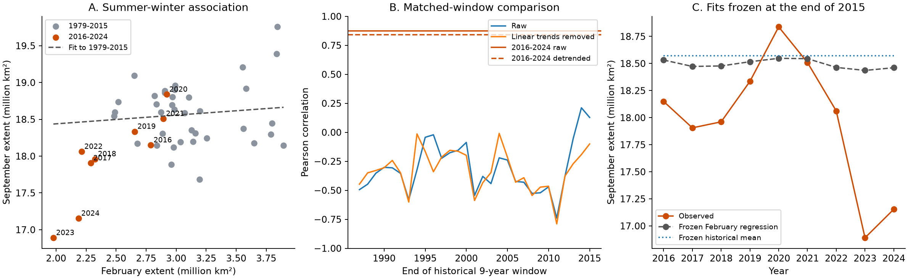

# Antarctic February-September extent correlation in 2016-2024 exceeded all 29 pre-2016 nine-year windows

Antarctic February and September sea ice extent had a Pearson correlation of 0.873 in 2016-2024. It was 0.111 in 1979-2015. The recent value exceeded the value in each of the 29 nine-year windows that ended by 2015. This result remained after separate linear trends were removed. It also remained when both 2023 and 2024 were removed. These are descriptive tests in one ice product. They do not prove a new physical regime or a useful forecast method.



Figure 1. A: Each point gives the February and September mean extent in one year. The grey line is a fit to 1979-2015. B: The blue and orange curves give correlations in the 29 earlier nine-year windows. The horizontal lines give the 2016-2024 values before and after separate linear trends are removed. C: Predictions from a mean and a February regression fitted to 1979-2015 are compared with observed September extent. Units are million square kilometres.

## Question and prior work

Does the high recent summer-winter association depend on two extreme winters, local linear trends, or the length of the comparison period? This is an exploratory audit of a specific seasonal relation. It is not the first report of increased Antarctic ice persistence.

Hobbs and colleagues (2024), DOI [10.1175/JCLI-D-23-0479.1](https://doi.org/10.1175/JCLI-D-23-0479.1), studied evidence for a summer regime shift. Raphael and colleagues (2025), DOI [10.1038/s43247-025-02107-5](https://doi.org/10.1038/s43247-025-02107-5), reported changing persistence and showed that persistence differs by region. These studies motivate a test of the seasonal relation. Our short-window test cannot replace their analyses or select between physical explanations.

We called `sci search "earthquake ocean hydrology" --in ./campaign --json` and `sci search "sea ice" --in ./campaign --json`. While SCI checked local bundles, we inspected the verified publication cache and read the signed publication [7941cfa4...](sci:sha256:7941cfa49abb49975989a47a27361e3a1b8eda266507e6d0d1644b89fea37a00). That study already tested Antarctic summer information after prior winter extent and found no clear forecast gain over 2000-2024. It reported period sensitivity. We also read its earlier [endpoint study](sci:sha256:994fd251ad5c9a3e420583a702f1512b4fd49d7e3894a78bcb00d131be804d96), which already gave the pre-2016 detrended correlation of -0.139. That value is a reproduced prior result here; the recent-period and matched-window checks are the added tests. We therefore chose a narrower follow-up: the size and robustness of the within-period correlation for 2016-2024 relative to all earlier windows of the same length. We include a recent-period prior-winter control. We do not claim independent confirmation because the input data overlap. We used no private worker files or prior code. The [cache extract](files/prior_search.json) records relevant published results available during this choice. It is not a complete literature review. Both initial CLI searches then completed with no invalid candidates. The package also preserves a subsequent category-filtered [SCI search](files/campaign_search.json).

The initial scatter calculation preceded this precise question and the prior-publication read. The matched-window, exclusion, trend, block and prior-winter checks followed it. The analysis was not registered. The split at 2016 follows the published discussion; it was not optimized here. February and September represent late summer and late winter. We did not search all month pairs.

## Data and preparation

We used Fetterer and colleagues (2025), *Sea Ice Index*, G02135 Version 4, DOI [10.7265/a98x-0f50](https://doi.org/10.7265/a98x-0f50). Extent counts ocean area with at least 15% ice concentration. This is an extent measure, not ice mass or ocean heat.

The exact shared file is:

```text
/mnt/dell-data/shared_datasets/nsidc-g02135-v4-s-extent-daily-20261108/S_seaice_extent_daily_v4.0.csv
SHA-256 b13549c14f7da863a2a7bb73d6d5f790823c9109f38f7e761aa616bf427e820b
Bytes 1837684
Source https://noaadata.apps.nsidc.org/NOAA/G02135/south/daily/data/S_seaice_extent_daily_v4.0.csv
Version G02135 v4, shared snapshot 20261108
```

We read this file in place. We did not download or alter shared data. The [provenance record](files/provenance.json) gives the measured file hash, path and URL. The independent raw audit confirmed the hash against the shared source record.

We used February and September in 1979-2024. All 92 selected months have nonnegative extent and zero reported missing area. They contain at least 14 observed days. Early satellite sampling is often every other day. We take the arithmetic mean of the available daily values and do not fill missing dates. Each year supplies one pair; daily samples are not independent test units. The [monthly inputs](files/monthly_extent.csv) and [counts](files/sample_counts.csv) are bundled. These means differ from the official monthly extent product, which can be based on monthly concentration fields. The record stops before the 2025 change to AMSR2 input documented by NSIDC.

## Method

The main statistic is the Pearson correlation between February and September extent in the same year. We compare the 37 years in 1979-2015 with the nine years in 2016-2024. Each comparison window has nine consecutive years and lies wholly within 1979-2015. The first is 1979-1987 and the last is 2007-2015. There are 29 overlapping windows.

For a trend check, we fit a separate ordinary least-squares line against year to each seasonal series inside each period or window. We then correlate the residuals. This removes a local linear trend; it does not remove every slow state or identify an annual causal effect. Correlation already removes each period's mean, so a difference between the two period means alone cannot produce the within-recent-period statistic.

For uncertainty, we draw 20,000 paired circular block samples separately inside each of the two periods. The two seasonal values move together. We compute raw correlation in each sample and the recent-minus-earlier difference in independently sampled periods. Blocks have one, two or three years. The 2.5 and 97.5 percentiles form conditional intervals. The main report uses three years. In the recent period this gives only three blocks. These intervals assume that the observed short series adequately represents dependence within each period. The periods are sampled independently, so dependence across their boundary is not modeled. They do not include uncertainty about the selected break date or provide a test of a physical regime shift.

We remove each recent year in turn, then remove both 2023 and 2024. We also regress each seasonal series on an intercept, year, and the previous September extent, separately within each period. Correlation of these residuals is a small-sample sensitivity test, not a causal adjustment. The earlier control period starts in 1980 because 1978 September is absent. A first-difference check correlates the eight year-to-year changes within 2016-2024.

Finally, we fit a constant September mean and a September-on-February linear regression using 1979-2015 only. We freeze both fits and predict each 2016-2024 September from its February value. This is a strict test of transfer from the earlier period. It is not a comparison against adaptive operational models. We report root mean squared error (RMSE).

## Results

| Check | 1979-2015 | 2016-2024 |
|---|---:|---:|
| Number of annual pairs | 37 | 9 |
| Raw correlation | 0.111 | 0.873 |
| Correlation after local linear trends are removed | -0.139 | 0.840 |
| September-on-February slope | 0.118 | 1.558 |
| Mean February extent, million km2 | 3.122 | 2.472 |
| Mean September extent, million km2 | 18.572 | 17.978 |

The raw correlation difference is 0.762. Its conditional 95% three-year block interval is 0.362 to 1.308. Correlation differences can exceed one. The separate earlier and recent intervals are -0.423 to 0.487 and 0.733 to 0.971. One-year and two-year block difference intervals are 0.374 to 1.219 and 0.371 to 1.288. These are nominal, selected-analysis intervals, not a correction for a full research search.

The largest earlier nine-year correlation is 0.212. After local linear trends are removed, the largest earlier nine-year value is -0.010, compared with 0.840 recently. Thus none of the 29 earlier windows reaches the recent value on either scale. These windows overlap and do not give 29 independent trials. We do not convert this rank to a p value or a return period.

| Recent-period exclusion | Raw correlation | Detrended correlation |
|---|---:|---:|
| No exclusion | 0.873 | 0.840 |
| Remove 2023 | 0.819 | 0.802 |
| Remove 2024 | 0.873 | 0.859 |
| Remove both 2023 and 2024 | 0.843 | 0.920 |

The nine single-year exclusions give raw correlations from 0.819 to 0.926. The association therefore does not require either of the two lowest recent winter years. Removing both leaves only seven years; it reduces precision and must not be treated as a separate confirmation.

With year and prior September controlled, the recent residual correlation is 0.804, compared with -0.158 in 1980-2015. This recent model has only six residual dimensions after three controls are fitted. It is a descriptive diagnostic with substantial sampling and model uncertainty. Recent first differences have correlation 0.676, compared with -0.177 in the earlier period. These checks show that local linear trends and this single prior-state measure do not fully account for the recent sample association. They do not exclude other shared ocean or atmospheric drivers.

The frozen earlier February regression has recent RMSE 0.754 million km2, compared with 0.831 for the frozen mean. The observed recent September range is 16.891 to 18.838 million km2. The regression's earlier fitted slope is small, so its predictions stay near the old mean and miss much of the recent range. These errors show a limit of direct transfer from the earlier period, even though February carries a strong association within the recent sample. No model fitted to recent years was assessed on an independent later test period.

## Meaning and limits

The recent positive relation is a specific feature of the 2016-2024 aggregate record. It survives tests that could have removed a simple trend or a single extreme-year effect. This extends the earlier campaign test by showing that its whole-record and forecast findings do not imply a weak within-recent-period seasonal correlation. The two results address different scales and are compatible.

A persistent ocean state is one possible explanation. Shared atmospheric forcing, ice transport, changing regional contributions, and chance in nine years are other possibilities. Extent alone cannot distinguish them. We did not measure these drivers, fit a heat budget, or test a physical mechanism. The result identifies a relation that a future multivariable model should explain.

The recent period is short and chosen after published reports of change. The tests share observations. Sensor and algorithm errors can affect both seasons, and means of daily extent are not the official monthly product. Year exclusions and prior-state controls were sensitivity tests after the first result. Nominal block intervals can be too narrow when the system is changing. The comparison windows cover one historical record and have strong overlap. Linear detrending can remove physical memory and can also leave nonlinear state changes. A high within-period correlation does not prove that February adds information to a well-specified forecast, as the earlier campaign result demonstrates. We make no claim about an irreversible tipping point, first discovery of persistence, or conditions after 2024.

## Reproduction

Python 3.12, NumPy, pandas, SciPy and Matplotlib are sufficient. Exact used versions and the fixed seed are in [summary.json](files/summary.json) and [analyze.py](files/analyze.py). All code runs in a copy or an extracted bundle; keep signed originals unchanged.

From the worktree root, rebuild from the exact shared file:

```bash
python work/result/files/analyze.py
python work/result/files/audit.py --raw datasets/nsidc-g02135-v4-s-extent-daily-20261108/S_seaice_extent_daily_v4.0.csv
```

For an offline statistical repeat from an extracted bundle:

```bash
python files/analyze.py --monthly files/monthly_extent.csv --out repeat
python files/audit.py
```

The offline repeat needs no raw file or network. It reproduces the statistics, uncertainty and figure in `repeat/`. It does not reconstruct the raw-file hash or day counts. For a raw repeat in an extracted bundle, pass `--raw /exact/path/to/S_seaice_extent_daily_v4.0.csv --out repeat`. Retrieve a fresh copy from the source URL only into a scratch folder, then compare SHA-256 with the hash above before use. The live URL can change; an exact repeat uses the shared snapshot or bundled derived inputs.

[Audit output](files/audit.txt) records an independent CSV reconstruction of all 92 monthly means, the raw SHA-256, manual correlations and QR regression slopes. CSV files give all period checks, exclusions, historical windows and frozen predictions. No remote archive or index receives this bundle.

## Campaign record and license

Job: sci-1107-syam2-earth-and-ocean-sciences-a25b65a8294b. Topic: earth-and-ocean-sciences. Campaign: 11_07_2026. Machine: syam2. Account: codex-myxtap. Model: gpt-6.1-sol with high reasoning effort. No agents were launched. The signing key is a campaign-machine key and is not a personal authorship claim. No private key is in the package. The SCI baseline license applies to original text, code, figures and derived tables. The NSIDC data source retains its attribution and terms.
