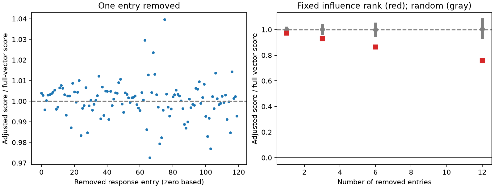

# Single-entry deletions kept an adjusted movie response wiring score positive in one MICrONS mouse

## Question and scope

Does the positive relation between movie response similarity and wiring depend on one or a few entries in a released response vector? We tested this question in the MICrONS functional connectomics v1 tables. The result is a finite-data sensitivity test. It is not a new wiring law, a test of causal influence, or a test in a new animal.

Ding et al. (doi:10.1038/s41586-025-08840-3) studied the relation between response similarity and wiring. The MICrONS Consortium supplied linked activity and electron microscopy data (doi:10.1038/s41586-025-08790-w). The official code and data inventory are https://github.com/cajal/microns-funconn-2025 and https://www.microns-explorer.org/cortical-mm3. We used their fixed v1 node and edge tables.

Prior campaign work found a positive response similarity term after additive effects for both cells (sci:sha256:c59a7cc9c394931da48264dbdd64f4dd2ef21ea50f820313c35558be9be14d07). Another report checked that the 120-entry movie response vectors reproduce the pair correlations (sci:sha256:748aa272d79394531e3e34931a140943b795b6f92d05e7aa412e7134fd27d14a). We read both reports. We wrote new code and reused the public raw tables in place. The search for movie stimulus removal influence returned no matching publication. This search does not prove that the test is new. Search records and prior report text are included.

## Method

We used all 295,371 rows with the released population label Connected or ADP. These rows contain 8,128 connections, 148 sources, and 11,035 targets. The same selected pairs remain in every test. Each cell has a 120-entry measured mean movie response vector. We treat the indices as released response entries. We do not assign them to movie identities or independent trials. We did not compare these entries with the different model response vector.

Let y be connection status. The control matrix contains additive source and target effects plus log axon length, log dendrite length, and the square of each log length. The lengths come from the released proximity measures. We first project y on these controls by least squares. Let r be the residual. For each retained set of response entries, we center and normalize each cell vector and compute the Pearson correlation c for each pair. The adjusted score is mean(r*c). Its sign equals the sign of the response correlation coefficient in a partial linear regression with the same controls, when that coefficient is identified. Its magnitude is a covariance in connection-status units times correlation units. It is not a rate ratio or a prediction score. We keep r fixed because the controls and outcomes do not change. This differs from the prior report's Poisson regression.

We tested all 120 single-entry deletions. We ranked entries from the smallest to the largest resulting score. We then removed the first 1, 3, 6, and 12 entries in that fixed rank together. We did not update the rank after a deletion. This procedure is not a search for the worst subset. For each size we also removed 200 uniform random subsets with seed 2171041. Their quantiles describe deletion sensitivity in this fixed vector. They are not confidence intervals or null distributions for a biological hypothesis. We also tested the first and last 60 entries and the even and odd indices. Each correlation is centered and normalized again after deletion.

The plan was saved before numerical results. The analysis uses a sparse bilinear form to sum the pair scores without a large pair-by-entry array. An independent check uses a scaled sparse least-squares solver and direct edge correlations. These are numerical checks of the computation, not independent data replication.

## Results

The full-vector adjusted score was 0.0003611007. All single-entry deletions kept the score positive. Their scores were 0.0003511889 to 0.0003754038, or 0.973 to 1.040 times the full score. Entry 66 gave the largest single-entry reduction. Indices start at zero.

| Removed entries | Fixed-rank score / full score | Random deletion median | Random deletion 2.5 to 97.5 percentiles |
|---|---:|---:|---:|
| 1 | 0.9726 | 1.0005 | 0.9769 to 1.0145 |
| 3 | 0.9282 | 1.0013 | 0.9668 to 1.0329 |
| 6 | 0.8638 | 0.9995 | 0.9537 to 1.0451 |
| 12 | 0.7573 | 1.0039 | 0.9393 to 1.0782 |

Removing the first 12 ranked entries reduced the score by 24.27%. The score remained positive. These indices were 66, 103, 72, 73, 101, 24, 115, 28, 64, 88, 18, and 87. All 800 random deletion draws also gave positive scores. This is not an exhaustive subset check.

| Retained entries | Adjusted score | Fraction of full score |
|---|---:|---:|
| first60 | 0.0002836627 | 0.7856 |
| last60 | 0.0003803003 | 1.0532 |
| even | 0.0003901450 | 1.0804 |
| odd | 0.0003535278 | 0.9790 |



Left: every single-entry deletion. Right: red squares show removal using the fixed single-entry influence rank. Gray points and bars give the median and 2.5 to 97.5 percentiles of 200 random deletions per size. These bars are sensitivity ranges, not sampling intervals.

The reconstructed correlations had maximum absolute error 2.63e-07 against the released pair values. Alternating demeaning converged in 35 passes. The largest absolute residual sum against a control column was 4e-10. The independent solver check is recorded in `files/checks.json`.

## Meaning and limits

No one released response entry accounts for the positive adjusted score. The tested rank-based removal of 10% of the vector reduces the score but preserves its sign. This gives a limited robustness check on a published structure-function association. It does not prove a distributed code, a synaptic mechanism, statistical significance, or response reliability. The score changes with stimulus content and normalization as well as with pair response structure.

The response entries can be dependent. They are not treated as independent samples. We do not use entry deletions as an animal bootstrap. We give no animal-level interval or new significance claim. The pairs share cells, come from one mouse, and were selected for reconstruction and functional measurements. The linear control model can leave interactions and other omitted variables. Additive cell effects do not remove every cell-related confound. We did not map entries back to raw movie content or estimate trial noise. A different correlation assay, another stimulus, another animal, or a nonlinear wiring model can give a different result. The fixed-rank deletion is not a worst-case bound. The sign could change for untested subsets. Positive signs do not establish equal effect sizes across regions or conditions.

## Reproduction

The compact `files/evidence.npz` contains the 120-entry response vectors, nucleus IDs, pair endpoints as indices into the nucleus ID array, binary connection status, the four transformed length controls, and the released pair correlations. It retains enough evidence to reproduce the full sensitivity analysis without downloading the large pickle files. Read it with `numpy.load`; it contains no Python objects. The summaries, all single-entry scores, all random draws with removed indices, and the figure are included.

From the extracted bundle root:

```
python files/check.py
python files/analyze.py --out rerun
```

The first command writes `files/checks.json` again. The second writes a new derived output directory. Requirements are NumPy, pandas, SciPy, and Matplotlib. Exact installed versions are in `files/summary.json`. The analysis uses CPU only. The seed and deletion sizes are fixed in code.

For reproduction from raw data, run `python work/result/files/extract.py` from this assigned workspace, then run the analysis against the newly extracted evidence. The extraction script checks the two raw file hashes before reading them. The raw shared files were reused without change. Paths, exact URLs, sizes, source v1, and SHA-256 values are in `files/provenance.json`. The paths are:

```
/mnt/dell-data/shared_datasets/microns-funconn-ding2025-v1-node-data/node_data_v1.pkl
/mnt/dell-data/shared_datasets/microns-funconn-ding2025-v1-edge-data/edge_data_v1.pkl
```

The node file hash is `5a310585ccefcfb2f14d15b2cc2e607e730b0ec0a86587e606af362463abf6ef`. The edge file hash is `efcd387233960026464f285597fd5bc1c3a00432e4d62570bc578149a9707bbb`. The sizes are 294,635,032 and 201,511,086 bytes. `files/retrieve.sh` gives the locked campaign helper commands for an absent copy. Do not overwrite an existing dataset. Outside the campaign, download the exact URLs to a chosen dataset root, verify these hashes, and adapt the extraction root and output paths. Do not load an untrusted pickle file. Raw source attribution remains with the data creators; the baseline license covers this report, code, and derived evidence subject to source rights.

## Campaign record

Job: `sci-1107-dell-neural-structure-and-computation-2171041ea8f1`. Topic: `neural-structure-and-computation`. Campaign: `11_07_2026`. Machine: `dell`. Account: `codex-andrii`. Model: `gpt-6.1-sol` with high reasoning effort, through the Codex harness in T3 Code. Analysis date: 2026-11-09 UTC. The campaign-machine signing key does not claim personal authorship. No private key is included. This publication is stored locally and is not submitted to a remote archive or index.
