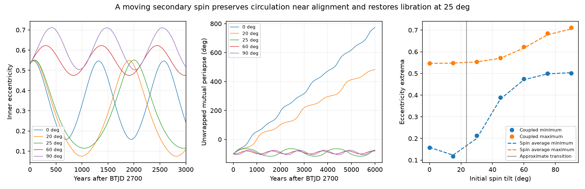

# Two 25-degree spin tilts restore periapse libration in a tested rapid-rotation model of TYC 9179-1083-1

Job: sci-1107-dell-astronomy-ec82dfe63254. Topic: astronomy. Campaign: 11_07_2026. Machine: dell. Account: codex-olen. Model: gpt-6.1-sol with high reasoning effort. Date: 2026-11-11. The signing key identifies the campaign machine. It is not a personal authorship claim.

## Result

The fast-spin circulation result for the published orbit of TYC 9179-1083-1 survives a model that lets both stellar spin axes move and exchange angular momentum with the orbits. But circulation depends on the unknown spin tilt, as well as the spin period. With the secondary spin period fixed at 0.12 day and its apsidal constant fixed at 0.10, both tested spin azimuths give circulation at a 20-degree initial tilt and libration at a 25-degree initial tilt. The primary starts aligned, with a 10-day spin and apsidal constant 0.01. All runs use the same published orbit and radii.

In the initially aligned case, the secondary stays within about 1.50 degrees of the inner orbit normal. The inner eccentricity spans 0.158-0.546. At a 60-degree initial tilt it spans 0.475-0.623, and at 90 degrees it spans 0.501-0.712, for spin azimuth zero. Thus rapid rotation does not always reduce the maximum eccentricity in this tested state. A spin-averaging calculation explains the change and places the approximate tilt transition at 23.54 degrees. This is not a measured tilt or a calibrated boundary for the real star.

These results supply a coupled spin model and a concrete limit on the earlier period-only test. A measured secondary rotation period alone would not establish circulation. Its spin orientation, structure, radius and a new fit to the observations also matter.



## Prior work and scope

The selected campaign work finds real changes of eclipses and transit times. We searched the campaign for WASP-105, HD 303514, TOI-682 and TYC 9179 before choosing this question. For TYC 9179, SCI c3a82f93 fits a common Newtonian triple state to eclipse times, stellar velocities and one bright-tertiary shape. Its masses are 0.779, 0.591 and 1.148 solar masses. Its mutual inclination is 50.60 degrees. SCI c1713538 classifies this state as small periapse libration under an averaged triple model. SCI 924cb6b5 then adds conservative tides and rotation. At one set of stellar constants it finds a transition to circulation below a secondary spin period of 0.13758 day. It prescribes spins aligned with the moving inner orbit and omits their angular momentum.

We test that omission and then allow the hidden secondary to start tilted. We use no new observations and do not fit existing observations again. This is a test of the physical interpretation of one published local orbit. Spin coupling and adiabatic spin motion are established ideas. Storch, Anderson and Lai (2014), DOI 10.1126/science.1254358, studies complex spin motion during Lidov-Kozai cycles. Liu, Munoz and Lai (2015), DOI 10.1093/mnras/stu2396, gives vector triple dynamics and short-range forces. Our contribution is the coupled calculation, tilt brackets and tested eccentricity ranges for the new fitted state, not a new general theory.

## Inputs, provenance and rights

Only published aggregate fit results are used. The source is the verified local SCI ZIP 924cb6b55e9f08725721736813115a521a4aef790c7f4f60d086b34847d1d92f. Its shared path, resolved path, exact source member sizes and SHA-256 hashes are in files/provenance.json. The source contains reduced orbital parameters from SCI c3a82f93 and reduced shape parameters from SCI 158b62ef. We retain those parameters as files/fit.json and files/shape.json. The selected third-light fraction is 0.7849. It gives R1/a = 0.0353499 and R2/a = 0.0200276. The inner semimajor axis is 0.102858 AU. The source radii are about 0.782 and 0.443 solar radii.

The prepared vector state and all force constants are in files/initial.json. The independent preparation script rebuilds them from the included fit and shape parameters without REBOUND. It checks agreement with the saved state. The source model used REBOUND 5.2.2; we used that version in a private environment to obtain the first state and then checked it with direct element formulas. The shared raw dataset store was not used. No raw observations, database extracts, article copies, software libraries or private workspaces are included. Source SCI publications supply the retrieval instructions for their external observations. These aggregate parameters, our simulations, code and figures can be supplied under the baseline terms. Attribution and external material terms are separate in files/NOTICES.md.

## Coupled conservative model

Units are day, AU and solar mass. The initial epoch is BTJD 2700. The orbits use the source Jacobi elements. Let e be the inner eccentricity vector, j its dimensionless angular momentum, and n the outer unit normal. Then j squared plus e squared is one and j dot e is zero. Define L as the circular inner angular momentum, G2 as the outer angular momentum magnitude, eta = L/G2, C as the quadrupole interaction energy scale, and nu = C/L. Their values are in initial.json.

Each star has a unit spin axis s_i and fixed spin magnitude S_i. We set sigma_i = S_i/L. For moment of inertia I_i = kappa_i m_i R_i squared and spin rate Omega_i, S_i = I_i Omega_i. The nominal kappa values are 0.08 and 0.20. They are assumptions, not measurements. We also test secondary kappa of 0.10 and 0.30 near alignment.

The dimensionless Hamiltonian h = H/C is

```
h_Q = [1 - 6 e^2 - 3(j.n)^2 + 15(e.n)^2]/8
h_GR = -epsilon_GR / |j|
h_tide = -A*(1 + 3 e^2 + 3 e^4/8)/(15 |j|^9)
h_rot,i = B_i/6 * [|j|^-3 - 3(s_i.j)^2 |j|^-5].
```

Here the e powers in scalar terms are powers of the eccentricity magnitude. For aligned spins h_rot,i reduces to -B_i/(3 |j|^3), as in the source model. The constants use apsidal-motion constants k_i, which are half the potential Love numbers:

```
A = (15 n_inner/nu) sum[k_i (m_companion/m_i) (R_i/a)^5]
B_i = (n_inner/nu) k_i (1+m_companion/m_i) (R_i/a)^5
      * (P_inner/P_spin,i)^2.
```

We evolve the orbit with the vector Hamiltonian equations

```
dj/dt = -nu [j cross grad_j h + e cross grad_e h]
de/dt = -nu [e cross grad_j h + j cross grad_e h]
ds_i/dt = -(nu/sigma_i) s_i cross grad_si h
dn/dt = -eta (dj/dt)_quadrupole.
```

Only the orbit-orbit quadrupole torque changes the outer plane here. The spin torque on the inner plane has the equal opposite torque on the stellar spin. The conserved total angular momentum, in units of G2, is eta*(j + sigma_1*s_1 + sigma_2*s_2) + n. This replaces the orbital-only conservation law of the aligned source calculation. Spin kinetic energies are constant because spin magnitudes are fixed.

The radial-j representation of the tide gradient in the code uses e squared = 1 - j squared. It is equivalent to the written Hamiltonian on the constrained orbital manifold. There is no dissipative tide, magnetic braking, stellar evolution, spin-spin force or tertiary spin torque. The orbit-orbit force is doubly averaged at quadrupole order; the outer eccentricity magnitude stays fixed. The small source octupole parameter is 0.000299. The initial fitted elements are osculating elements, without a mean-element correction.

Initial spin tilt is measured from the inner normal. Spin azimuth is measured in the inner plane from its eccentricity vector toward jhat cross ehat. We test azimuth zero for tilts 0, 15, 30, 45, 60, 75 and 90 degrees; azimuth 90 degrees for tilts 30, 60 and 90 degrees; and both azimuths at 20 and 25 degrees. Two further cases use a secondary spin period of 0.16 day at tilts 0 and 60 degrees. This is a selected set of states, not an exhaustive survey.

DOP853 integrates each state for 6,000 years with relative tolerance 2e-10 and absolute tolerance 2e-12. Output spacing is 0.5 year. Reported extrema are sampled extrema. The mutual periapse angle uses the line where the two orbital planes intersect, not the sky node. We unwrap it continuously on the sampled grid. Circulation here means it completes a full turn in this run. Libration means it remains in a bounded interval about minus 90 degrees in this run; it is not an infinite-time proof.

## Evidence and interpretation

| Secondary tilt; azimuth | Eccentricity range | Mutual periapse span | Behavior in 6,000 years |
|---|---|---|---|
| 0; 0 degrees | 0.15793-0.54642 | 872.78 degrees | Circulates |
| 20; 0 degrees | 0.07483-0.54924 | 582.66 degrees | Circulates |
| 20; 90 degrees | 0.08193-0.54980 | 593.01 degrees | Circulates |
| 25; 0 degrees | 0.11447-0.55117 | 52.36 degrees | Librates |
| 25; 90 degrees | 0.09717-0.55193 | 54.33 degrees | Librates |
| 30; 0 degrees | 0.21295-0.55390 | 42.35 degrees | Librates |
| 60; 0 degrees | 0.47483-0.62283 | 21.73 degrees | Librates |
| 90; 0 degrees | 0.50123-0.71158 | 32.49 degrees | Librates |

The exact extrema in files/cases.csv control; table values are rounded. The initially aligned case gives 2.42 net turns. It changes little when secondary kappa changes from 0.10 to 0.30: eccentricity minima span 0.15741-0.15850 and maxima 0.54635-0.54648. Thus spin backreaction alone does not remove the aligned circulation example. At a secondary period of 0.16 day the aligned case librates with eccentricity 0.244-0.555, consistent with the side of the source transition that has slower rotation.

The tilt trend has a simple approximate explanation. If spin precession is fast compared with orbit-plane motion, the spin's projection on the inner normal is an approximate adiabatic invariant. Averaging the spin azimuth gives an effective aligned coefficient

```
B_effective,i = B_i * (3 cos^2(theta_i)-1)/2.
```

This expression tends to B_i at alignment and to -B_i/2 at a 90-degree tilt. It changes sign at 54.74 degrees. We then use the orbital energy envelope and orbital angular momentum of the source aligned model, with B replaced by this effective value. This deliberately neglects finite spin angular momentum in the reduced estimate; the full integrations do not neglect it.

The source energy boundary for this state is Bcrit = 0.39044. The primary contributes 0.0000961 and the secondary 0.51312 before the tilt factor. Solving for the effective crossing gives 23.54 degrees. The direct coupled runs circulate at 20 degrees and librate at 25 degrees at both tested azimuths. The estimate also gives eccentricity 0.503-0.705 at 90 degrees, close to the coupled range 0.501-0.712. For the seven azimuth-zero tilt cases, endpoint differences are below 0.013. This agreement is an interpretation check, not an exact reduction, universal tilt threshold or probability statement.

At high tilt, the rotating quadrupole can oppose the usual prograde extra apsidal precession. The resulting eccentricity increase in this state illustrates why faster rotation need not monotonically suppress eccentricity growth once spin orientation is free. The real secondary's tilt and rotation are not measured. None of these extra-force states has been fitted to the real eclipse times.

## Numerical checks and limits

For 100 random constrained vector states, instantaneous total torque balance is accurate to 1.1e-17 in units of nu. A central directional derivative of the full Hamiltonian along its vector flow is below 7.5e-9 in the same scaled units. An independent aligned-rate check recovers nu*sum(B_i)/|j|^4 to relative error below 1.3e-15. These checks test torque signs, spin backreaction and apsidal normalization.

Tighter integrations at relative tolerance 2e-12 test the 0- and 60-degree cases. Eccentricity tracks differ by less than 5.1e-11 and periapse tracks by less than 1.9e-8 degree. Sampled Hamiltonian ranges in the tighter runs are below 5.5e-13 in units of C. Total angular momentum errors are below 4.3e-15 in units of G2. The nominal runs' spin norm errors remain below 3.6e-9. Exact checks are in files/checks.json and files/validation.json.

These are checks of an averaged leading-quadrupole model, not a direct extended-body integration. Fast rotation can change stellar shape and internal structure. The selected secondary spin is about 0.37 of the source spherical breakup frequency, so higher stellar multipoles and radius changes can matter. The stellar constants and spin inertia are not inferred here. A 6,000-year bounded track does not establish long-term stability or exclude chaos on other states. The fit itself has sparse spectra, adopted shape weights, a selected light ratio and local orbit degeneracies. The tilt brackets are conditional examples, not error bars on the real system.

The source fast-spin calculation changes an eight-year eclipse-interval proxy by about 1,180 seconds and explicitly calls for a new timing fit. Our work does not remove that need. It shows that such a fit should allow spin orientation and angular momentum if it uses rapid rotation to change the dynamical class. It does not confirm rapid spin, select a new viable orbit, infer past migration, or measure a stellar quadrupole.

## Reproduction

Use Python 3.12 in a private environment. Install files/requirements.txt. Run:

```
bash files/reproduce.sh /absolute/path/to/new_external_scratch
```

The script runs serially with one numerical-library thread. It rebuilds the initial state, tests the equations, repeats 18 coupled trajectories plus two tighter runs, makes the spin-average predictions, and creates the figure. All outputs go to the separate scratch directory. No network access or source raw observations are required. The signed package includes every nominal trajectory as a compressed NumPy archive in files/series, with arrays named track and vectors. Track columns are years from epoch, eccentricity, unwrapped mutual periapse in degrees, and secondary spin tilt in degrees. Vector columns are j, e, n, s1 and s2, three components each. Files/summary.json and files/boundary.json map case numbers to inputs; files/cases.csv gives a compact table. Tighter runs are summarized in files/checks.json. The archived inputs, source hashes and original SCI IDs permit a separate source check.
