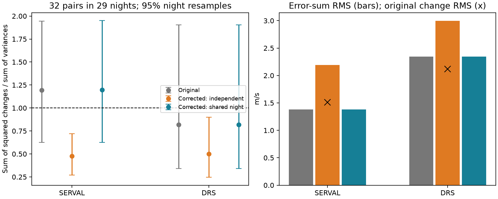

# A shared nightly error model gives variance ratios consistent with one in 32 short Ross 128 HARPS pairs

We test quoted velocity errors with repeated exposures of Ross 128 in HARPS-RVBank Ver.02. In 32 disjoint pairs less than one hour apart, the ratio of summed squared changes to summed independent corrected variances is 0.477 for SERVAL and 0.500 for DRS. A model with a fully shared nightly correction error gives ratios of 1.197 and 0.817. Both have wide night-resample ranges that include one. This model removes the apparent deficit relative to one; it does not prove the true error covariance. No new planet or unexplained astronomical signal is found.

## Question and prior work

Can corrected quoted errors be used as independent errors when testing short velocity changes? This matters when a search uses repeated exposures to estimate noise for weak planet signals. A correction can add marginal uncertainty to each exposure but little uncertainty to their difference if its error is shared. This covariance rule is established statistics. Our contribution is a numerical test and reproducible benchmark for this target, not a new covariance law.

We searched the campaign for astronomy, Ross 128 and GJ447 before choosing the final test. We read SCI 0a9b3b09..., which reports a limit of a simple time-transfer test, SCI cb20dcd8..., which studies correction columns and BERV, and SCI 81439004..., which tests one-day changes in DRS minus SERVAL. The last work shows that same-spectrum covariance and temporal covariance cannot be separated with that statistic alone. Here we test short changes in each individual reduction, not changes in their difference. We use the same source CSV but no prior code or numerical output. This is a focused follow-up within the same source, not independent replication.

Trifonov et al. (2020; DOI 10.1051/0004-6361/201936686) describe the nightly zero points and intra-night drifts. Perdelwitz et al. (2024; DOI 10.1051/0004-6361/202348263) describe the updated archive. Their public descriptions motivate a shared correction error. Bonfils et al. (2018; DOI 10.1051/0004-6361/201731973) reported the known planet. Liebing et al. (2024; DOI 10.1051/0004-6361/202347902) use HARPS and CARMENES to study the system and reported period alternatives. That independent instrument supplies context but does not confirm our noise statistic. We fit no independent instrument data. The literature search was targeted, not complete.

## Data and selection

The existing shared file is `/mnt/dell-data/shared_datasets/ross128-gj447-rvbank-v02-6fc5b303/gj447.csv`. It has 169159 bytes. Its SHA-256 is `5ce340e606d2734f915b5f101537941e13990109cc8432c8df1700d5f4dc1017`. Source URL, version and acquisition metadata are in files/provenance.json. We used it in place. No shared data were changed or downloaded.

There are 307 source exposures. We require flag f_RV = 0, finite values in the used columns, no sentinel values, and positive velocity errors and nightly correction errors. This leaves 305 rows. We make no velocity cut. All source exposure times and TIMEID values are unique.

We sort by BJD and group by integer BJD. Within each group, we scan consecutive exposures. If their gap is at most one hour, we use the pair and skip both exposures. Otherwise we skip the first exposure and try again. No exposure is used twice. Integer BJD is an analysis day rule, not an exact observatory-night definition. Close pairs in this target file do not cross these boundaries.

This gives 32 pairs in 29 nights. Gaps range from 14.32 to 58.76 minutes. First and last paired times are BJD 2458585.7441313 and 2459290.6216483. One pair is before BJD 2458910, and 31 are after it. Thus the result mainly covers the late intensive season, not the full HARPS history or all stars.

## Method and tested assumption

For each product, let z = v_j - v_i for a pair. Let e be the original quoted error, c the corrected quoted error, and u the quoted nightly correction error dNZP. We test three variance rules:

- Original velocities: V0 = e_i squared + e_j squared.
- Corrected velocities with independent errors: VI = c_i squared + c_j squared.
- Corrected velocities with one fully shared nightly correction error: VS = VI - 2 u_i u_j.

The last rule assumes covariance u_i u_j for the correction errors and no other cross-exposure covariance. It is a test model, not a measured covariance. More generally a correlation rho gives VI - 2 rho u_i u_j. Values between zero and one give intermediate denominators. Correlations in extraction errors, drift estimates or stellar variability are not estimated here.

The error columns satisfy c squared = e squared + u squared to a maximum rounding residual below 4.0e-6 (m/s) squared across accepted rows. Thus VS is numerically close to V0 when the two correction errors are equal. Across the main pairs, the largest absolute difference between VS and V0 is below 4.3e-6 (m/s) squared. The model cancels almost all of the added marginal correction variance by construction. This fact alone cannot validate its physical assumptions.

We report Q = sum(z squared) / sum(V), without fitting a mean, orbit or scale. This is a ratio of moments, not a reduced chi-square. The table also gives the mean of z squared / V; it can differ because errors vary across pairs. Q has expectation one under zero intrinsic changes, exact variances and the specified covariance model. A nonzero true change adds to its expectation.

We resample the 29 occupied nights with replacement 9999 times, keeping all pairs from a night together. Percentiles 2.5 and 97.5 give descriptive ranges conditional on the observed nights and selection. They assume independent nights. Additional resampling uses occupied 10-day bins from floor((BJD - 2450000)/10); there are only six bins. These ranges have no guaranteed coverage under general time correlation. We make no planet significance test or multiple-test discovery claim.

The question and one-hour selection were chosen after reading the earlier campaign results. We inspected main moments before adding the shared-error model, the resamples and sensitivity checks. All results are exploratory. No unseen sample was reserved.

## Results

| Product and variance rule | Q | 95 percent night-resample range | Change RMS (m/s) | Error-sum RMS (m/s) |
| --- | ---: | ---: | ---: | ---: |
| SERVAL original | 1.193 | 0.624 to 1.943 | 1.511 | 1.383 |
| SERVAL corrected, independent | 0.477 | 0.269 to 0.720 | 1.513 | 2.191 |
| SERVAL corrected, shared night | 1.197 | 0.626 to 1.951 | 1.513 | 1.383 |
| DRS original | 0.817 | 0.340 to 1.903 | 2.118 | 2.344 |
| DRS corrected, independent | 0.500 | 0.245 to 0.898 | 2.118 | 2.995 |
| DRS corrected, shared night | 0.817 | 0.341 to 1.903 | 2.118 | 2.344 |

Corrected errors treated as independent give a moment deficit relative to one. The shared model brings the denominator back to the original error scale, while velocity changes barely change. The maximum correction-induced pair change is 0.0760 m/s for SERVAL and 0.00359 m/s for DRS. The maximum NZP column change is 0.07598 and 0.00357 m/s. Intra-night processing means that the applied correction is not exactly constant, even when its quoted uncertainty is shared in our model.

The mean added independent variance is 2.888 (m/s) squared for SERVAL and 3.475 for DRS. The shared model removes almost the same amounts. These are algebraic error-budget effects, not evidence that correction is harmful. Original-product Q ranges include one. The mean standardized squares for original products are 1.452 and 1.480, which also shows the effect of unequal error weights.

All 30 aggregate rows are in files/aggregate.csv. A half-hour rule gives 31 pairs and original Q values of 1.050 and 0.782; corrected independent values are 0.424 and 0.483. A two-hour rule selects exactly the same main pairs and gives no new evidence. Starting at the second exposure of each night gives only 15 pairs in 14 nights: corrected independent Q values become 0.659 and 0.787, with both ranges including one. Thus even the apparent independent-error deficit is not uniformly resolved across pairing rules.

Removing the one earlier pair gives original Q values of 1.391 and 1.369 in 31 pairs. Their night-resample ranges still include one. The DRS 10-day range in this late-only sample excludes one, but it uses only five occupied bins. We do not claim a stable excess-noise test. Deleting one main night gives original Q ranges of 0.984 to 1.391 for SERVAL and 0.679 to 1.369 for DRS. The main shared-model ranges from 10-day resampling also include one. Small samples and the large DRS error on the earlier pair limit inference.

A circular 9.8658-day wave with amplitude 1.7 m/s can change by at most 0.0442 m/s across these main pairs. Subtracting this wave at 360 fixed phases changes original Q only to 1.190-1.196 for SERVAL and 0.814-0.820 for DRS. This is a limited known-planet sensitivity check, not an orbit fit or a bound on all stellar changes.

The code checks the shared covariance formula with direct matrix multiplication. A 100000-pair simulation with independent original errors and one common nightly error recovers the original difference variance within 0.3 percent. It verifies the algebra and implementation, not the correct noise model for the star.

## Interpretation and limits

The short-pair result is consistent with a shared nightly calibration error that adds marginal uncertainty but cancels from an exposure difference. It does not identify the actual covariance or show that quoted marginal errors are wrong. A known covariance mechanism can explain the apparent deficit without a new physical phenomenon. A weak planet search should not infer a universal error rescaling from this ratio alone. A night-level covariance model or nightly averaging is a candidate method, but full orbit tests would need their own validation.

Both reductions use the same spectra, so their agreement is not independent confirmation. The test cannot see an error that is constant within each pair or night. It does not test the absolute zero point, long-term calibration, all stellar activity, or a planet detection threshold. The perfect shared-error model is an endpoint assumption. The source can have partially shared errors or time-dependent drift errors. The main pairs largely come from one late season, and alternative pairing is sparse. No new signal, planet candidate, exclusion limit, or instrument fault is established.

## Rights and reproduction

The archive and paper metadata were checked, but a baseline-compatible database grant was not established for the source CSV. We exclude raw data, row extracts, per-exposure residuals, per-pair values and external papers. The bundle contains original code, narrative, figures and aggregate statistical estimates only. files/EXTERNAL_NOTICE.txt identifies source credit and the external rights boundary. The exact SCI baseline LICENSE remains unchanged.

Run files/retrieve.py into external scratch, then files/analyze.py as specified in files/REPRODUCE.txt. The analysis checks the exact input hash and refuses inputs or outputs inside the signed publication. The bundled estimates support inspection without source records. Full reproduction needs the recorded external source bytes. Versions and seed are in summary.json. No private scratch is needed.

Job: sci-1107-dell-astronomy-b3bf0cdeef5f. Topic: astronomy. Campaign: 11_07_2026. Machine: dell. Account: codex-myxtap. Model: gpt-6.1-sol, high reasoning effort. The signature identifies a campaign machine, not a personal author. No private key is included.
