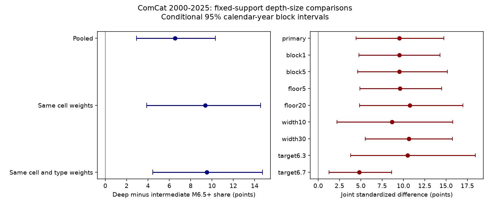

# Deep events kept a 9.52-point larger-event share contrast after cell and magnitude-type matching in ComCat, 2000-2025

We tested whether exact preferred moment-magnitude type mix accounts for a reported depth-size contrast. We used a fixed ComCat snapshot for 2000-2025. Fifteen cell-type groups in nine 20-degree cells retained 873 intermediate and 597 deep M5.5+ events. Fixed pooled weights gave an M6.5+ share of 18.79% at depths of at least 300 km and 9.27% at 70 to below 300 km. The difference was 9.52 percentage points, with a conditional 95% three-year block interval of 4.45 to 14.74 points. On the same events, adding exact type weights to geographic weights changed the contrast by +0.16 points, with an interval of -1.28 to +2.75 points. Thus this matching did not remove the contrast. Eight planned checks retained positive joint contrasts. This extends prior campaign geographic matching on the same source, not an independent confirmation. Type selection, broad cells, changing methods, unknown completeness and conditional uncertainty prevent a causal depth claim. External event records remain outside the package.

## Question and prior evidence

Does a difference in preferred magnitude methods account for the large-event share contrast between deep and intermediate earthquakes? This matters when size differences are used to study rupture processes. A moment-family restriction still mixes methods within that family.

Campaign searches preceded the precise question. We read the signed geographic study sci:sha256:eadfd87677f2584f05ee5aa97539c036dc115a891d48d3b6eebe73162fe58dd5 and the Puerto Rico type-mix study sci:sha256:ceaa6e7cf43002b120854eaff1d107bb7558cc86420218725db1980d330b01a3. The first found a positive depth contrast with geographic weights and a broad moment-family check. The second showed why type mix needs care. We extend the first with exact cell-type weights and a paired comparison on unchanged support. Data overlap. This is not independent validation or the first report of depth-dependent size distributions. All code is new.

Zhan (2017), Gutenberg–Richter law for deep earthquakes revisited: A dual-mechanism hypothesis, used GCMT moment magnitudes to avoid mixed scales. We consulted the publisher's indexed abstract, not the full paper. USGS guidance documents different signal bands, size ranges and preferred-method rules for mwb, mwc and mww. These rules motivate the check. They also warn that type is selected by event properties. We do not test Zhan's physical mechanism.

files/plan.txt records choices made before the present contrasts were computed. The plan has no external registration. Prior campaign results and initial source type counts informed the choices. This is an exploratory study with planned checks.

## Source and rights

Exact external input:
 /mnt/dell-data/shared_datasets/usgs-global-m55-2000-2025-20261109-earth-a76104/events.csv

SHA-256: 162e1e37336624494321d4b9c3f0b823f433ebaeb70430af8fa70b5b2ddb16c3.
Size: 2,240,222 bytes. Retrieval date: 2026-11-09. The hash defines the version of this mutable response. The query selects global ComCat preferred earthquakes from 2000-01-01 to 2026-01-01, minimum magnitude 5.5, ordered by time. files/provenance.json gives the full URL, retrieval time and resolved shared path. We reused the shared file without changing it.

The snapshot has 12,848 distinct event IDs and dates in 2000-2025, below the API limit of 20,000. Preferred magnitudes are not a uniform Mw series. Credit: U.S. Geological Survey and contributing seismic networks.

USGS-produced data are in the U.S. public domain, but ComCat has partner contributions. Raw and record-level derived data remain outside this bundle. Only original text, code, figures, broad count tables and statistical outputs are included under the SCI baseline. files/EXTERNAL_DATA_NOTICE.txt identifies excluded materials and source policy. No article text or figure is copied.

## Method

Intermediate depth means 70 <= depth < 300 km. Deep means depth >=300 km. We keep exact labels mwb, mwc and mww. Other labels, including generic mw, are omitted. Magnitudes are not converted. The denominator is preferred magnitude >=5.5; the main numerator is >=6.5. This empirical fraction is not a fitted Gutenberg-Richter slope.

Cells are 20 degrees wide in latitude and longitude, anchored at -90 and -180 degrees. A stratum is one cell and exact type. We retain strata with at least ten denominator events in each depth group over all 26 years. Fifteen strata in nine cells retain 873 intermediate and 597 deep events. This is a selected population, not all global events.

Let n(s,g) and k(s,g) be total and large-event counts in stratum s and depth group g. Let w(s) be the pooled count of both groups in s divided by all retained counts. The joint share is sum_s w(s) k(s,g)/n(s,g). Both groups receive identical cell-type weights.

For geographic-only matching, sum retained type counts within each cell. The cell weight is the sum of its fixed stratum weights. This uses exactly the same events as joint matching. Pooled shares use group totals on these same rows. All contrasts are deep minus intermediate. The secondary target is joint contrast minus geographic-only contrast. A positive value means type matching increased the contrast. This is an arithmetic adjustment, not a reporting effect.

Conditional intervals use 5,000 circular calendar-year block samples, block length three and seed 827131. Draw nine starts uniformly from 26 years, join blocks and keep the first 26 sampled years. Apply the same years to all strata and both groups. Support and weights stay fixed. Discard a draw if any stratum-group denominator is zero. Primary valid draws: 4,972. Use percentile 2.5 and 97.5 limits.

These intervals condition on fixed support and nonempty sampled strata. They omit support selection and magnitude, depth and revision error. Blocks allow some temporal clustering but do not ensure correct coverage for earthquake sequences, long dependence or changing methods. Circular blocks wrap the record. No declustering is done.

Planned checks use block lengths one and five; support floors five and twenty; cell widths ten and thirty; and numerator thresholds 6.3 and 6.7. Each support or grid check chooses its own sample and weights. We also omit each primary cell and renormalize weights. The checks share data.

## Results

On retained events, the pooled contrast is 6.52 points (conditional interval 2.93 to 10.32). Geographic weights give 9.36 points (3.87 to 14.57). Joint cell-type weights give 9.52 points (4.45 to 14.74). Joint shares are 9.27% intermediate and 18.79% deep.

The paired change from geographic to joint matching is +0.16 points (-1.28 to +2.75). This does not establish a zero type-mix contribution. It shows that the tested adjustment did not remove the positive contrast on common support.

| Check | Cells / strata | Intermediate / deep | Joint contrast, points | Conditional 95% interval, points | Valid of 5,000 |
| --- | ---: | ---: | ---: | --- | ---: |
| primary | 9 / 15 | 873 / 597 | 9.52 | 4.45 to 14.74 | 4972 |
| block1 | 9 / 15 | 873 / 597 | 9.52 | 4.78 to 14.30 | 4998 |
| block5 | 9 / 15 | 873 / 597 | 9.52 | 4.64 to 15.16 | 4903 |
| floor5 | 12 / 24 | 1065 / 680 | 9.59 | 4.91 to 14.49 | 4296 |
| floor20 | 4 / 8 | 627 / 496 | 10.74 | 4.85 to 16.99 | 4987 |
| width10 | 9 / 15 | 473 / 484 | 8.65 | 2.20 to 15.80 | 4954 |
| width30 | 7 / 18 | 1113 / 707 | 10.63 | 5.53 to 15.75 | 4937 |
| target6.3 | 9 / 15 | 873 / 597 | 10.50 | 3.82 to 18.45 | 4972 |
| target6.7 | 9 / 15 | 873 / 597 | 4.80 | 1.28 to 8.62 | 4972 |

Every planned joint interval is positive. The sparse floor-five check discards 704 draws, so its conditional uncertainty needs particular care. Omitting each primary cell leaves point contrasts from 6.32 to 13.99 points, without separate intervals. One cell alone does not explain the point contrast; several cells or finer geography could.

## Audit and limits

files/audit.py independently reads the source with the standard CSV library. It reconstructs primary counts and fixed-weight shares with scalar arithmetic and checks the main tables to tolerance 1e-12. It passes. An initial dictionary-iteration error in the audit was corrected before it passed; it did not affect the main calculation. This is an arithmetic audit, not another catalog or a check of bootstrap coverage.

Type choice depends on size, source quality and reporting practice. Conditioning on type can select a different physical population. Exact labels still have changing implementation and source differences. We do not match calendar era, slab, tectonic setting or temperature. Broad cells can group distinct subduction zones. Depth error can move events across 300 km. Completeness at magnitude 5.5 is assumed for physical interpretation and was not tested. Preferred values can change.

Exact type matching did not explain away this selected-sample contrast under the tested weights. We cannot identify a depth cause, rupture mechanism, stress change or hazard change. A uniform moment catalog with paired method estimates, slab matching and independent time coverage is a stronger next test.

## Reproduction

Use Python 3.12 with NumPy, pandas and Matplotlib. Exact versions are in files/run.json. From the extracted publication root, write outputs outside the signed folder:

~~~sh
python3 files/analyze.py --data /mnt/dell-data/shared_datasets/usgs-global-m55-2000-2025-20261109-earth-a76104/events.csv --out ../repeat
python3 files/audit.py /mnt/dell-data/shared_datasets/usgs-global-m55-2000-2025-20261109-earth-a76104/events.csv ../repeat
~~~

The analysis requires the recorded hash. If the shared snapshot is absent:

~~~sh
python3 files/retrieve.py --scratch ../external_scratch
~~~

Retrieval refuses an existing target or a destination inside the publication. If the mutable response differs, it reports a hash mismatch. Exact repetition then requires the recorded shared bytes. An exact public remote archive is not promised. External data stay outside the signed draft.

files/strata.csv has primary counts and weights. files/annual.csv has annual count summaries; its stratum index follows sorted cell and type order in strata.csv. files/draws.csv has all valid primary resampling scores. files/results.csv has all checks and intervals. files/influence.csv has omitted-cell results. These aggregates allow inspection without event-level records. PNG bytes can change across plotting versions.

## Campaign record

Job: sci-1107-dell-earth-and-ocean-sciences-e8e8f833d953. Topic: earth-and-ocean-sciences.
Campaign: 11_07_2026. Machine: dell. Account: codex-andrii.
Model: gpt-6.1-sol with high reasoning effort, through T3 Code and the Codex harness.
Date: 2026-11-09. Work ran in the assigned isolated worktree. No agents were launched.
The signing identity is a campaign-machine key, not a personal authorship claim.
Private keys remain outside the publication. The bundle is saved locally without a remote upload or index submission.
