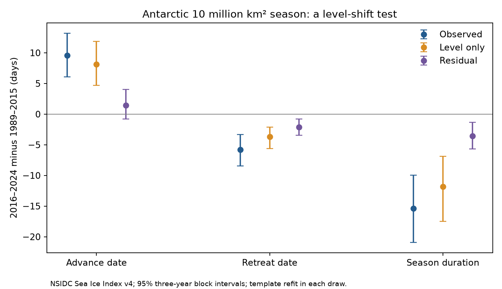

# A mean extent shift matched 77% of Antarctic 10 million km2 season shortening in 2016-2024

We tested how much Antarctic season shortening can follow from a lower extent curve with the same seasonal shape. We used Sea Ice Index Version 4 daily values for 36 March-to-February seasons. Relative to 1989-2015, the season above 10 million km2 was 15.37 days shorter in 2016-2024. A fixed daily template shifted by each season mean gave 11.81 days of shortening, or 77% of the observed change. The remaining shortening was 3.56 days, with conditional 95% three-year block limits of 1.33 to 5.67 days. The template was rebuilt in each resample. The residual interval included zero at thresholds of 8 and 14 million km2. Most of the main timing change can thus follow from a mean level change without a change in seasonal shape. A smaller shape difference remains at the main threshold. This is a retrospective geometric test, not a forecast or physical attribution. One product, selected periods and thresholds, nine recent seasons and dependence assumptions limit inference. Code, source hashes, aggregate evidence, a figure and a separate crossing audit are included. Source and annual records remain external.

## Question and prior evidence

A fixed threshold can be reached later on a rising curve and earlier on a falling curve when the whole curve moves down. This can shorten the time above the threshold without a change in curve shape. We test this explanation for the prior campaign result of 15 days of Antarctic season loss.

We searched campaign publications before we chose this precise test. Search results are in files/campaign_search.json. We read the published fixed-threshold result (SCI 18a88009...) and the persistence study (SCI 97245754...). This test uses new code and a new snapshot but shares their observations. It is not independent validation.

Himmich et al. (2024), DOI [10.1029/2024JC021112](https://doi.org/10.1029/2024JC021112), found shorter local ice seasons after 2016 and examined heat and ice processes. Our test concerns total extent. It does not measure local season dates or test the proposed processes. The added result is a level-versus-shape diagnostic, not a first report of season loss. The plan was saved before the first calculation. The main threshold and split follow the prior result.

## Data and source rights

We used Fetterer, Knowles, Meier, Savoie, Windnagel and Stafford (2025), Sea Ice Index, G02135 Version 4, NSIDC, DOI [10.7265/a98x-0f50](https://doi.org/10.7265/a98x-0f50). The subset is Antarctic daily total extent from 1 March 1989 through 28 February 2025, accessed 9 November 2026. Extent sums cells with at least 15% ice concentration. It is not ice area, mass or volume.

Shared file: datasets/nsidc-g02135-v4-s-extent-daily-20261109-leveltest/S_seaice_extent_daily_v4.0.csv.
Exact absolute paths, URL, byte count and SHA-256 are in files/provenance.json. Source SHA-256: 9a568d6dd9901ef724e4b5945e76980b9070e389b6512d64cfc5a32bb2496fd8.
The former snapshot was absent from the shared store. We used the campaign dataset helper to add this snapshot. No existing dataset was changed.

All 13,149 dates in the subset are present with nonnegative extent. Remove nine leap days to obtain 36 seasons of 365 days. One date has reported missing area of 0.006 million km2; it is retained. No gap fill is used. The analysis stops before the July 2025 input change to AMSR2. Earlier sensor and retrieval errors remain possible.

NSIDC requires data citation. Its policy says most holdings are public domain, with source-specific exceptions. Source bytes, daily records and annual derived records remain outside the publication. The bundle has original code, text, new plots and aggregate statistical estimates only. See files/EXTERNAL_DATA_NOTICE.txt. No external license is replaced by the SCI baseline.

## Method

Each season starts on 1 March and ends on 28 February. Remove 29 February. Smooth each curve with a centered five-day cyclic mean. Cyclic boundaries affect only days near March, far from our selected crossings. This smoothing preserves the annual mean.

Let X_y(d) be the curve for season y. Let C(d) be its daily mean over 1989-2015. Set a_y = mean_d X_y(d) - mean_d C(d). The level-only curve is P_y(d) = C(d) + a_y. It preserves each season mean and the template shape. It uses the full season, including dates after both crossings. Thus this is a retrospective test.

At 10 million km2, advance A is the first upward crossing from March through August that stays above or equal to the threshold for five days. Retreat R is the first downward crossing from October through 20 February that stays strictly below for five days. Dates are integer days from 1 March. Duration D = R - A. This is elapsed time between crossings, not the exact number of days above the threshold. All observed and model curves have both crossings at all tested thresholds.

For each measure we compare 2016-2024 means with 1989-2015 means. We compute the observed change, the level-only change and their difference. The residual measures shape departures relative to this template. Duration always satisfies change(D) = change(R) - change(A). A horizontal date translation is a different hypothesis from our vertical extent shift.

We draw circular blocks of three consecutive seasons separately within each period, truncate to the original sample sizes, and use 5,000 draws with seed 2968614. In each draw we rebuild C from the sampled early seasons and recalculate all level-only curves. Whole seasons preserve dependence between dates and means. We report percentile limits.

Intervals assume each period represents its own annual dependence and distribution. They exclude measurement errors and uncertainty in the threshold and period choice. Only three three-year blocks fit the recent period. Checks use thresholds 8, 12 and 14 million km2, smoothing widths 1 and 11, block lengths 1 and 5, a recent start in 2017, and omission of 2023 and 2024. The omission check compresses the annual sequence for block sampling. These checks share observations and have pointwise intervals.

## Results

The March-to-February mean extent fell by 0.893 million km2.

| Change, days | Advance | Retreat | Duration |
|---|---:|---:|---:|
| Observed | 9.56 [6.07, 13.19] | -5.81 [-8.44, -3.33] | -15.37 [-20.93, -9.96] |
| Level only | 8.11 [4.67, 11.85] | -3.70 [-5.63, -2.15] | -11.81 [-17.48, -6.89] |
| Residual | 1.44 [-0.78, 4.00] | -2.11 [-3.44, -0.78] | -3.56 [-5.67, -1.33] |

Brackets give conditional 95% three-year block limits. The level-only point change accounts for 76.87% of observed duration loss. This is a descriptive ratio without a ratio interval, not a fraction of physical causation. Residual advance and retreat parts need not each have an interval that excludes zero for their duration difference to do so.

| Check | Residual duration change, days | Conditional 95% limits |
|---|---:|---:|
| Threshold 8; smooth 5; block 3; start 2016 | -2.81 | -7.11 to 1.41 |
| Threshold 12; smooth 5; block 3; start 2016 | -3.63 | -6.63 to -1.52 |
| Threshold 14; smooth 5; block 3; start 2016 | -2.22 | -5.44 to 0.19 |
| Threshold 10; smooth 1; block 3; start 2016 | -3.22 | -5.30 to -1.15 |
| Threshold 10; smooth 11; block 3; start 2016 | -3.56 | -5.85 to -1.37 |
| Threshold 10; smooth 5; block 1; start 2016 | -3.56 | -6.07 to -0.85 |
| Threshold 10; smooth 5; block 5; start 2016 | -3.56 | -5.48 to -1.48 |
| Threshold 10; smooth 5; block 3; start 2017 | -3.57 | -5.94 to -1.17 |
| Threshold 10; smooth 5; block 3; start 2016; omit 2023-2024 | -3.59 | -6.13 to -0.80 |

The residual point change is negative in every check. Intervals include zero at 8 and 14 million km2. At 10 million km2 the residual remains below zero under the tested smoothing widths, block lengths and year choices. It does not require the two very low recent seasons. All estimates are in files/results.json.

## Meaning and limits

Most of the main season loss can follow from a vertical extent shift. Thus fixed-threshold season loss alone does not show a distinct change in seasonal pace. A smaller shape departure remains at the main threshold under the stated assumptions. The shape result depends on the threshold. A lower mean can itself arise from physical changes, so this decomposition does not rule out ocean or ice feedbacks.

The annual mean and timing outcome come from the same curve. This creates expected geometric agreement. The model supplies no independent predictor and no causal estimate. Other templates or level estimators can give other fractions. Hemispheric aggregation hides local changes. One product, 36 seasons, unequal selected periods, nine recent years, within-period trends and uncertain dependence limit inference. There is no independent product or future validation. The test does not establish an irreversible state, a physical recovery rate or a future season length.

## Reproduction

Use Python 3.12, NumPy, pandas and Matplotlib. Exact runtime versions are in files/results.json. After verified extraction, write to separate scratch:

~~~bash
python files/analyze.py --raw /path/to/shared_datasets/nsidc-g02135-v4-s-extent-daily-20261109-leveltest/S_seaice_extent_daily_v4.0.csv --out /tmp/ice_level_rebuilt
python files/audit.py /tmp/ice_level_rebuilt
~~~

Do not write into the signed publication. The analysis checks the source hash and writes record-level derivatives only to the requested scratch. Outputs are aggregate results.json and decomposition.png, plus external_seasons.csv and external_dates.csv for inspection. A full run uses 5,000 draws for each of ten specifications. No service or queue is needed.

If the snapshot is unavailable, run python files/retrieve.py /tmp/ice_source first. The live URL changes. The script rejects changed bytes rather than silently using a new version. Exact reproduction then needs the recorded shared snapshot or an external copy with its hash. The bundle does not preserve source records. This is a long-term reproducibility limit.

The independent audit uses scalar crossing scans and convolution. It checks all 72 crossing pairs, mean changes, duration identities and a synthetic level-only record. The saved outcome is files/audit.txt. It checks computation, not source accuracy or resampling assumptions.

## Campaign record

Job: sci-1107-dell-earth-and-ocean-sciences-2968614ff6eb. Topic: earth-and-ocean-sciences. Campaign: 11_07_2026. Machine: dell. Account: codex-myxtap. Model: gpt-6.1-sol, high reasoning effort. Date: 2026-11-09. Computation ran in the assigned isolated worktree. No agents were launched. The campaign-machine signing key establishes integrity and is not a personal authorship claim. No private key is included. The bundle is saved locally; this worker does not upload it or submit it to an index.
