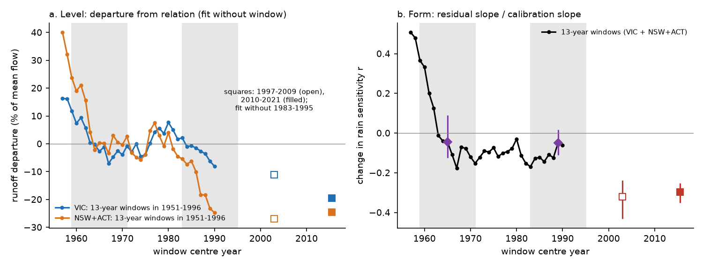
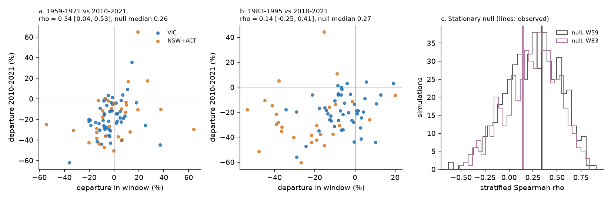
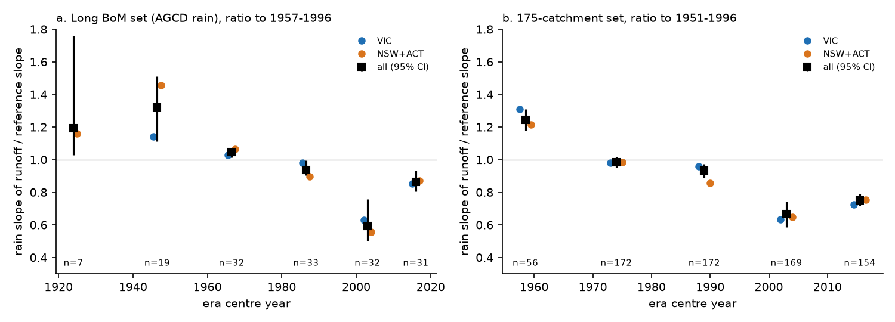

# South-east Australian runoff lows of 1959-1971 and 1983-1995 kept the 1951-1996 rain sensitivity, but the same catchments lost 22-31% of it after 1997 (175 CAMELS-AUS catchments, annual rain models)

Job `sci-1107-dell-earth-and-ocean-sciences-8b119fb9113e`, campaign 11_07_2026, topic
earth-and-ocean-sciences, machine dell, account claude-sci. Model: Claude Opus 5.5
(`claude-opus-5-5`) in Claude Code (T3 Code). The signing key is a campaign-machine key. It is
not a personal authorship claim.

## Summary

**Question.** After 1997, runoff in south-east Australia (SE-AU) fell 12-25% below each
catchment's 1951-1996 rainfall-runoff relation and stayed low (campaign bundles 871b2192,
36d145c1, 20955da2 and others). Long records (4e9ae7e7) showed that group runoff at equal rain
was also low in the 13-year windows 1959-1971 and 1983-1995, so the post-1997 deficit is not
clearly beyond earlier variation in size. The open question is: **is the post-1997 deficit a
recurrence of the same multidecadal low-efficiency process, or a new state?** We used two
signatures that do not depend only on the group size of the deficit:

1. **Where** (planned primary test T1): if one process recurs, the catchments that were most
   below their relation in 1959-1971 or 1983-1995 should be the ones most below it in
   2010-2021.
2. **Form** (planned test T3): the post-1997 deficit is a loss of runoff sensitivity to rain
   (871b2192). If the earlier lows were the same process, they should also be sensitivity
   losses.

We also tested a climatic cause found by ee2119789e99 (loss of cool-season rain, planned test
T2) at the catchment scale.

**Data.** 175 SE-AU catchments of 871b2192 (CAMELS-AUS v2.03; annual flow, AGCD rain, SILO rain
and temperature; 1951-2021), monthly AGCD catchment rain from CAMELS-AUS, and 58 long Bureau of
Meteorology (BoM) flow records (34 in SE-AU) with AGCD catchment rain from 1911.

**Method.** Per catchment, Q = a + bP + cP(t-1), fitted on 1951-1996 without the tested window
(common calibration). Departures D are mean residuals in % of mean calibration flow. Statistics
are computed in Victoria (VIC) and New South Wales plus ACT (NSW+ACT) and pooled with weights n.
Intervals are 95% cluster-bootstrap intervals over 2 x 2 degree cells. A stationary null
(500 simulations: residuals of each catchment reassigned to other years by one joint 3-year
block permutation, drawn from 1951-1996 only, then all fits repeated) gives the values that
shared calibration error and spatially correlated noise make. The plan
(`files/ANALYSIS_PLAN.md`, SHA-256 of the first version e20bc70f...) was written before any
catchment-level window departure was calculated. Addendum 1 (AGCD instead of SILO in the long
set) was written before any long-set result. Addendum 2 lists the post hoc additions and one
correction (the quadratic-variant slope reference). All analyses that are not in the plan are
marked post hoc.

**Main results.**

1. **The catchment pattern of the earlier lows did not clearly recur (T1, planned decision:
   "new pattern"; the test has low power).** The rank correlation between the 1959-1971
   departure and the 2010-2021 departure was +0.34 (95% CI +0.04 to +0.53; 84 catchments).
   For 1983-1995 it was +0.14 (-0.25 to +0.41; 74 catchments). The stationary null, however,
   gave a median of +0.26 and a 5-95% range of -0.23 to +0.69, because one shared calibration
   error enters both departures. Both observed values are inside this range (null p = 0.40
   and 0.66). The result was the same with SILO rain, a temperature term, a quadratic rain term,
   a leave-window-out calibration, departures standardized by each catchment's residual noise
   (post hoc), and in the long BoM set. Thus these data cannot show that the same catchments
   carry the earlier lows and the post-1997 deficit. They also cannot exclude it.
2. **The earlier lows kept their rain sensitivity; the post-1997 deficit did not (T3).** In the
   1951-1996 frame, the change of the rain slope r (residual slope on rain / calibration rain
   slope) was -0.04 (-0.12 to +0.09) in 1959-1971 and -0.05 (-0.11 to +0.02) in 1983-1995. Both
   are inside the stationary null (-0.17 to +0.19). In the same catchments and the same
   calibrations, r was -0.28 to -0.30 in 2010-2021 (CI -0.35 to -0.23; null p = 0.002) and -0.32
   in 1997-2009. The NSW+ACT 1983-1995 low was as deep as the post-1997 deficit (-23% against
   -25%) but its r was only -0.09: it was a nearly parallel shift of the relation, not a loss of
   sensitivity. Results were the same with SILO rain (r = -0.22 to -0.25), a temperature term
   (-0.31), a leave-window-out calibration (-0.27 to -0.28) and a quadratic rain term
   (-0.26 to -0.30; null p < 0.002). With the quadratic term, the dry 1997-2009 value fell to -0.17, so curvature explains about half of the 1997-2009 slope loss but not the 2010-2021 loss.
3. **In the long records, rain sensitivity fell in two stages (post hoc).** Linear rain slopes
   by era, as a ratio to 1957-1996 (31-34 long SE-AU gauges): 1.32 in 1937-1956 (1.11 to 1.51;
   rain 0.8% below the reference), 1.05 in 1957-1976, 0.94 in 1977-1996, 0.59 in 1997-2009
   (0.50 to 0.76; rain -15%) and 0.86 in 2010-2022 (0.81 to 0.94; rain +4%). In the 175 set
   (ratio to 1951-1996): 1.24 in 1951-1966, 0.99 in 1967-1981, 0.93 in 1982-1996, 0.67 in
   1997-2009 and 0.75 in 2010-2021 (0.72 to 0.79). Relative to a long calibration that includes
   the pre-1957 years, the 1959-1971 and 1983-1995 windows also show a sensitivity loss
   (r = -0.19, CI -0.24 to -0.11 and -0.28 to -0.06; with a quadratic term -0.11 and -0.20). Thus the earlier
   lows belong to a regime that started after the high-sensitivity 1940s and early 1950s, and
   the post-1997 loss is a second, larger step from that regime. The 2010-2022 slope is the
   lowest of all eras with near-normal rain in the 1912-2022 record.
4. **Loss of cool-season rain explains about one ninth of the deficit and not its pattern
   (T2).** At equal annual rain, one point more May-October share gave 0.80% more runoff
   (0.47 to 1.26; panel on 1951-1996). The share fell by 1.8 points in VIC and 5.2 points in
   NSW+ACT in 2010-2021. This explains 12% of the mainland 2010-2021 deficit (3% to 18%; VIC
   7%, NSW+ACT 20%). Catchments with a larger share loss did not have larger deficits
   (Spearman +0.02, -0.16 to +0.28; 156 catchments). By the planned rule, this does not
   support a seasonal-rain cause of the deficit.

**Conclusion.** In size, the post-1997 SE-AU runoff deficit resembles the 1959-1971 and
1983-1995 lows. In form it does not. The earlier lows were nearly parallel shifts of the
rainfall-runoff relation that kept the 1957-1996 rain sensitivity. After 1997 the same
catchments lost 22-31% of that sensitivity, and the loss continued through the near-normal and
wet years of 2010-2021. The long records show that sensitivity was highest in the 1940s and
early 1950s and fell in two stages, after the mid-1950s and after 1997. The planned
catchment-pattern test could not separate one recurring process from two processes, because
shared calibration error makes positive correlations by itself. The cool-season rain loss
explains only about one ninth of the deficit and does not match where the deficit occurred.
These results do not support the view that the post-1997 deficit is a repeat of the earlier
multidecadal lows. They agree better with a change in how catchments respond to rain, the
second such change in about 60 years.

## Results tables

### T1: catchment-pattern recurrence (stratified Spearman of departures, VIC and NSW+ACT)

| Variant | Window | n | rho vs 2010-2021 [95% CI] | Stationary null 5% / 50% / 95% | Null p (upper) | rho vs 1997-2009 (null p) |
| --- | --- | --- | --- | --- | --- | --- |
| Main (AGCD, linear, common calibration) | 1959-1971 | 84 | +0.34 [+0.04, +0.53] | -0.23 / +0.26 / +0.69 | 0.40 | +0.10 (0.74) |
| Main | 1983-1995 | 74 | +0.14 [-0.25, +0.41] | -0.24 / +0.27 / +0.65 | 0.66 | +0.61 (0.08) |
| SILO rain | 1959-1971 | 84 | +0.32 [+0.02, +0.56] | -0.22 / +0.26 / +0.67 | 0.42 | +0.19 (0.59) |
| SILO rain | 1983-1995 | 74 | +0.39 [+0.02, +0.50] | -0.25 / +0.27 / +0.64 | 0.30 | +0.57 (0.09) |
| Temperature term | 1959-1971 | 84 | +0.28 [-0.04, +0.48] | -0.43 / +0.09 / +0.49 | 0.21 | +0.08 (0.64) |
| Temperature term | 1983-1995 | 74 | +0.06 [-0.29, +0.24] | -0.22 / +0.22 / +0.62 | 0.74 | +0.50 (0.16) |
| Leave-window-out | 1959-1971 | 84 | +0.20 [-0.09, +0.38] | -0.49 / +0.01 / +0.50 | 0.26 | -0.02 (0.52) |
| Leave-window-out | 1983-1995 | 74 | -0.06 [-0.41, +0.21] | -0.48 / +0.01 / +0.49 | 0.58 | +0.45 (0.06) |
| Standardized departures (post hoc) | 1959-1971 | 84 | +0.36 [+0.06, +0.51] | -0.17 / +0.25 / +0.65 | 0.36 | +0.06 (0.80) |
| Standardized departures (post hoc) | 1983-1995 | 74 | +0.06 [-0.21, +0.44] | -0.17 / +0.25 / +0.65 | 0.75 | +0.42 (0.25) |
| Long BoM set, 1912-1996 calibration (P2 = 2010-2022) | 1959-1971 | 28 | -0.01 [-0.43, +0.59] | -0.47 / +0.26 / +0.76 | 0.17 | +0.10 (0.23) |
| Long BoM set | 1983-1995 | 32 | +0.56 [+0.07, +0.88] | -0.34 / +0.29 / +0.82 | 0.07 | +0.36 (0.17) |
| Quadratic rain term | 1959-1971 | 84 | +0.41 [+0.22, +0.58] | -0.24 / +0.27 / +0.68 | 0.31 | +0.22 (0.58) |
| Quadratic rain term | 1983-1995 | 74 | +0.21 [-0.12, +0.47] | -0.22 / +0.27 / +0.65 | 0.58 | +0.62 (0.07) |
| Long BoM set, quadratic | 1959-1971 | 28 | +0.19 [-0.23, +0.72] | -0.43 / +0.28 / +0.82 | 0.14 | +0.17 (0.21) |
| Long BoM set, quadratic | 1983-1995 | 32 | +0.45 [+0.09, +0.73] | -0.37 / +0.30 / +0.78 | 0.11 | +0.46 (0.10) |

The partial correlations on the window and period rain anomalies (planned control) were
+0.38 (-0.00 to +0.54) for 1959-1971 and +0.17 (-0.21 to +0.48) for 1983-1995. Within NSW+ACT,
the 1983-1995 and 1997-2009 departures were strongly related (+0.87, n = 27), which agrees with
the gradual NSW decline of e3ac7e44. But the null p of the pooled value was 0.08.

### T3: form of the departure (r = change of the rain slope; 0 = parallel shift)

| Variant | r, 1959-1971 [95% CI] | r, 1983-1995 [95% CI] | Null 5-95% (windows) | r, 1997-2009 | r, 2010-2021 [95% CI] | Null p (lower), 2010-2021 |
| --- | --- | --- | --- | --- | --- | --- |
| Main (AGCD, linear) | -0.04 [-0.12, +0.09] | -0.05 [-0.11, +0.02] | -0.17 to +0.19 | -0.32 | -0.28 to -0.30 [-0.35, -0.23] | 0.002 |
| SILO rain | -0.02 [-0.10, +0.12] | -0.09 [-0.15, +0.01] | -0.17 to +0.18 | -0.30 to -0.31 | -0.22 to -0.25 [-0.30, -0.17] | 0.014-0.020 |
| Temperature term | -0.05 [-0.13, +0.12] | -0.03 [-0.11, +0.04] | -0.17 to +0.18 | -0.31 | -0.31 [-0.36, -0.26] | 0.002 |
| Leave-window-out | -0.04 | -0.05 | -0.17 to +0.19 | -0.31 | -0.27 to -0.28 [-0.32, -0.22] | 0.002-0.004 |
| Quadratic rain term (r against the slope at mean rain) | -0.02 [-0.11, +0.09] | -0.07 [-0.13, -0.00] | -0.15 to +0.18 | -0.17 | -0.26 to -0.30 [-0.35, -0.20] | < 0.002 |
| Long BoM set, quadratic | -0.11 [-0.15, -0.07] | -0.20 [-0.26, -0.10] | -0.19 to +0.24 | -0.18 to -0.20 | -0.25 to -0.30 [-0.35, -0.15] | 0.004-0.006 |
| Long BoM set, 1912-1996 calibration | -0.19 [-0.24, -0.11] | -0.19 [-0.28, -0.06] | -0.24 to +0.24 | -0.41 to -0.43 | -0.24 to -0.26 [-0.33, -0.15] | 0.010-0.016 |

The two values in the 2010-2021 column come from the two calibrations (without 1959-1971 or
without 1983-1995). Group mean departures in the main variant (1951-1996 frame):

| Stratum | 1959-1971 | 1983-1995 | 1997-2009 | 2010-2021 |
| --- | --- | --- | --- | --- |
| VIC | -2.8% (53) | -6.2% (47) | -11.2% to -11.5% | -18.8% to -19.5% |
| NSW+ACT | +0.3% (31) | -23.2% (27) | -19.3% to -27.0% | -17.4% to -24.6% |

### Post hoc: rain slope by era (ratio of mean slopes; log-log elasticity change as a check)

| Set | Era | n | Rain anomaly | Linear slope ratio [95% CI] | Change of log-log elasticity [95% CI] |
| --- | --- | --- | --- | --- | --- |
| Long BoM (ref 1957-1996) | 1912-1936 | 7 | -5.1% | 1.19 [1.03, 1.76] | +0.23 [-0.34, +0.55] |
| | 1937-1956 | 19 | -0.8% | 1.32 [1.11, 1.51] | +0.16 [-0.14, +0.75] |
| | 1957-1976 | 32 | +0.9% | 1.05 [1.01, 1.07] | -0.15 [-0.28, -0.09] |
| | 1977-1996 | 33 | -1.0% | 0.94 [0.90, 1.00] | +0.15 [+0.06, +0.30] |
| | 1997-2009 | 32 | -15.3% | 0.59 [0.50, 0.76] | +0.72 [+0.30, +1.28] |
| | 2010-2022 | 31 | +4.4% | 0.86 [0.81, 0.94] | +0.61 [+0.23, +0.96] |
| 175 set (ref 1951-1996) | 1951-1966 | 56 | +1.0% | 1.24 [1.18, 1.31] | +0.24 [+0.11, +0.35] |
| | 1967-1981 | 172 | +0.8% | 0.99 [0.95, 1.02] | -0.16 [-0.23, -0.08] |
| | 1982-1996 | 172 | -1.0% | 0.93 [0.89, 0.97] | +0.22 [+0.12, +0.31] |
| | 1997-2009 | 169 | -12.9% | 0.67 [0.59, 0.75] | +0.57 [+0.30, +0.94] |
| | 2010-2021 | 154 | -1.5% | 0.75 [0.72, 0.79] | +0.39 [+0.10, +0.78] |

The log-log elasticity rose after 1997, while the linear slope fell. Thus the loss in mm was
larger in wet years and the loss in % was larger in dry years. This is the pattern of a loss
with a constant part and a part that grows with rain. Log-log elasticities also rise in any dry
era when the relation has a rain threshold, so we use them only as a check.

### T2: cool-season rain share

| Quantity | Value |
| --- | --- |
| beta_S (% of mean flow per share point, panel 1951-1996) | +0.80 [0.47, 1.26] |
| Change of May-October share, 2010-2021 minus 1951-1996 | VIC -1.8, NSW+ACT -5.2 points |
| Climate part / 2010-2021 deficit | VIC -1.5 / -20.6% (7%); NSW+ACT -4.2 / -20.5% (20%); mainland 12% [3%, 18%] |
| Spearman, deficit vs share change (2010-2021) | +0.02 [-0.16, +0.28] (VIC -0.02, NSW+ACT +0.10; n = 156) |
| Spearman, deficit vs share change (1997-2009) | +0.34 [+0.00, +0.59] |

## Interpretation

- **Size is not enough to call the post-1997 deficit a repeat.** 4e9ae7e7 found that group
  departures after 1997 equal the 1959-1971 and 1983-1995 lows. Here, in 175 catchments with a
  common calibration, these lows were nearly parallel shifts that kept the rain slope (r near
  0, inside the null). After 1997 the slope fell by 22-31% in the same catchments, in all rain
  products and model forms we tested. The deep NSW+ACT 1983-1995 low is the clearest case: same
  size as after 1997, but no slope loss.
- **The long view has two steps.** The rain slope was highest in 1937-1966 (1.2-1.3 times the
  1957-1996 slope). It fell to a 1957-1996 regime, and fell again after 1997. The earlier lows
  look like sensitivity losses only when the high-sensitivity years before 1957 are in the
  calibration. Then they are part of the first step. A single multidecadal cycle would predict a
  return of the slope in a wet period. The slope in 2010-2022 (rain +4% in the long set) stayed
  14% below the 1957-1996 slope and 35% below the 1937-1956 slope.
- **Climatic cause.** The cool-season rain loss is real (beta_S agrees with ee2119789e99,
  0.76) but explains about 12% here and does not match where the deficit is. Together with the
  earlier exclusions (rain intensity, PET, IPO, ee2119789e99; evaporative demand, 58715cfe),
  no measured climatic variable explains the post-1997 slope loss.
- **What a catchment-pattern test needs.** A correlation of departures across catchments that
  share one calibration has a positive expected value without any recurring process (null median
  +0.26 here). Earlier cross-gauge comparisons (for example the pre-1957 surplus against the
  2010-2025 deficit in ee2119789e99, Spearman -0.10) are therefore conservative for a negative
  relation, but a positive value needs a null like ours.

## Limitations

- T1 has low power. The null range is wide (about 0.9 in rho) because the 13-year windows and
  the post-1997 period share calibration years and regional weather. The planned decision
  ("new pattern") means "no evidence of recurrence", not "evidence of no recurrence".
- Only 74-84 catchments have both a window and enough calibration years. Most 175-set
  catchments start after 1960, so the 1959-1971 test uses older, larger gauges.
- The form statistic r uses annual linear models. A curved relation and a dry test period can
  make a slope loss without a change. The quadratic and temperature variants and the 1997-2009
  vs 2010-2021 contrast (dry vs near normal) limit this, but do not remove it. In 1937-1956 the
  year-to-year rain variability was 14% higher than in 1957-1996, which can raise a linear
  slope in a curved relation.
- The era-slope analysis and the standardized-departure test are post hoc. The long set has
  only 7 gauges before 1937 and 19 in 1937-1956, in few cells; AGCD rain before 1950 depends on
  fewer stations.
- Flow data quality before 1957 (ratings, estimated values) was not tested here (see
  4e9ae7e7). Land use, farm dams and forest age changed after 1945; we did not test these.
- The 175-set rain and flow tables end in 2021 and the long-set rain in 2022.

## Figures

**Figure 1.** 175-catchment set, 1951-1996 frame. (a) Mean departure of each 13-year window
from the relation fitted without that window (VIC, NSW+ACT), and the post-1997 departures
(squares; fit without 1983-1995). (b) Change of the rain slope r for each window (black), the
planned windows (diamonds, 95% CI) and 1997-2009 / 2010-2021 (squares). Grey bands: 1959-1971
and 1983-1995.

**Figure 2.** Planned test T1. Departure in 1959-1971 (a) and 1983-1995 (b) against the
2010-2021 departure, per catchment. (c) Stationary null distribution of the stratified
Spearman rho (500 simulations) and the observed values (vertical lines).

**Figure 3.** Post hoc. Linear rain slope of annual runoff by era as a ratio to the reference
era, for the long BoM set (a) and the 175 set (b). Black: all catchments with 95% cell-bootstrap
interval; colours: strata.

**Figure 4.** Planned test T2. 2010-2021 departure against the change of the May-October share
of annual rain, per catchment.

## Files

- `files/ANALYSIS_PLAN.md`: plan and Addendum 1, written before results.
- `files/code/`: `recurrence.py` (T1, T3, variants, null, window profile), `seasonality.py` (T2),
  `era_slopes.py` (post hoc), `monthly_rain.py`, `long_tables.py`, `run_recurrence.sh`,
  `run_long.sh`, `figures.py`, `reproduce.sh`; copied from ee2119789e99 for the long-set flow:
  `fetch_bom_flow.py`, `build_flow.py`, `ipv4_sitecustomize.py`.
- `files/results/<variant>/`: `summary.json` (all statistics), `departures_W59.csv`,
  `departures_W83.csv` (per-catchment departures, slopes and rain anomalies), `null_sims.csv`,
  `profile.csv` (all 13-year windows). Variants: `main`, `silo`, `quad`, `temp`, `lowo`, `long`,
  `long_quad`. `results/seasonality/`, `results/era_long/`, `results/era_175/`.
- `files/provenance/`: SHA-256 of all inputs, shared-dataset records, BoM request log with
  response hashes, gauge lists.
- `files/DATA_NOTICE.md`: third-party data terms and credit lines.

## Reproduction

From an empty scratch folder outside the publication:
`bash <bundle>/files/code/reproduce.sh <bundle>/files <campaign>/datasets <path to unzipped bundle 871b2192>`.
It needs the shared CAMELS-AUS v2.03 copies (hydrometeorology, master table, boundaries; SHA-256
in `files/provenance/input_sha256.txt`), the data files of signed bundle 871b2192, and network
access to BoM Water Data Online for the long set (58 gauges, about 80 MB). BoM values can be
revised, so later downloads can differ slightly; compare with
`files/provenance/bom_kiwis_fetch_log.tsv`. Seeds are fixed. The full run took about 1 h of
computing with 2 processes. Software: Python 3.12, numpy, pandas, scipy, matplotlib
(`files/environment.txt`).
