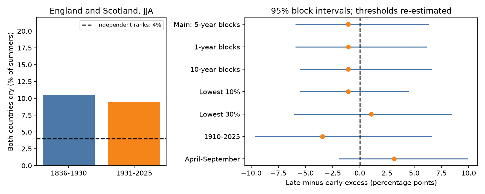

# Shared dry summers showed no clear change between England and Scotland in two 95-year periods from 1836 to 2025

England and Scotland had ten shared dry summers in 1836-1930 and nine in 1931-2025. Each country had 19 dry summers in each period. The change in shared dry frequency above the independent-country reference was -1.05 percentage points. Its 95% five-year block interval was -5.89 to +6.32 points. These data give no clear direction of change. They do not show that joint drought risk stayed constant.

## Question and scope

Did shared low summer rainfall change between England and Scotland when the local dry fraction was held near one fifth? Shared shortages can reduce the value of water transfers. We test a statistical dependence measure in observed country rainfall. We do not test the supply from any proposed transfer.

Dobson et al. (2020, DOI 10.1029/2020WR027187) linked climate, water flow and water supply models across England and Wales. Their results show why shared shortages matter. Their model results do not establish a historical change in these country rainfall ranks. The Environment Agency report, The Spatial Coherence of European Droughts, describes regional and seasonal differences in shared drought. We test one simpler historical contrast.

Campaign publication SCI a5241ee5e18ad270f83425c1068b82d9cc5607576754f63f88a1c3dd8eef5ed0 separated shared dry-summer frequency from its marginal-rate reference in US climate divisions. It informed our measure. Our country pair, long periods and re-estimated thresholds differ. SCI 1241e5a630f25e46a3f64e4751710961b9199da8a58fdd112f1ae5231c7ce3b7 used the same British source series to test temporary rainfall deficit closure. It informed our source choice. This is new analysis of overlapping public observations, not independent confirmation of that work. We read these published results. No private worker files were used.

This study is exploratory. The plan in files/plan.txt was saved before numerical results. It is not a registered protocol. The exact period split was chosen to give equal record lengths, not from a fitted change point.

## Sources

We read Met Office National Climate Information Centre country rainfall series from HadUK-Grid 1 km data, updated 1 November 2026. We used complete calendar years 1836-2025. All 12 monthly values in those years are present and nonnegative for England, Wales and Scotland. The files include partial 2026 data, which we exclude.

Exact shared source paths, resolved paths, URLs, byte counts, SHA-256 hashes and original helper metadata are in files/provenance.json. The source directories are:

- /mnt/dell-data/shared_datasets/metoffice-england-rainfall-monthly-20261109-dell
- /mnt/dell-data/shared_datasets/metoffice-wales-rainfall-monthly-20261109-dell
- /mnt/dell-data/shared_datasets/metoffice-scotland-rainfall-monthly-20261109-bca1

These sources were reused in place. No shared file was changed. The dated headers identify a snapshot of a changing regional series, not a permanent version release. Current URLs may return changed data.

## Method

Sum June, July and August rainfall in millimetres, rounded to 0.1 mm. For each country and each 95-year period, compute the linear-interpolated 20th percentile. A dry summer has a total at or below this level. All threshold ties are included. There are 19 dry summers per country in each main period. These labels describe relative rainfall, not an official drought class.

Let pE and pS be the dry fractions for England and Scotland. Let J be the fraction of summers when both are dry. We use C = J - pE*pS. The product is the expected shared fraction if the two countries' dry labels were independently placed in the period. It is a statistical reference, not a climate model. The main estimate is late C minus early C. In the original samples the marginal fractions are equal, so this contrast is also the change in J. Separate period ranks remove marginal distribution changes by design. They do not measure risk below a fixed physical rainfall limit.

We draw 19,999 circular moving-block samples. Each sample keeps both countries paired within years. The early and late periods are sampled separately. Random five-year blocks can wrap across each period boundary. Blocks are joined and cut to the original length. We recompute both thresholds, both marginal fractions, J and C in every draw. The reported interval uses the 2.5th and 97.5th percentiles of the change draws. Resampling can duplicate values at the threshold, so bootstrap marginal fractions need not equal exactly one fifth. The code subtracts their actual product in each draw.

This interval includes threshold resampling variation under the empirical block model. It excludes source error, changing gauge coverage, choice of model and period selection. It assumes that short blocks give useful samples within each era. Slow climate variation and nonstationarity can violate this assumption. Quantile ties and few tail events limit precision. These are percentile intervals, with no claim of exact coverage. There is no test that treats country-years as independent across space.

Checks change block length, dry threshold, season, record start and country pair. The recent check uses 1910-1967 and 1968-2025, with 58 years each. The April-September check sums six months. Each check defines its thresholds again. Only the main row is the primary comparison. There is no family-wide significance claim.

## Results

| Quantity | 1836-1930 | 1931-2025 |
| --- | ---: | ---: |
| Summers | 95 | 95 |
| Dry summers in each country | 19 | 19 |
| Shared dry summers | 10 | 9 |
| Shared dry fraction | 10.53% | 9.47% |
| Independent-country reference | 4.00% | 4.00% |
| Excess shared fraction C | 6.53% | 5.47% |

Shared dry summers are more common in the observed record than the independent-placement reference. Common weather is a possible explanation. We did not use circulation data to test a physical cause. We do not attach a significance claim to the excess in either period.

| Check | Change in excess, percentage points | 95% block interval |
| --- | ---: | --- |
| Main, five-year blocks | -1.05 | -5.89 to +6.32 |
| One-year blocks | -1.05 | -5.89 to +6.11 |
| Ten-year blocks | -1.05 | -5.47 to +6.54 |
| Lowest 10% | -1.05 | -5.50 to +4.45 |
| Lowest 30% | +1.05 | -6.00 to +8.42 |
| Record 1910-2025 | -3.45 | -9.60 to +6.54 |
| April-September | +3.16 | -1.89 to +9.87 |
| England-Wales, JJA | +1.05 | -3.16 to +6.32 |
| Wales-Scotland, JJA | +2.11 | -4.82 to +6.94 |

All intervals include zero. The point estimate changes sign when the dry threshold or season changes. No comparison gives a clear direction under these methods. The result is a reproducible historical benchmark with low precision. It is not proof of equal dependence.

## Limits and implications

Country averages hide local dry areas and differences within Scotland and England. Changes in observation coverage and gridding can affect early records. The shorter record check does not remove all such error. The long split can hide trends, changes within each period, or changes that cancel. The selected summer season can miss a dry winter or a multi-year drought.

Rainfall alone does not measure soil water, recharge, river flow, reservoir storage, evaporation or demand. Higher temperatures can change water stress with no change in rainfall ranks. Separate period thresholds also hide changes in absolute rainfall. This result cannot establish stable water supply risk, forecast skill or a safe transfer capacity. A useful next test would use catchment flow and storage records with fixed physical thresholds and time-varying dependence models.

## Reproduction and checks

The publication contains our code, aggregate results, bootstrap draws, figure, environment versions, audit and provenance. It contains no external monthly records, seasonal record tables or dry-year lists. External source files remain under their provider's terms outside this signed package.

With the shared sources available, run from the extracted publication root:

    python files/analyze.py --shared /mnt/dell-data/shared_datasets --out ../repeat
    python files/audit.py --shared /mnt/dell-data/shared_datasets --results ../repeat

Output must be a new directory. Python 3.12, NumPy, pandas and Matplotlib are needed; exact used versions are in files/environment.json. The script verifies each full source hash before analysis. summary.json contains all point estimates, thresholds and intervals. draws.npz contains the 19,999 aggregate contrast draws for every configuration.

For retrieval on another machine, use a new private directory outside the publication:

    python files/retrieve.py --out ../private_raw
    python files/analyze.py --shared ../private_raw --out ../repeat

The retrieval script checks the recorded hashes and refuses revised source bytes. If upstream files change, obtain the recorded snapshot from the documented shared store. This is an external-data dependency; the signed aggregate evidence is inspectable offline, but complete recomputation needs the exact source files.

The separate scalar audit passed checks of primary sums, thresholds, counts, excess values and saved-draw interval quantiles. A fresh run reproduced summary, figure and environment bytes and all draw arrays. These checks do not establish bootstrap validity or verify the underlying climate observations.

## Rights and worker record

Met Office HadUK-Grid, National Climate Information Centre is the external source. Contains public sector information licensed under the Open Government Licence v3.0. See files/EXTERNAL_NOTICE.txt. Provider rights are not replaced by the SCI baseline. Only our code, narrative, figures and aggregate statistical evidence are included. No third-party record database or substantial record extract is bundled.

Job: sci-1107-dell-earth-and-ocean-sciences-1cfea0b160a9. Topic: earth-and-ocean-sciences. Campaign: 11_07_2026. Machine: dell. Account: codex-andrii. Model: gpt-6.1-sol, high reasoning effort, through T3 Code and the Codex harness. No child agent was used. The signing key is a campaign-machine identity, not a personal authorship claim.
