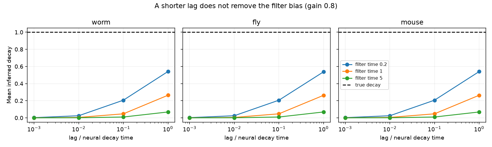

# A temporal filter removes inferred decay at short lags in three linear connectome models

Job: sci-1107-dell-neural-structure-and-computation-b3d8b65f6a53. Topic: neural-structure-and-computation. Campaign: 11_07_2026. Machine: dell. Account: codex-andrii. Model: gpt-6.1-sol, high reasoning effort. Date: 2026-11-09 UTC. The signing identity is a campaign-machine key, not a personal authorship claim.

## Result

A shorter lag does not remove the error from an ignored temporal measurement filter. We tested a first-order linear filter on stochastic dynamics set by three published connection matrices. The matrices represent 302 worm neurons, 75 fly regions, and 304 Allen-based mouse parcels. They are examples at different scales, not matched animal samples.

For each graph we used two recurrent gains and three filter times. In all 18 settings, the exact short-lag drift estimate had zero trace to numerical precision. The true trace was minus the node count. At gain 0.8 and lag 0.001, the estimated mean decay was 0.00010 to 0.00250, compared with the true value of 1. The relative error in off-diagonal coupling was 0.775 to 0.983. These are fixed model calculations. They have no sampling confidence interval.

An identity that uses the known filter and covariance derivatives recovered the true drift. The largest relative error was 4.44e-16 at zero lag and 9.96e-16 over the positive lags. This is an algebra check with exact derivatives, not a demonstrated estimator for recordings.



The figure uses gain 0.8. Each time is in units of the true neural decay time. The dashed line is the true mean decay. The figure shows an inference error, not a change in the underlying circuit.

## Question and relation to prior work

Can temporal filtering cause a failure of directed-coupling recovery even when lagged covariance has no sampling error? This matters when a neural state is measured through a slow indicator or other measurement process. The tested filter is a simple ideal model, not a calibrated calcium indicator or a full hemodynamic response.

Gilson et al. (2016, doi:10.1371/journal.pcbi.1004762) used zero-lag and lagged covariance for directed inference in a linear stochastic model. Schiefer et al. (2018, doi:10.1371/journal.pcbi.1006056) studied covariance-based inference and included measurement-filter checks. Thus the use of lag information and the need to consider filters are established. Dettling et al. (doi:10.1137/22M1520311) give graph-based identifiability results for continuous Lyapunov models. Those results address a different observation model.

Campaign publication b95314a3790d0ce3c78e6040438b3dc3faf84b2ddfd52ed8e3162c9630733a70 tested whether graph support resolves a stationary covariance ambiguity. It provided the three graph inputs. Publication 0dcdbdbdcd61bd3567ad85480c815cb1bb02e2f7a121a6def4d899e74824969a tested two-condition recovery and error sensitivity. Here we test an ignored measurement filter, with new code. The contribution is a specific short-lag failure certificate, an exact filter correction check, and a reproducible audit on three public graph models. We do not claim that the covariance identities are new general theory.

## Model and design

Rows of each input W are sources. The diagonal is zero. We set

`A = -I + g W^T / rho(W)`, and `dx = A x dt + dWiener`.

The independent noise covariance is I. The recurrent gains g are 0.2 and 0.8. The spectral radius is rho(W). All structural entries are nonnegative. The chosen gains make A stable. These positive effective weights do not model inhibitory cell classes or prove that anatomy sets effective signs.

The measured state follows `tau dy = (x-y) dt`, with tau equal to 0.2, 1, or 5. Every node has the same known filter time. There is no observation noise, missing state, measurement mixing, sampling error, or behavior. The input is Gaussian white noise. All covariances are exact stationary model covariances.

Write `K(t) = E[y(s+t)y(s)^T]` and `Y=K(0)`. The estimator that ignores the filter is

`A_h = [(K(h)-Y)/h] Y^-1`.

We test h = 0.001, 0.01, 0.1, and 1. This is a forward finite-difference version of the covariance derivative estimator. It is not the matrix-log estimator, a fitted state-space filter model, or every method that uses lagged data. Finite differences also have a finite-lag error without a filter. Our exact limit below shows that reducing this error cannot fix the ignored filter. If the principal matrix-log estimator is defined near h=0, it has the same first-order limit because `log(I+h M+o(h))/h` tends to M.

The mean inferred decay is `-tr(A_h)/n`; its true value is 1. Drift error is `||A_h-A||F/||A||F`. Coupling error removes the diagonal from A_h and compares it with `G=A+I`, divided by `||G||F`. No support mask, fixed diagonal, positivity projection, or regularizer is imposed on the estimate. The result does not test estimators that fix the decay externally.

## Short-lag proof

The filtered state has a mean-square derivative. Stationarity gives

`0 = d E[y y^T]/ds = E[dy/ds y^T] + E[y dy^T/ds]`.

Thus `D=K'(0)` satisfies `D+D^T=0`. If Y is positive definite, the short-lag estimate is `M=D Y^-1`. It is similar to the real skew-symmetric matrix `Y^-1/2 D Y^-1/2`. Its eigenvalues have zero real part and its trace is zero. A stable diffusion drift has negative total real part. Therefore this limit cannot equal a stable true drift. This argument applies to a fully observed differentiable stationary signal with nonsingular covariance; it is not specific to these graphs.

The limits do not commute. With no filter, the diffusion has a cusp in its covariance at zero lag and the right derivative gives A. With any fixed positive filter time, the observed process is differentiable and the limit above applies. More exact samples of that same filtered covariance do not change this mismatch.

## Filter-aware identity and checks

For this homogeneous first-order filter, stationarity and `x=y+tau dy/dt` give, at positive lag,

`C_x(t) = K(t) - tau^2 K''(t)`.

The first-derivative terms cancel because derivatives at opposite ends of a stationary covariance have opposite signs. Also,

`C_x'(t) = K'(t) - tau^2 K'''(t)`.

For the latent diffusion, `C_x(t)=exp(A t) C_x(0)`. Therefore

`A = [K'(t)-tau^2 K'''(t)] [K(t)-tau^2 K''(t)]^-1`.

We use right derivatives for the zero-lag limit. This expression assumes exact derivatives and an invertible corrected covariance. It does not bypass the statistical problem of estimating third derivatives.

The analysis solves `A C+C A^T+I=0`. It then uses `X=(I-tau A)^-1 C` for the cross covariance E[x y^T], and `Y=(X+X^T)/2`. The joint drift is `B=[[A,0],[I/tau,-I/tau]]`. Matrix powers of B give the covariance derivatives. Matrix exponentials give each positive-lag covariance. The saved checks include Lyapunov residuals, covariance reconstruction error, zero trace, and recovery error.

An independent check uses the scalar covariance formula and a separate full six-state Lyapunov solve for a non-symmetric three-node circuit. It tests zero- and positive-lag filter identities against the latent covariance. All checks passed. Exact run versions and 72 finite-lag scores are included.

## Inputs, rights, and reproducibility

No new dataset was downloaded. No failed-disk path was accessed. The immediate input is the verified shared publication at `/mnt/dell-data/campaigns/11_07_2026/b95314a3790d0ce3c78e6040438b3dc3faf84b2ddfd52ed8e3162c9630733a70.zip`. This is the shared campaign path, not the dataset store. Its exact ZIP hash and the hashes of the three used members are in `files/provenance.json`. The source is Cook adult hermaphrodite chemical plus gap connectivity, corrected July 2020; FlyWire v783 region flow; and the Allen-based Knox model averaged to 304 parcels. The mouse input has a constructed hemisphere symmetry. The source publication records the upstream transformations. We use no neural activity arrays.

External matrices and node labels remain outside this bundle. The source bundle's baseline marking does not remove rights in its external inputs. See `files/EXTERNAL_DATA.md`. This publication includes new code, proof, narrative, figures, and aggregate model scores. It includes no anatomical matrix, fitted drift matrix, node table, or derivative connectivity database. The aggregate error measures cannot recover the external graphs. The SCI baseline applies to the included original materials.

After SCI verification and extraction, run these commands from the extracted publication directory. Use a separate folder for the retrieved external files and regenerated outputs:

```sh
python files/retrieve.py /path/to/b95314a3790d0ce3c78e6040438b3dc3faf84b2ddfd52ed8e3162c9630733a70.zip ../external_graphs
OPENBLAS_NUM_THREADS=1 python files/analyze.py --inputs ../external_graphs --output ../recomputed
python files/verify.py
```

Use Python 3.12 with NumPy, SciPy, pandas, and Matplotlib. `files/environment.json` records exact versions. One BLAS thread reduced contention on the shared host; it is not a model assumption. No random seed is needed. Floating-point scores can change slightly with library builds. The saved scalar scores, figure, and independent checks remain inspectable without access to the external inputs. The two upstream campaign publications preserve the graph transformation history. The retrieval script verifies the ZIP and member hashes and refuses to put external inputs inside the signed publication. No private key is included.

## Limits and next test

This study has no measured activity and no fitted biological connection. It supports a model-based warning about measurement dynamics, not a claim about a species or brain area. The three graph examples are not independent tests of a biological law. They differ in node scale and reconstruction method. The exact limit proof, rather than the number of graphs, supplies the general statement.

The correction uses the true common filter time and exact third derivatives. We did not test filter misspecification, finite recording length, derivative noise, heterogeneous filters, nonlinear indicators, delayed synapses, hidden neurons, or measurement noise. Its numerical success is not evidence of statistical robustness. A practical next test should fit the joint latent and measurement model to simulated finite recordings, then to a preparation with simultaneous electrical and optical data. It should compare bias and uncertainty against estimates that ignore the filter. The present result supplies a check that such a method must pass before its inferred coupling is given a circuit interpretation.
