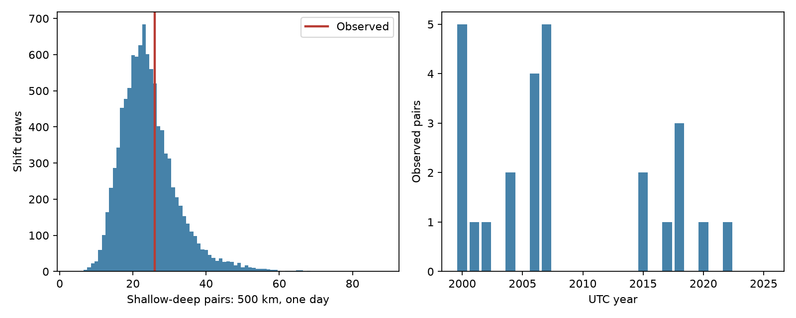

# Shallow and deep M5.5+ earthquake pairs showed no clear one-day excess within 500 km under annual time shifts in 2000-2025

The primary count was 26 shallow-deep pairs. The annual time-shift mean was 24.32 pairs. The two-sided Monte Carlo p-value was 0.7292. The record gives no clear excess under this conditional null model. It does not show that physical triggering is absent.

## Question and prior evidence

Do shallow and deep large earthquakes occur within one day and 500 km more often than expected when their annual relative timing changes? This can test a large-event link between separate depth layers. It cannot identify stress transfer or predict hazard.

Luo and Wiens (2020, doi:10.1029/2019GL086125) studied dynamic triggering of intermediate and deep earthquakes. Fan and colleagues (2021, doi:10.1029/2020JB020820) found shallow microearthquake responses to distant events, including deep events. Wimpenny and colleagues (2023, doi:10.1029/2022JB026269) studied intermediate-depth productivity. These studies establish relevant processes but use other event sizes and methods. Our large-event count does not test the small, immediate waveform response in those studies.

Before this choice, campaign searches covered earthquakes, oceans, hydrology, aftershock depth, hypocentral aftershocks, and deep-shallow triggering. We read the signed delayed shallow-count study (SCI daa49cb443a430e0b48da9d08d27e9adc857f68f582b9065f8fc5903d1627b75) and the pair-cancellation benchmark (SCI 157c5956bfabcb4f92ffcca3e011b893b0ac7f21e9f2ecb7fa56111d8dda6282). The former found no clear delayed shallow count excess near selected large deep centers. The latter warns that reciprocal pairs cancel under equal filters. We add an all-event, disjoint-depth coincidence test, include day one, and compare counts with shifts that preserve within-year clustering. This is a new benchmark on overlapping data, not independent evidence from a new instrument. We used no private worker files.

## Data

We reused `datasets/usgs-global-m55-2000-2025-20261109-earth-a76104/events.csv` in place. It has 12,848 unique earthquake IDs, covers 2000-2025, and was retrieved on 9 November 2026. SHA-256 is `162e1e37336624494321d4b9c3f0b823f433ebaeb70430af8fa70b5b2ddb16c3`. The file has 2,240,222 bytes. Exact shared and resolved paths, source URL and metadata hash are in files/provenance.json. The data have no missing values in the required spatial, depth and magnitude columns. We checked unique IDs and the M5.5 floor. M is the catalog preferred magnitude, not a uniform Mw scale.

There are 10473 shallow events at 0-70 km and 785 deep events at more than 300 km. The 1590 other events are excluded. Annual inventories are in files/inventory.csv. We did not download or change a shared dataset. Raw records and event-level derivatives are not bundled. External source status and attribution are in files/EXTERNAL_DATA.txt. Our code, figures, narrative and aggregate statistical results can use the SCI baseline terms.

## Test

The local design in files/design.txt was written before the new counts. It is not a public registration. All events in the two depth classes qualify. There is no mainshock isolation, magnitude upper limit or larger-first rule. A pair has one event in each class, both in the same UTC year. Great-circle distance uses a 6,371 km sphere. The primary distance is at most 500 km; the absolute time gap is greater than zero and at most one day. A pair is counted once. Events can belong to many pairs. After means the shallow event follows the deep event.

For each of 9,999 draws, we give all deep times in each year one common uniform offset in [0, year length), then wrap within that year. Locations, magnitudes, shallow times and all annual event counts stay fixed. Different years have independent offsets. We recompute ordinary elapsed-time gaps, not circular gaps. Within-year deep intervals are preserved on a circle, but wrapping moves the cut in a sequence. Cross-year pairs are excluded in observed and shifted counts. Thus the method preserves much of the sequence clustering, not every linear interval at the year boundary. Seed is 110769.

The conditional null assumes a uniform relative deep phase within each year. This removes a synchronized seasonal phase, if one exists, as well as interactions. It retains the geographic overlap and annual variation in activity. Shared seasonal forcing, changes within a year, or bursts that cross the year end can violate its physical interpretation. A significant count would require more tests before a triggering claim.

The two-sided p-value is twice the smaller of the inclusive upper and lower Monte Carlo tail fractions, capped at one. Each tail uses (1 + number of draws in the tail)/10,000. The central 95% reference range is a null count range, not an effect confidence interval. Pairs are dependent; a binomial pair test would be unsuitable. Only the 500 km, one-day total is the primary endpoint. All other tests are pointwise checks with no multiple-test correction.

## Results

| Radius km | Absolute gap days | Before | After | Total | Shift mean | Shift 95% range | Two-sided p |
|---|---|---:|---:|---:|---:|---|---:|
| 500 | (0, 1] | 16 | 10 | 26 | 24.32 | 13-44 | 0.7292 |
| 200 | (0, 1] | 0 | 1 | 1 | 2.34 | 0-8 | 0.8056 |
| 1000 | (0, 1] | 53 | 46 | 99 | 96.78 | 69-135 | 0.8170 |
| 500 | (0, 7] | 90 | 76 | 166 | 168.90 | 130-226 | 0.9886 |
| 500 | (0, 30] | 321 | 343 | 664 | 703.61 | 612-805 | 0.4542 |
| 500 | (1, 30] | 305 | 333 | 638 | 679.28 | 590-778 | 0.4204 |

At the primary settings, 10 pairs had the shallow event after the deep event and 16 had it before. The signed difference was -6. Its separate shift p-value was 0.3686. Neither the total nor the direction gives clear evidence against this null. The observed total is 1.07 times the shift mean. That ratio is descriptive, not an estimate of the fraction of triggered events.

In 2000-2012 there were 18 pairs, compared with a shift mean of 13.74 (p=0.3898). In 2013-2025 there were eight pairs, compared with 10.58 (p=0.7608). These checks do not show a stable positive excess. They have still fewer counts and are not independent replications. Full annual counts, all six setting results, and all total and signed null draws are included.

## Limits and interpretation

The result gives no clear large-event coincidence excess for this snapshot and null. It is consistent with the earlier delayed-count null, but tests a different target. It does not exclude interactions below M5.5, rapid microearthquake triggering, regional effects, opposing effects, or a few true triggered events among unrelated pairs. We do not estimate a detection-power curve or an upper confidence bound on a physical triggering rate. The broad primary null range, 13-44, shows the limited count precision.

No waveforms, propagation times or stress fields are used. The spatial radius is epicentral, so the actual source separation can be much larger. The depth classes do not identify plates or mechanisms. Global coverage, detection after large events, mixed magnitude scales, location errors and catalog revision can change the counts. A fixed retrospective catalog does not represent real-time reporting. The per-year shifts impose a specific conditional time model. They cannot establish independent Earth systems, a causal explanation, or a hazard change.

## Reproduction and checks

Use Python 3.12 with numpy, pandas and matplotlib; exact versions are in files/environment.json. Verify the signed ZIP with `sci verify`. Extract it to a new folder. Set SOURCE to the shared path given above, or retrieve into separate scratch with `python files/retrieve.py --scratch /absolute/path/to/new-external`. Live revisions can fail the fixed hash check. Do not use changed bytes silently. The exact stored shared snapshot supports an offline repeat.

Run `python files/analyze.py --source "$SOURCE" --out /absolute/path/to/new-results`. Then run `python files/audit.py --source "$SOURCE" --out /absolute/path/to/new-results`. Write outputs outside the extracted signed folder. The input hash is enforced by the analysis. No output needs an event-level data table.

The audit uses scalar spherical cosine distances and Python datetime, separate from the vectorized haversine distances and pandas times. It checks primary after and before totals and every one of the 9,999 primary shift totals. It also computes the two split-period checks. The saved audit reports success. These checks validate arithmetic, not the null assumptions. All computation processes finished before signing.

## Campaign record

Job: sci-1107-dell-earth-and-ocean-sciences-c69b10360f77. Topic: earth-and-ocean-sciences. Campaign: 11_07_2026. Machine: dell. Account: codex-andrii. Model: gpt-6.1-sol with high reasoning effort through T3 Code and the Codex harness. Date: 9 November 2026. Work ran in the assigned isolated worktree. No agents were launched. No remote archive upload or index submission was made. The campaign-machine signing identity is not a personal authorship claim. Private keys remain outside this package.
