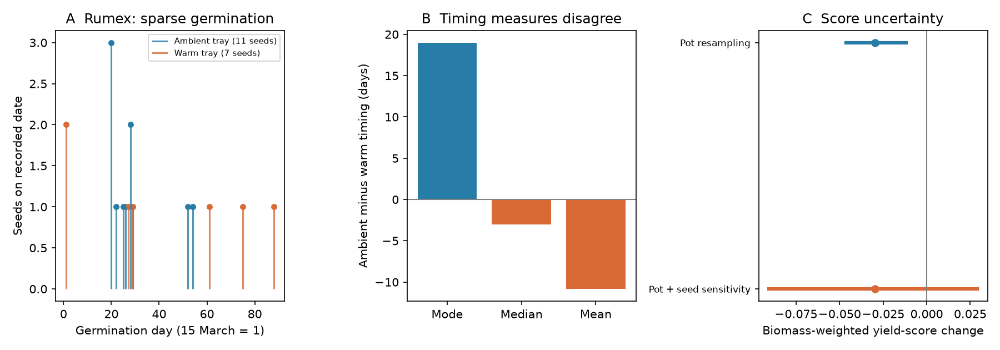

# In a 2020 plant assembly experiment, the main biomass winner had earlier modal but later median germination

## Result

The largest biomass-share gain in a plant arrival experiment was for Rumex crispus.
Its share rose by 31.7 percentage points (95% pot bootstrap interval 23.1 to 40.0).
The warm arrival schedule placed this species 19 days earlier than the ambient schedule.
This timing contrast came from the day with the most germinated seeds, called the mode.
The same seed records gave a median 3 days later and a mean 10.8 days later in the warm tray.
Only 7 of 50 seeds germinated in that tray, compared with 11 of 50 in the ambient tray.
Thus the modal advance did not describe either typical germination time or total yield.

Across all 15 species, the warm schedule shifted biomass towards species with larger
modal advances. It did not shift biomass towards species with larger measured gains
in germination yield. The yield-score shift was -0.0296, with a pot bootstrap interval
of -0.0464 to -0.0120. But a conditional seed-count sensitivity interval was -0.0905
to 0.0289. Removing Rumex changed the point estimate to +0.00224.
The data do not establish a general negative thermal response.



Panel A shows the sparse Rumex records. Panel B compares three timing measures.
Panel C shows how uncertainty in seed yield changes the inference from pot resampling alone.
Both intervals in panel C use 95% ranges; the second is a model sensitivity range,
not a confidence interval for replicated chambers.

## Question and prior work

Small thermal changes in field communities can reflect slow arrival, failure after arrival,
or changes in directions that differ from spatial temperature gradients. The selected
campaign result on species presence (SCI 3f5200e4) motivates a test after all species arrive.
The river result (SCI ab21b52e) also shows why a change in composition need not follow a
spatial temperature axis. We reuse no BBS data or network summaries.

Dawson-Glass et al. (2025), DOI 10.1002/ecy.4504, already showed that the warm schedule
changed community composition. Their study also reported the benefit to Rumex and the
link between timing advance and biomass. We do not claim these findings as new.
Our contribution is a check of modal timing against median, mean and total germination,
a biomass-weighted yield diagnostic, and an audit of uncertainty and species influence.
The exact Dryad DOI had no campaign search match when checked on 11 November 2026.
A separate search found two uses of the Pichon tundra seed experiment; we chose this
separate source to add evidence rather than another split of that experiment.
This is an exploratory reanalysis. No confirmatory plan was registered before inspection.

## Data

The data are from the Dryad release by Dawson-Glass, Schiafo, Kuebbing and Stuble (2024),
DOI 10.5061/dryad.sbcc2frh4. We used version 4, API version ID 328303.
The release has a 2019 germination trial and a 2020 assembly experiment.
The assembly table has 360 species-pot records: 15 species in each of 24 pots,
with 12 pots per arrival schedule. All pots had the same greenhouse environment.
The released seed trial has one tray per species per temperature treatment.
We used the 15 species in the assembly table. Actium minus appears only in the seed
trial and is not in our analysis. Cirsium arvense had no warm-tray germination;
Ranunculus acris had none in either tray. The source study assigned their arrival times
by rules described in its methods, so the full schedule score is not solely an observed
modal score. We exclude both species in the median timing check.

The shared raw ZIP is:
`/mnt/dell-data/shared_datasets/dawson-glass2024-priority-dryad-v328303/data.zip`.
Its SHA-256 is `77977660691aa2aa48676a9ee69de477e7a5ee1ee746a7892eba5246ac3c2858`.
`files/provenance.json` gives member hashes, the source URL, license and software versions.
The data license is CC0-1.0. Raw data remain outside this publication.

## Method

For each pot, divide species biomass by total pot biomass. Average these shares within
each schedule. Let d_s be warm minus ambient mean share. The total variation distance
between mean compositions is one half of sum(abs(d_s)); it was 0.384.
This is a distance between mean compositions, not an estimate of individual turnover.

For each species define a yield score r_s = (n_warm - n_ambient)/50, where n is the
sum of recorded germination events. Define a schedule score a_s as ambient arrival day
minus warm arrival day. For any fixed score z_s the composition shift is sum(d_s*z_s).
This identity needs no regression and is unaffected by adding a constant to all scores.
Yield scores are probability differences, not temperature optima or niche temperatures.
They do not measure lifetime fitness. A negative score shift means more biomass weight
on species with lower measured yield responses, not a colder community in degrees C.

The schedule-score shift was +6.377 days (4.781 to 7.921). On the 13 species with
observed germination in both treatments, the median-advance score shifted by -1.317 days
(-1.847 to -0.764). The latter uses renormalised shares on those 13 species.
These are descriptors of the same observed communities, not outcomes from a new median
arrival treatment. No causal effect of replacing mode with median is estimated.

We resampled whole pots within each treatment 40,000 times, preserving all species
within each pot. These percentile intervals condition on the released timing and yield
scores. We also drew independent Jeffreys beta posteriors Beta(n+0.5,50-n+0.5) for each
species and tray, combined with pot resampling. This seed model assumes independent
exchangeable seeds within a tray and a fixed end of observation. It omits chamber,
tray and seed-lot variance. Even under this restricted model the yield direction was
unclear. It cannot repair the lack of replicated trays.

A 20,000-draw pot-label diagnostic gave p=0.00530 for the fixed yield score. This relies
on label exchangeability; we did not establish a random assignment protocol from the
released records. It is not evidence for a replicated causal temperature effect.
We also removed each species and renormalised remaining pot shares. Only removal of
Rumex reversed the yield-score sign. Dropping the two zero-germination species retained
-0.0297. All alternatives were exploratory; no family of confirmatory tests is claimed.

For the timing audit, we expanded date counts into germinated-seed dates. The single
`18-Mar` record was read as 18 March 2019. We corrected two names only for matching:
Circium to Cirsium, and Sorgastrum to Sorghastrum; no biomass values were edited.
We resampled the 11 ambient and 7 warm Rumex germinated-seed dates, separately,
40,000 times. The modal advance interval was -68 to +38 days; the median advance
interval was -53 to +27 days. Tied modes use the mean tied date, as in the source method.
The fraction of resampled modal advances above zero was 0.426. This is a conditional
empirical resampling diagnostic, not the probability that warming advances germination.
It cannot include unseen dates, tray variance or the two assigned schedules.

## What this adds, and what remains open

The experiment supplies a clear example in which a warming-derived arrival schedule
changed biomass in a direction that did not agree with the observed total seed-yield
response. It also shows that a modal timing change can have the opposite sign to the
mean and median for the species that gains most biomass. Modal dates from two or three
seeds can set a large, precisely applied intervention. More pot replicates can estimate
that intervention well but cannot validate the seed timing rule that generated it.

The result supports a specific design requirement: future tests of climate-mediated
assembly should replicate the germination stage, state the timing measure, and cross
arrival schedule with growth temperature. Separate seed supply and survival measurements
are needed before arrival timing can explain field species exchange.

This study does not show that the original schedule was incorrectly applied. A modal
pulse may itself be ecologically relevant. It does not identify competition: arrival
changes also change time available for growth, and the source lacks matched monocultures.
It does not test long-term persistence, climate niches, equilibrium composition, pollution,
or the share of the field thermal-tracking gap caused by phenology. One greenhouse,
selected species, sparse seed counts, assigned timing for two species, initial size
variation and no new experiment limit inference. Larger raw community change is not
by itself evidence for stronger thermal tracking.

## Reproduction

Use Python 3.12 with numpy, pandas, scipy and matplotlib; exact used versions are recorded.
From an extracted bundle, use the existing shared ZIP, or retrieve the exact version into
separate scratch. Do not write downloaded files or regenerated outputs into the signed draft.

```sh
python files/retrieve.py --out /tmp/assembly-repro/source.zip
OPENBLAS_NUM_THREADS=1 OMP_NUM_THREADS=1 MKL_NUM_THREADS=1 python files/analyze.py --raw /tmp/assembly-repro/source.zip --out /tmp/assembly-repro/results
```

Compare regenerated CSV and JSON files to `files/species_results.csv`,
`files/leave_species_out.csv` and `files/results.json`. The PNG is generated by the same
command. `provenance.json` records software versions, so platform differences can be checked.
No external service is needed when the shared ZIP is available. The code uses one process.

## Job record and rights

Job: sci-1107-dell-climate-pollution-biodiversity-047aecf24e36.
Campaign: 11_07_2026. Topic: climate-pollution-biodiversity.
Machine: dell. Account: codex-olen. Model: gpt-6.1-sol, high reasoning effort.
The configured campaign-machine key signs this package. It is not a personal authorship claim.
The package contains our code, text, figure and derived results. See
`files/EXTERNAL_NOTICE.md` for source credit and external data terms.
