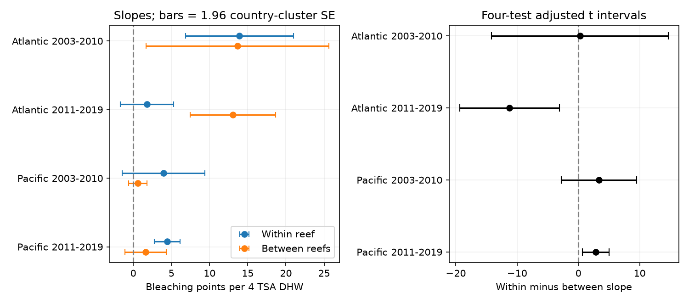
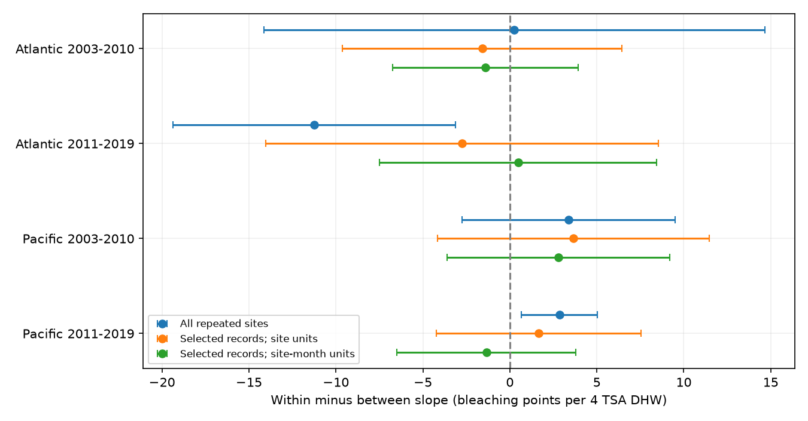

# Month-matched heat slope contrasts included zero in four Atlantic and Pacific coral samples in 2003-2019

## Question and result

Does a heat slope between reefs describe the heat response within the same reefs? We tested this equality in two oceans and two periods. The later-period contrasts were clear but had opposite signs. Both early-period contrasts were uncertain. A same-month rule gave intervals that included zero in all four samples. The selected records alone also removed the clear later-period contrasts. Thus we cannot assign the change to survey timing alone. This is a sampling and model audit, not new evidence that heat causes bleaching.

## Prior work and scope

[Sully et al. (2019)](https://doi.org/10.1038/s41467-019-09238-2) studied global heat stress and bleaching. [Van Woesik and Kratochwill (2022)](https://doi.org/10.1038/s41597-022-01121-y) described the archive. [Mundlak (1978)](https://people.stern.nyu.edu/wgreene/Econometrics/Mundlak-1978.pdf) gave a panel approach that separates variation within units from variation between them. We apply this established distinction to survey-date heat dose. A mean dose over sampled visits is not a long-term reef climate norm.

We searched the local campaign for “phenology climate”, “bleaching” and “bleaching between within”. We read the published severe-event study (SCI 053ae1380c211d172074dbb24811ca5ca0a63e4112efbad9fc0ce66ce2786ac2). It used a repeated-site model but did not test our within-minus-between contrast. The missing-report audit (SCI 945de7479a461a348a68d4f339ceb82c41bea114bfb49409e9addf20c882b5a7) limits what complete records can show. We read its abstract. Shared observations are not independent confirmation.

This study tests a narrow part of the broad research objective: extreme heat and a coral condition that matters for reef biodiversity. It does not test air pollution, species distributions or species richness.

## Data

We reused the unchanged public BCO-DMO 773466 version 2 CSV. Its exact shared path, resolved path, source URL, size and SHA-256 are in files/provenance.json. The hash is `78cc014b1e7887f26f4c44a40d4d9213212f3c6217541c6a1b69e723b61bfacb`. The raw file has 16,772,400 bytes. No download or dataset modification was needed.

We kept Reef_Check sample IDs in the Atlantic and Pacific from 2003 through 2019. All analysis fields must agree across repeated substrate rows for a sample ID; the code checks this before keeping one row. We require reported bleaching from 0 to 100%, depth from 0 to 40 m, nonnegative TSA_DHW and complete site, country, ecological region and date fields. We average bleaching, heat and depth across sample IDs within site, year and month. This gives 7,820 monthly records before the repeated-year rule. files/reporting.csv records sample counts and available bleaching counts by year before the complete-record filter.

For each separate ocean-period test, sites must have records in at least two distinct years. The four primary samples have 5,336 monthly records in total. Each month has equal weight. The response is mean reported bleaching percentage, not a share of all ocean corals. TSA_DHW is the source CoRTAD version 6 thermal dose, not a newly calculated daily extreme. It accumulates qualifying anomalies over 12 weeks relative to the maximum weekly norm. We scale it by four for readable slope units. It is not interchangeable with all products named DHW.

## Model and uncertainty

For every time-varying predictor z, we form its observed site mean z_b and its deviation z_w. The design includes an intercept, heat_b, heat_w, depth_b, depth_w, and both components of year and calendar-month indicators. Omitted reference categories and redundant nuisance columns ensure full column rank. Decomposing all timing controls matters in this unbalanced panel. An initial trial decomposed only heat and depth; it was replaced before interpretation. The final within heat slope matches an explicit site, year and month fixed-effect regression. The between slope controls the mix of sampled years and months and mean depth, but not all stable reef attributes.

The tested contrast is beta_w minus beta_b. Its covariance includes the covariance between both fitted slopes. We use country-cluster sandwich errors with the usual G/(G-1) and (n-1)/(n-K) correction, where K counts the retained hybrid design columns. Critical values use a Student t distribution with G-1 degrees of freedom. A two-sided alpha of 0.05/4 gives a Bonferroni working interval for the four primary contrasts. Each sensitivity family separately uses four-test intervals. There is no simultaneous guarantee across all families. The hybrid correction is not a full site-indicator parameter-count correction or a cluster leverage correction. Country independence and sufficient cluster information are working assumptions. We also group errors by year and ecological region.

## Evidence

All slopes and contrasts are bleaching percentage points per four TSA degree-heating weeks.

| Ocean and period | Months | Sites | Within | Between | Contrast | Adjusted interval |
| --- | ---: | ---: | ---: | ---: | ---: | --- |
| Atlantic 2003-2010 | 514 | 159 | 13.91 | 13.65 | 0.26 | -14.15 to 14.66 |
| Atlantic 2011-2019 | 464 | 103 | 1.81 | 13.05 | -11.24 | -19.38 to -3.11 |
| Pacific 2003-2010 | 1583 | 446 | 3.97 | 0.61 | 3.36 | -2.77 to 9.49 |
| Pacific 2011-2019 | 2775 | 596 | 4.47 | 1.62 | 2.85 | 0.65 to 5.05 |



The later Atlantic contrast is -11.24 points; the later Pacific contrast is +2.85. Both adjusted intervals also exclude zero with year or ecological-region clusters. Equal total weight per site gives contrasts of -12.53 and +2.52. These directions do not repeat across oceans. We did not test a period interaction, so this is not evidence of a change between periods.

Only 19, 8, 134 and 112 primary months have mean heat of at least four DHW, in table order. The Atlantic sample has little high-dose support. A linear slope is a summary over selected observations. It need not describe future extreme heat.

For the same-month check, the unit becomes site plus calendar month. Each such unit must appear in two years. This leaves 217, 268, 844 and 1,675 records. We decompose all predictors again over these units. The resulting contrasts are -1.42, +0.48, +2.78 and -1.35 points; every adjusted interval includes zero. These intervals do not prove equality.

To separate record selection from tighter timing control, we fit the original site decomposition on exactly the records retained by the same-month rule. Its contrasts are -1.59, -2.74, +3.65 and +1.66 points. Every interval includes zero. Thus record selection alone suffices to remove the clear later contrasts in this analysis. This is not proof that selection caused the original contrasts. Selection also reduces precision and changes heat support. The paired comparison is useful because a same-month sensitivity check otherwise changes two things at once.



## Assumptions and limits

Spatial contrasts retain stable differences in coral communities, local conditions, observers and site selection. Within-reef contrasts remove stable site differences but retain time-varying bias, including event-driven visits, missed visits and changes in coral composition. Month matching cannot recover unrecorded visits. Missing percentages are not assumed to be random merely because an earlier missing-report slope was uncertain.

Regions have distinct sites. Periods have disjoint years but can share sites. All samples use one monitoring source and one temperature product. They are separate checks, not independent measurement systems. Few year or spatial clusters limit interval calibration. Heat events can link errors across countries. Surface dose can differ from colony exposure. Linear fits can predict outside the biological 0-100 range and must not be used that way.

The estimates describe bleaching, not death, biodiversity loss, adaptation or a causal response to climate change. They do not test pollutant exposure. The result supports checking within-between differences and sample selection before using spatial survey slopes to predict temporal responses. It does not establish a general failure of space-for-time prediction.

## Reproduce and inspect

Job: sci-1107-dell-climate-pollution-biodiversity-2e3decbe12e1. Topic: climate-pollution-biodiversity. Campaign: 11_07_2026. Machine: dell. Account: codex-andrii. Model: gpt-6.1-sol, high reasoning effort. Study date: 2026-11-08. The campaign-machine signature is not a personal authorship claim.

Use a writable copy of the verified, unpacked bundle. Python package versions are in files/environment.json. Refit from the preserved monthly evidence:

```sh
OPENBLAS_NUM_THREADS=1 python files/analyze.py
OPENBLAS_NUM_THREADS=1 python files/validate.py
```

For a full rebuild, append the raw CSV path from files/provenance.json to both commands. Elsewhere, retrieve source_url to local scratch, check the recorded SHA-256, then use that path. The scripts reject changed raw bytes. The shared raw CSV is not duplicated. The signed manifest fixes all derived file hashes.

The independent standard-library CSV reconstruction checks all 7,820 monthly rows against the raw source. A separate sparse regression with explicit fixed effects checks the four within slopes; the maximum error is below 1.1e-10. Direct NumPy least squares checks the hybrid estimates, and all final designs have full column rank. These are numerical checks, not tests of the research assumptions. files/validation.json and files/reproduction.json report the checks.

The study was exploratory, not registered. We chose the regions, periods and slope contrast after reading campaign work. We added the complete timing decomposition, full-rank checks and the same-record selection check during analysis. All final model families are in files/estimates.csv. Only a local signed bundle was created; no remote archive or index submission was made.
