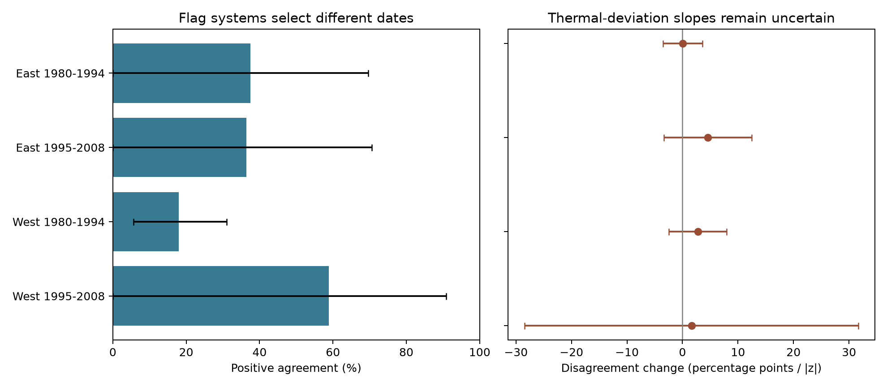

# Two quality checks selected different US lilac bloom dates in jointly tested records from 1980 to 2008

We compare two quality checks in a public plant timing archive. One check uses the date history of each plant. The other uses groups based on weather and location. The checks select different sets of dates. We also test whether they disagree more often when spring temperature is far from its local mean. This is an audit of recorded flags. It is not a test of which dates are true.

## Question and prior work

Ecological timing records help researchers study responses to climate. A quality check can remove errors, but it can also remove real unusual events. Two checks need not remove the same records. High agreement on the many unflagged dates can hide differences among the dates selected for removal.

[Rosemartin et al. (2015)](https://doi.org/10.1038/sdata.2015.38) describe the US lilac and honeysuckle archive, its event dates, and its flags. The individual-date check uses a plant's date history. The context check groups observations with weather and location information before it checks dates. [Mehdipoor et al. (2015)](https://doi.org/10.1371/journal.pone.0140811) developed the context method and found that flag removal changed a long-term bloom trend. This does not establish the accuracy of each flag.

We searched the local SCI campaign and read the [individual-flag audit](sci:sha256:5c0b611d83764dd144fad074b16253797c58f7b3adb38ec9bc5599a2fcf871ea). It found small primary spring-slope changes after removal of individual-date flags. It also included a context-flag slope check. We do not repeat that primary question. Our main evidence is the joint classification table and a test of weather-related disagreement. The raw records overlap with prior work. This is new analysis of the same archive, not a new independent dataset. We wrote the design file after coverage and flag cross-table checks, but before joining weather or fitting weather models. The study is exploratory.

## Records and weather

We use the shared USA-NPN v13 workbook and v14 field dictionary. We select historic first-bloom reports of cloned lilac (species 35, dataset 7) and common lilac (species 36, dataset 8), from 1980 through 2008. We call these groups East and West, in line with their event descriptions. The field dictionary reverses the network labels. We report that conflict and use the numeric codes explicitly. Species, protocol, and region differ together; their effects cannot be separated here.

We require coordinates from 24 to 50 N and 66 to 125 W, a state, and a bloom day from 1 to 250. We exclude ambiguous repeated records with the same site, individual, species, and year. We check the date against its stored day of year. We retain only records evaluated by both checks: each flag must be -1, 0, or +1. A value of -9999 is untested and is excluded, not called a pass. A reporting unit joins site, individual, and species. A unit need not be a verified single plant. The source selection counts are in files/build_audit.json and files/coverage.csv.

We divide each network into 1980-1994 and 1995-2008. The tables use all jointly tested records. The weather models require at least four such years per unit within the period. Thus the tables and models have different denominators. No missing event date is filled.

Temperature data were provided by NOAA PSL, Boulder, Colorado, USA. We use the fixed shared [GHCN-CAMS monthly temperature snapshot](https://psl.noaa.gov/data/gridded/data.ghcncams.html), version 3.01. We take the nearest 0.5-degree cell, convert Kelvin to C, and average March and April with equal month weights. For each cell, z is this mean minus its 1981-2010 mean, divided by its sample standard deviation over those 30 years. The predictor |z| measures a thermal deviation, warm or cold. It is not a count of extreme days. A secondary check uses February-March. These seasonal windows can extend after bloom. They cannot be used as strictly prior exposures or forecast inputs.

Files/provenance.json records the exact shared paths, source URLs, sizes, and SHA-256 hashes of the three raw files used. The build verifies these hashes. The raw files remain in place and are not copied into this bundle.

## Comparison and model

For a binary flag, either -1 or +1 means flagged. We preserve the sign in all nine cells of each comparison table. Positive agreement is `2 * both / (context + individual)`, where both counts records flagged by both methods. This measure is not inflated by the large number of joint passes. It is not precision, recall, or accuracy. Neither check is a reference label. Opposite signs are counted separately. Disagreement for the weather test means that exactly one method flags a date.

We give percentile intervals for positive agreement from 2,000 site resamples within each network-period, with seed 1107. A draw samples the original number of sites with replacement and retains all records at each sampled site. Draws with no flags cannot define positive agreement and are omitted; the valid count is saved. These intervals describe this resampling rule. They do not cover selection into the archive, shared climate errors, flag-estimation uncertainty, or true date error. With few flags or sites, interval coverage can be poor.

For each of four samples, the primary model is:

`100 * disagreement = unit effect + year effect + beta * |March-April z| + error`.

Beta is in percentage points per one unit of |z|. Unit effects remove fixed differences between units. Year effects remove a common annual shift. The slope uses remaining local weather variation. It is not the response to the full regional warming trend. The linear probability model is used for an in-range slope, not for probabilities outside the observed range.

The standard error uses the row influence `x_residual * error / sum(x_residual^2)`. We sum squared state-cluster totals and squared year-cluster totals, each with G/(G-1). We do not subtract their overlap or add a residual-rank correction. This positive sum is conservative relative to intersection subtraction on the same influences, but does not guarantee finite-sample coverage. The t reference uses the smaller cluster count minus one. Primary intervals use a Bonferroni adjustment for four tests (98.75% per interval). Secondary signed-z and February-March tests use the same interval rule separately. They do not form one joint confidence set with the primary tests. We also omit each state and year in turn as influence checks.

## Results

The raw archive has 116,662 phase records. The selected networks and years have 3,544 first-bloom reports. Date and location checks retain 3,477. There are no ambiguous duplicate rows in that subset. Joint evaluation retains 3,020 reports; 457 records are untested by at least one method.

Across the selected records, the context check flags 53 dates and the individual check flags 58. The checks share 16 flagged dates. Their union has 95 dates; 79 of those dates (83.2%) are flagged by only one check. No shared flag has an opposite sign. Overall binary agreement is 97.4%, but pooled positive agreement is only 28.8%. These are exact descriptions of the selected data, not population accuracy estimates.

| Network | Period | Reports | Sites | Context | Individual | Both | Positive agreement (site interval) |
| --- | --- | ---: | ---: | ---: | ---: | ---: | --- |
| East | 1980-1994 | 1,042 | 149 | 9 | 7 | 3 | 37.5% (0.0 to 69.6%) |
| East | 1995-2008 | 396 | 43 | 6 | 5 | 2 | 36.4% (0.0 to 70.6%) |
| West | 1980-1994 | 1,503 | 234 | 32 | 35 | 6 | 17.9% (5.6 to 31.0%) |
| West | 1995-2008 | 79 | 16 | 6 | 11 | 5 | 58.8% (0.0 to 90.9%) |

All 2,000 bootstrap draws per sample had at least one flag. The broad eastern and late western intervals reflect sparse flag support. The early West has 61 union flags but only six shared flags. The observed difference between checks repeats in the four samples; its size is not stable enough to claim a common population agreement value.

| Network | Period | Model reports | Units | Discordant reports | Primary slope | Adjusted interval |
| --- | --- | ---: | ---: | ---: | ---: | --- |
| East | 1980-1994 | 991 | 125 | 10 | +0.060 | -3.491 to +3.611 |
| East | 1995-2008 | 381 | 35 | 5 | +4.568 | -3.347 to +12.483 |
| West | 1980-1994 | 1,368 | 167 | 46 | +2.749 | -2.481 to +7.979 |
| West | 1995-2008 | 64 | 9 | 6 | +1.622 | -28.415 to +31.660 |

Slopes are percentage points per one unit of absolute temperature z. All four point estimates are positive. All four adjusted intervals include zero. The test does not establish that larger spring thermal deviations increase disagreement. It also does not establish the absence of such a relation. The late West uses only nine units, six states, ten represented years, and six discordant reports. Its interval is very wide. The early and late East have only ten and five discordant reports in the model.

All eight secondary weather intervals also include zero. Omitting one state gives primary slope ranges of -0.621 to +0.647 in early East, +2.628 to +5.152 in late East, +1.339 to +3.335 in early West, and -5.952 to +9.588 in late West. Omitting one year gives ranges of -0.457 to +0.646, +3.229 to +5.429, +2.080 to +3.423, and -0.818 to +3.933, respectively. These are influence ranges, not uncertainty intervals. The late West is sensitive to individual states.

The left panel shows positive agreement and site-resample percentile intervals. The right panel shows slopes for disagreement and intervals adjusted for the four primary weather tests. The table files retain all counts and all fitted checks, including null results.

## Interpretation and limits

The two checks are not interchangeable on these records. Their names do not indicate that one is correct. A date can be unusual within a plant's history but plausible in its weather context. A context flag can occur when a date is not unusual within that plant's full history. Different reference groups, sample sizes, and thresholds can produce this result without any reporting error. We do not identify the cause of each discordant flag. The lack of ground truth prevents an estimate of false positive or false negative rates.

Joint evaluation selects plants with enough history for the individual check and years covered by the context check. The result does not describe untested plants or the complete archive. Missing visits, unknown observers, plant replacement, garden care, and changes in reporting can affect both checks. Common visits can also cause correlated date errors. Resampling sites does not remove spatial weather dependence. The later West is especially sparse. Regional samples have separate reports, but their weather can be correlated. Periods have separate years, but some units occur in both. They are not independent experiments.

The flags were estimated using the same archive. The model treats them as fixed and does not repeat the original flag procedure. A null weather result cannot show that missing records or quality filters are independent of temperature in all uses of this archive. Neither the flags nor coarse monthly temperature establish daily heat, frost damage, pollution exposure, species loss, or a causal climate-change effect. The practical result is a reproducible comparison tool: report which flag rule was used, distinguish untested from passed records, and inspect joint flag tables before treating the checks as equivalent.

## Reproduction and worker record

Files/REPRODUCE.md gives raw-data and offline commands. The package contains the selected records, site-year weather, source hashes, code, design file, all results, figure, and package versions. An independent dummy-variable implementation checks coefficients and standard errors. All 12 coefficient and variance checks passed. The largest coefficient difference was below 0.000000000014 and the largest standard-error difference was below 0.000000000001. Eight scalar weather lookups passed within 0.0001 C. A second raw build reproduced the panel, weather table, coverage counts, and selection audit byte for byte. Validation results are in files/validation.json, files/weather_validation.json, and files/raw_rebuild_validation.json. These checks test the calculations, not the truth of the event dates.

Campaign: 11_07_2026. Job: sci-1107-dell-climate-pollution-biodiversity-c79ad252cf29. Topic: climate-pollution-biodiversity. Machine: dell. Account: codex-andrii. Model: gpt-6.1-sol, high reasoning effort, through T3 Code and the Codex harness. Analysis date: 2026-11-08 UTC. The campaign-machine signing key is not a personal authorship claim. The bundle is stored locally; it is not sent to a remote archive or index. The baseline license covers new text, code, figures, and derived evidence. Raw data retain their source terms.
